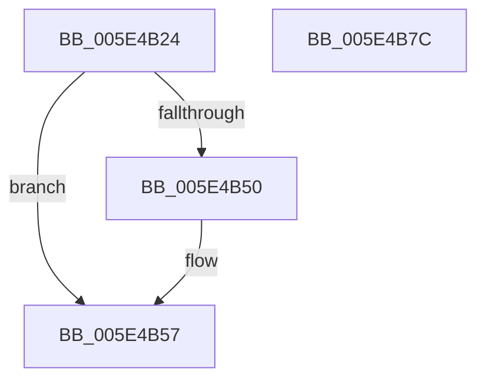

# PspAddPartitionToGlobalList

- RVA: `0x005E4B24`–`0x005E4B7D` (길이 `89` bytes)
- VA: `0x00000001405E4B24`
- 실행 섹션: `.text`
- PDB 이름 있음: `예`; PDB Function 태그: `아니요`
- unwind 정보 RVA: `0x0005CF00`
- 디코드: `23`개 명령, `89/89` bytes 표시
- 미해석 바이트: `0` (있으면 어셈블리에 `.byte`로 보존)

> 이 문서는 커널 이미지의 기계어와 PDB 기호를 분석해 생성했습니다. 4번과 5번은 함수 원형과 자료형을 바이너리 사용 방식에서 추정한 C 해석이며 원본 소스 복구 결과는 아닙니다.

## 1. Dependencies

- 직접 호출 지점: **2**; 고유 호출 대상: **2**
- 직접 호출자로 확인된 함수: **1**
- RIP 상대 이미지 참조: **4**

### Outgoing calls
- `0x005E4B34` → [ExAcquireSpinLockExclusive](../24/ExAcquireSpinLockExclusive_function_00248690.md) (function, `0x00248690`)
- `0x005E4B71` → [ExReleaseSpinLockExclusive](../2C/ExReleaseSpinLockExclusive_function_002C0EF0.md) (function, `0x002C0EF0`)

### Direct callers
- [PspAllocatePartition](../../page/78/PspAllocatePartition_function_0078802C.md) at `0x00788148`

### Static image references
- `0x005E4B2D` → RVA `0x00F05D60` (`.data`; read)
- `0x005E4B39` → RVA `0x00E087F8` (`.data`; read)
- `0x005E4B40` → RVA `0x00E087F0` (`.data`; read)
- `0x005E4B6A` → RVA `0x00E087F8` (`.data`; write)

## 2. Other-region calls and transfers

- 다른 실행 섹션으로 향하는 call: **0**
- 별도 외부 분기/꼬리 이동을 확인하지 못했습니다.

## 3. Assembly (complete function range)

```asm
005E4B24  40 53                           push rbx
005E4B26  48 83 EC 20                     sub rsp, 0x20
005E4B2A  48 8B D9                        mov rbx, rcx
005E4B2D  48 8D 0D 2C 12 92 00            lea rcx, [rip + 0x92122c]
005E4B34  E8 57 3B C6 FF                  call 0x140248690
005E4B39  48 8B 0D B8 3C 82 00            mov rcx, qword ptr [rip + 0x823cb8]
005E4B40  48 8D 15 A9 3C 82 00            lea rdx, [rip + 0x823ca9]
005E4B47  48 83 C3 38                     add rbx, 0x38
005E4B4B  48 39 11                        cmp qword ptr [rcx], rdx
005E4B4E  74 07                           je 0x1405e4b57
005E4B50  B9 03 00 00 00                  mov ecx, 3
005E4B55  CD 29                           int 0x29
005E4B57  48 89 13                        mov qword ptr [rbx], rdx
005E4B5A  8A D0                           mov dl, al
005E4B5C  48 89 4B 08                     mov qword ptr [rbx + 8], rcx
005E4B60  48 89 19                        mov qword ptr [rcx], rbx
005E4B63  48 8D 0D F6 11 92 00            lea rcx, [rip + 0x9211f6]
005E4B6A  48 89 1D 87 3C 82 00            mov qword ptr [rip + 0x823c87], rbx
005E4B71  E8 7A C3 CD FF                  call 0x1402c0ef0
005E4B76  48 83 C4 20                     add rsp, 0x20
005E4B7A  5B                              pop rbx
005E4B7B  C3                              ret
005E4B7C  CC                              int3
```

## 4. C-style interpretation (structured pseudocode)

```c
__int64 __fastcall PspAddPartitionToGlobalList(__int64 a1)
{
    __int64 result;
    __int64 v_rbx;
    __int64 v_rsp;

    v_rsp = (v_rsp) - (32);
    result = ExAcquireSpinLockExclusive(v_rip + 9572908, a2, a3, a4);
    v_rbx = (a1) + (56);
    if ((*(unsigned __int64 *)(*(unsigned __int64 *)(v_rip + 8535224))) != (v_rip + 8535209)) {
        a1 = 3;
    }
    *(unsigned __int64 *)(v_rbx) = v_rip + 8535209;
    *(unsigned __int64 *)(v_rbx + 8) = a1;
    *(unsigned __int64 *)(a1) = v_rbx;
    *(unsigned __int64 *)(v_rip + 8535175) = v_rbx;
    result = ExReleaseSpinLockExclusive(v_rip + 9572854, (unsigned __int8)(result), a3, a4);
    v_rsp = (v_rsp) + (32);
    return result;
}
```

## 5. (Beta) C Style

```c
int64_t PspAddPartitionToGlobalList(void *Arg1)
{
    uint8_t *arg1 = (uint8_t *)Arg1;

    int64_t result;
    int64_t local_rbx;
    int64_t local_rsp;

    local_rsp = (local_rsp) - (32);
    result = ExAcquireSpinLockExclusive(v_rip + 9572908, a2, a3, a4);
    local_rbx = (Arg1) + (56);
    if ((*(uint64_t *)(*(uint64_t *)(v_rip + 0x823CB8))) != (v_rip + 8535209)) {
        Arg1 = 3;
    }
    *(uint64_t *)(local_rbx) = v_rip + 8535209;
    *(void **)(local_rbx + 0x8) = Arg1;
    *(uint64_t *)(arg1) = local_rbx;
    *(uint64_t *)(v_rip + 0x823C87) = local_rbx;
    result = ExReleaseSpinLockExclusive(v_rip + 9572854, (uint8_t)(result), a3, a4);
    local_rsp = (local_rsp) + (32);
    return result;
}
```

### 관측된 메모리 오프셋

구조체 형식이 확인되지 않은 접근은 인자 기준의 오프셋으로만 기록했습니다.

| 기준 인자 | 오프셋 표현 | 폭 (bit) | 접근 |
|---|---:|---:|---|
| `Arg1` | `+ 0x0` | `64` | `W` |
| `Arg1` | `+ 0x8` | `64` | `W` |

## 6. Execution-region graph

[열기: 2D/3D 그래프와 함수 탐색 컨트롤 패널](../../../control-panel.html?section=text&rva=0x005E4B24&view=graph)

- 2D 그래프는 위에서 아래로 흐르고, 3D 그래프는 빈 공간을 드래그해 회전합니다. Shift+드래그는 이동, 휠은 확대·축소, 함수 노드 선택은 대상 보고서 이동입니다.

### Static fallback


