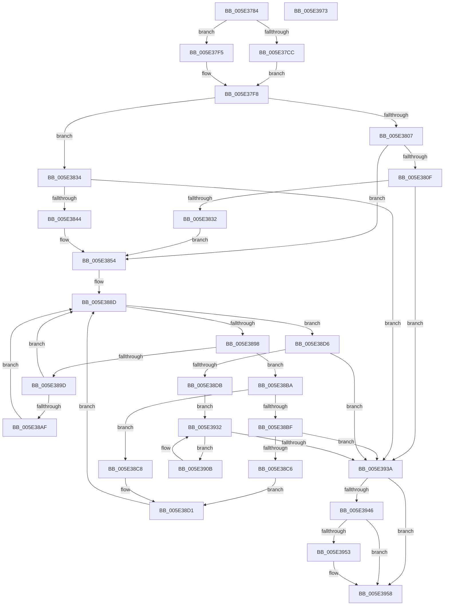

# PspApplyTimerDelayProcess

- RVA: `0x005E3784`–`0x005E3974` (길이 `496` bytes)
- VA: `0x00000001405E3784`
- 실행 섹션: `.text`
- PDB 이름 있음: `예`; PDB Function 태그: `아니요`
- unwind 정보 RVA: `0x00060300`
- 디코드: `130`개 명령, `496/496` bytes 표시
- 미해석 바이트: `0` (있으면 어셈블리에 `.byte`로 보존)

> 이 문서는 커널 이미지의 기계어와 PDB 기호를 분석해 생성했습니다. 4번과 5번은 함수 원형과 자료형을 바이너리 사용 방식에서 추정한 C 해석이며 원본 소스 복구 결과는 아닙니다.

## 1. Dependencies

- 직접 호출 지점: **5**; 고유 호출 대상: **3**
- 직접 호출자로 확인된 함수: **2**
- RIP 상대 이미지 참조: **0**

### Outgoing calls
- `0x005E38E1` → [PspSetProcessTimerDelayForKTimers](PspSetProcessTimerDelayForKTimers_function_005E3C40.md) (function, `0x005E3C40`)
- `0x005E38E9` → [PspSetProcessTimerDelayForWin32](PspSetProcessTimerDelayForWin32_function_005E3DB8.md) (function, `0x005E3DB8`)
- `0x005E3911` → [PspSetProcessTimerDelayForKTimers](PspSetProcessTimerDelayForKTimers_function_005E3C40.md) (function, `0x005E3C40`)
- `0x005E3919` → [PspSetProcessTimerDelayForWin32](PspSetProcessTimerDelayForWin32_function_005E3DB8.md) (function, `0x005E3DB8`)
- `0x005E3953` → [KiCheckForKernelApcDelivery](../2E/KiCheckForKernelApcDelivery_function_002E2C80.md) (function, `0x002E2C80`)

### Direct callers
- [PspTimerDelayProcess](PspTimerDelayProcess_function_005E3EC0.md) at `0x005E3F05`
- [PspTimerDelayWorkerRoutine](PspTimerDelayWorkerRoutine_function_005E3F30.md) at `0x005E3F53`

### Static image references
- 디코드된 RIP-relative 메모리 참조가 없습니다.

## 2. Other-region calls and transfers

- 다른 실행 섹션으로 향하는 call: **0**
- 별도 외부 분기/꼬리 이동을 확인하지 못했습니다.

## 3. Assembly (complete function range)

```asm
005E3784  48 89 5C 24 08                  mov qword ptr [rsp + 8], rbx
005E3789  48 89 6C 24 10                  mov qword ptr [rsp + 0x10], rbp
005E378E  48 89 74 24 18                  mov qword ptr [rsp + 0x18], rsi
005E3793  57                              push rdi
005E3794  41 56                           push r14
005E3796  41 57                           push r15
005E3798  48 83 EC 20                     sub rsp, 0x20
005E379C  65 4C 8B 34 25 88 01 00 00      mov r14, qword ptr gs:[0x188]
005E37A5  33 F6                           xor esi, esi
005E37A7  4C 8B CA                        mov r9, rdx
005E37AA  48 8B E9                        mov rbp, rcx
005E37AD  8B FE                           mov edi, esi
005E37AF  41 BA FF FF FF 3F               mov r10d, 0x3fffffff
005E37B5  66 41 FF 8E E6 01 00 00         dec word ptr [r14 + 0x1e6]
005E37BD  90                              nop
005E37BE  F0 0F BA A9 88 00 00 00 04      lock bts dword ptr [rcx + 0x88], 4
005E37C7  48 85 D2                        test rdx, rdx
005E37CA  74 29                           je 0x1405e37f5
005E37CC  B9 59 17 B7 D1                  mov ecx, 0xd1b71759
005E37D1  44 8A C6                        mov r8b, sil
005E37D4  8B C1                           mov eax, ecx
005E37D6  F7 62 04                        mul dword ptr [rdx + 4]
005E37D9  8B C1                           mov eax, ecx
005E37DB  8B FA                           mov edi, edx
005E37DD  41 F7 21                        mul dword ptr [r9]
005E37E0  C1 EF 0D                        shr edi, 0xd
005E37E3  C1 EA 0D                        shr edx, 0xd
005E37E6  49 23 FA                        and rdi, r10
005E37E9  49 23 D2                        and rdx, r10
005E37EC  48 C1 E7 1E                     shl rdi, 0x1e
005E37F0  48 0B FA                        or rdi, rdx
005E37F3  EB 03                           jmp 0x1405e37f8
005E37F5  41 B0 01                        mov r8b, 1
005E37F8  48 8B 85 F0 06 00 00            mov rax, qword ptr [rbp + 0x6f0]
005E37FF  48 8B C8                        mov rcx, rax
005E3802  45 84 C0                        test r8b, r8b
005E3805  75 2D                           jne 0x1405e3834
005E3807  48 33 CF                        xor rcx, rdi
005E380A  49 85 CA                        test r10, rcx
005E380D  75 45                           jne 0x1405e3854
005E380F  48 8B D7                        mov rdx, rdi
005E3812  48 8B C8                        mov rcx, rax
005E3815  49 B9 00 00 00 C0 FF FF FF 0F   movabs r9, 0xfffffffc0000000
005E381F  48 81 E2 00 00 00 C0            and rdx, 0xffffffffc0000000
005E3826  49 23 C9                        and rcx, r9
005E3829  48 3B CA                        cmp rcx, rdx
005E382C  0F 84 08 01 00 00               je 0x1405e393a
005E3832  EB 20                           jmp 0x1405e3854
005E3834  48 C1 E9 1E                     shr rcx, 0x1e
005E3838  48 0B C8                        or rcx, rax
005E383B  49 85 CA                        test r10, rcx
005E383E  0F 84 F6 00 00 00               je 0x1405e393a
005E3844  48 8B F8                        mov rdi, rax
005E3847  48 B9 FF FF FF FF FF FF FF 0F   movabs rcx, 0xfffffffffffffff
005E3851  48 23 F9                        and rdi, rcx
005E3854  48 B9 FF FF FF FF FF FF FF 7F   movabs rcx, 0x7fffffffffffffff
005E385E  48 BA 00 00 00 00 00 00 00 80   movabs rdx, 0x8000000000000000
005E3868  48 23 C1                        and rax, rcx
005E386B  49 B9 00 00 00 00 00 00 00 F0   movabs r9, 0xf000000000000000
005E3875  41 0F B6 C8                     movzx ecx, r8b
005E3879  48 C1 E1 3D                     shl rcx, 0x3d
005E387D  48 0B CA                        or rcx, rdx
005E3880  48 BA 00 00 00 00 00 00 00 40   movabs rdx, 0x4000000000000000
005E388A  48 0B F9                        or rdi, rcx
005E388D  F0 48 0F B1 BD F0 06 00 00      lock cmpxchg qword ptr [rbp + 0x6f0], rdi
005E3896  74 3E                           je 0x1405e38d6
005E3898  48 85 C0                        test rax, rax
005E389B  78 1D                           js 0x1405e38ba
005E389D  48 B9 FF FF FF FF FF FF FF BF   movabs rcx, 0xbfffffffffffffff
005E38A7  48 23 F9                        and rdi, rcx
005E38AA  45 84 C0                        test r8b, r8b
005E38AD  74 DE                           je 0x1405e388d
005E38AF  48 33 F8                        xor rdi, rax
005E38B2  49 23 F9                        and rdi, r9
005E38B5  48 33 F8                        xor rdi, rax
005E38B8  EB D3                           jmp 0x1405e388d
005E38BA  45 84 C0                        test r8b, r8b
005E38BD  75 09                           jne 0x1405e38c8
005E38BF  48 0F BA E0 3D                  bt rax, 0x3d
005E38C4  73 74                           jae 0x1405e393a
005E38C6  EB 09                           jmp 0x1405e38d1
005E38C8  48 33 F8                        xor rdi, rax
005E38CB  49 23 F9                        and rdi, r9
005E38CE  48 33 F8                        xor rdi, rax
005E38D1  48 0B FA                        or rdi, rdx
005E38D4  EB B7                           jmp 0x1405e388d
005E38D6  48 85 FA                        test rdx, rdi
005E38D9  75 5F                           jne 0x1405e393a
005E38DB  48 8B CD                        mov rcx, rbp
005E38DE  48 8B DF                        mov rbx, rdi
005E38E1  E8 5A 03 00 00                  call 0x1405e3c40
005E38E6  48 8B CD                        mov rcx, rbp
005E38E9  E8 CA 04 00 00                  call 0x1405e3db8
005E38EE  49 BF FF FF FF FF FF FF FF 1F   movabs r15, 0x1fffffffffffffff
005E38F8  8B F0                           mov esi, eax
005E38FA  49 23 FF                        and rdi, r15
005E38FD  48 8B C3                        mov rax, rbx
005E3900  F0 48 0F B1 BD F0 06 00 00      lock cmpxchg qword ptr [rbp + 0x6f0], rdi
005E3909  EB 27                           jmp 0x1405e3932
005E390B  48 8B CD                        mov rcx, rbp
005E390E  48 8B DF                        mov rbx, rdi
005E3911  E8 2A 03 00 00                  call 0x1405e3c40
005E3916  48 8B CD                        mov rcx, rbp
005E3919  E8 9A 04 00 00                  call 0x1405e3db8
005E391E  48 8B CF                        mov rcx, rdi
005E3921  8B F0                           mov esi, eax
005E3923  49 23 CF                        and rcx, r15
005E3926  48 8B C7                        mov rax, rdi
005E3929  F0 48 0F B1 8D F0 06 00 00      lock cmpxchg qword ptr [rbp + 0x6f0], rcx
005E3932  48 8B F8                        mov rdi, rax
005E3935  48 3B D8                        cmp rbx, rax
005E3938  75 D1                           jne 0x1405e390b
005E393A  90                              nop
005E393B  66 41 83 86 E6 01 00 00 01      add word ptr [r14 + 0x1e6], 1
005E3944  75 12                           jne 0x1405e3958
005E3946  49 8D 86 98 00 00 00            lea rax, [r14 + 0x98]
005E394D  90                              nop
005E394E  48 39 00                        cmp qword ptr [rax], rax
005E3951  74 05                           je 0x1405e3958
005E3953  E8 28 F3 CF FF                  call 0x1402e2c80
005E3958  48 8B 5C 24 40                  mov rbx, qword ptr [rsp + 0x40]
005E395D  8B C6                           mov eax, esi
005E395F  48 8B 74 24 50                  mov rsi, qword ptr [rsp + 0x50]
005E3964  48 8B 6C 24 48                  mov rbp, qword ptr [rsp + 0x48]
005E3969  48 83 C4 20                     add rsp, 0x20
005E396D  41 5F                           pop r15
005E396F  41 5E                           pop r14
005E3971  5F                              pop rdi
005E3972  C3                              ret
005E3973  CC                              int3
```

## 4. C-style interpretation (structured pseudocode)

```c
__int64 __fastcall PspApplyTimerDelayProcess(__int64 a1, __int64 a2)
{
    __int64 result;
    __int64 v_rdi;
    __int64 v_rsi;
    __int64 v_rsp;
    unsigned __int64 v_stack_p10;
    unsigned __int64 v_stack_p18;
    unsigned __int64 v_stack_p8;

    v_stack_p8 = v_rbx;
    v_stack_p10 = v_rbp;
    v_stack_p18 = v_rsi;
    v_rsp = (v_rsp) - (32);
    v_rsi = 0;
    if (a2 == 0) goto loc_005E37F5;
    v_rdi = (unsigned int)(((unsigned int)((unsigned int)(a2))) >> (13));
    a2 = (unsigned int)((a2) >> (13));
    v_rdi = (v_rdi) & ((unsigned int)(0x3FFFFFFFULL));
    a2 = (a2) & ((unsigned int)(0x3FFFFFFFULL));
    v_rdi = (v_rdi) << (30);
    v_rdi = (v_rdi) | (a2);
    goto loc_005E37F8;
loc_005E37F5:
loc_005E37F8:
    if (1 != 0) goto loc_005E3834;
    a1 = (*(unsigned __int64 *)(a1 + 1776)) ^ (v_rdi);
    if ((((unsigned int)(0x3FFFFFFFULL)) & (a1)) != 0) goto loc_005E3854;
    a2 = (v_rdi) & (0xFFFFFFFFC0000000ULL);
    a1 = (*(unsigned __int64 *)(a1 + 1776)) & (a2);
    if (a1 == a2) goto loc_005E393A;
    goto loc_005E3854;
loc_005E3834:
    a1 = (a1) >> (30);
    a1 = (a1) | (*(unsigned __int64 *)(a1 + 1776));
    if ((((unsigned int)(0x3FFFFFFFULL)) & (a1)) == 0) goto loc_005E393A;
    v_rdi = (*(unsigned __int64 *)(a1 + 1776)) & (a1);
loc_005E3854:
    result = (*(unsigned __int64 *)(a1 + 1776)) & (a1);
    a1 = (1) << (61);
    a1 = (a1) | (a2);
    v_rdi = (v_rdi) | (a1);
loc_005E388D:
    if (condition_is_equal) goto loc_005E38D6;
    if (sign_flag) goto loc_005E38BA;
    v_rdi = (v_rdi) & (a1);
    if (1 == 0) goto loc_005E388D;
    v_rdi = (v_rdi) ^ (result);
    v_rdi = (v_rdi) & (a2);
    v_rdi = (v_rdi) ^ (result);
    goto loc_005E388D;
loc_005E38BA:
    if (1 != 0) goto loc_005E38C8;
    if (condition_is_above_or_equal) goto loc_005E393A;
    goto loc_005E38D1;
loc_005E38C8:
    v_rdi = (v_rdi) ^ (result);
    v_rdi = (v_rdi) & (a2);
    v_rdi = (v_rdi) ^ (result);
loc_005E38D1:
    v_rdi = (v_rdi) | (a2);
    goto loc_005E388D;
loc_005E38D6:
    if (((a2) & (v_rdi)) != 0) goto loc_005E393A;
    result = PspSetProcessTimerDelayForKTimers(a1, a2, 1, a2);
    result = PspSetProcessTimerDelayForWin32(a1, a2, 1, a2);
    v_rdi = (v_rdi) & (v_r15);
    goto loc_005E3932;
loc_005E390B:
    result = PspSetProcessTimerDelayForKTimers(a1, a2, 1, a2);
    result = PspSetProcessTimerDelayForWin32(a1, a2, 1, a2);
    a1 = (v_rdi) & (v_r15);
loc_005E3932:
    if (v_rdi != v_rdi) goto loc_005E390B;
loc_005E393A:
    if (v_rdi != v_rdi) goto loc_005E3958;
    result = *(unsigned __int64 *)(gs_base + (0 + 392)) + 152;
    if ((*(unsigned __int64 *)(*(unsigned __int64 *)(gs_base + (0 + 392)) + 152)) != (*(unsigned __int64 *)(gs_base + (0 + 392)) + 152)) {
        result = KiCheckForKernelApcDelivery(a1, a2, 1, a2);
    }
    v_rsp = (v_rsp) + (32);
    return (unsigned int)((unsigned int)((unsigned int)((unsigned int)(result))));
}
```

## 5. (Beta) C Style

```c
int64_t PspApplyTimerDelayProcess(void *Arg1, void *Arg2)
{
    uint8_t *arg1 = (uint8_t *)Arg1;
    uint8_t *arg2 = (uint8_t *)Arg2;

    int64_t result;
    int64_t local_rdi;
    int64_t local_rsi;
    int64_t local_rsp;
    uint64_t v_stack_p10;
    uint64_t v_stack_p18;
    uint64_t v_stack_p8;

    v_stack_p8 = local_rbx;
    v_stack_p10 = local_rbp;
    v_stack_p18 = local_rsi;
    local_rsp = (local_rsp) - (32);
    local_rsi = 0;
    if (Arg2 == NULL) goto loc_005E37F5;
    local_rdi = (uint32_t)(((uint32_t)((uint32_t)(Arg2))) >> (13));
    Arg2 = (uint32_t)((Arg2) >> (13));
    local_rdi = (local_rdi) & ((uint32_t)(0x3FFFFFFFULL));
    Arg2 = (Arg2) & ((uint32_t)(0x3FFFFFFFULL));
    local_rdi = (local_rdi) << (30);
    local_rdi = (local_rdi) | (Arg2);
    goto loc_005E37F8;
loc_005E37F5:
loc_005E37F8:
    if (1 != 0) goto loc_005E3834;
    Arg1 = (*(uint64_t *)(arg1 + 0x6F0)) ^ (local_rdi);
    if ((((uint32_t)(0x3FFFFFFFULL)) & (Arg1)) != 0) goto loc_005E3854;
    Arg2 = (local_rdi) & (0xFFFFFFFFC0000000ULL);
    Arg1 = (*(uint64_t *)(arg1 + 0x6F0)) & (Arg2);
    if (Arg1 == Arg2) goto loc_005E393A;
    goto loc_005E3854;
loc_005E3834:
    Arg1 = (Arg1) >> (30);
    Arg1 = (Arg1) | (*(uint64_t *)(arg1 + 0x6F0));
    if ((((uint32_t)(0x3FFFFFFFULL)) & (Arg1)) == 0) goto loc_005E393A;
    local_rdi = (*(uint64_t *)(arg1 + 0x6F0)) & (Arg1);
loc_005E3854:
    result = (*(uint64_t *)(arg1 + 0x6F0)) & (Arg1);
    Arg1 = (1) << (61);
    Arg1 = (Arg1) | (Arg2);
    local_rdi = (local_rdi) | (Arg1);
loc_005E388D:
    if (condition_is_equal) goto loc_005E38D6;
    if (sign_flag) goto loc_005E38BA;
    local_rdi = (local_rdi) & (Arg1);
    if (1 == 0) goto loc_005E388D;
    local_rdi = (local_rdi) ^ (result);
    local_rdi = (local_rdi) & (Arg2);
    local_rdi = (local_rdi) ^ (result);
    goto loc_005E388D;
loc_005E38BA:
    if (1 != 0) goto loc_005E38C8;
    if (condition_is_above_or_equal) goto loc_005E393A;
    goto loc_005E38D1;
loc_005E38C8:
    local_rdi = (local_rdi) ^ (result);
    local_rdi = (local_rdi) & (Arg2);
    local_rdi = (local_rdi) ^ (result);
loc_005E38D1:
    local_rdi = (local_rdi) | (Arg2);
    goto loc_005E388D;
loc_005E38D6:
    if (((Arg2) & (local_rdi)) != 0) goto loc_005E393A;
    result = PspSetProcessTimerDelayForKTimers(Arg1, Arg2, 1, Arg2);
    result = PspSetProcessTimerDelayForWin32(Arg1, Arg2, 1, Arg2);
    local_rdi = (local_rdi) & (local_r15);
    goto loc_005E3932;
loc_005E390B:
    result = PspSetProcessTimerDelayForKTimers(Arg1, Arg2, 1, Arg2);
    result = PspSetProcessTimerDelayForWin32(Arg1, Arg2, 1, Arg2);
    Arg1 = (local_rdi) & (local_r15);
loc_005E3932:
    if (local_rdi != local_rdi) goto loc_005E390B;
loc_005E393A:
    if (local_rdi != local_rdi) goto loc_005E3958;
    result = *(uint64_t *)(gs_base + (0 + 0x188)) + 152;
    if ((*(uint64_t *)(*(uint64_t *)(gs_base + (0 + 0x188)) + 0x98)) != (*(uint64_t *)(gs_base + (0 + 0x188)) + 152)) {
        result = KiCheckForKernelApcDelivery(Arg1, Arg2, 1, Arg2);
    }
    local_rsp = (local_rsp) + (32);
    return (uint32_t)((uint32_t)((uint32_t)((uint32_t)(result))));
}
```

### 관측된 메모리 오프셋

구조체 형식이 확인되지 않은 접근은 인자 기준의 오프셋으로만 기록했습니다.

| 기준 인자 | 오프셋 표현 | 폭 (bit) | 접근 |
|---|---:|---:|---|
| `Arg1` | `+ 0x88` | `32` | `R/W` |
| `Arg1` | `+ 0x6F0` | `64` | `R` |
| `Arg2` | `+ 0x0` | `32` | `R` |

## 6. Execution-region graph

[열기: 2D/3D 그래프와 함수 탐색 컨트롤 패널](../../../control-panel.html?section=text&rva=0x005E3784&view=graph)

- 2D 그래프는 위에서 아래로 흐르고, 3D 그래프는 빈 공간을 드래그해 회전합니다. Shift+드래그는 이동, 휠은 확대·축소, 함수 노드 선택은 대상 보고서 이동입니다.

### Static fallback


