# PspChangeProcessExecutionStateLegacy

- RVA: `0x005E4098`–`0x005E42D1` (길이 `569` bytes)
- VA: `0x00000001405E4098`
- 실행 섹션: `.text`
- PDB 이름 있음: `예`; PDB Function 태그: `아니요`
- unwind 정보 RVA: `0x000CF34C`
- 디코드: `170`개 명령, `569/569` bytes 표시
- 미해석 바이트: `0` (있으면 어셈블리에 `.byte`로 보존)

> 이 문서는 커널 이미지의 기계어와 PDB 기호를 분석해 생성했습니다. 4번과 5번은 함수 원형과 자료형을 바이너리 사용 방식에서 추정한 C 해석이며 원본 소스 복구 결과는 아닙니다.

## 1. Dependencies

- 직접 호출 지점: **12**; 고유 호출 대상: **12**
- 직접 호출자로 확인된 함수: **5**
- RIP 상대 이미지 참조: **3**

### Outgoing calls
- `0x005E4161` → [KiStackAttachProcess](../21/KiStackAttachProcess_function_00216820.md) (function, `0x00216820`)
- `0x005E417C` → [MmInSwapWorkingSet](../45/MmInSwapWorkingSet_function_0045B6C4.md) (function, `0x0045B6C4`)
- `0x005E4196` → [PsRemoveDeepFreezeOptimizations](../../page/AB/PsRemoveDeepFreezeOptimizations_function_00AB5FA4.md) (function, `0x00AB5FA4`)
- `0x005E41AF` → [PsFreezeProcess](../../page/AA/PsFreezeProcess_function_00AA6D04.md) (function, `0x00AA6D04`)
- `0x005E41B6` → [PsThawProcess](../../page/A8/PsThawProcess_function_00A878FC.md) (function, `0x00A878FC`)
- `0x005E41CD` → [PsApplyDeepFreezeOptimizations](../../page/AA/PsApplyDeepFreezeOptimizations_function_00AA9EDC.md) (function, `0x00AA9EDC`)
- `0x005E41EB` → [MmOutSwapWorkingSet](../2A/MmOutSwapWorkingSet_function_002A6BC8.md) (function, `0x002A6BC8`)
- `0x005E426C` → [KiUnstackDetachProcess](../21/KiUnstackDetachProcess_function_00217D30.md) (function, `0x00217D30`)
- `0x005E427E` → [ExGetExtensionTable](../42/ExGetExtensionTable_function_00428814.md) (function, `0x00428814`)
- `0x005E428E` → [guard_dispatch_icall](../6B/guard_dispatch_icall_function_006BAAD0.md) (function, `0x006BAAD0`)
- `0x005E429E` → [ExReleaseRundownProtection](../34/ExReleaseRundownProtection_function_00349E80.md) (function, `0x00349E80`)
- `0x005E42AD` → [_security_check_cookie](../6A/_security_check_cookie_function_006AC640.md) (function, `0x006AC640`)

### Direct callers
- [PspExecuteJobFreezeThawCallback](../4E/PspExecuteJobFreezeThawCallback_function_004E9850.md) at `0x004E9892`
- [PsSwapProcessWorkingSet](../../page/78/PsSwapProcessWorkingSet_function_00781C24.md) at `0x00781CEF`
- [PspRemoveProcessFromJobChain](../../page/90/PspRemoveProcessFromJobChain_function_00907288.md) at `0x0090756B`
- [PspInsertThread](../../page/9F/PspInsertThread_function_009F0314.md) at `0x009F0858`
- [PspAssignProcessToJob](../../page/A2/PspAssignProcessToJob_function_00A23370.md) at `0x00A23813`

### Static image references
- `0x005E40B7` → RVA `0x00E0A740` (`.data`; read)
- `0x005E41E2` → RVA `0x00E67AD8` (`.data`; read)
- `0x005E4277` → RVA `0x00FC6EA8` (`ALMOSTRO`; read)

## 2. Other-region calls and transfers

- 다른 실행 섹션으로 향하는 call: **4**
  - `0x005E4196` → [PsRemoveDeepFreezeOptimizations](../../page/AB/PsRemoveDeepFreezeOptimizations_function_00AB5FA4.md) (`.text` → `PAGE`)
  - `0x005E41AF` → [PsFreezeProcess](../../page/AA/PsFreezeProcess_function_00AA6D04.md) (`.text` → `PAGE`)
  - `0x005E41B6` → [PsThawProcess](../../page/A8/PsThawProcess_function_00A878FC.md) (`.text` → `PAGE`)
  - `0x005E41CD` → [PsApplyDeepFreezeOptimizations](../../page/AA/PsApplyDeepFreezeOptimizations_function_00AA9EDC.md) (`.text` → `PAGE`)
- 별도 외부 분기/꼬리 이동을 확인하지 못했습니다.

## 3. Assembly (complete function range)

```asm
005E4098  48 89 5C 24 10                  mov qword ptr [rsp + 0x10], rbx
005E409D  48 89 74 24 18                  mov qword ptr [rsp + 0x18], rsi
005E40A2  48 89 7C 24 20                  mov qword ptr [rsp + 0x20], rdi
005E40A7  55                              push rbp
005E40A8  41 54                           push r12
005E40AA  41 55                           push r13
005E40AC  41 56                           push r14
005E40AE  41 57                           push r15
005E40B0  48 8B EC                        mov rbp, rsp
005E40B3  48 83 EC 70                     sub rsp, 0x70
005E40B7  48 8B 05 82 66 82 00            mov rax, qword ptr [rip + 0x826682]
005E40BE  48 33 C4                        xor rax, rsp
005E40C1  48 89 45 F0                     mov qword ptr [rbp - 0x10], rax
005E40C5  83 65 BC 00                     and dword ptr [rbp - 0x44], 0
005E40C9  0F 57 C0                        xorps xmm0, xmm0
005E40CC  45 33 E4                        xor r12d, r12d
005E40CF  C6 45 B8 00                     mov byte ptr [rbp - 0x48], 0
005E40D3  0F 11 45 C0                     movups xmmword ptr [rbp - 0x40], xmm0
005E40D7  45 32 ED                        xor r13b, r13b
005E40DA  4C 8B F1                        mov r14, rcx
005E40DD  0F 11 45 D0                     movups xmmword ptr [rbp - 0x30], xmm0
005E40E1  0F 11 45 E0                     movups xmmword ptr [rbp - 0x20], xmm0
005E40E5  0F 0D 89 F8 07 00 00            prefetchw byte ptr [rcx + 0x7f8]
005E40EC  8B 81 F8 07 00 00               mov eax, dword ptr [rcx + 0x7f8]
005E40F2  41 8D 7C 24 01                  lea edi, [r12 + 1]
005E40F7  EB 42                           jmp 0x1405e413b
005E40F9  8B 4D B4                        mov ecx, dword ptr [rbp - 0x4c]
005E40FC  8B F1                           mov esi, ecx
005E40FE  C1 EE 10                        shr esi, 0x10
005E4101  C1 E9 08                        shr ecx, 8
005E4104  40 3A F1                        cmp sil, cl
005E4107  0F 84 96 01 00 00               je 0x1405e42a3
005E410D  8B 45 B4                        mov eax, dword ptr [rbp - 0x4c]
005E4110  89 45 B0                        mov dword ptr [rbp - 0x50], eax
005E4113  8A 45 B0                        mov al, byte ptr [rbp - 0x50]
005E4116  40 0A C7                        or al, dil
005E4119  88 45 B0                        mov byte ptr [rbp - 0x50], al
005E411C  8B 45 B4                        mov eax, dword ptr [rbp - 0x4c]
005E411F  8B 55 B0                        mov edx, dword ptr [rbp - 0x50]
005E4122  F0 41 0F B1 96 F8 07 00 00      lock cmpxchg dword ptr [r14 + 0x7f8], edx
005E412B  89 45 B0                        mov dword ptr [rbp - 0x50], eax
005E412E  8B 55 B0                        mov edx, dword ptr [rbp - 0x50]
005E4131  8B 45 B4                        mov eax, dword ptr [rbp - 0x4c]
005E4134  3B D0                           cmp edx, eax
005E4136  74 13                           je 0x1405e414b
005E4138  8B 45 B0                        mov eax, dword ptr [rbp - 0x50]
005E413B  89 45 B4                        mov dword ptr [rbp - 0x4c], eax
005E413E  8A 45 B4                        mov al, byte ptr [rbp - 0x4c]
005E4141  40 84 C7                        test dil, al
005E4144  74 B3                           je 0x1405e40f9
005E4146  E9 58 01 00 00                  jmp 0x1405e42a3
005E414B  40 8A DE                        mov bl, sil
005E414E  45 32 FF                        xor r15b, r15b
005E4151  32 D9                           xor bl, cl
005E4153  45 84 ED                        test r13b, r13b
005E4156  75 11                           jne 0x1405e4169
005E4158  4C 8D 45 C0                     lea r8, [rbp - 0x40]
005E415C  33 D2                           xor edx, edx
005E415E  49 8B CE                        mov rcx, r14
005E4161  E8 BA 26 C3 FF                  call 0x140216820
005E4166  44 8A EF                        mov r13b, dil
005E4169  F6 C3 02                        test bl, 2
005E416C  74 13                           je 0x1405e4181
005E416E  40 F6 C6 02                     test sil, 2
005E4172  74 05                           je 0x1405e4179
005E4174  44 8A FF                        mov r15b, dil
005E4177  EB 08                           jmp 0x1405e4181
005E4179  49 8B CE                        mov rcx, r14
005E417C  E8 43 75 E7 FF                  call 0x14045b6c4
005E4181  F6 C3 04                        test bl, 4
005E4184  74 15                           je 0x1405e419b
005E4186  40 F6 C6 04                     test sil, 4
005E418A  75 0F                           jne 0x1405e419b
005E418C  48 8D 55 BC                     lea rdx, [rbp - 0x44]
005E4190  89 7D BC                        mov dword ptr [rbp - 0x44], edi
005E4193  49 8B CE                        mov rcx, r14
005E4196  E8 09 1E 4D 00                  call 0x140ab5fa4
005E419B  40 84 DF                        test dil, bl
005E419E  74 1B                           je 0x1405e41bb
005E41A0  40 88 7D B8                     mov byte ptr [rbp - 0x48], dil
005E41A4  40 8A D7                        mov dl, dil
005E41A7  49 8B CE                        mov rcx, r14
005E41AA  40 84 F7                        test dil, sil
005E41AD  74 07                           je 0x1405e41b6
005E41AF  E8 50 2B 4C 00                  call 0x140aa6d04
005E41B4  EB 05                           jmp 0x1405e41bb
005E41B6  E8 41 37 4A 00                  call 0x140a878fc
005E41BB  40 22 DE                        and bl, sil
005E41BE  F6 C3 04                        test bl, 4
005E41C1  74 0F                           je 0x1405e41d2
005E41C3  48 8D 55 BC                     lea rdx, [rbp - 0x44]
005E41C7  89 7D BC                        mov dword ptr [rbp - 0x44], edi
005E41CA  49 8B CE                        mov rcx, r14
005E41CD  E8 0A 5D 4C 00                  call 0x140aa9edc
005E41D2  40 8A DE                        mov bl, sil
005E41D5  40 8A FE                        mov dil, sil
005E41D8  45 84 FF                        test r15b, r15b
005E41DB  74 25                           je 0x1405e4202
005E41DD  33 D2                           xor edx, edx
005E41DF  49 8B CE                        mov rcx, r14
005E41E2  39 15 F0 38 88 00               cmp dword ptr [rip + 0x8838f0], edx
005E41E8  0F 95 C2                        setne dl
005E41EB  E8 D8 29 CC FF                  call 0x1402a6bc8
005E41F0  85 C0                           test eax, eax
005E41F2  79 0E                           jns 0x1405e4202
005E41F4  BA 99 00 00 C0                  mov edx, 0xc0000099
005E41F9  3B C2                           cmp eax, edx
005E41FB  44 0F 44 E2                     cmove r12d, edx
005E41FF  80 E3 FD                        and bl, 0xfd
005E4202  41 0F 0D 8E F8 07 00 00         prefetchw byte ptr [r14 + 0x7f8]
005E420A  41 8B 86 F8 07 00 00            mov eax, dword ptr [r14 + 0x7f8]
005E4211  89 45 B4                        mov dword ptr [rbp - 0x4c], eax
005E4214  8B 45 B4                        mov eax, dword ptr [rbp - 0x4c]
005E4217  C1 E8 10                        shr eax, 0x10
005E421A  40 8A F0                        mov sil, al
005E421D  40 3A C7                        cmp al, dil
005E4220  74 04                           je 0x1405e4226
005E4222  3A C3                           cmp al, bl
005E4224  75 2F                           jne 0x1405e4255
005E4226  8A 45 B0                        mov al, byte ptr [rbp - 0x50]
005E4229  24 FE                           and al, 0xfe
005E422B  88 5D B1                        mov byte ptr [rbp - 0x4f], bl
005E422E  88 45 B0                        mov byte ptr [rbp - 0x50], al
005E4231  8B 45 B4                        mov eax, dword ptr [rbp - 0x4c]
005E4234  88 5D B2                        mov byte ptr [rbp - 0x4e], bl
005E4237  8B 4D B0                        mov ecx, dword ptr [rbp - 0x50]
005E423A  F0 41 0F B1 8E F8 07 00 00      lock cmpxchg dword ptr [r14 + 0x7f8], ecx
005E4243  89 45 B0                        mov dword ptr [rbp - 0x50], eax
005E4246  8B 4D B0                        mov ecx, dword ptr [rbp - 0x50]
005E4249  8B 45 B4                        mov eax, dword ptr [rbp - 0x4c]
005E424C  3B C8                           cmp ecx, eax
005E424E  74 11                           je 0x1405e4261
005E4250  8B 45 B0                        mov eax, dword ptr [rbp - 0x50]
005E4253  EB BC                           jmp 0x1405e4211
005E4255  8A CB                           mov cl, bl
005E4257  BF 01 00 00 00                  mov edi, 1
005E425C  E9 EA FE FF FF                  jmp 0x1405e414b
005E4261  45 84 ED                        test r13b, r13b
005E4264  74 0B                           je 0x1405e4271
005E4266  33 D2                           xor edx, edx
005E4268  48 8D 4D C0                     lea rcx, [rbp - 0x40]
005E426C  E8 BF 3A C3 FF                  call 0x140217d30
005E4271  80 7D B8 00                     cmp byte ptr [rbp - 0x48], 0
005E4275  74 2C                           je 0x1405e42a3
005E4277  48 8B 0D 2A 2C 9E 00            mov rcx, qword ptr [rip + 0x9e2c2a]
005E427E  E8 91 45 E4 FF                  call 0x140428814
005E4283  48 85 C0                        test rax, rax
005E4286  74 1B                           je 0x1405e42a3
005E4288  48 8B 00                        mov rax, qword ptr [rax]
005E428B  49 8B CE                        mov rcx, r14
005E428E  E8 3D 68 0D 00                  call 0x1406baad0
005E4293  48 8B 0D 0E 2C 9E 00            mov rcx, qword ptr [rip + 0x9e2c0e]
005E429A  48 83 C1 58                     add rcx, 0x58
005E429E  E8 DD 5B D6 FF                  call 0x140349e80
005E42A3  41 8B C4                        mov eax, r12d
005E42A6  48 8B 4D F0                     mov rcx, qword ptr [rbp - 0x10]
005E42AA  48 33 CC                        xor rcx, rsp
005E42AD  E8 8E 83 0C 00                  call 0x1406ac640
005E42B2  4C 8D 5C 24 70                  lea r11, [rsp + 0x70]
005E42B7  49 8B 5B 38                     mov rbx, qword ptr [r11 + 0x38]
005E42BB  49 8B 73 40                     mov rsi, qword ptr [r11 + 0x40]
005E42BF  49 8B 7B 48                     mov rdi, qword ptr [r11 + 0x48]
005E42C3  49 8B E3                        mov rsp, r11
005E42C6  41 5F                           pop r15
005E42C8  41 5E                           pop r14
005E42CA  41 5D                           pop r13
005E42CC  41 5C                           pop r12
005E42CE  5D                              pop rbp
005E42CF  C3                              ret
005E42D0  CC                              int3
```

## 4. C-style interpretation (structured pseudocode)

```c
__int64 __fastcall PspChangeProcessExecutionStateLegacy(__int64 a1)
{
    __int64 result;
    __int64 v_r12;
    __int64 v_r13;
    __int64 v_r15;
    __int64 v_rbx;
    __int64 v_rsi;
    __int64 v_rsp;
    unsigned __int64 v_stack_m28;
    unsigned __int64 v_stack_m38;
    unsigned __int64 v_stack_m48;
    unsigned __int64 v_stack_m58;
    unsigned __int64 v_stack_m68;
    unsigned int v_stack_m6C;
    unsigned __int8 v_stack_m70;
    unsigned int v_stack_m74;
    unsigned __int8 v_stack_m76;
    unsigned __int8 v_stack_m77;
    unsigned int v_stack_m78;
    unsigned __int64 v_stack_p10;
    unsigned __int64 v_stack_p18;
    unsigned __int64 v_stack_p20;

    v_stack_p10 = v_rbx;
    v_stack_p18 = v_rsi;
    v_stack_p20 = v_rdi;
    v_rsp = (v_rsp) - (112);
    result = (*(unsigned __int64 *)(v_rip + 8545922)) ^ (v_rsp);
    v_stack_m38 = result;
    v_r12 = 0;
    v_stack_m70 = 0;
    v_stack_m68 = v_xmm0;
    v_r13 = 0;
    v_stack_m58 = v_xmm0;
    v_stack_m48 = v_xmm0;
    goto loc_005E413B;
loc_005E40F9:
    v_rsi = (unsigned int)(((unsigned int)((unsigned int)((unsigned int)(v_stack_m74)))) >> (16));
    a1 = (unsigned int)(((unsigned int)(v_stack_m74)) >> (8));
    if (((unsigned __int8)(v_rsi)) == ((unsigned __int8)(a1))) goto loc_005E42A3;
    v_stack_m78 = (unsigned int)((unsigned int)(v_stack_m74));
    result = (unsigned __int8)((v_stack_m78) | ((unsigned __int8)(v_r12 + 1)));
    v_stack_m78 = (unsigned __int8)(result);
    v_stack_m78 = (unsigned int)((unsigned int)(v_stack_m74));
    if (((unsigned int)((unsigned int)(v_stack_m78))) == ((unsigned int)((unsigned int)(v_stack_m74)))) goto loc_005E414B;
loc_005E413B:
    v_stack_m74 = (unsigned int)((unsigned int)(v_stack_m78));
    if ((((unsigned __int8)(v_r12 + 1)) & ((unsigned __int8)(v_stack_m74))) == 0) goto loc_005E40F9;
    goto loc_005E42A3;
loc_005E414B:
    v_r15 = 0;
    v_rbx = (unsigned __int8)(((unsigned __int8)(v_rsi)) ^ ((unsigned __int8)(a1)));
    result = v_stack_m74;
    if (0 == 0) {
        a3 = v_stack_m68;
        a2 = 0;
        a1 = a1;
        result = KiStackAttachProcess(a1, a2, a3, a4);
        v_r13 = (unsigned __int8)(v_r12 + 1);
    }
    if ((((unsigned __int8)(v_rbx)) & (2)) == 0) goto loc_005E4181;
    if ((((unsigned __int8)(v_rsi)) & (2)) == 0) goto loc_005E4179;
    goto loc_005E4181;
loc_005E4179:
    result = MmInSwapWorkingSet(a1, a2, a3, a4);
loc_005E4181:
    if ((((unsigned __int8)(v_rbx)) & (4)) == 0) goto loc_005E419B;
    if ((((unsigned __int8)(v_rsi)) & (4)) == 0) {
        a2 = v_stack_m6C;
        v_stack_m6C = (unsigned int)(v_r12 + 1);
        a1 = a1;
        result = PsRemoveDeepFreezeOptimizations(a1, a2, a3, a4);
    }
    if ((((unsigned __int8)(v_r12 + 1)) & ((unsigned __int8)(v_rbx))) == 0) goto loc_005E41BB;
    v_stack_m70 = (unsigned __int8)(v_r12 + 1);
    if ((((unsigned __int8)(v_r12 + 1)) & ((unsigned __int8)(v_rsi))) == 0) goto loc_005E41B6;
    result = PsFreezeProcess(a1, (unsigned __int8)(v_r12 + 1), a3, a4);
    goto loc_005E41BB;
loc_005E41B6:
    result = PsThawProcess(a1, (unsigned __int8)(v_r12 + 1), a3, a4);
loc_005E41BB:
    v_rbx = (unsigned __int8)((v_rbx) & ((unsigned __int8)(v_rsi)));
    if ((((unsigned __int8)(v_rbx)) & (4)) != 0) {
        a2 = v_stack_m6C;
        v_stack_m6C = (unsigned int)(v_r12 + 1);
        a1 = a1;
        result = PsApplyDeepFreezeOptimizations(a1, a2, a3, a4);
    }
    if ((unsigned __int8)((unsigned __int8)(v_r12 + 1)) == 0) goto loc_005E4202;
    a2 = 0;
    a2 = ((*(unsigned int *)(v_rip + 8927472)) != 0) ? 1 : 0;
    result = MmOutSwapWorkingSet(a1, a2, a3, a4);
    v_rbx = (unsigned __int8)(v_rsi);
    if (sign_flag) {
        a2 = 0xC0000099ULL;
        if (((unsigned int)(result)) == ((unsigned int)(a2))) { v_r12 = (unsigned int)(a2); }
        v_rbx = (unsigned __int8)(((unsigned __int8)(v_rsi)) & (253));
    }
loc_005E4211:
    v_stack_m74 = (unsigned int)((unsigned int)(*(unsigned int *)(a1 + 2040)));
    result = (unsigned int)(((unsigned int)(v_stack_m74)) >> (16));
    if (((unsigned __int8)(result)) == ((unsigned __int8)((unsigned __int8)(v_rsi)))) goto loc_005E4226;
    if (((unsigned __int8)(result)) != ((unsigned __int8)(v_rbx))) goto loc_005E4255;
loc_005E4226:
    result = (unsigned __int8)((v_stack_m78) & (254));
    v_stack_m77 = (unsigned __int8)(v_rbx);
    v_stack_m78 = (unsigned __int8)(result);
    v_stack_m76 = (unsigned __int8)(v_rbx);
    v_stack_m78 = (unsigned int)((unsigned int)(v_stack_m74));
    if (((unsigned int)((unsigned int)(v_stack_m78))) == ((unsigned int)((unsigned int)(v_stack_m74)))) goto loc_005E4261;
    goto loc_005E4211;
loc_005E4255:
    goto loc_005E414B;
loc_005E4261:
    result = (unsigned int)(v_stack_m78);
    if ((unsigned __int8)(v_r13) != 0) {
        a2 = 0;
        a1 = v_stack_m68;
        result = KiUnstackDetachProcess(a1, a2, a3, a4);
    }
    if (v_stack_m70 == 0) goto loc_005E42A3;
    result = ExGetExtensionTable(*(unsigned __int64 *)(v_rip + 10365994), a2, a3, a4);
    if (result != 0) {
        result = *(unsigned __int64 *)(result);
        a1 = a1;
        result = guard_dispatch_icall(a1, a2, a3, a4);
        a1 = *(unsigned __int64 *)(v_rip + 10365966);
        a1 = (a1) + (88);
        result = ExReleaseRundownProtection(a1, a2, a3, a4);
    }
    a1 = (v_stack_m38) ^ (v_rsp);
    result = _security_check_cookie(a1, a2, a3, a4);
    return result;
}
```

## 5. (Beta) C Style

```c
int64_t PspChangeProcessExecutionStateLegacy(void *Arg1)
{
    uint8_t *arg1 = (uint8_t *)Arg1;

    int64_t result;
    int64_t local_r12;
    int64_t local_r13;
    int64_t local_r15;
    int64_t local_rbx;
    int64_t local_rsi;
    int64_t local_rsp;
    uint64_t v_stack_m28;
    uint64_t v_stack_m38;
    uint64_t v_stack_m48;
    uint64_t v_stack_m58;
    uint64_t v_stack_m68;
    uint32_t v_stack_m6C;
    uint8_t v_stack_m70;
    uint32_t v_stack_m74;
    uint8_t v_stack_m76;
    uint8_t v_stack_m77;
    uint32_t v_stack_m78;
    uint64_t v_stack_p10;
    uint64_t v_stack_p18;
    uint64_t v_stack_p20;

    v_stack_p10 = local_rbx;
    v_stack_p18 = local_rsi;
    v_stack_p20 = local_rdi;
    local_rsp = (local_rsp) - (112);
    result = (*(uint64_t *)(v_rip + 0x826682)) ^ (local_rsp);
    v_stack_m38 = result;
    local_r12 = 0;
    v_stack_m70 = 0;
    v_stack_m68 = v_xmm0;
    local_r13 = 0;
    v_stack_m58 = v_xmm0;
    v_stack_m48 = v_xmm0;
    goto loc_005E413B;
loc_005E40F9:
    local_rsi = (uint32_t)(((uint32_t)((uint32_t)((uint32_t)(v_stack_m74)))) >> (16));
    Arg1 = (uint32_t)(((uint32_t)(v_stack_m74)) >> (8));
    if (((uint8_t)(local_rsi)) == ((uint8_t)(Arg1))) goto loc_005E42A3;
    v_stack_m78 = (uint32_t)((uint32_t)(v_stack_m74));
    result = (uint8_t)((v_stack_m78) | ((uint8_t)(local_r12 + 1)));
    v_stack_m78 = (uint8_t)(result);
    v_stack_m78 = (uint32_t)((uint32_t)(v_stack_m74));
    if (((uint32_t)((uint32_t)(v_stack_m78))) == ((uint32_t)((uint32_t)(v_stack_m74)))) goto loc_005E414B;
loc_005E413B:
    v_stack_m74 = (uint32_t)((uint32_t)(v_stack_m78));
    if ((((uint8_t)(local_r12 + 1)) & ((uint8_t)(v_stack_m74))) == 0) goto loc_005E40F9;
    goto loc_005E42A3;
loc_005E414B:
    local_r15 = 0;
    local_rbx = (uint8_t)(((uint8_t)(local_rsi)) ^ ((uint8_t)(Arg1)));
    result = v_stack_m74;
    if (0 == 0) {
        a3 = v_stack_m68;
        a2 = 0;
        Arg1 = Arg1;
        result = KiStackAttachProcess(Arg1, a2, a3, a4);
        local_r13 = (uint8_t)(local_r12 + 1);
    }
    if ((((uint8_t)(local_rbx)) & (2)) == 0) goto loc_005E4181;
    if ((((uint8_t)(local_rsi)) & (2)) == 0) goto loc_005E4179;
    goto loc_005E4181;
loc_005E4179:
    result = MmInSwapWorkingSet(Arg1, a2, a3, a4);
loc_005E4181:
    if ((((uint8_t)(local_rbx)) & (4)) == 0) goto loc_005E419B;
    if ((((uint8_t)(local_rsi)) & (4)) == 0) {
        a2 = v_stack_m6C;
        v_stack_m6C = (uint32_t)(local_r12 + 1);
        Arg1 = Arg1;
        result = PsRemoveDeepFreezeOptimizations(Arg1, a2, a3, a4);
    }
    if ((((uint8_t)(local_r12 + 1)) & ((uint8_t)(local_rbx))) == 0) goto loc_005E41BB;
    v_stack_m70 = (uint8_t)(local_r12 + 1);
    if ((((uint8_t)(local_r12 + 1)) & ((uint8_t)(local_rsi))) == 0) goto loc_005E41B6;
    result = PsFreezeProcess(Arg1, (uint8_t)(local_r12 + 1), a3, a4);
    goto loc_005E41BB;
loc_005E41B6:
    result = PsThawProcess(Arg1, (uint8_t)(local_r12 + 1), a3, a4);
loc_005E41BB:
    local_rbx = (uint8_t)((local_rbx) & ((uint8_t)(local_rsi)));
    if ((((uint8_t)(local_rbx)) & (4)) != 0) {
        a2 = v_stack_m6C;
        v_stack_m6C = (uint32_t)(local_r12 + 1);
        Arg1 = Arg1;
        result = PsApplyDeepFreezeOptimizations(Arg1, a2, a3, a4);
    }
    if ((uint8_t)((uint8_t)(local_r12 + 1)) == 0) goto loc_005E4202;
    a2 = 0;
    a2 = ((*(uint32_t *)(v_rip + 0x8838F0)) != 0) ? 1 : 0;
    result = MmOutSwapWorkingSet(Arg1, a2, a3, a4);
    local_rbx = (uint8_t)(local_rsi);
    if (sign_flag) {
        a2 = 0xC0000099ULL;
        if (((uint32_t)(result)) == ((uint32_t)(a2))) { local_r12 = (uint32_t)(a2); }
        local_rbx = (uint8_t)(((uint8_t)(local_rsi)) & (253));
    }
loc_005E4211:
    v_stack_m74 = (uint32_t)((uint32_t)(*(uint32_t *)(arg1 + 0x7F8)));
    result = (uint32_t)(((uint32_t)(v_stack_m74)) >> (16));
    if (((uint8_t)(result)) == ((uint8_t)((uint8_t)(local_rsi)))) goto loc_005E4226;
    if (((uint8_t)(result)) != ((uint8_t)(local_rbx))) goto loc_005E4255;
loc_005E4226:
    result = (uint8_t)((v_stack_m78) & (254));
    v_stack_m77 = (uint8_t)(local_rbx);
    v_stack_m78 = (uint8_t)(result);
    v_stack_m76 = (uint8_t)(local_rbx);
    v_stack_m78 = (uint32_t)((uint32_t)(v_stack_m74));
    if (((uint32_t)((uint32_t)(v_stack_m78))) == ((uint32_t)((uint32_t)(v_stack_m74)))) goto loc_005E4261;
    goto loc_005E4211;
loc_005E4255:
    goto loc_005E414B;
loc_005E4261:
    result = (uint32_t)(v_stack_m78);
    if ((uint8_t)(local_r13) != 0) {
        a2 = 0;
        Arg1 = v_stack_m68;
        result = KiUnstackDetachProcess(Arg1, a2, a3, a4);
    }
    if (v_stack_m70 == 0) goto loc_005E42A3;
    result = ExGetExtensionTable(*(uint64_t *)(v_rip + 0x9E2C2A), a2, a3, a4);
    if (result != 0) {
        result = *(uint64_t *)(result);
        Arg1 = Arg1;
        result = guard_dispatch_icall(Arg1, a2, a3, a4);
        Arg1 = *(uint64_t *)(v_rip + 0x9E2C0E);
        Arg1 = (Arg1) + (88);
        result = ExReleaseRundownProtection(Arg1, a2, a3, a4);
    }
    Arg1 = (v_stack_m38) ^ (local_rsp);
    result = _security_check_cookie(Arg1, a2, a3, a4);
    return result;
}
```

### 관측된 메모리 오프셋

구조체 형식이 확인되지 않은 접근은 인자 기준의 오프셋으로만 기록했습니다.

| 기준 인자 | 오프셋 표현 | 폭 (bit) | 접근 |
|---|---:|---:|---|
| `Arg1` | `+ 0x7F8` | `8` | `R` |
| `Arg1` | `+ 0x7F8` | `32` | `R` |

## 6. Execution-region graph

[열기: 2D/3D 그래프와 함수 탐색 컨트롤 패널](../../../control-panel.html?section=text&rva=0x005E4098&view=graph)

- 2D 그래프는 위에서 아래로 흐르고, 3D 그래프는 빈 공간을 드래그해 회전합니다. Shift+드래그는 이동, 휠은 확대·축소, 함수 노드 선택은 대상 보고서 이동입니다.

### Static fallback

```mermaid
flowchart TD
  bb_005E4098[BB_005E4098]
  bb_005E40F9[BB_005E40F9]
  bb_005E410D[BB_005E410D]
  bb_005E4138[BB_005E4138]
  bb_005E413B[BB_005E413B]
  bb_005E4146[BB_005E4146]
  bb_005E414B[BB_005E414B]
  bb_005E4158[BB_005E4158]
  bb_005E4169[BB_005E4169]
  bb_005E416E[BB_005E416E]
  bb_005E4174[BB_005E4174]
  bb_005E4179[BB_005E4179]
  bb_005E4181[BB_005E4181]
  bb_005E4186[BB_005E4186]
  bb_005E418C[BB_005E418C]
  bb_005E419B[BB_005E419B]
  bb_005E41A0[BB_005E41A0]
  bb_005E41AF[BB_005E41AF]
  bb_005E41B6[BB_005E41B6]
  bb_005E41BB[BB_005E41BB]
  bb_005E41C3[BB_005E41C3]
  bb_005E41D2[BB_005E41D2]
  bb_005E41DD[BB_005E41DD]
  bb_005E41F4[BB_005E41F4]
  bb_005E4202[BB_005E4202]
  bb_005E4211[BB_005E4211]
  bb_005E4222[BB_005E4222]
  bb_005E4226[BB_005E4226]
  bb_005E4250[BB_005E4250]
  bb_005E4255[BB_005E4255]
  bb_005E4261[BB_005E4261]
  bb_005E4266[BB_005E4266]
  bb_005E4271[BB_005E4271]
  bb_005E4277[BB_005E4277]
  bb_005E4288[BB_005E4288]
  bb_005E42A3[BB_005E42A3]
  bb_005E42D0[BB_005E42D0]
  bb_005E4098 -->|branch| bb_005E413B
  bb_005E40F9 -->|branch| bb_005E42A3
  bb_005E40F9 -->|fallthrough| bb_005E410D
  bb_005E410D -->|branch| bb_005E414B
  bb_005E410D -->|fallthrough| bb_005E4138
  bb_005E4138 -->|flow| bb_005E413B
  bb_005E413B -->|branch| bb_005E40F9
  bb_005E413B -->|fallthrough| bb_005E4146
  bb_005E4146 -->|branch| bb_005E42A3
  bb_005E414B -->|branch| bb_005E4169
  bb_005E414B -->|fallthrough| bb_005E4158
  bb_005E4158 -->|flow| bb_005E4169
  bb_005E4169 -->|branch| bb_005E4181
  bb_005E4169 -->|fallthrough| bb_005E416E
  bb_005E416E -->|branch| bb_005E4179
  bb_005E416E -->|fallthrough| bb_005E4174
  bb_005E4174 -->|branch| bb_005E4181
  bb_005E4179 -->|flow| bb_005E4181
  bb_005E4181 -->|branch| bb_005E419B
  bb_005E4181 -->|fallthrough| bb_005E4186
  bb_005E4186 -->|branch| bb_005E419B
  bb_005E4186 -->|fallthrough| bb_005E418C
  bb_005E418C -->|flow| bb_005E419B
  bb_005E419B -->|branch| bb_005E41BB
  bb_005E419B -->|fallthrough| bb_005E41A0
  bb_005E41A0 -->|branch| bb_005E41B6
  bb_005E41A0 -->|fallthrough| bb_005E41AF
  bb_005E41AF -->|branch| bb_005E41BB
  bb_005E41B6 -->|flow| bb_005E41BB
  bb_005E41BB -->|branch| bb_005E41D2
  bb_005E41BB -->|fallthrough| bb_005E41C3
  bb_005E41C3 -->|flow| bb_005E41D2
  bb_005E41D2 -->|branch| bb_005E4202
  bb_005E41D2 -->|fallthrough| bb_005E41DD
  bb_005E41DD -->|branch| bb_005E4202
  bb_005E41DD -->|fallthrough| bb_005E41F4
  bb_005E41F4 -->|flow| bb_005E4202
  bb_005E4202 -->|flow| bb_005E4211
  bb_005E4211 -->|branch| bb_005E4226
  bb_005E4211 -->|fallthrough| bb_005E4222
  bb_005E4222 -->|branch| bb_005E4255
  bb_005E4222 -->|fallthrough| bb_005E4226
  bb_005E4226 -->|branch| bb_005E4261
  bb_005E4226 -->|fallthrough| bb_005E4250
  bb_005E4250 -->|branch| bb_005E4211
  bb_005E4255 -->|branch| bb_005E414B
  bb_005E4261 -->|branch| bb_005E4271
  bb_005E4261 -->|fallthrough| bb_005E4266
  bb_005E4266 -->|flow| bb_005E4271
  bb_005E4271 -->|branch| bb_005E42A3
  bb_005E4271 -->|fallthrough| bb_005E4277
  bb_005E4277 -->|branch| bb_005E42A3
  bb_005E4277 -->|fallthrough| bb_005E4288
  bb_005E4288 -->|flow| bb_005E42A3
```


