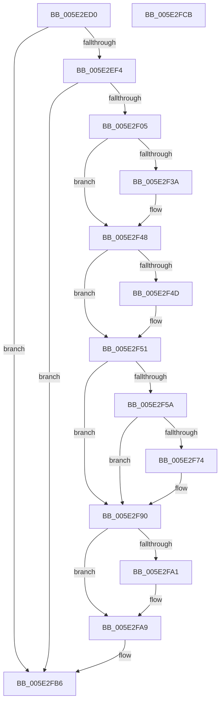

# PspEnqueueProcessQosChangeNotification

- RVA: `0x005E2ED0`–`0x005E2FCC` (길이 `252` bytes)
- VA: `0x00000001405E2ED0`
- 실행 섹션: `.text`
- PDB 이름 있음: `예`; PDB Function 태그: `아니요`
- unwind 정보 RVA: `0x0005C954`
- 디코드: `60`개 명령, `252/252` bytes 표시
- 미해석 바이트: `0` (있으면 어셈블리에 `.byte`로 보존)

> 이 문서는 커널 이미지의 기계어와 PDB 기호를 분석해 생성했습니다. 4번과 5번은 함수 원형과 자료형을 바이너리 사용 방식에서 추정한 C 해석이며 원본 소스 복구 결과는 아닙니다.

## 1. Dependencies

- 직접 호출 지점: **8**; 고유 호출 대상: **8**
- 직접 호출자로 확인된 함수: **5**
- RIP 상대 이미지 참조: **6**

### Outgoing calls
- `0x005E2EE7` → [Feature_ProcessDefaultQosNotifications__private_IsEnabledDeviceUsageNoInline](Feature_ProcessDefaultQosNotifications__private_IsEnabledDeviceUsageNoInline_function_005E24B4.md) (function, `0x005E24B4`)
- `0x005E2F29` → [KeAbPreAcquire](../21/KeAbPreAcquire_function_00210230.md) (function, `0x00210230`)
- `0x005E2F43` → [ExfAcquirePushLockExclusiveEx](../20/ExfAcquirePushLockExclusiveEx_function_0020FC90.md) (function, `0x0020FC90`)
- `0x005E2F64` → [PspProcessQosChangeNotificationInsertList](PspProcessQosChangeNotificationInsertList_function_005E2FD4.md) (function, `0x005E2FD4`)
- `0x005E2F8B` → [ExQueueWorkItem](../2F/ExQueueWorkItem_function_002F9520.md) (function, `0x002F9520`)
- `0x005E2FA4` → [ExfTryToWakePushLock](../26/ExfTryToWakePushLock_function_00265DD0.md) (function, `0x00265DD0`)
- `0x005E2FAC` → [KeAbPostRelease](../2E/KeAbPostRelease_function_002E1600.md) (function, `0x002E1600`)
- `0x005E2FB1` → [KeLeaveCriticalRegion](../25/KeLeaveCriticalRegion_function_0025D8B0.md) (function, `0x0025D8B0`)

### Direct callers
- [PspSetProcessPriorityByClass](../4E/PspSetProcessPriorityByClass_function_004E9754.md) at `0x004E97A1`
- [PspRefreshProcessUserPresencePpmPolicyCallback](PspRefreshProcessUserPresencePpmPolicyCallback_function_005E3100.md) at `0x005E31CC`
- [PspSetProcessPpmPolicy](../../page/AE/PspSetProcessPpmPolicy_function_00AE34F0.md) at `0x00AE35EF`
- [NtSetInformationProcess](../../page/AE/NtSetInformationProcess_function_00AE5370.md) at `0x00AE593D`
- [PspSetProcessPriorityByClassIgnoreForegroundBoost](../../page/AE/PspSetProcessPriorityByClassIgnoreForegroundBoost_function_00AEA1CC.md) at `0x00AEA1F9`

### Static image references
- `0x005E2F0E` → RVA `0x00F06768` (`.data`; read)
- `0x005E2F51` → RVA `0x00F06760` (`.data`; read)
- `0x005E2F5A` → RVA `0x00F06770` (`.data`; read)
- `0x005E2F78` → RVA `0x00F06778` (`.data`; read)
- `0x005E2F84` → RVA `0x00F06760` (`.data`; write)
- `0x005E2F90` → RVA `0x00F06768` (`.data`; read/write)

## 2. Other-region calls and transfers

- 다른 실행 섹션으로 향하는 call: **0**
- 별도 외부 분기/꼬리 이동을 확인하지 못했습니다.

## 3. Assembly (complete function range)

```asm
005E2ED0  48 89 5C 24 08                  mov qword ptr [rsp + 8], rbx
005E2ED5  48 89 6C 24 10                  mov qword ptr [rsp + 0x10], rbp
005E2EDA  48 89 74 24 18                  mov qword ptr [rsp + 0x18], rsi
005E2EDF  57                              push rdi
005E2EE0  48 83 EC 20                     sub rsp, 0x20
005E2EE4  48 8B F1                        mov rsi, rcx
005E2EE7  E8 C8 F5 FF FF                  call 0x1405e24b4
005E2EEC  85 C0                           test eax, eax
005E2EEE  0F 84 C2 00 00 00               je 0x1405e2fb6
005E2EF4  8B 86 F4 01 00 00               mov eax, dword ptr [rsi + 0x1f4]
005E2EFA  A9 08 00 00 40                  test eax, 0x40000008
005E2EFF  0F 85 B1 00 00 00               jne 0x1405e2fb6
005E2F05  65 48 8B 04 25 88 01 00 00      mov rax, qword ptr gs:[0x188]
005E2F0E  48 8D 2D 53 38 92 00            lea rbp, [rip + 0x923853]
005E2F15  48 83 CB FF                     or rbx, 0xffffffffffffffff
005E2F19  45 33 C0                        xor r8d, r8d
005E2F1C  33 D2                           xor edx, edx
005E2F1E  48 8B CD                        mov rcx, rbp
005E2F21  66 01 98 E4 01 00 00            add word ptr [rax + 0x1e4], bx
005E2F28  90                              nop
005E2F29  E8 02 D3 C2 FF                  call 0x140210230
005E2F2E  F0 48 0F BA 6D 00 00            lock bts qword ptr [rbp], 0
005E2F35  48 8B F8                        mov rdi, rax
005E2F38  73 0E                           jae 0x1405e2f48
005E2F3A  4C 8B C5                        mov r8, rbp
005E2F3D  48 8B D0                        mov rdx, rax
005E2F40  48 8B CD                        mov rcx, rbp
005E2F43  E8 48 CD C2 FF                  call 0x14020fc90
005E2F48  48 85 FF                        test rdi, rdi
005E2F4B  74 04                           je 0x1405e2f51
005E2F4D  C6 47 0A 01                     mov byte ptr [rdi + 0xa], 1
005E2F51  F6 05 08 38 92 00 02            test byte ptr [rip + 0x923808], 2
005E2F58  74 36                           je 0x1405e2f90
005E2F5A  48 8D 15 0F 38 92 00            lea rdx, [rip + 0x92380f]
005E2F61  48 8B CE                        mov rcx, rsi
005E2F64  E8 6B 00 00 00                  call 0x1405e2fd4
005E2F69  48 8B 05 F0 37 92 00            mov rax, qword ptr [rip + 0x9237f0]
005E2F70  A8 01                           test al, 1
005E2F72  75 1C                           jne 0x1405e2f90
005E2F74  48 83 C8 01                     or rax, 1
005E2F78  48 8D 0D F9 37 92 00            lea rcx, [rip + 0x9237f9]
005E2F7F  BA 01 00 00 00                  mov edx, 1
005E2F84  48 89 05 D5 37 92 00            mov qword ptr [rip + 0x9237d5], rax
005E2F8B  E8 90 65 D1 FF                  call 0x1402f9520
005E2F90  F0 48 0F C1 1D CF 37 92 00      lock xadd qword ptr [rip + 0x9237cf], rbx
005E2F99  80 E3 06                        and bl, 6
005E2F9C  80 FB 02                        cmp bl, 2
005E2F9F  75 08                           jne 0x1405e2fa9
005E2FA1  48 8B CD                        mov rcx, rbp
005E2FA4  E8 27 2E C8 FF                  call 0x140265dd0
005E2FA9  48 8B CD                        mov rcx, rbp
005E2FAC  E8 4F E6 CF FF                  call 0x1402e1600
005E2FB1  E8 FA A8 C7 FF                  call 0x14025d8b0
005E2FB6  48 8B 5C 24 30                  mov rbx, qword ptr [rsp + 0x30]
005E2FBB  48 8B 6C 24 38                  mov rbp, qword ptr [rsp + 0x38]
005E2FC0  48 8B 74 24 40                  mov rsi, qword ptr [rsp + 0x40]
005E2FC5  48 83 C4 20                     add rsp, 0x20
005E2FC9  5F                              pop rdi
005E2FCA  C3                              ret
005E2FCB  CC                              int3
```

## 4. C-style interpretation (structured pseudocode)

```c
__int64 __fastcall PspEnqueueProcessQosChangeNotification(__int64 a1, int a2, int a3)
{
    __int64 result;
    __int64 v_rbx;
    __int64 v_rsp;
    unsigned __int64 v_stack_p10;
    unsigned __int64 v_stack_p18;
    unsigned __int64 v_stack_p8;

    v_stack_p8 = v_rbx;
    v_stack_p10 = v_rbp;
    v_stack_p18 = v_rsi;
    v_rsp = (v_rsp) - (32);
    result = Feature_ProcessDefaultQosNotifications__private_IsEnabledDeviceUsageNoInline(a1, a2, a3, a4);
    if ((unsigned int)(result) == 0) goto loc_005E2FB6;
    if ((((unsigned int)((unsigned int)(*(unsigned int *)(a1 + 500)))) & (0x40000008ULL)) != 0) goto loc_005E2FB6;
    v_rbx = (v_rbx) | (-1);
    a3 = 0;
    a2 = 0;
    result = KeAbPreAcquire(v_rip + 9582675, a2, a3, a4);
    if (!(condition_is_above_or_equal)) {
        a3 = v_rip + 9582675;
        a2 = result;
        a1 = v_rip + 9582675;
        result = ExfAcquirePushLockExclusiveEx(a1, a2, a3, a4);
    }
    if (result != 0) {
        *(unsigned __int8 *)(result + 10) = 1;
    }
    if (((*(unsigned __int8 *)(v_rip + 9582600)) & (2)) == 0) goto loc_005E2F90;
    result = PspProcessQosChangeNotificationInsertList(a1, v_rip + 9582607, a3, a4);
    result = *(unsigned __int64 *)(v_rip + 9582576);
    if ((((unsigned __int8)(*(unsigned __int64 *)(v_rip + 9582576))) & (1)) == 0) {
        result = (*(unsigned __int64 *)(v_rip + 9582576)) | (1);
        a1 = v_rip + 9582585;
        a2 = 1;
        *(unsigned __int64 *)(v_rip + 9582549) = result;
        result = ExQueueWorkItem(a1, a2, a3, a4);
    }
    v_rbx = (unsigned __int8)((v_rbx) & (6));
    if (((unsigned __int8)(v_rbx)) == 2) {
        a1 = v_rip + 9582675;
        result = ExfTryToWakePushLock(a1, a2, a3, a4);
    }
    result = KeAbPostRelease(v_rip + 9582675, a2, a3, a4);
    result = KeLeaveCriticalRegion(v_rip + 9582675, a2, a3, a4);
loc_005E2FB6:
    v_rsp = (v_rsp) + (32);
    return result;
}
```

## 5. (Beta) C Style

```c
int64_t PspEnqueueProcessQosChangeNotification(void *Arg1, int32_t Arg2, int32_t Arg3)
{
    uint8_t *arg1 = (uint8_t *)Arg1;

    int64_t result;
    int64_t local_rbx;
    int64_t local_rsp;
    uint64_t v_stack_p10;
    uint64_t v_stack_p18;
    uint64_t v_stack_p8;

    v_stack_p8 = local_rbx;
    v_stack_p10 = local_rbp;
    v_stack_p18 = local_rsi;
    local_rsp = (local_rsp) - (32);
    result = Feature_ProcessDefaultQosNotifications__private_IsEnabledDeviceUsageNoInline(Arg1, Arg2, Arg3, a4);
    if ((uint32_t)(result) == 0) goto loc_005E2FB6;
    if ((((uint32_t)((uint32_t)(*(uint32_t *)(arg1 + 0x1F4)))) & (0x40000008ULL)) != 0) goto loc_005E2FB6;
    local_rbx = (local_rbx) | (-1);
    Arg3 = 0;
    Arg2 = 0;
    result = KeAbPreAcquire(v_rip + 9582675, Arg2, Arg3, a4);
    if (!(condition_is_above_or_equal)) {
        Arg3 = v_rip + 9582675;
        Arg2 = result;
        Arg1 = v_rip + 9582675;
        result = ExfAcquirePushLockExclusiveEx(Arg1, Arg2, Arg3, a4);
    }
    if (result != 0) {
        *(uint8_t *)(result + 0xA) = 1;
    }
    if (((*(uint8_t *)(v_rip + 0x923808)) & (2)) == 0) goto loc_005E2F90;
    result = PspProcessQosChangeNotificationInsertList(Arg1, v_rip + 9582607, Arg3, a4);
    result = *(uint64_t *)(v_rip + 0x9237F0);
    if ((((uint8_t)(*(uint64_t *)(v_rip + 0x9237F0))) & (1)) == 0) {
        result = (*(uint64_t *)(v_rip + 0x9237F0)) | (1);
        Arg1 = v_rip + 9582585;
        Arg2 = 1;
        *(uint64_t *)(v_rip + 0x9237D5) = result;
        result = ExQueueWorkItem(Arg1, Arg2, Arg3, a4);
    }
    local_rbx = (uint8_t)((local_rbx) & (6));
    if (((uint8_t)(local_rbx)) == 2) {
        Arg1 = v_rip + 9582675;
        result = ExfTryToWakePushLock(Arg1, Arg2, Arg3, a4);
    }
    result = KeAbPostRelease(v_rip + 9582675, Arg2, Arg3, a4);
    result = KeLeaveCriticalRegion(v_rip + 9582675, Arg2, Arg3, a4);
loc_005E2FB6:
    local_rsp = (local_rsp) + (32);
    return result;
}
```

### 관측된 메모리 오프셋

구조체 형식이 확인되지 않은 접근은 인자 기준의 오프셋으로만 기록했습니다.

| 기준 인자 | 오프셋 표현 | 폭 (bit) | 접근 |
|---|---:|---:|---|
| `Arg1` | `+ 0x1F4` | `32` | `R` |

## 6. Execution-region graph

[열기: 2D/3D 그래프와 함수 탐색 컨트롤 패널](../../../control-panel.html?section=text&rva=0x005E2ED0&view=graph)

- 2D 그래프는 위에서 아래로 흐르고, 3D 그래프는 빈 공간을 드래그해 회전합니다. Shift+드래그는 이동, 휠은 확대·축소, 함수 노드 선택은 대상 보고서 이동입니다.

### Static fallback


