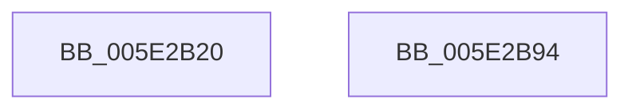

# PspExpandLimit

- RVA: `0x005E2B20`–`0x005E2B95` (길이 `117` bytes)
- VA: `0x00000001405E2B20`
- 실행 섹션: `.text`
- PDB 이름 있음: `예`; PDB Function 태그: `아니요`
- unwind 정보 RVA: `0x000A118C`
- 디코드: `34`개 명령, `117/117` bytes 표시
- 미해석 바이트: `0` (있으면 어셈블리에 `.byte`로 보존)

> 이 문서는 커널 이미지의 기계어와 PDB 기호를 분석해 생성했습니다. 4번과 5번은 함수 원형과 자료형을 바이너리 사용 방식에서 추정한 C 해석이며 원본 소스 복구 결과는 아닙니다.

## 1. Dependencies

- 직접 호출 지점: **3**; 고유 호출 대상: **3**
- 직접 호출자로 확인된 함수: **1**
- RIP 상대 이미지 참조: **1**

### Outgoing calls
- `0x005E2B57` → [PspLockQuotaExpansion](../39/PspLockQuotaExpansion_function_00390774.md) (function, `0x00390774`)
- `0x005E2B6A` → [guard_dispatch_icall](../6B/guard_dispatch_icall_function_006BAAD0.md) (function, `0x006BAAD0`)
- `0x005E2B78` → [PspUnlockQuotaExpansion](../39/PspUnlockQuotaExpansion_function_00390E68.md) (function, `0x00390E68`)

### Direct callers
- [PspInitializeQuotaBlock](../../page/78/PspInitializeQuotaBlock_function_00780EB0.md) at `0x00780FC1`

### Static image references
- `0x005E2B43` → RVA `0x00F06640` (`.data`; read)

## 2. Other-region calls and transfers

- 다른 실행 섹션으로 향하는 call: **0**
- 별도 외부 분기/꼬리 이동을 확인하지 못했습니다.

## 3. Assembly (complete function range)

```asm
005E2B20  48 8B C4                        mov rax, rsp
005E2B23  48 89 58 10                     mov qword ptr [rax + 0x10], rbx
005E2B27  48 89 68 18                     mov qword ptr [rax + 0x18], rbp
005E2B2B  48 89 70 20                     mov qword ptr [rax + 0x20], rsi
005E2B2F  57                              push rdi
005E2B30  48 83 EC 30                     sub rsp, 0x30
005E2B34  48 63 F1                        movsxd rsi, ecx
005E2B37  48 8D 54 24 40                  lea rdx, [rsp + 0x40]
005E2B3C  C6 40 08 00                     mov byte ptr [rax + 8], 0
005E2B40  49 8B D9                        mov rbx, r9
005E2B43  48 8D 05 F6 3A 92 00            lea rax, [rip + 0x923af6]
005E2B4A  49 8B F8                        mov rdi, r8
005E2B4D  48 6B EE 38                     imul rbp, rsi, 0x38
005E2B51  48 03 E8                        add rbp, rax
005E2B54  48 8B CD                        mov rcx, rbp
005E2B57  E8 18 DC DA FF                  call 0x140390774
005E2B5C  48 8B 45 18                     mov rax, qword ptr [rbp + 0x18]
005E2B60  4C 8B CB                        mov r9, rbx
005E2B63  4C 8B C7                        mov r8, rdi
005E2B66  33 D2                           xor edx, edx
005E2B68  8B CE                           mov ecx, esi
005E2B6A  E8 61 7F 0D 00                  call 0x1406baad0
005E2B6F  8A 54 24 40                     mov dl, byte ptr [rsp + 0x40]
005E2B73  48 8B CD                        mov rcx, rbp
005E2B76  8A D8                           mov bl, al
005E2B78  E8 EB E2 DA FF                  call 0x140390e68
005E2B7D  48 8B 6C 24 50                  mov rbp, qword ptr [rsp + 0x50]
005E2B82  8A C3                           mov al, bl
005E2B84  48 8B 5C 24 48                  mov rbx, qword ptr [rsp + 0x48]
005E2B89  48 8B 74 24 58                  mov rsi, qword ptr [rsp + 0x58]
005E2B8E  48 83 C4 30                     add rsp, 0x30
005E2B92  5F                              pop rdi
005E2B93  C3                              ret
005E2B94  CC                              int3
```

## 4. C-style interpretation (structured pseudocode)

```c
__int64 __fastcall PspExpandLimit(int a1, __int64 a2, __int64 a3, __int64 a4)
{
    __int64 result;
    __int64 v_rbp;
    __int64 v_rsp;
    unsigned __int64 v_stack_p10;
    unsigned __int64 v_stack_p18;
    unsigned __int64 v_stack_p20;
    unsigned __int64 v_stack_p8;

    *(unsigned __int64 *)(v_rsp + 16) = v_rbx;
    *(unsigned __int64 *)(v_rsp + 24) = v_rbp;
    *(unsigned __int64 *)(v_rsp + 32) = v_rsi;
    v_rsp = (v_rsp) - (48);
    *(unsigned __int8 *)(v_rsp + 8) = 0;
    v_rbp = (v_rbp) * ((int)(a1));
    v_rbp = (v_rbp) + (v_rip + 9583350);
    result = PspLockQuotaExpansion(v_rbp, v_stack_p8, a3, a4);
    a2 = 0;
    result = guard_dispatch_icall((unsigned int)((unsigned int)((int)(a1))), a2, a3, a4);
    result = PspUnlockQuotaExpansion(v_rbp, v_stack_p8, a3, a4);
    v_rsp = (v_rsp) + (48);
    return (unsigned __int8)((unsigned __int8)(result));
}
```

## 5. (Beta) C Style

```c
int64_t PspExpandLimit(int32_t Arg1, int64_t Arg2, int64_t Arg3, int64_t Arg4)
{
    int64_t result;
    int64_t local_rbp;
    int64_t local_rsp;
    uint64_t v_stack_p10;
    uint64_t v_stack_p18;
    uint64_t v_stack_p20;
    uint64_t v_stack_p8;

    *(uint64_t *)(local_rsp + 0x10) = local_rbx;
    *(uint64_t *)(local_rsp + 0x18) = local_rbp;
    *(uint64_t *)(local_rsp + 0x20) = local_rsi;
    local_rsp = (local_rsp) - (48);
    *(uint8_t *)(local_rsp + 0x8) = 0;
    local_rbp = (local_rbp) * ((int32_t)(Arg1));
    local_rbp = (local_rbp) + (v_rip + 9583350);
    result = PspLockQuotaExpansion(local_rbp, v_stack_p8, Arg3, Arg4);
    Arg2 = 0;
    result = guard_dispatch_icall((uint32_t)((uint32_t)((int32_t)(Arg1))), Arg2, Arg3, Arg4);
    result = PspUnlockQuotaExpansion(local_rbp, v_stack_p8, Arg3, Arg4);
    local_rsp = (local_rsp) + (48);
    return (uint8_t)((uint8_t)(result));
}
```

## 6. Execution-region graph

[열기: 2D/3D 그래프와 함수 탐색 컨트롤 패널](../../../control-panel.html?section=text&rva=0x005E2B20&view=graph)

- 2D 그래프는 위에서 아래로 흐르고, 3D 그래프는 빈 공간을 드래그해 회전합니다. Shift+드래그는 이동, 휠은 확대·축소, 함수 노드 선택은 대상 보고서 이동입니다.

### Static fallback


