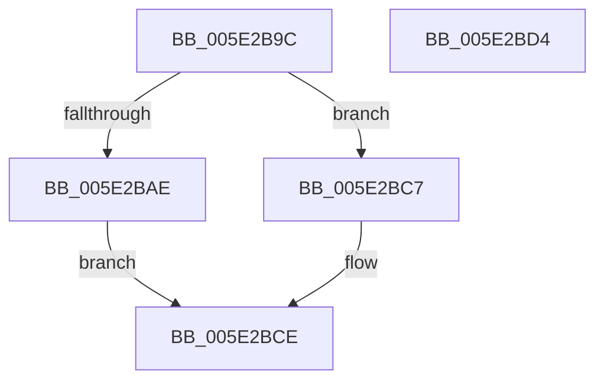

# PspGetQuotaSid

- RVA: `0x005E2B9C`–`0x005E2BD5` (길이 `57` bytes)
- VA: `0x00000001405E2B9C`
- 실행 섹션: `.text`
- PDB 이름 있음: `예`; PDB Function 태그: `아니요`
- unwind 정보 RVA: `0x0005CF00`
- 디코드: `18`개 명령, `57/57` bytes 표시
- 미해석 바이트: `0` (있으면 어셈블리에 `.byte`로 보존)

> 이 문서는 커널 이미지의 기계어와 PDB 기호를 분석해 생성했습니다. 4번과 5번은 함수 원형과 자료형을 바이너리 사용 방식에서 추정한 C 해석이며 원본 소스 복구 결과는 아닙니다.

## 1. Dependencies

- 직접 호출 지점: **1**; 고유 호출 대상: **1**
- 직접 호출자로 확인된 함수: **3**
- RIP 상대 이미지 참조: **0**

### Outgoing calls
- `0x005E2BA5` → [Feature_2056154424__private_IsEnabledDeviceUsageNoInline](Feature_2056154424__private_IsEnabledDeviceUsageNoInline_function_005E276C.md) (function, `0x005E276C`)

### Direct callers
- [PspRemoveQuotaBlock](../../page/9D/PspRemoveQuotaBlock_function_009DAA00.md) at `0x009DAA34`
- [PspAssignProcessQuotaBlock](../../page/AE/PspAssignProcessQuotaBlock_function_00AE3124.md) at `0x00AE32C5`
- [PspLookupProcessQuotaBlock](../../page/AE/PspLookupProcessQuotaBlock_function_00AE336C.md) at `0x00AE33E6`

### Static image references
- 디코드된 RIP-relative 메모리 참조가 없습니다.

## 2. Other-region calls and transfers

- 다른 실행 섹션으로 향하는 call: **0**
- 별도 외부 분기/꼬리 이동을 확인하지 못했습니다.

## 3. Assembly (complete function range)

```asm
005E2B9C  40 53                           push rbx
005E2B9E  48 83 EC 20                     sub rsp, 0x20
005E2BA2  48 8B D9                        mov rbx, rcx
005E2BA5  E8 C2 FB FF FF                  call 0x1405e276c
005E2BAA  85 C0                           test eax, eax
005E2BAC  74 19                           je 0x1405e2bc7
005E2BAE  8B 83 18 02 00 00               mov eax, dword ptr [rbx + 0x218]
005E2BB4  48 8D 8B 40 02 00 00            lea rcx, [rbx + 0x240]
005E2BBB  24 01                           and al, 1
005E2BBD  F6 D8                           neg al
005E2BBF  48 1B C0                        sbb rax, rax
005E2BC2  48 23 C1                        and rax, rcx
005E2BC5  EB 07                           jmp 0x1405e2bce
005E2BC7  48 8D 83 40 02 00 00            lea rax, [rbx + 0x240]
005E2BCE  48 83 C4 20                     add rsp, 0x20
005E2BD2  5B                              pop rbx
005E2BD3  C3                              ret
005E2BD4  CC                              int3
```

## 4. C-style interpretation (structured pseudocode)

```c
__int64 __fastcall PspGetQuotaSid(__int64 a1)
{
    __int64 result;
    __int64 v_rsp;

    v_rsp = (v_rsp) - (32);
    result = Feature_2056154424__private_IsEnabledDeviceUsageNoInline(a1, a2, a3, a4);
    if ((unsigned int)(result) == 0) goto loc_005E2BC7;
    result = (unsigned __int8)(((unsigned int)(*(unsigned int *)(a1 + 536))) & (1));
    result = (unsigned __int8)(-(result));
    result = (result) & (a1 + 576);
    goto loc_005E2BCE;
loc_005E2BC7:
loc_005E2BCE:
    v_rsp = (v_rsp) + (32);
    return a1 + 576;
}
```

## 5. (Beta) C Style

```c
void *PspGetQuotaSid(void *Arg1)
{
    uint8_t *arg1 = (uint8_t *)Arg1;

    int64_t result;
    int64_t local_rsp;

    local_rsp = (local_rsp) - (32);
    result = Feature_2056154424__private_IsEnabledDeviceUsageNoInline(Arg1, a2, a3, a4);
    if ((uint32_t)(result) == 0) goto loc_005E2BC7;
    result = (uint8_t)(((uint32_t)(*(uint32_t *)(arg1 + 0x218))) & (1));
    result = (uint8_t)(-(result));
    result = (result) & (Arg1 + 576);
    goto loc_005E2BCE;
loc_005E2BC7:
loc_005E2BCE:
    local_rsp = (local_rsp) + (32);
    return Arg1 + 576;
}
```

### 관측된 메모리 오프셋

구조체 형식이 확인되지 않은 접근은 인자 기준의 오프셋으로만 기록했습니다.

| 기준 인자 | 오프셋 표현 | 폭 (bit) | 접근 |
|---|---:|---:|---|
| `Arg1` | `+ 0x218` | `32` | `R` |
| `Arg1` | `+ 0x240` | `64` | `R` |

## 6. Execution-region graph

[열기: 2D/3D 그래프와 함수 탐색 컨트롤 패널](../../../control-panel.html?section=text&rva=0x005E2B9C&view=graph)

- 2D 그래프는 위에서 아래로 흐르고, 3D 그래프는 빈 공간을 드래그해 회전합니다. Shift+드래그는 이동, 휠은 확대·축소, 함수 노드 선택은 대상 보고서 이동입니다.

### Static fallback


