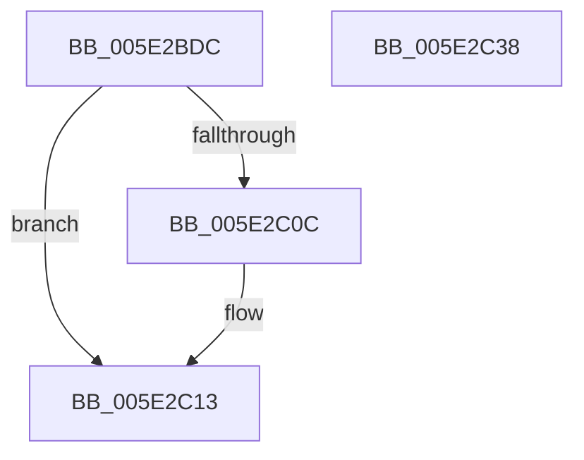

# PspInsertExpansionEntry

- RVA: `0x005E2BDC`–`0x005E2C39` (길이 `93` bytes)
- VA: `0x00000001405E2BDC`
- 실행 섹션: `.text`
- PDB 이름 있음: `예`; PDB Function 태그: `아니요`
- unwind 정보 RVA: `0x00068D5C`
- 디코드: `27`개 명령, `93/93` bytes 표시
- 미해석 바이트: `0` (있으면 어셈블리에 `.byte`로 보존)

> 이 문서는 커널 이미지의 기계어와 PDB 기호를 분석해 생성했습니다. 4번과 5번은 함수 원형과 자료형을 바이너리 사용 방식에서 추정한 C 해석이며 원본 소스 복구 결과는 아닙니다.

## 1. Dependencies

- 직접 호출 지점: **2**; 고유 호출 대상: **2**
- 직접 호출자로 확인된 함수: **1**
- RIP 상대 이미지 참조: **0**

### Outgoing calls
- `0x005E2BF6` → [PspLockQuotaExpansion](../39/PspLockQuotaExpansion_function_00390774.md) (function, `0x00390774`)
- `0x005E2C28` → [PspUnlockQuotaExpansion](../39/PspUnlockQuotaExpansion_function_00390E68.md) (function, `0x00390E68`)

### Direct callers
- [PspInitializeQuotaBlock](../../page/78/PspInitializeQuotaBlock_function_00780EB0.md) at `0x00780FA1`

### Static image references
- 디코드된 RIP-relative 메모리 참조가 없습니다.

## 2. Other-region calls and transfers

- 다른 실행 섹션으로 향하는 call: **0**
- 별도 외부 분기/꼬리 이동을 확인하지 못했습니다.

## 3. Assembly (complete function range)

```asm
005E2BDC  48 89 5C 24 10                  mov qword ptr [rsp + 0x10], rbx
005E2BE1  57                              push rdi
005E2BE2  48 83 EC 20                     sub rsp, 0x20
005E2BE6  48 8B DA                        mov rbx, rdx
005E2BE9  C6 44 24 30 00                  mov byte ptr [rsp + 0x30], 0
005E2BEE  48 8D 54 24 30                  lea rdx, [rsp + 0x30]
005E2BF3  48 8B F9                        mov rdi, rcx
005E2BF6  E8 79 DB DA FF                  call 0x140390774
005E2BFB  48 8D 47 28                     lea rax, [rdi + 0x28]
005E2BFF  48 83 C3 50                     add rbx, 0x50
005E2C03  48 8B 50 08                     mov rdx, qword ptr [rax + 8]
005E2C07  48 39 02                        cmp qword ptr [rdx], rax
005E2C0A  74 07                           je 0x1405e2c13
005E2C0C  B9 03 00 00 00                  mov ecx, 3
005E2C11  CD 29                           int 0x29
005E2C13  48 89 53 08                     mov qword ptr [rbx + 8], rdx
005E2C17  48 8B CF                        mov rcx, rdi
005E2C1A  48 89 03                        mov qword ptr [rbx], rax
005E2C1D  48 89 1A                        mov qword ptr [rdx], rbx
005E2C20  8A 54 24 30                     mov dl, byte ptr [rsp + 0x30]
005E2C24  48 89 58 08                     mov qword ptr [rax + 8], rbx
005E2C28  E8 3B E2 DA FF                  call 0x140390e68
005E2C2D  48 8B 5C 24 38                  mov rbx, qword ptr [rsp + 0x38]
005E2C32  48 83 C4 20                     add rsp, 0x20
005E2C36  5F                              pop rdi
005E2C37  C3                              ret
005E2C38  CC                              int3
```

## 4. C-style interpretation (structured pseudocode)

```c
__int64 __fastcall PspInsertExpansionEntry(__int64 a1, __int64 a2)
{
    __int64 result;
    __int64 v_rbx;
    __int64 v_rsp;
    unsigned __int64 v_stack_p10;
    unsigned __int8 v_stack_p8;

    v_stack_p10 = v_rbx;
    v_rsp = (v_rsp) - (32);
    v_stack_p8 = 0;
    result = PspLockQuotaExpansion(a1, v_stack_p8, a3, a4);
    v_rbx = (a2) + (80);
    if ((*(unsigned __int64 *)(*(unsigned __int64 *)(a1 + 40 + 8))) != (a1 + 40)) {
        a1 = 3;
    }
    *(unsigned __int64 *)(v_rbx + 8) = *(unsigned __int64 *)(a1 + 40 + 8);
    *(unsigned __int64 *)(v_rbx) = a1 + 40;
    *(unsigned __int64 *)(*(unsigned __int64 *)(a1 + 40 + 8)) = v_rbx;
    *(unsigned __int64 *)(a1 + 40 + 8) = v_rbx;
    result = PspUnlockQuotaExpansion(a1, v_stack_p8, a3, a4);
    v_rsp = (v_rsp) + (32);
    return result;
}
```

## 5. (Beta) C Style

```c
int64_t PspInsertExpansionEntry(void *Arg1, void *Arg2)
{
    uint8_t *arg1 = (uint8_t *)Arg1;
    uint8_t *arg2 = (uint8_t *)Arg2;

    int64_t result;
    int64_t local_rbx;
    int64_t local_rsp;
    uint64_t v_stack_p10;
    uint8_t v_stack_p8;

    v_stack_p10 = local_rbx;
    local_rsp = (local_rsp) - (32);
    v_stack_p8 = 0;
    result = PspLockQuotaExpansion(Arg1, v_stack_p8, a3, a4);
    local_rbx = (Arg2) + (80);
    if ((*(uint64_t *)(*(uint64_t *)(arg1 + 0x28 + 0x8))) != (Arg1 + 40)) {
        Arg1 = 3;
    }
    *(uint64_t *)(local_rbx + 0x8) = *(uint64_t *)(arg1 + 0x28 + 0x8);
    *(void **)(local_rbx) = Arg1 + 40;
    *(uint64_t *)(*(uint64_t *)(arg1 + 0x28 + 0x8)) = local_rbx;
    *(uint64_t *)(arg1 + 0x28 + 0x8) = local_rbx;
    result = PspUnlockQuotaExpansion(Arg1, v_stack_p8, a3, a4);
    local_rsp = (local_rsp) + (32);
    return result;
}
```

### 관측된 메모리 오프셋

구조체 형식이 확인되지 않은 접근은 인자 기준의 오프셋으로만 기록했습니다.

| 기준 인자 | 오프셋 표현 | 폭 (bit) | 접근 |
|---|---:|---:|---|
| `Arg1` | `+ 0x8` | `64` | `R` |
| `Arg1` | `+ 0x8` | `64` | `W` |
| `Arg1` | `+ 0x28` | `64` | `R` |
| `Arg2` | `+ 0x0` | `64` | `W` |
| `Arg2` | `+ 0x8` | `64` | `W` |

## 6. Execution-region graph

[열기: 2D/3D 그래프와 함수 탐색 컨트롤 패널](../../../control-panel.html?section=text&rva=0x005E2BDC&view=graph)

- 2D 그래프는 위에서 아래로 흐르고, 3D 그래프는 빈 공간을 드래그해 회전합니다. Shift+드래그는 이동, 휠은 확대·축소, 함수 노드 선택은 대상 보고서 이동입니다.

### Static fallback


