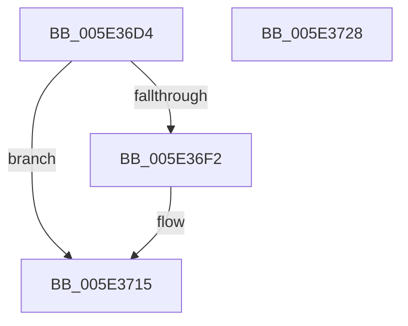

# PspIsTamperProtectedProcess

- RVA: `0x005E36D4`–`0x005E3729` (길이 `85` bytes)
- VA: `0x00000001405E36D4`
- 실행 섹션: `.text`
- PDB 이름 있음: `예`; PDB Function 태그: `아니요`
- unwind 정보 RVA: `0x00060BC4`
- 디코드: `23`개 명령, `85/85` bytes 표시
- 미해석 바이트: `0` (있으면 어셈블리에 `.byte`로 보존)

> 이 문서는 커널 이미지의 기계어와 PDB 기호를 분석해 생성했습니다. 4번과 5번은 함수 원형과 자료형을 바이너리 사용 방식에서 추정한 C 해석이며 원본 소스 복구 결과는 아닙니다.

## 1. Dependencies

- 직접 호출 지점: **2**; 고유 호출 대상: **2**
- 직접 호출자로 확인된 함수: **3**
- RIP 상대 이미지 참조: **0**

### Outgoing calls
- `0x005E36E8` → [PsReferencePrimaryToken](../../page/9A/PsReferencePrimaryToken_function_009A2CB0.md) (function, `0x009A2CB0`)
- `0x005E3709` → [ObFastDereferenceObject](../3E/ObFastDereferenceObject_function_003ED5F0.md) (function, `0x003ED5F0`)

### Direct callers
- [PsOpenProcess](../../page/89/PsOpenProcess_function_00894A30.md) at `0x00894CEF`
- [PsOpenThread](../../page/9C/PsOpenThread_function_009C5CC0.md) at `0x009C5F8D`
- [PspUpdateCreateInfo](../../page/AE/PspUpdateCreateInfo_function_00AEC060.md) at `0x00AEC15A`

### Static image references
- 디코드된 RIP-relative 메모리 참조가 없습니다.

## 2. Other-region calls and transfers

- 다른 실행 섹션으로 향하는 call: **1**
  - `0x005E36E8` → [PsReferencePrimaryToken](../../page/9A/PsReferencePrimaryToken_function_009A2CB0.md) (`.text` → `PAGE`)
- 별도 외부 분기/꼬리 이동을 확인하지 못했습니다.

## 3. Assembly (complete function range)

```asm
005E36D4  48 89 5C 24 08                  mov qword ptr [rsp + 8], rbx
005E36D9  48 89 74 24 10                  mov qword ptr [rsp + 0x10], rsi
005E36DE  57                              push rdi
005E36DF  48 83 EC 20                     sub rsp, 0x20
005E36E3  48 8B F1                        mov rsi, rcx
005E36E6  33 FF                           xor edi, edi
005E36E8  E8 C3 F5 3B 00                  call 0x1409a2cb0
005E36ED  48 85 C0                        test rax, rax
005E36F0  74 23                           je 0x1405e3715
005E36F2  48 8B 98 98 04 00 00            mov rbx, qword ptr [rax + 0x498]
005E36F9  48 8D 8E 48 02 00 00            lea rcx, [rsi + 0x248]
005E3700  41 B8 44 66 6C 74               mov r8d, 0x746c6644
005E3706  48 8B D0                        mov rdx, rax
005E3709  E8 E2 9E E0 FF                  call 0x1403ed5f0
005E370E  48 85 DB                        test rbx, rbx
005E3711  40 0F 95 C7                     setne dil
005E3715  48 8B 5C 24 30                  mov rbx, qword ptr [rsp + 0x30]
005E371A  40 8A C7                        mov al, dil
005E371D  48 8B 74 24 38                  mov rsi, qword ptr [rsp + 0x38]
005E3722  48 83 C4 20                     add rsp, 0x20
005E3726  5F                              pop rdi
005E3727  C3                              ret
005E3728  CC                              int3
```

## 4. C-style interpretation (structured pseudocode)

```c
__int64 __fastcall PspIsTamperProtectedProcess(__int64 a1)
{
    __int64 result;
    __int64 v_rbx;
    __int64 v_rdi;
    __int64 v_rsp;
    unsigned __int64 v_stack_p10;
    unsigned __int64 v_stack_p8;

    v_stack_p8 = v_rbx;
    v_stack_p10 = v_rsi;
    v_rsp = (v_rsp) - (32);
    v_rdi = 0;
    result = PsReferencePrimaryToken(a1, a2, a3, a4);
    if (result != 0) {
        v_rbx = *(unsigned __int64 *)(result + 1176);
        a1 = a1 + 584;
        a3 = 0x746C6644ULL;
        a2 = result;
        result = ObFastDereferenceObject(a1, a2, a3, a4);
        v_rdi = (v_rbx != 0) ? 1 : 0;
    }
    v_rsp = (v_rsp) + (32);
    return (unsigned __int8)(v_rdi);
}
```

## 5. (Beta) C Style

```c
int64_t PspIsTamperProtectedProcess(void *Arg1)
{
    uint8_t *arg1 = (uint8_t *)Arg1;

    int64_t result;
    int64_t local_rbx;
    int64_t local_rdi;
    int64_t local_rsp;
    uint64_t v_stack_p10;
    uint64_t v_stack_p8;

    v_stack_p8 = local_rbx;
    v_stack_p10 = local_rsi;
    local_rsp = (local_rsp) - (32);
    local_rdi = 0;
    result = PsReferencePrimaryToken(Arg1, a2, a3, a4);
    if (result != 0) {
        local_rbx = *(uint64_t *)(result + 0x498);
        Arg1 = Arg1 + 584;
        a3 = 0x746C6644ULL;
        a2 = result;
        result = ObFastDereferenceObject(Arg1, a2, a3, a4);
        local_rdi = (local_rbx != 0) ? 1 : 0;
    }
    local_rsp = (local_rsp) + (32);
    return (uint8_t)(local_rdi);
}
```

### 관측된 메모리 오프셋

구조체 형식이 확인되지 않은 접근은 인자 기준의 오프셋으로만 기록했습니다.

| 기준 인자 | 오프셋 표현 | 폭 (bit) | 접근 |
|---|---:|---:|---|
| `Arg1` | `+ 0x248` | `64` | `R` |

## 6. Execution-region graph

[열기: 2D/3D 그래프와 함수 탐색 컨트롤 패널](../../../control-panel.html?section=text&rva=0x005E36D4&view=graph)

- 2D 그래프는 위에서 아래로 흐르고, 3D 그래프는 빈 공간을 드래그해 회전합니다. Shift+드래그는 이동, 휠은 확대·축소, 함수 노드 선택은 대상 보고서 이동입니다.

### Static fallback


