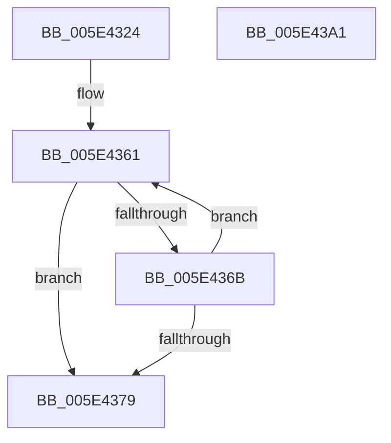

# PspIumAlertMultipleThreadByThreadId

- RVA: `0x005E4324`–`0x005E43A2` (길이 `126` bytes)
- VA: `0x00000001405E4324`
- 실행 섹션: `.text`
- PDB 이름 있음: `예`; PDB Function 태그: `아니요`
- unwind 정보 RVA: `0x000986F8`
- 디코드: `33`개 명령, `126/126` bytes 표시
- 미해석 바이트: `0` (있으면 어셈블리에 `.byte`로 보존)

> 이 문서는 커널 이미지의 기계어와 PDB 기호를 분석해 생성했습니다. 4번과 5번은 함수 원형과 자료형을 바이너리 사용 방식에서 추정한 C 해석이며 원본 소스 복구 결과는 아닙니다.

## 1. Dependencies

- 직접 호출 지점: **3**; 고유 호출 대상: **3**
- 직접 호출자로 확인된 함수: **1**
- RIP 상대 이미지 참조: **1**

### Outgoing calls
- `0x005E434D` → [memset](../6C/memset_function_006C6C40.md) (function, `0x006C6C40`)
- `0x005E4381` → [KeAlertMultipleThreadByThreadId](../5B/KeAlertMultipleThreadByThreadId_function_005B8DA0.md) (function, `0x005B8DA0`)
- `0x005E4393` → [_security_check_cookie](../6A/_security_check_cookie_function_006AC640.md) (function, `0x006AC640`)

### Direct callers
- [sub_006F88AE](../6F/Unknown_function_006F88AE.md) at `0x006F9021`

### Static image references
- `0x005E432D` → RVA `0x00E0A740` (`.data`; read)

## 2. Other-region calls and transfers

- 다른 실행 섹션으로 향하는 call: **0**
- 별도 외부 분기/꼬리 이동을 확인하지 못했습니다.

## 3. Assembly (complete function range)

```asm
005E4324  40 53                           push rbx
005E4326  48 81 EC 90 00 00 00            sub rsp, 0x90
005E432D  48 8B 05 0C 64 82 00            mov rax, qword ptr [rip + 0x82640c]
005E4334  48 33 C4                        xor rax, rsp
005E4337  48 89 84 24 80 00 00 00         mov qword ptr [rsp + 0x80], rax
005E433F  33 D2                           xor edx, edx
005E4341  48 8B D9                        mov rbx, rcx
005E4344  48 8D 4C 24 20                  lea rcx, [rsp + 0x20]
005E4349  44 8D 42 60                     lea r8d, [rdx + 0x60]
005E434D  E8 EE 28 0E 00                  call 0x1406c6c40
005E4352  33 D2                           xor edx, edx
005E4354  48 8D 4C 24 20                  lea rcx, [rsp + 0x20]
005E4359  48 2B D9                        sub rbx, rcx
005E435C  48 8D 44 24 20                  lea rax, [rsp + 0x20]
005E4361  48 8B 4C 03 08                  mov rcx, qword ptr [rbx + rax + 8]
005E4366  48 85 C9                        test rcx, rcx
005E4369  74 0E                           je 0x1405e4379
005E436B  48 89 08                        mov qword ptr [rax], rcx
005E436E  FF C2                           inc edx
005E4370  48 83 C0 08                     add rax, 8
005E4374  83 FA 0C                        cmp edx, 0xc
005E4377  72 E8                           jb 0x1405e4361
005E4379  45 33 C0                        xor r8d, r8d
005E437C  48 8D 4C 24 20                  lea rcx, [rsp + 0x20]
005E4381  E8 1A 4A FD FF                  call 0x1405b8da0
005E4386  33 C0                           xor eax, eax
005E4388  48 8B 8C 24 80 00 00 00         mov rcx, qword ptr [rsp + 0x80]
005E4390  48 33 CC                        xor rcx, rsp
005E4393  E8 A8 82 0C 00                  call 0x1406ac640
005E4398  48 81 C4 90 00 00 00            add rsp, 0x90
005E439F  5B                              pop rbx
005E43A0  C3                              ret
005E43A1  CC                              int3
```

## 4. C-style interpretation (structured pseudocode)

```c
__int64 __fastcall PspIumAlertMultipleThreadByThreadId(__int64 a1, int a2)
{
    __int64 result;
    __int64 v_rbx;
    __int64 v_rsp;
    unsigned __int64 v_stack_m18;
    unsigned __int64 v_stack_m78;

    v_rsp = (v_rsp) - (144);
    result = (*(unsigned __int64 *)(v_rip + 8545292)) ^ (v_rsp);
    v_stack_m18 = result;
    a2 = 0;
    result = memset(v_stack_m78, a2, a2 + 96, a4);
    a2 = 0;
    v_rbx = (a1) - (v_stack_m78);
loc_005E4361:
    if (*(unsigned __int64 *)(v_rbx + v_stack_m78 * 1 + 8) == 0) goto loc_005E4379;
    *(unsigned __int64 *)(v_stack_m78) = *(unsigned __int64 *)(v_rbx + v_stack_m78 * 1 + 8);
    a2 = (unsigned int)((a2) + 1);
    result = (v_stack_m78) + (8);
    if (a2 < 12) goto loc_005E4361;
loc_005E4379:
    a3 = 0;
    result = KeAlertMultipleThreadByThreadId(v_stack_m78, a2, a3, a4);
    result = 0;
    a1 = (v_stack_m18) ^ (v_rsp);
    result = _security_check_cookie(a1, a2, a3, a4);
    v_rsp = (v_rsp) + (144);
    return result;
}
```

## 5. (Beta) C Style

```c
int64_t PspIumAlertMultipleThreadByThreadId(void *Arg1, int32_t Arg2)
{
    uint8_t *arg1 = (uint8_t *)Arg1;

    int64_t result;
    int64_t local_rbx;
    int64_t local_rsp;
    uint64_t v_stack_m18;
    uint64_t v_stack_m78;

    local_rsp = (local_rsp) - (144);
    result = (*(uint64_t *)(v_rip + 0x82640C)) ^ (local_rsp);
    v_stack_m18 = result;
    Arg2 = 0;
    result = memset(v_stack_m78, Arg2, Arg2 + 96, a4);
    Arg2 = 0;
    local_rbx = (Arg1) - (v_stack_m78);
loc_005E4361:
    if (*(uint64_t *)(local_rbx + v_stack_m78 * 1 + 0x8) == 0) goto loc_005E4379;
    *(uint64_t *)(v_stack_m78) = *(uint64_t *)(local_rbx + v_stack_m78 * 1 + 0x8);
    Arg2 = (uint32_t)((Arg2) + 1);
    result = (v_stack_m78) + (8);
    if (Arg2 < 12) goto loc_005E4361;
loc_005E4379:
    a3 = 0;
    result = KeAlertMultipleThreadByThreadId(v_stack_m78, Arg2, a3, a4);
    result = 0;
    Arg1 = (v_stack_m18) ^ (local_rsp);
    result = _security_check_cookie(Arg1, Arg2, a3, a4);
    local_rsp = (local_rsp) + (144);
    return result;
}
```

### 관측된 메모리 오프셋

구조체 형식이 확인되지 않은 접근은 인자 기준의 오프셋으로만 기록했습니다.

| 기준 인자 | 오프셋 표현 | 폭 (bit) | 접근 |
|---|---:|---:|---|
| `Arg1` | `+ 0x8 + rax*1` | `64` | `R` |

## 6. Execution-region graph

[열기: 2D/3D 그래프와 함수 탐색 컨트롤 패널](../../../control-panel.html?section=text&rva=0x005E4324&view=graph)

- 2D 그래프는 위에서 아래로 흐르고, 3D 그래프는 빈 공간을 드래그해 회전합니다. Shift+드래그는 이동, 휠은 확대·축소, 함수 노드 선택은 대상 보고서 이동입니다.

### Static fallback


