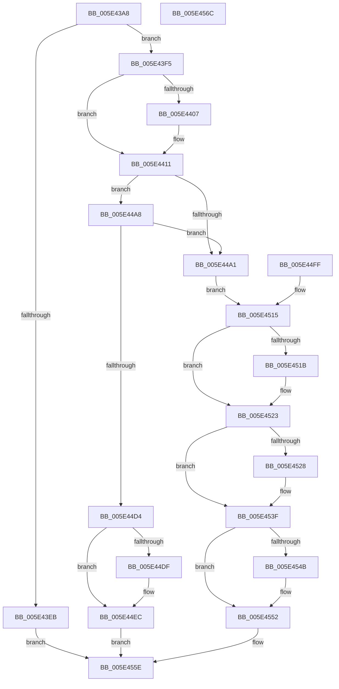

# PspIumAllocatePartitionState

- RVA: `0x005E43A8`–`0x005E456D` (길이 `453` bytes)
- VA: `0x00000001405E43A8`
- 실행 섹션: `.text`
- PDB 이름 있음: `예`; PDB Function 태그: `아니요`
- unwind 정보 RVA: `0x000CF400`
- 디코드: `120`개 명령, `453/453` bytes 표시
- 미해석 바이트: `0` (있으면 어셈블리에 `.byte`로 보존)

> 이 문서는 커널 이미지의 기계어와 PDB 기호를 분석해 생성했습니다. 4번과 5번은 함수 원형과 자료형을 바이너리 사용 방식에서 추정한 C 해석이며 원본 소스 복구 결과는 아닙니다.

## 1. Dependencies

- 직접 호출 지점: **9**; 고유 호출 대상: **7**
- 직접 호출자로 확인된 함수: **1**
- RIP 상대 이미지 참조: **0**

### Outgoing calls
- `0x005E43D9` → [ExAllocatePool2](../../poolcode/B8/ExAllocatePool2_function_00B820F0.md) (function, `0x00B820F0`)
- `0x005E4472` → [MmProbeAndLockPages](../23/MmProbeAndLockPages_function_0023B990.md) (function, `0x0023B990`)
- `0x005E448D` → [ExAllocatePool2](../../poolcode/B8/ExAllocatePool2_function_00B820F0.md) (function, `0x00B820F0`)
- `0x005E44BF` → [MmAllocateNonChargedSecurePages](../2C/MmAllocateNonChargedSecurePages_function_002C886C.md) (function, `0x002C886C`)
- `0x005E44E7` → [ObfReferenceObjectWithTag](../21/ObfReferenceObjectWithTag_function_00210710.md) (function, `0x00210710`)
- `0x005E451E` → [MmUnlockPages](../29/MmUnlockPages_function_0029EEE0.md) (function, `0x0029EEE0`)
- `0x005E453A` → [MmFreeNonChargedSecurePages](../3E/MmFreeNonChargedSecurePages_function_003E9218.md) (function, `0x003E9218`)
- `0x005E454D` → [ExFreePoolWithTag](../../poolcode/B8/ExFreePoolWithTag_function_00B82870.md) (function, `0x00B82870`)
- `0x005E4557` → [ExFreePoolWithTag](../../poolcode/B8/ExFreePoolWithTag_function_00B82870.md) (function, `0x00B82870`)

### Direct callers
- [sub_006F88AE](../6F/Unknown_function_006F88AE.md) at `0x006F8DE3`

### Static image references
- 디코드된 RIP-relative 메모리 참조가 없습니다.

## 2. Other-region calls and transfers

- 다른 실행 섹션으로 향하는 call: **4**
  - `0x005E43D9` → [ExAllocatePool2](../../poolcode/B8/ExAllocatePool2_function_00B820F0.md) (`.text` → `POOLCODE`)
  - `0x005E448D` → [ExAllocatePool2](../../poolcode/B8/ExAllocatePool2_function_00B820F0.md) (`.text` → `POOLCODE`)
  - `0x005E454D` → [ExFreePoolWithTag](../../poolcode/B8/ExFreePoolWithTag_function_00B82870.md) (`.text` → `POOLCODE`)
  - `0x005E4557` → [ExFreePoolWithTag](../../poolcode/B8/ExFreePoolWithTag_function_00B82870.md) (`.text` → `POOLCODE`)
- 별도 외부 분기/꼬리 이동을 확인하지 못했습니다.

## 3. Assembly (complete function range)

```asm
005E43A8  40 53                           push rbx
005E43AA  56                              push rsi
005E43AB  57                              push rdi
005E43AC  41 54                           push r12
005E43AE  41 56                           push r14
005E43B0  41 57                           push r15
005E43B2  48 83 EC 28                     sub rsp, 0x28
005E43B6  48 8B F9                        mov rdi, rcx
005E43B9  4C 8B 71 10                     mov r14, qword ptr [rcx + 0x10]
005E43BD  4C 89 74 24 68                  mov qword ptr [rsp + 0x68], r14
005E43C2  33 F6                           xor esi, esi
005E43C4  44 8B FE                        mov r15d, esi
005E43C7  89 74 24 60                     mov dword ptr [rsp + 0x60], esi
005E43CB  BA A8 00 00 00                  mov edx, 0xa8
005E43D0  8D 4E 40                        lea ecx, [rsi + 0x40]
005E43D3  41 B8 49 75 50 70               mov r8d, 0x70507549
005E43D9  E8 12 DD 59 00                  call 0x140b820f0
005E43DE  48 8B D8                        mov rbx, rax
005E43E1  48 89 44 24 70                  mov qword ptr [rsp + 0x70], rax
005E43E6  48 85 C0                        test rax, rax
005E43E9  75 0A                           jne 0x1405e43f5
005E43EB  B8 9A 00 00 C0                  mov eax, 0xc000009a
005E43F0  E9 69 01 00 00                  jmp 0x1405e455e
005E43F5  4C 89 70 08                     mov qword ptr [rax + 8], r14
005E43F9  8B 47 18                        mov eax, dword ptr [rdi + 0x18]
005E43FC  89 83 98 00 00 00               mov dword ptr [rbx + 0x98], eax
005E4402  83 F8 08                        cmp eax, 8
005E4405  73 0A                           jae 0x1405e4411
005E4407  C7 83 98 00 00 00 08 00 00 00   mov dword ptr [rbx + 0x98], 8
005E4411  4C 8D 63 60                     lea r12, [rbx + 0x60]
005E4415  4C 89 64 24 78                  mov qword ptr [rsp + 0x78], r12
005E441A  49 89 34 24                     mov qword ptr [r12], rsi
005E441E  0F B7 C3                        movzx eax, bx
005E4421  BA FF 0F 00 00                  mov edx, 0xfff
005E4426  66 23 C2                        and ax, dx
005E4429  B9 A7 10 00 00                  mov ecx, 0x10a7
005E442E  66 03 C1                        add ax, cx
005E4431  66 C1 E8 0C                     shr ax, 0xc
005E4435  66 83 C0 06                     add ax, 6
005E4439  66 C1 E0 03                     shl ax, 3
005E443D  66 41 89 44 24 08               mov word ptr [r12 + 8], ax
005E4443  66 41 89 74 24 0A               mov word ptr [r12 + 0xa], si
005E4449  48 8B C3                        mov rax, rbx
005E444C  48 25 00 F0 FF FF               and rax, 0xfffffffffffff000
005E4452  49 89 44 24 20                  mov qword ptr [r12 + 0x20], rax
005E4457  8B C3                           mov eax, ebx
005E4459  23 C2                           and eax, edx
005E445B  41 89 44 24 2C                  mov dword ptr [r12 + 0x2c], eax
005E4460  41 C7 44 24 28 A8 00 00 00      mov dword ptr [r12 + 0x28], 0xa8
005E4469  33 D2                           xor edx, edx
005E446B  44 8D 42 02                     lea r8d, [rdx + 2]
005E446F  49 8B CC                        mov rcx, r12
005E4472  E8 19 75 C5 FF                  call 0x14023b990
005E4477  90                              nop
005E4478  8B 93 98 00 00 00               mov edx, dword ptr [rbx + 0x98]
005E447E  48 C1 E2 03                     shl rdx, 3
005E4482  B9 40 00 00 00                  mov ecx, 0x40
005E4487  41 B8 49 75 50 61               mov r8d, 0x61507549
005E448D  E8 5E DC 59 00                  call 0x140b820f0
005E4492  4C 8B C8                        mov r9, rax
005E4495  48 89 83 A0 00 00 00            mov qword ptr [rbx + 0xa0], rax
005E449C  48 85 C0                        test rax, rax
005E449F  75 07                           jne 0x1405e44a8
005E44A1  BF 9A 00 00 C0                  mov edi, 0xc000009a
005E44A6  EB 6D                           jmp 0x1405e4515
005E44A8  8B 83 98 00 00 00               mov eax, dword ptr [rbx + 0x98]
005E44AE  89 44 24 60                     mov dword ptr [rsp + 0x60], eax
005E44B2  4C 8D 44 24 60                  lea r8, [rsp + 0x60]
005E44B7  BA 01 00 00 00                  mov edx, 1
005E44BC  49 8B CE                        mov rcx, r14
005E44BF  E8 A8 43 CE FF                  call 0x1402c886c
005E44C4  8B 83 98 00 00 00               mov eax, dword ptr [rbx + 0x98]
005E44CA  44 8B 7C 24 60                  mov r15d, dword ptr [rsp + 0x60]
005E44CF  41 3B C7                        cmp eax, r15d
005E44D2  75 CD                           jne 0x1405e44a1
005E44D4  89 83 9C 00 00 00               mov dword ptr [rbx + 0x9c], eax
005E44DA  4D 85 F6                        test r14, r14
005E44DD  74 0D                           je 0x1405e44ec
005E44DF  BA 44 66 6C 74                  mov edx, 0x746c6644
005E44E4  49 8B CE                        mov rcx, r14
005E44E7  E8 24 C2 C2 FF                  call 0x140210710
005E44EC  48 89 5F 10                     mov qword ptr [rdi + 0x10], rbx
005E44F0  48 8B 83 90 00 00 00            mov rax, qword ptr [rbx + 0x90]
005E44F7  48 89 47 18                     mov qword ptr [rdi + 0x18], rax
005E44FB  33 C0                           xor eax, eax
005E44FD  EB 5F                           jmp 0x1405e455e
005E44FF  8B F8                           mov edi, eax
005E4501  4C 8B 74 24 68                  mov r14, qword ptr [rsp + 0x68]
005E4506  48 8B 5C 24 70                  mov rbx, qword ptr [rsp + 0x70]
005E450B  44 8B 7C 24 60                  mov r15d, dword ptr [rsp + 0x60]
005E4510  4C 8B 64 24 78                  mov r12, qword ptr [rsp + 0x78]
005E4515  F6 43 6A 02                     test byte ptr [rbx + 0x6a], 2
005E4519  74 08                           je 0x1405e4523
005E451B  49 8B CC                        mov rcx, r12
005E451E  E8 BD A9 CB FF                  call 0x14029eee0
005E4523  45 85 FF                        test r15d, r15d
005E4526  74 17                           je 0x1405e453f
005E4528  4C 8B 8B A0 00 00 00            mov r9, qword ptr [rbx + 0xa0]
005E452F  45 8B C7                        mov r8d, r15d
005E4532  BA 01 00 00 00                  mov edx, 1
005E4537  49 8B CE                        mov rcx, r14
005E453A  E8 D9 4C E0 FF                  call 0x1403e9218
005E453F  48 8B 8B A0 00 00 00            mov rcx, qword ptr [rbx + 0xa0]
005E4546  48 85 C9                        test rcx, rcx
005E4549  74 07                           je 0x1405e4552
005E454B  33 D2                           xor edx, edx
005E454D  E8 1E E3 59 00                  call 0x140b82870
005E4552  33 D2                           xor edx, edx
005E4554  48 8B CB                        mov rcx, rbx
005E4557  E8 14 E3 59 00                  call 0x140b82870
005E455C  8B C7                           mov eax, edi
005E455E  48 83 C4 28                     add rsp, 0x28
005E4562  41 5F                           pop r15
005E4564  41 5E                           pop r14
005E4566  41 5C                           pop r12
005E4568  5F                              pop rdi
005E4569  5E                              pop rsi
005E456A  5B                              pop rbx
005E456B  C3                              ret
005E456C  CC                              int3
```

## 4. C-style interpretation (structured pseudocode)

```c
__int64 __fastcall PspIumAllocatePartitionState(__int64 a1)
{
    __int64 result;
    __int64 v_rsi;
    __int64 v_rsp;
    unsigned __int64 v_stack_p10;
    unsigned __int64 v_stack_p18;
    unsigned __int64 v_stack_p20;
    unsigned int v_stack_p8;

    v_rsp = (v_rsp) - (40);
    v_stack_p10 = *(unsigned __int64 *)(a1 + 16);
    v_rsi = 0;
    v_stack_p8 = 0;
    result = ExAllocatePool2(v_rsi + 64, 168, (unsigned int)(0x70507549ULL), a4);
    v_stack_p18 = result;
    if (result != 0) goto loc_005E43F5;
    goto loc_005E455E;
loc_005E43F5:
    *(unsigned __int64 *)((unsigned int)(0xC000009AULL) + 8) = *(unsigned __int64 *)(a1 + 16);
    *(unsigned int *)(result + 152) = (unsigned int)((unsigned int)(*(unsigned int *)(a1 + 24)));
    if (((unsigned int)((unsigned int)(*(unsigned int *)(a1 + 24)))) < 8) {
        *(unsigned int *)(result + 152) = 8;
    }
    v_stack_p20 = result + 96;
    *(unsigned __int64 *)(result + 96) = 0;
    result = (unsigned __int16)(((unsigned __int16)(result)) & ((unsigned __int16)((unsigned int)(0xFFFULL))));
    result = (unsigned __int16)((result) + ((unsigned __int16)((unsigned int)(0x10A7ULL))));
    result = (unsigned __int16)((result) >> (12));
    result = (unsigned __int16)((result) + (6));
    result = (unsigned __int16)((result) << (3));
    *(unsigned __int16 *)(result + 96 + 8) = (unsigned __int16)(result);
    *(unsigned __int16 *)(result + 96 + 10) = 0;
    result = (result) & (0xFFFFFFFFFFFFF000ULL);
    *(unsigned __int64 *)(result + 96 + 32) = result;
    result = (unsigned int)(((unsigned int)((unsigned int)(result))) & ((unsigned int)((unsigned int)(0xFFFULL))));
    *(unsigned int *)(result + 96 + 44) = (unsigned int)(result);
    *(unsigned int *)(result + 96 + 40) = 168;
    a2 = 0;
    result = MmProbeAndLockPages(result + 96, a2, a2 + 2, a4);
    a2 = ((unsigned int)(*(unsigned int *)(result + 152))) << (3);
    result = ExAllocatePool2(64, a2, (unsigned int)(0x61507549ULL), a4);
    *(unsigned __int64 *)(result + 160) = result;
    if (result != 0) goto loc_005E44A8;
loc_005E44A1:
    goto loc_005E4515;
loc_005E44A8:
    v_stack_p8 = (unsigned int)((unsigned int)(*(unsigned int *)(result + 152)));
    result = MmAllocateNonChargedSecurePages(*(unsigned __int64 *)(a1 + 16), 1, v_stack_p8, result);
    if (((unsigned int)((unsigned int)(*(unsigned int *)(result + 152)))) != ((unsigned int)((unsigned int)(v_stack_p8)))) goto loc_005E44A1;
    *(unsigned int *)(result + 156) = (unsigned int)((unsigned int)(*(unsigned int *)(result + 152)));
    result = (unsigned int)(*(unsigned int *)(result + 152));
    if (*(unsigned __int64 *)(a1 + 16) != 0) {
        a2 = 0x746C6644ULL;
        a1 = *(unsigned __int64 *)(a1 + 16);
        result = ObfReferenceObjectWithTag(a1, a2, v_stack_p8, result);
    }
    *(unsigned __int64 *)((unsigned int)(0xC000009AULL) + 16) = result;
    *(unsigned __int64 *)((unsigned int)(0xC000009AULL) + 24) = *(unsigned __int64 *)(result + 144);
    result = 0;
    goto loc_005E455E;
loc_005E4515:
    if (((*(unsigned __int8 *)(result + 106)) & (2)) != 0) {
        a1 = result + 96;
        result = MmUnlockPages(a1, a2, v_stack_p8, result);
    }
    if ((unsigned int)((unsigned int)(v_stack_p8)) != 0) {
        a4 = *(unsigned __int64 *)(result + 160);
        a3 = (unsigned int)((unsigned int)(v_stack_p8));
        a2 = 1;
        a1 = *(unsigned __int64 *)(a1 + 16);
        result = MmFreeNonChargedSecurePages(a1, a2, a3, a4);
    }
    if (*(unsigned __int64 *)(result + 160) != 0) {
        a2 = 0;
        result = ExFreePoolWithTag(*(unsigned __int64 *)(result + 160), a2, a3, a4);
    }
    a2 = 0;
    result = ExFreePoolWithTag(result, a2, a3, a4);
loc_005E455E:
    v_rsp = (v_rsp) + (40);
    return (unsigned int)((unsigned int)((unsigned int)(0xC000009AULL)));
}
```

## 5. (Beta) C Style

```c
int64_t PspIumAllocatePartitionState(void *Arg1)
{
    uint8_t *arg1 = (uint8_t *)Arg1;

    int64_t result;
    int64_t local_rsi;
    int64_t local_rsp;
    uint64_t v_stack_p10;
    uint64_t v_stack_p18;
    uint64_t v_stack_p20;
    uint32_t v_stack_p8;

    local_rsp = (local_rsp) - (40);
    v_stack_p10 = *(uint64_t *)(arg1 + 0x10);
    local_rsi = 0;
    v_stack_p8 = 0;
    result = ExAllocatePool2(local_rsi + 64, 168, (uint32_t)(0x70507549ULL), a4);
    v_stack_p18 = result;
    if (result != 0) goto loc_005E43F5;
    goto loc_005E455E;
loc_005E43F5:
    *(uint64_t *)((uint32_t)(0xC000009AULL) + 0x8) = *(uint64_t *)(arg1 + 0x10);
    *(uint32_t *)(result + 0x98) = (uint32_t)((uint32_t)(*(uint32_t *)(arg1 + 0x18)));
    if (((uint32_t)((uint32_t)(*(uint32_t *)(arg1 + 0x18)))) < 8) {
        *(uint32_t *)(result + 0x98) = 8;
    }
    v_stack_p20 = result + 96;
    *(uint64_t *)(result + 0x60) = 0;
    result = (uint16_t)(((uint16_t)(result)) & ((uint16_t)((uint32_t)(0xFFFULL))));
    result = (uint16_t)((result) + ((uint16_t)((uint32_t)(0x10A7ULL))));
    result = (uint16_t)((result) >> (12));
    result = (uint16_t)((result) + (6));
    result = (uint16_t)((result) << (3));
    *(uint16_t *)(result + 0x60 + 0x8) = (uint16_t)(result);
    *(uint16_t *)(result + 0x60 + 0xA) = 0;
    result = (result) & (0xFFFFFFFFFFFFF000ULL);
    *(uint64_t *)(result + 0x60 + 0x20) = result;
    result = (uint32_t)(((uint32_t)((uint32_t)(result))) & ((uint32_t)((uint32_t)(0xFFFULL))));
    *(uint32_t *)(result + 0x60 + 0x2C) = (uint32_t)(result);
    *(uint32_t *)(result + 0x60 + 0x28) = 168;
    a2 = 0;
    result = MmProbeAndLockPages(result + 96, a2, a2 + 2, a4);
    a2 = ((uint32_t)(*(uint32_t *)(result + 0x98))) << (3);
    result = ExAllocatePool2(64, a2, (uint32_t)(0x61507549ULL), a4);
    *(uint64_t *)(result + 0xA0) = result;
    if (result != 0) goto loc_005E44A8;
loc_005E44A1:
    goto loc_005E4515;
loc_005E44A8:
    v_stack_p8 = (uint32_t)((uint32_t)(*(uint32_t *)(result + 0x98)));
    result = MmAllocateNonChargedSecurePages(*(uint64_t *)(arg1 + 0x10), 1, v_stack_p8, result);
    if (((uint32_t)((uint32_t)(*(uint32_t *)(result + 0x98)))) != ((uint32_t)((uint32_t)(v_stack_p8)))) goto loc_005E44A1;
    *(uint32_t *)(result + 0x9C) = (uint32_t)((uint32_t)(*(uint32_t *)(result + 0x98)));
    result = (uint32_t)(*(uint32_t *)(result + 0x98));
    if (*(uint64_t *)(arg1 + 0x10) != 0) {
        a2 = 0x746C6644ULL;
        Arg1 = *(uint64_t *)(arg1 + 0x10);
        result = ObfReferenceObjectWithTag(Arg1, a2, v_stack_p8, result);
    }
    *(uint64_t *)((uint32_t)(0xC000009AULL) + 0x10) = result;
    *(uint64_t *)((uint32_t)(0xC000009AULL) + 0x18) = *(uint64_t *)(result + 0x90);
    result = 0;
    goto loc_005E455E;
loc_005E4515:
    if (((*(uint8_t *)(result + 0x6A)) & (2)) != 0) {
        Arg1 = result + 96;
        result = MmUnlockPages(Arg1, a2, v_stack_p8, result);
    }
    if ((uint32_t)((uint32_t)(v_stack_p8)) != 0) {
        a4 = *(uint64_t *)(result + 0xA0);
        a3 = (uint32_t)((uint32_t)(v_stack_p8));
        a2 = 1;
        Arg1 = *(uint64_t *)(arg1 + 0x10);
        result = MmFreeNonChargedSecurePages(Arg1, a2, a3, a4);
    }
    if (*(uint64_t *)(result + 0xA0) != 0) {
        a2 = 0;
        result = ExFreePoolWithTag(*(uint64_t *)(result + 0xA0), a2, a3, a4);
    }
    a2 = 0;
    result = ExFreePoolWithTag(result, a2, a3, a4);
loc_005E455E:
    local_rsp = (local_rsp) + (40);
    return (uint32_t)((uint32_t)((uint32_t)(0xC000009AULL)));
}
```

### 관측된 메모리 오프셋

구조체 형식이 확인되지 않은 접근은 인자 기준의 오프셋으로만 기록했습니다.

| 기준 인자 | 오프셋 표현 | 폭 (bit) | 접근 |
|---|---:|---:|---|
| `Arg1` | `+ 0x10` | `64` | `R` |
| `Arg1` | `+ 0x10` | `64` | `W` |
| `Arg1` | `+ 0x18` | `32` | `R` |
| `Arg1` | `+ 0x18` | `64` | `W` |

## 6. Execution-region graph

[열기: 2D/3D 그래프와 함수 탐색 컨트롤 패널](../../../control-panel.html?section=text&rva=0x005E43A8&view=graph)

- 2D 그래프는 위에서 아래로 흐르고, 3D 그래프는 빈 공간을 드래그해 회전합니다. Shift+드래그는 이동, 휠은 확대·축소, 함수 노드 선택은 대상 보고서 이동입니다.

### Static fallback


