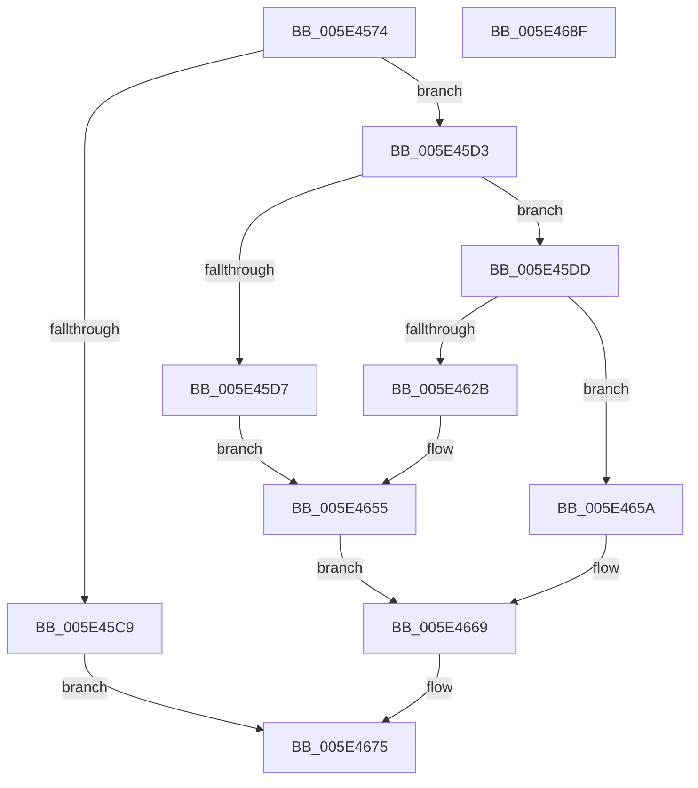

# PspIumAllocatePhysicalPages

- RVA: `0x005E4574`–`0x005E4690` (길이 `284` bytes)
- VA: `0x00000001405E4574`
- 실행 섹션: `.text`
- PDB 이름 있음: `예`; PDB Function 태그: `아니요`
- unwind 정보 RVA: `0x000CF3E4`
- 디코드: `80`개 명령, `284/284` bytes 표시
- 미해석 바이트: `0` (있으면 어셈블리에 `.byte`로 보존)

> 이 문서는 커널 이미지의 기계어와 PDB 기호를 분석해 생성했습니다. 4번과 5번은 함수 원형과 자료형을 바이너리 사용 방식에서 추정한 C 해석이며 원본 소스 복구 결과는 아닙니다.

## 1. Dependencies

- 직접 호출 지점: **6**; 고유 호출 대상: **6**
- 직접 호출자로 확인된 함수: **1**
- RIP 상대 이미지 참조: **0**

### Outgoing calls
- `0x005E45BA` → [MmAllocateSecureKernelPages](../68/MmAllocateSecureKernelPages_function_0068F394.md) (function, `0x0068F394`)
- `0x005E461E` → [MmMapLockedPagesSpecifyCache](../31/MmMapLockedPagesSpecifyCache_function_00318800.md) (function, `0x00318800`)
- `0x005E4639` → [memcpy](../6C/memcpy_function_006C6840.md) (function, `0x006C6840`)
- `0x005E464C` → [MmUnmapLockedPages](../24/MmUnmapLockedPages_function_00246E60.md) (function, `0x00246E60`)
- `0x005E465F` → [MmFreeSecureKernelPages](../3E/MmFreeSecureKernelPages_function_003E7A98.md) (function, `0x003E7A98`)
- `0x005E466E` → [ExFreePoolWithTag](../../poolcode/B8/ExFreePoolWithTag_function_00B82870.md) (function, `0x00B82870`)

### Direct callers
- [PsDispatchIumService](../4A/PsDispatchIumService_function_004A2F0C.md) at `0x004A31A3`

### Static image references
- 디코드된 RIP-relative 메모리 참조가 없습니다.

## 2. Other-region calls and transfers

- 다른 실행 섹션으로 향하는 call: **1**
  - `0x005E466E` → [ExFreePoolWithTag](../../poolcode/B8/ExFreePoolWithTag_function_00B82870.md) (`.text` → `POOLCODE`)
- 별도 외부 분기/꼬리 이동을 확인하지 못했습니다.

## 3. Assembly (complete function range)

```asm
005E4574  4C 8B DC                        mov r11, rsp
005E4577  49 89 5B 08                     mov qword ptr [r11 + 8], rbx
005E457B  49 89 73 10                     mov qword ptr [r11 + 0x10], rsi
005E457F  49 89 7B 18                     mov qword ptr [r11 + 0x18], rdi
005E4583  55                              push rbp
005E4584  41 56                           push r14
005E4586  41 57                           push r15
005E4588  48 8B EC                        mov rbp, rsp
005E458B  48 83 EC 70                     sub rsp, 0x70
005E458F  0F 57 C0                        xorps xmm0, xmm0
005E4592  33 C0                           xor eax, eax
005E4594  4C 8B D2                        mov r10, rdx
005E4597  48 89 45 F0                     mov qword ptr [rbp - 0x10], rax
005E459B  48 8B 45 40                     mov rax, qword ptr [rbp + 0x40]
005E459F  8D 51 01                        lea edx, [rcx + 1]
005E45A2  8B F1                           mov esi, ecx
005E45A4  49 89 43 98                     mov qword ptr [r11 - 0x68], rax
005E45A8  49 8B CA                        mov rcx, r10
005E45AB  4D 8B F9                        mov r15, r9
005E45AE  0F 11 45 C0                     movups xmmword ptr [rbp - 0x40], xmm0
005E45B2  0F 11 45 D0                     movups xmmword ptr [rbp - 0x30], xmm0
005E45B6  0F 11 45 E0                     movups xmmword ptr [rbp - 0x20], xmm0
005E45BA  E8 D5 AD 0A 00                  call 0x14068f394
005E45BF  33 DB                           xor ebx, ebx
005E45C1  48 8B F8                        mov rdi, rax
005E45C4  48 85 C0                        test rax, rax
005E45C7  75 0A                           jne 0x1405e45d3
005E45C9  B8 17 00 00 C0                  mov eax, 0xc0000017
005E45CE  E9 A2 00 00 00                  jmp 0x1405e4675
005E45D3  85 F6                           test esi, esi
005E45D5  75 06                           jne 0x1405e45dd
005E45D7  48 8B 40 30                     mov rax, qword ptr [rax + 0x30]
005E45DB  EB 78                           jmp 0x1405e4655
005E45DD  44 8B 70 28                     mov r14d, dword ptr [rax + 0x28]
005E45E1  48 8D 4D C0                     lea rcx, [rbp - 0x40]
005E45E5  45 33 C9                        xor r9d, r9d
005E45E8  C7 45 C8 38 00 02 00            mov dword ptr [rbp - 0x38], 0x20038
005E45EF  48 89 5D E0                     mov qword ptr [rbp - 0x20], rbx
005E45F3  33 D2                           xor edx, edx
005E45F5  48 C7 45 E8 00 10 00 00         mov qword ptr [rbp - 0x18], 0x1000
005E45FD  41 C1 EE 0C                     shr r14d, 0xc
005E4601  C7 44 24 28 10 00 00 40         mov dword ptr [rsp + 0x28], 0x40000010
005E4609  45 8D 41 01                     lea r8d, [r9 + 1]
005E460D  89 5C 24 20                     mov dword ptr [rsp + 0x20], ebx
005E4611  41 8D 46 FF                     lea eax, [r14 - 1]
005E4615  48 8B 44 C7 30                  mov rax, qword ptr [rdi + rax*8 + 0x30]
005E461A  48 89 45 F0                     mov qword ptr [rbp - 0x10], rax
005E461E  E8 DD 41 D3 FF                  call 0x140318800
005E4623  48 8B F0                        mov rsi, rax
005E4626  48 85 C0                        test rax, rax
005E4629  74 2F                           je 0x1405e465a
005E462B  4E 8D 04 F5 30 00 00 00         lea r8, [r14*8 + 0x30]
005E4633  48 8B D7                        mov rdx, rdi
005E4636  48 8B C8                        mov rcx, rax
005E4639  E8 02 22 0E 00                  call 0x1406c6840
005E463E  81 46 28 00 F0 FF FF            add dword ptr [rsi + 0x28], 0xfffff000
005E4645  48 8D 55 C0                     lea rdx, [rbp - 0x40]
005E4649  48 8B CE                        mov rcx, rsi
005E464C  E8 0F 28 C6 FF                  call 0x140246e60
005E4651  48 8B 45 F0                     mov rax, qword ptr [rbp - 0x10]
005E4655  49 89 07                        mov qword ptr [r15], rax
005E4658  EB 0F                           jmp 0x1405e4669
005E465A  33 D2                           xor edx, edx
005E465C  48 8B CF                        mov rcx, rdi
005E465F  E8 34 34 E0 FF                  call 0x1403e7a98
005E4664  BB 9A 00 00 C0                  mov ebx, 0xc000009a
005E4669  33 D2                           xor edx, edx
005E466B  48 8B CF                        mov rcx, rdi
005E466E  E8 FD E1 59 00                  call 0x140b82870
005E4673  8B C3                           mov eax, ebx
005E4675  4C 8D 5C 24 70                  lea r11, [rsp + 0x70]
005E467A  49 8B 5B 20                     mov rbx, qword ptr [r11 + 0x20]
005E467E  49 8B 73 28                     mov rsi, qword ptr [r11 + 0x28]
005E4682  49 8B 7B 30                     mov rdi, qword ptr [r11 + 0x30]
005E4686  49 8B E3                        mov rsp, r11
005E4689  41 5F                           pop r15
005E468B  41 5E                           pop r14
005E468D  5D                              pop rbp
005E468E  C3                              ret
005E468F  CC                              int3
```

## 4. C-style interpretation (structured pseudocode)

```c
__int64 __fastcall PspIumAllocatePhysicalPages(__int64 a1, __int64 a2, __int64 a3, __int64 a4, __int64 a5)
{
    __int64 result;
    __int64 v_r14;
    __int64 v_rbx;
    __int64 v_rsp;
    unsigned __int64 v_stack_m18;
    unsigned __int64 v_stack_m28;
    unsigned __int64 v_stack_m30;
    unsigned __int64 v_stack_m38;
    unsigned __int64 v_stack_m48;
    unsigned int v_stack_m50;
    unsigned __int64 v_stack_m58;
    unsigned int v_stack_m60;
    unsigned int v_stack_m68;

    *(unsigned __int64 *)(v_rsp + 8) = v_rbx;
    *(unsigned __int64 *)(v_rsp + 16) = v_rsi;
    *(unsigned __int64 *)(v_rsp + 24) = v_rdi;
    v_rsp = (v_rsp) - (112);
    result = 0;
    v_stack_m28 = 0;
    *(unsigned __int64 *)(v_rsp - 104) = a5;
    v_stack_m58 = v_xmm0;
    v_stack_m48 = v_xmm0;
    v_stack_m38 = v_xmm0;
    result = MmAllocateSecureKernelPages(a2, a1 + 1, a3, a4);
    v_rbx = 0;
    if (result != 0) goto loc_005E45D3;
    goto loc_005E4675;
loc_005E45D3:
    if ((unsigned int)((unsigned int)((unsigned int)(a1))) != 0) goto loc_005E45DD;
    goto loc_005E4655;
loc_005E45DD:
    a4 = 0;
    v_stack_m50 = 0x20038ULL;
    v_stack_m38 = 0;
    a2 = 0;
    v_stack_m30 = 0x1000ULL;
    v_r14 = (unsigned int)(((unsigned int)(*(unsigned int *)(*(unsigned __int64 *)((unsigned int)(0xC0000017ULL) + 48) + 40))) >> (12));
    v_stack_m60 = 0x40000010ULL;
    v_stack_m68 = 0;
    v_stack_m28 = *(unsigned __int64 *)(result + v_r14 - 1 * 8 + 48);
    result = MmMapLockedPagesSpecifyCache(v_stack_m58, a2, a4 + 1, a4);
    if (result == 0) goto loc_005E465A;
    result = memcpy(result, result, v_r14 * 8 + 48, a4);
    result = MmUnmapLockedPages(result, v_stack_m58, v_r14 * 8 + 48, a4);
loc_005E4655:
    *(unsigned __int64 *)(a4) = v_stack_m28;
    goto loc_005E4669;
loc_005E465A:
    a2 = 0;
    result = MmFreeSecureKernelPages(result, a2, v_r14 * 8 + 48, a4);
loc_005E4669:
    a2 = 0;
    result = ExFreePoolWithTag(result, a2, v_r14 * 8 + 48, a4);
loc_005E4675:
    return (unsigned int)((unsigned int)((unsigned int)(0xC000009AULL)));
}
```

## 5. (Beta) C Style

```c
int64_t PspIumAllocatePhysicalPages(void *Arg1, int64_t Arg2, int64_t Arg3, void *Arg4, int64_t Arg5)
{
    uint8_t *arg1 = (uint8_t *)Arg1;
    uint8_t *arg4 = (uint8_t *)Arg4;

    int64_t result;
    int64_t local_r14;
    int64_t local_rbx;
    int64_t local_rsp;
    uint64_t v_stack_m18;
    uint64_t v_stack_m28;
    uint64_t v_stack_m30;
    uint64_t v_stack_m38;
    uint64_t v_stack_m48;
    uint32_t v_stack_m50;
    uint64_t v_stack_m58;
    uint32_t v_stack_m60;
    uint32_t v_stack_m68;

    *(uint64_t *)(local_rsp + 0x8) = local_rbx;
    *(uint64_t *)(local_rsp + 0x10) = local_rsi;
    *(uint64_t *)(local_rsp + 0x18) = local_rdi;
    local_rsp = (local_rsp) - (112);
    result = 0;
    v_stack_m28 = 0;
    *(uint64_t *)(local_rsp - 0x68) = Arg5;
    v_stack_m58 = v_xmm0;
    v_stack_m48 = v_xmm0;
    v_stack_m38 = v_xmm0;
    result = MmAllocateSecureKernelPages(Arg2, Arg1 + 1, Arg3, Arg4);
    local_rbx = 0;
    if (result != 0) goto loc_005E45D3;
    goto loc_005E4675;
loc_005E45D3:
    if ((uint32_t)((uint32_t)((uint32_t)(Arg1))) != 0) goto loc_005E45DD;
    goto loc_005E4655;
loc_005E45DD:
    Arg4 = 0;
    v_stack_m50 = 0x20038ULL;
    v_stack_m38 = 0;
    Arg2 = 0;
    v_stack_m30 = 0x1000ULL;
    local_r14 = (uint32_t)(((uint32_t)(*(uint32_t *)(*(uint64_t *)((uint32_t)(0xC0000017ULL) + 0x30) + 0x28))) >> (12));
    v_stack_m60 = 0x40000010ULL;
    v_stack_m68 = 0;
    v_stack_m28 = *(uint64_t *)(result + local_r14 - 0x1 * 8 + 0x30);
    result = MmMapLockedPagesSpecifyCache(v_stack_m58, Arg2, Arg4 + 1, Arg4);
    if (result == 0) goto loc_005E465A;
    result = memcpy(result, result, local_r14 * 8 + 48, Arg4);
    result = MmUnmapLockedPages(result, v_stack_m58, local_r14 * 8 + 48, Arg4);
loc_005E4655:
    *(uint64_t *)(arg4) = v_stack_m28;
    goto loc_005E4669;
loc_005E465A:
    Arg2 = 0;
    result = MmFreeSecureKernelPages(result, Arg2, local_r14 * 8 + 48, Arg4);
loc_005E4669:
    Arg2 = 0;
    result = ExFreePoolWithTag(result, Arg2, local_r14 * 8 + 48, Arg4);
loc_005E4675:
    return (uint32_t)((uint32_t)((uint32_t)(0xC000009AULL)));
}
```

### 관측된 메모리 오프셋

구조체 형식이 확인되지 않은 접근은 인자 기준의 오프셋으로만 기록했습니다.

| 기준 인자 | 오프셋 표현 | 폭 (bit) | 접근 |
|---|---:|---:|---|
| `Arg1` | `+ 0x1` | `32` | `R` |
| `Arg4` | `+ 0x0` | `64` | `W` |

## 6. Execution-region graph

[열기: 2D/3D 그래프와 함수 탐색 컨트롤 패널](../../../control-panel.html?section=text&rva=0x005E4574&view=graph)

- 2D 그래프는 위에서 아래로 흐르고, 3D 그래프는 빈 공간을 드래그해 회전합니다. Shift+드래그는 이동, 휠은 확대·축소, 함수 노드 선택은 대상 보고서 이동입니다.

### Static fallback


