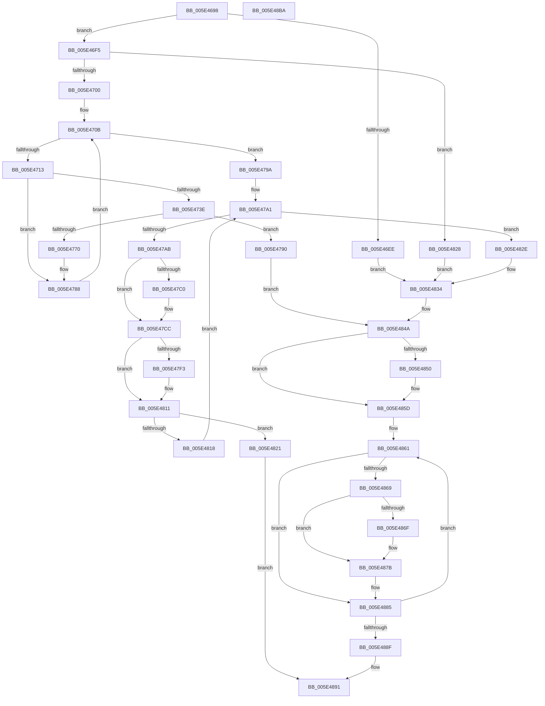

# PspIumAllocateSecurePool

- RVA: `0x005E4698`–`0x005E48BB` (길이 `547` bytes)
- VA: `0x00000001405E4698`
- 실행 섹션: `.text`
- PDB 이름 있음: `예`; PDB Function 태그: `아니요`
- unwind 정보 RVA: `0x000CF3B0`
- 디코드: `143`개 명령, `547/547` bytes 표시
- 미해석 바이트: `0` (있으면 어셈블리에 `.byte`로 보존)

> 이 문서는 커널 이미지의 기계어와 PDB 기호를 분석해 생성했습니다. 4번과 5번은 함수 원형과 자료형을 바이너리 사용 방식에서 추정한 C 해석이며 원본 소스 복구 결과는 아닙니다.

## 1. Dependencies

- 직접 호출 지점: **9**; 고유 호출 대상: **7**
- 직접 호출자로 확인된 함수: **1**
- RIP 상대 이미지 참조: **1**

### Outgoing calls
- `0x005E4761` → [ExAllocatePool2](../../poolcode/B8/ExAllocatePool2_function_00B820F0.md) (function, `0x00B820F0`)
- `0x005E47C7` → [MmUnmapLockedPages](../24/MmUnmapLockedPages_function_00246E60.md) (function, `0x00246E60`)
- `0x005E47E7` → [memcpy](../6C/memcpy_function_006C6840.md) (function, `0x006C6840`)
- `0x005E480C` → [MmMapLockedPagesSpecifyCache](../31/MmMapLockedPagesSpecifyCache_function_00318800.md) (function, `0x00318800`)
- `0x005E4843` → [MmAllocateSecurePoolMemory](../68/MmAllocateSecurePoolMemory_function_00682CC8.md) (function, `0x00682CC8`)
- `0x005E4858` → [MmUnmapLockedPages](../24/MmUnmapLockedPages_function_00246E60.md) (function, `0x00246E60`)
- `0x005E4876` → [MmUnmapLockedPages](../24/MmUnmapLockedPages_function_00246E60.md) (function, `0x00246E60`)
- `0x005E4880` → [ExFreePoolWithTag](../../poolcode/B8/ExFreePoolWithTag_function_00B82870.md) (function, `0x00B82870`)
- `0x005E4898` → [_security_check_cookie](../6A/_security_check_cookie_function_006AC640.md) (function, `0x006AC640`)

### Direct callers
- [sub_006F88AE](../6F/Unknown_function_006F88AE.md) at `0x006F8B87`

### Static image references
- `0x005E46B7` → RVA `0x00E0A740` (`.data`; read)

## 2. Other-region calls and transfers

- 다른 실행 섹션으로 향하는 call: **2**
  - `0x005E4761` → [ExAllocatePool2](../../poolcode/B8/ExAllocatePool2_function_00B820F0.md) (`.text` → `POOLCODE`)
  - `0x005E4880` → [ExFreePoolWithTag](../../poolcode/B8/ExFreePoolWithTag_function_00B82870.md) (`.text` → `POOLCODE`)
- 별도 외부 분기/꼬리 이동을 확인하지 못했습니다.

## 3. Assembly (complete function range)

```asm
005E4698  48 89 74 24 10                  mov qword ptr [rsp + 0x10], rsi
005E469D  48 89 7C 24 18                  mov qword ptr [rsp + 0x18], rdi
005E46A2  55                              push rbp
005E46A3  41 54                           push r12
005E46A5  41 55                           push r13
005E46A7  41 56                           push r14
005E46A9  41 57                           push r15
005E46AB  48 8D 6C 24 C9                  lea rbp, [rsp - 0x37]
005E46B0  48 81 EC A0 00 00 00            sub rsp, 0xa0
005E46B7  48 8B 05 82 60 82 00            mov rax, qword ptr [rip + 0x826082]
005E46BE  48 33 C4                        xor rax, rsp
005E46C1  48 89 45 27                     mov qword ptr [rbp + 0x27], rax
005E46C5  0F 57 C0                        xorps xmm0, xmm0
005E46C8  33 C0                           xor eax, eax
005E46CA  F7 41 28 00 20 00 00            test dword ptr [rcx + 0x28], 0x2000
005E46D1  48 8B F9                        mov rdi, rcx
005E46D4  0F 11 45 D7                     movups xmmword ptr [rbp - 0x29], xmm0
005E46D8  48 89 45 07                     mov qword ptr [rbp + 7], rax
005E46DC  44 8D 60 02                     lea r12d, [rax + 2]
005E46E0  0F 11 45 E7                     movups xmmword ptr [rbp - 0x19], xmm0
005E46E4  0F 11 45 F7                     movups xmmword ptr [rbp - 9], xmm0
005E46E8  0F 11 45 C7                     movups xmmword ptr [rbp - 0x39], xmm0
005E46EC  74 07                           je 0x1405e46f5
005E46EE  33 F6                           xor esi, esi
005E46F0  E9 3F 01 00 00                  jmp 0x1405e4834
005E46F5  8B 71 2C                        mov esi, dword ptr [rcx + 0x2c]
005E46F8  85 F6                           test esi, esi
005E46FA  0F 84 28 01 00 00               je 0x1405e4828
005E4700  4C 8B 71 20                     mov r14, qword ptr [rcx + 0x20]
005E4704  49 C1 EE 0C                     shr r14, 0xc
005E4708  45 33 FF                        xor r15d, r15d
005E470B  85 F6                           test esi, esi
005E470D  0F 84 87 00 00 00               je 0x1405e479a
005E4713  FF CE                           dec esi
005E4715  4A 8D 0C F5 00 00 00 00         lea rcx, [r14*8]
005E471D  48 F7 C1 FF 0F 00 00            test rcx, 0xfff
005E4724  B8 00 00 00 00                  mov eax, 0
005E4729  0F 95 C0                        setne al
005E472C  48 C1 E9 0C                     shr rcx, 0xc
005E4730  4C 8D 34 08                     lea r14, [rax + rcx]
005E4734  4C 89 74 F5 0F                  mov qword ptr [rbp + rsi*8 + 0xf], r14
005E4739  45 3B FC                        cmp r15d, r12d
005E473C  73 4A                           jae 0x1405e4788
005E473E  48 B8 FF FF FF FF FF FF 0F 00   movabs rax, 0xfffffffffffff
005E4748  49 8B D6                        mov rdx, r14
005E474B  48 23 D0                        and rdx, rax
005E474E  B9 40 00 00 00                  mov ecx, 0x40
005E4753  41 B8 4D 64 6C 00               mov r8d, 0x6c644d
005E4759  48 8D 14 D5 30 00 00 00         lea rdx, [rdx*8 + 0x30]
005E4761  E8 8A D9 59 00                  call 0x140b820f0
005E4766  4A 89 44 FD C7                  mov qword ptr [rbp + r15*8 - 0x39], rax
005E476B  48 85 C0                        test rax, rax
005E476E  74 20                           je 0x1405e4790
005E4770  48 83 20 00                     and qword ptr [rax], 0
005E4774  48 83 60 20 00                  and qword ptr [rax + 0x20], 0
005E4779  83 60 2C 00                     and dword ptr [rax + 0x2c], 0
005E477D  83 60 28 00                     and dword ptr [rax + 0x28], 0
005E4781  C7 40 08 30 00 02 00            mov dword ptr [rax + 8], 0x20030
005E4788  41 FF C7                        inc r15d
005E478B  E9 7B FF FF FF                  jmp 0x1405e470b
005E4790  BE 9A 00 00 C0                  mov esi, 0xc000009a
005E4795  E9 B0 00 00 00                  jmp 0x1405e484a
005E479A  48 8D 77 40                     lea rsi, [rdi + 0x40]
005E479E  45 33 E4                        xor r12d, r12d
005E47A1  44 3B 67 2C                     cmp r12d, dword ptr [rdi + 0x2c]
005E47A5  0F 83 83 00 00 00               jae 0x1405e482e
005E47AB  41 FF CF                        dec r15d
005E47AE  41 8B C7                        mov eax, r15d
005E47B1  83 E0 01                        and eax, 1
005E47B4  4C 8B 74 C5 C7                  mov r14, qword ptr [rbp + rax*8 - 0x39]
005E47B9  41 F6 46 0A 01                  test byte ptr [r14 + 0xa], 1
005E47BE  74 0C                           je 0x1405e47cc
005E47C0  49 8B 4E 18                     mov rcx, qword ptr [r14 + 0x18]
005E47C4  49 8B D6                        mov rdx, r14
005E47C7  E8 94 26 C6 FF                  call 0x140246e60
005E47CC  4E 8B 44 E5 0F                  mov r8, qword ptr [rbp + r12*8 + 0xf]
005E47D1  49 8D 4E 30                     lea rcx, [r14 + 0x30]
005E47D5  49 8B C0                        mov rax, r8
005E47D8  48 8B D6                        mov rdx, rsi
005E47DB  48 C1 E0 0C                     shl rax, 0xc
005E47DF  49 C1 E0 03                     shl r8, 3
005E47E3  41 89 46 28                     mov dword ptr [r14 + 0x28], eax
005E47E7  E8 54 20 0E 00                  call 0x1406c6840
005E47EC  41 F6 46 0A 05                  test byte ptr [r14 + 0xa], 5
005E47F1  75 1E                           jne 0x1405e4811
005E47F3  45 33 C9                        xor r9d, r9d
005E47F6  C7 44 24 28 10 00 00 40         mov dword ptr [rsp + 0x28], 0x40000010
005E47FE  83 64 24 20 00                  and dword ptr [rsp + 0x20], 0
005E4803  33 D2                           xor edx, edx
005E4805  49 8B CE                        mov rcx, r14
005E4808  45 8D 41 01                     lea r8d, [r9 + 1]
005E480C  E8 EF 3F D3 FF                  call 0x140318800
005E4811  41 F6 46 0A 01                  test byte ptr [r14 + 0xa], 1
005E4816  74 09                           je 0x1405e4821
005E4818  49 8B 76 18                     mov rsi, qword ptr [r14 + 0x18]
005E481C  41 FF C4                        inc r12d
005E481F  EB 80                           jmp 0x1405e47a1
005E4821  B8 9A 00 00 C0                  mov eax, 0xc000009a
005E4826  EB 69                           jmp 0x1405e4891
005E4828  48 8D 71 40                     lea rsi, [rcx + 0x40]
005E482C  EB 06                           jmp 0x1405e4834
005E482E  41 BC 02 00 00 00               mov r12d, 2
005E4834  44 8B 47 28                     mov r8d, dword ptr [rdi + 0x28]
005E4838  4C 8B CE                        mov r9, rsi
005E483B  48 8B 57 20                     mov rdx, qword ptr [rdi + 0x20]
005E483F  48 8B 4F 18                     mov rcx, qword ptr [rdi + 0x18]
005E4843  E8 80 E4 09 00                  call 0x140682cc8
005E4848  8B F0                           mov esi, eax
005E484A  F6 45 E1 01                     test byte ptr [rbp - 0x1f], 1
005E484E  74 0D                           je 0x1405e485d
005E4850  48 8B 4D EF                     mov rcx, qword ptr [rbp - 0x11]
005E4854  48 8D 55 D7                     lea rdx, [rbp - 0x29]
005E4858  E8 03 26 C6 FF                  call 0x140246e60
005E485D  4C 8D 75 C7                     lea r14, [rbp - 0x39]
005E4861  49 8B 3E                        mov rdi, qword ptr [r14]
005E4864  48 85 FF                        test rdi, rdi
005E4867  74 1C                           je 0x1405e4885
005E4869  F6 47 0A 01                     test byte ptr [rdi + 0xa], 1
005E486D  74 0C                           je 0x1405e487b
005E486F  48 8B 4F 18                     mov rcx, qword ptr [rdi + 0x18]
005E4873  48 8B D7                        mov rdx, rdi
005E4876  E8 E5 25 C6 FF                  call 0x140246e60
005E487B  33 D2                           xor edx, edx
005E487D  48 8B CF                        mov rcx, rdi
005E4880  E8 EB DF 59 00                  call 0x140b82870
005E4885  49 83 C6 08                     add r14, 8
005E4889  49 83 EC 01                     sub r12, 1
005E488D  75 D2                           jne 0x1405e4861
005E488F  8B C6                           mov eax, esi
005E4891  48 8B 4D 27                     mov rcx, qword ptr [rbp + 0x27]
005E4895  48 33 CC                        xor rcx, rsp
005E4898  E8 A3 7D 0C 00                  call 0x1406ac640
005E489D  4C 8D 9C 24 A0 00 00 00         lea r11, [rsp + 0xa0]
005E48A5  49 8B 73 38                     mov rsi, qword ptr [r11 + 0x38]
005E48A9  49 8B 7B 40                     mov rdi, qword ptr [r11 + 0x40]
005E48AD  49 8B E3                        mov rsp, r11
005E48B0  41 5F                           pop r15
005E48B2  41 5E                           pop r14
005E48B4  41 5D                           pop r13
005E48B6  41 5C                           pop r12
005E48B8  5D                              pop rbp
005E48B9  C3                              ret
005E48BA  CC                              int3
```

## 4. C-style interpretation (structured pseudocode)

```c
__int64 __fastcall PspIumAllocateSecurePool(__int64 a1, __int64 a2, __int64 a3, int a4)
{
    __int64 result;
    __int64 v_r12;
    __int64 v_r14;
    __int64 v_r15;
    __int64 v_rsi;
    __int64 v_rsp;
    unsigned __int64 v_stack_m28;
    unsigned __int64 v_stack_m38;
    unsigned __int64 v_stack_m58;
    unsigned __int64 v_stack_m5F;
    unsigned __int64 v_stack_m68;
    unsigned __int64 v_stack_m70;
    unsigned __int64 v_stack_m78;
    unsigned __int8 v_stack_m7E;
    unsigned __int64 v_stack_m88;
    unsigned __int64 v_stack_m98;
    unsigned int v_stack_mA0;
    unsigned int v_stack_mA8;
    unsigned __int64 v_stack_p10;
    unsigned __int64 v_stack_p18;

    v_stack_p10 = v_rsi;
    v_stack_p18 = v_rdi;
    v_rsp = (v_rsp) - (160);
    result = (*(unsigned __int64 *)(v_rip + 8544386)) ^ (v_rsp);
    v_stack_m38 = result;
    result = 0;
    v_stack_m88 = v_xmm0;
    v_stack_m58 = 0;
    v_stack_m78 = v_xmm0;
    v_stack_m68 = v_xmm0;
    v_stack_m98 = v_xmm0;
    if (((*(unsigned int *)(a1 + 40)) & (0x2000ULL)) == 0) goto loc_005E46F5;
    v_rsi = 0;
    goto loc_005E4834;
loc_005E46F5:
    if ((unsigned int)((unsigned int)(*(unsigned int *)(a1 + 44))) == 0) goto loc_005E4828;
    v_r14 = (*(unsigned __int64 *)(a1 + 32)) >> (12);
    v_r15 = 0;
loc_005E470B:
    if ((unsigned int)((unsigned int)(*(unsigned int *)(a1 + 44))) == 0) goto loc_005E479A;
    v_rsi = (unsigned int)(((unsigned int)(*(unsigned int *)(a1 + 44))) - 1);
    result = (((v_r14 * 8) & (0xFFFULL)) != 0) ? 1 : 0;
    a1 = (v_r14 * 8) >> (12);
    *(unsigned __int64 *)(v_stack_m5F + v_rsi * 8 + 15) = result + a1 * 1;
    if (0 >= ((unsigned int)(result + 2))) goto loc_005E4788;
    a2 = (result + a1 * 1) & (result);
    result = ExAllocatePool2(64, a2 * 8 + 48, (unsigned int)(0x6C644DULL), a4);
    *(unsigned __int64 *)(v_stack_m5F + v_r15 * 8 - 57) = result;
    if (result == 0) goto loc_005E4790;
    *(unsigned int *)(result + 8) = 0x20030ULL;
loc_005E4788:
    v_r15 = (unsigned int)((v_r15) + 1);
    goto loc_005E470B;
loc_005E4790:
    goto loc_005E484A;
loc_005E479A:
    v_r12 = 0;
loc_005E47A1:
    if (0 >= (*(unsigned int *)(a1 + 44))) goto loc_005E482E;
    v_r15 = (unsigned int)((v_r15) - 1);
    result = (unsigned int)(((unsigned int)((unsigned int)(v_r15))) & (1));
    if (((*(unsigned __int8 *)(*(unsigned __int64 *)(v_stack_m5F + result * 8 - 57) + 10)) & (1)) != 0) {
        a1 = *(unsigned __int64 *)(*(unsigned __int64 *)(v_stack_m5F + result * 8 - 57) + 24);
        a2 = *(unsigned __int64 *)(v_stack_m5F + result * 8 - 57);
        result = MmUnmapLockedPages(a1, a2, (unsigned int)(0x6C644DULL), a4);
    }
    result = (*(unsigned __int64 *)(v_stack_m5F + v_r12 * 8 + 15)) << (12);
    a3 = (*(unsigned __int64 *)(v_stack_m5F + v_r12 * 8 + 15)) << (3);
    *(unsigned int *)(*(unsigned __int64 *)(v_stack_m5F + result * 8 - 57) + 40) = (unsigned int)(result);
    result = memcpy(*(unsigned __int64 *)(v_stack_m5F + result * 8 - 57) + 48, a1 + 64, a3, a4);
    if (((*(unsigned __int8 *)(*(unsigned __int64 *)(v_stack_m5F + result * 8 - 57) + 10)) & (5)) == 0) {
        a4 = 0;
        v_stack_mA0 = 0x40000010ULL;
        a2 = 0;
        a1 = *(unsigned __int64 *)(v_stack_m5F + result * 8 - 57);
        a3 = a4 + 1;
        result = MmMapLockedPagesSpecifyCache(a1, a2, a3, a4);
    }
    if (((*(unsigned __int8 *)(*(unsigned __int64 *)(v_stack_m5F + result * 8 - 57) + 10)) & (1)) == 0) goto loc_005E4821;
    v_r12 = (unsigned int)((v_r12) + 1);
    goto loc_005E47A1;
loc_005E4821:
    goto loc_005E4891;
loc_005E4828:
    goto loc_005E4834;
loc_005E482E:
loc_005E4834:
    result = MmAllocateSecurePoolMemory(*(unsigned __int64 *)(a1 + 24), *(unsigned __int64 *)(a1 + 32), (unsigned int)(*(unsigned int *)(a1 + 40)), a1 + 64);
loc_005E484A:
    if (((v_stack_m7E) & (1)) != 0) {
        a1 = v_stack_m70;
        a2 = v_stack_m88;
        result = MmUnmapLockedPages(a1, a2, (unsigned int)(*(unsigned int *)(a1 + 40)), a1 + 64);
    }
loc_005E4861:
    if (*(unsigned __int64 *)(v_stack_m98) == 0) goto loc_005E4885;
    if (((*(unsigned __int8 *)(*(unsigned __int64 *)(v_stack_m98) + 10)) & (1)) != 0) {
        a1 = *(unsigned __int64 *)(*(unsigned __int64 *)(v_stack_m98) + 24);
        a2 = *(unsigned __int64 *)(v_stack_m98);
        result = MmUnmapLockedPages(a1, a2, (unsigned int)(*(unsigned int *)(a1 + 40)), a1 + 64);
    }
    a2 = 0;
    result = ExFreePoolWithTag(*(unsigned __int64 *)(v_stack_m98), a2, (unsigned int)(*(unsigned int *)(a1 + 40)), a1 + 64);
loc_005E4885:
    v_r14 = (v_stack_m98) + (8);
    v_r12 = (2) - (1);
    if (condition_is_not_equal) goto loc_005E4861;
loc_005E4891:
    a1 = (v_stack_m38) ^ (v_rsp);
    result = _security_check_cookie(a1, a2, (unsigned int)(*(unsigned int *)(a1 + 40)), a1 + 64);
    return result;
}
```

## 5. (Beta) C Style

```c
int64_t PspIumAllocateSecurePool(void *Arg1, int64_t Arg2, int64_t Arg3, int32_t Arg4)
{
    uint8_t *arg1 = (uint8_t *)Arg1;

    int64_t result;
    int64_t local_r12;
    int64_t local_r14;
    int64_t local_r15;
    int64_t local_rsi;
    int64_t local_rsp;
    uint64_t v_stack_m28;
    uint64_t v_stack_m38;
    uint64_t v_stack_m58;
    uint64_t v_stack_m5F;
    uint64_t v_stack_m68;
    uint64_t v_stack_m70;
    uint64_t v_stack_m78;
    uint8_t v_stack_m7E;
    uint64_t v_stack_m88;
    uint64_t v_stack_m98;
    uint32_t v_stack_mA0;
    uint32_t v_stack_mA8;
    uint64_t v_stack_p10;
    uint64_t v_stack_p18;

    v_stack_p10 = local_rsi;
    v_stack_p18 = local_rdi;
    local_rsp = (local_rsp) - (160);
    result = (*(uint64_t *)(v_rip + 0x826082)) ^ (local_rsp);
    v_stack_m38 = result;
    result = 0;
    v_stack_m88 = v_xmm0;
    v_stack_m58 = 0;
    v_stack_m78 = v_xmm0;
    v_stack_m68 = v_xmm0;
    v_stack_m98 = v_xmm0;
    if (((*(uint32_t *)(arg1 + 0x28)) & (0x2000ULL)) == 0) goto loc_005E46F5;
    local_rsi = 0;
    goto loc_005E4834;
loc_005E46F5:
    if ((uint32_t)((uint32_t)(*(uint32_t *)(arg1 + 0x2C))) == 0) goto loc_005E4828;
    local_r14 = (*(uint64_t *)(arg1 + 0x20)) >> (12);
    local_r15 = 0;
loc_005E470B:
    if ((uint32_t)((uint32_t)(*(uint32_t *)(arg1 + 0x2C))) == 0) goto loc_005E479A;
    local_rsi = (uint32_t)(((uint32_t)(*(uint32_t *)(arg1 + 0x2C))) - 1);
    result = (((local_r14 * 8) & (0xFFFULL)) != 0) ? 1 : 0;
    Arg1 = (local_r14 * 8) >> (12);
    *(uint64_t *)(v_stack_m5F + local_rsi * 8 + 0xF) = result + Arg1 * 1;
    if (0 >= ((uint32_t)(result + 2))) goto loc_005E4788;
    Arg2 = (result + Arg1 * 1) & (result);
    result = ExAllocatePool2(64, Arg2 * 8 + 48, (uint32_t)(0x6C644DULL), Arg4);
    *(uint64_t *)(v_stack_m5F + local_r15 * 8 - 0x39) = result;
    if (result == 0) goto loc_005E4790;
    *(uint32_t *)(result + 0x8) = 0x20030ULL;
loc_005E4788:
    local_r15 = (uint32_t)((local_r15) + 1);
    goto loc_005E470B;
loc_005E4790:
    goto loc_005E484A;
loc_005E479A:
    local_r12 = 0;
loc_005E47A1:
    if (0 >= (*(uint32_t *)(arg1 + 0x2C))) goto loc_005E482E;
    local_r15 = (uint32_t)((local_r15) - 1);
    result = (uint32_t)(((uint32_t)((uint32_t)(local_r15))) & (1));
    if (((*(uint8_t *)(*(uint64_t *)(v_stack_m5F + result * 8 - 0x39) + 0xA)) & (1)) != 0) {
        Arg1 = *(uint64_t *)(*(uint64_t *)(v_stack_m5F + result * 8 - 0x39) + 0x18);
        Arg2 = *(uint64_t *)(v_stack_m5F + result * 8 - 0x39);
        result = MmUnmapLockedPages(Arg1, Arg2, (uint32_t)(0x6C644DULL), Arg4);
    }
    result = (*(uint64_t *)(v_stack_m5F + local_r12 * 8 + 0xF)) << (12);
    Arg3 = (*(uint64_t *)(v_stack_m5F + local_r12 * 8 + 0xF)) << (3);
    *(uint32_t *)(*(uint64_t *)(v_stack_m5F + result * 8 - 0x39) + 0x28) = (uint32_t)(result);
    result = memcpy(*(uint64_t *)(v_stack_m5F + result * 8 - 0x39) + 48, Arg1 + 64, Arg3, Arg4);
    if (((*(uint8_t *)(*(uint64_t *)(v_stack_m5F + result * 8 - 0x39) + 0xA)) & (5)) == 0) {
        Arg4 = 0;
        v_stack_mA0 = 0x40000010ULL;
        Arg2 = 0;
        Arg1 = *(uint64_t *)(v_stack_m5F + result * 8 - 0x39);
        Arg3 = Arg4 + 1;
        result = MmMapLockedPagesSpecifyCache(Arg1, Arg2, Arg3, Arg4);
    }
    if (((*(uint8_t *)(*(uint64_t *)(v_stack_m5F + result * 8 - 0x39) + 0xA)) & (1)) == 0) goto loc_005E4821;
    local_r12 = (uint32_t)((local_r12) + 1);
    goto loc_005E47A1;
loc_005E4821:
    goto loc_005E4891;
loc_005E4828:
    goto loc_005E4834;
loc_005E482E:
loc_005E4834:
    result = MmAllocateSecurePoolMemory(*(uint64_t *)(arg1 + 0x18), *(uint64_t *)(arg1 + 0x20), (uint32_t)(*(uint32_t *)(arg1 + 0x28)), Arg1 + 64);
loc_005E484A:
    if (((v_stack_m7E) & (1)) != 0) {
        Arg1 = v_stack_m70;
        Arg2 = v_stack_m88;
        result = MmUnmapLockedPages(Arg1, Arg2, (uint32_t)(*(uint32_t *)(arg1 + 0x28)), Arg1 + 64);
    }
loc_005E4861:
    if (*(uint64_t *)(v_stack_m98) == 0) goto loc_005E4885;
    if (((*(uint8_t *)(*(uint64_t *)(v_stack_m98) + 0xA)) & (1)) != 0) {
        Arg1 = *(uint64_t *)(*(uint64_t *)(v_stack_m98) + 0x18);
        Arg2 = *(uint64_t *)(v_stack_m98);
        result = MmUnmapLockedPages(Arg1, Arg2, (uint32_t)(*(uint32_t *)(arg1 + 0x28)), Arg1 + 64);
    }
    Arg2 = 0;
    result = ExFreePoolWithTag(*(uint64_t *)(v_stack_m98), Arg2, (uint32_t)(*(uint32_t *)(arg1 + 0x28)), Arg1 + 64);
loc_005E4885:
    local_r14 = (v_stack_m98) + (8);
    local_r12 = (2) - (1);
    if (condition_is_not_equal) goto loc_005E4861;
loc_005E4891:
    Arg1 = (v_stack_m38) ^ (local_rsp);
    result = _security_check_cookie(Arg1, Arg2, (uint32_t)(*(uint32_t *)(arg1 + 0x28)), Arg1 + 64);
    return result;
}
```

### 관측된 메모리 오프셋

구조체 형식이 확인되지 않은 접근은 인자 기준의 오프셋으로만 기록했습니다.

| 기준 인자 | 오프셋 표현 | 폭 (bit) | 접근 |
|---|---:|---:|---|
| `Arg1` | `+ 0x18` | `64` | `R` |
| `Arg1` | `+ 0x20` | `64` | `R` |
| `Arg1` | `+ 0x28` | `32` | `R` |
| `Arg1` | `+ 0x2C` | `32` | `R` |
| `Arg1` | `+ 0x40` | `64` | `R` |

## 6. Execution-region graph

[열기: 2D/3D 그래프와 함수 탐색 컨트롤 패널](../../../control-panel.html?section=text&rva=0x005E4698&view=graph)

- 2D 그래프는 위에서 아래로 흐르고, 3D 그래프는 빈 공간을 드래그해 회전합니다. Shift+드래그는 이동, 휠은 확대·축소, 함수 노드 선택은 대상 보고서 이동입니다.

### Static fallback


