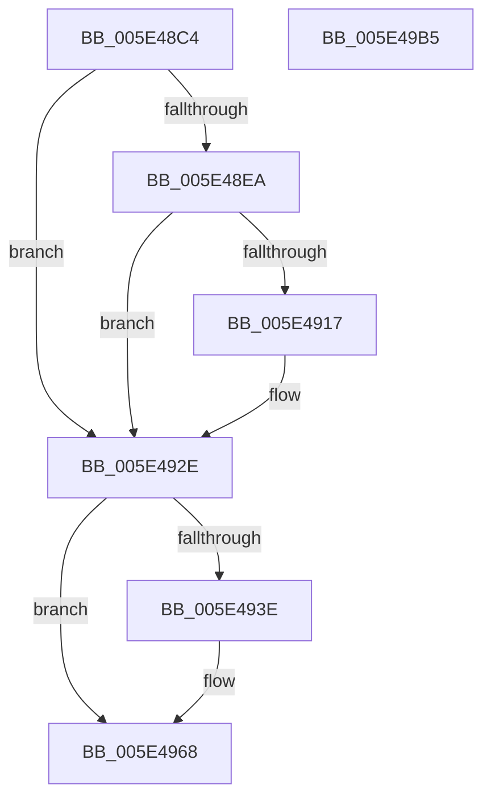

# PspIumFreePartitionState

- RVA: `0x005E48C4`–`0x005E49B6` (길이 `242` bytes)
- VA: `0x00000001405E48C4`
- 실행 섹션: `.text`
- PDB 이름 있음: `예`; PDB Function 태그: `아니요`
- unwind 정보 RVA: `0x000ACCDC`
- 디코드: `62`개 명령, `242/242` bytes 표시
- 미해석 바이트: `0` (있으면 어셈블리에 `.byte`로 보존)

> 이 문서는 커널 이미지의 기계어와 PDB 기호를 분석해 생성했습니다. 4번과 5번은 함수 원형과 자료형을 바이너리 사용 방식에서 추정한 C 해석이며 원본 소스 복구 결과는 아닙니다.

## 1. Dependencies

- 직접 호출 지점: **7**; 고유 호출 대상: **6**
- 직접 호출자로 확인된 함수: **1**
- RIP 상대 이미지 참조: **0**

### Outgoing calls
- `0x005E4929` → [KeWaitForSingleObject](../20/KeWaitForSingleObject_function_0020E6B0.md) (function, `0x0020E6B0`)
- `0x005E4932` → [MmUnlockPages](../29/MmUnlockPages_function_0029EEE0.md) (function, `0x0029EEE0`)
- `0x005E495A` → [memcpy](../6C/memcpy_function_006C6840.md) (function, `0x006C6840`)
- `0x005E497F` → [MmFreeNonChargedSecurePages](../3E/MmFreeNonChargedSecurePages_function_003E9218.md) (function, `0x003E9218`)
- `0x005E498D` → [ExFreePoolWithTag](../../poolcode/B8/ExFreePoolWithTag_function_00B82870.md) (function, `0x00B82870`)
- `0x005E499B` → [ObfDereferenceObjectWithTag](../2F/ObfDereferenceObjectWithTag_function_002F78E0.md) (function, `0x002F78E0`)
- `0x005E49A5` → [ExFreePoolWithTag](../../poolcode/B8/ExFreePoolWithTag_function_00B82870.md) (function, `0x00B82870`)

### Direct callers
- [sub_006F88AE](../6F/Unknown_function_006F88AE.md) at `0x006F8DD5`

### Static image references
- 디코드된 RIP-relative 메모리 참조가 없습니다.

## 2. Other-region calls and transfers

- 다른 실행 섹션으로 향하는 call: **2**
  - `0x005E498D` → [ExFreePoolWithTag](../../poolcode/B8/ExFreePoolWithTag_function_00B82870.md) (`.text` → `POOLCODE`)
  - `0x005E49A5` → [ExFreePoolWithTag](../../poolcode/B8/ExFreePoolWithTag_function_00B82870.md) (`.text` → `POOLCODE`)
- 별도 외부 분기/꼬리 이동을 확인하지 못했습니다.

## 3. Assembly (complete function range)

```asm
005E48C4  48 89 5C 24 08                  mov qword ptr [rsp + 8], rbx
005E48C9  55                              push rbp
005E48CA  48 8B EC                        mov rbp, rsp
005E48CD  48 83 EC 50                     sub rsp, 0x50
005E48D1  33 C0                           xor eax, eax
005E48D3  0F 57 C0                        xorps xmm0, xmm0
005E48D6  48 89 45 F0                     mov qword ptr [rbp - 0x10], rax
005E48DA  48 8B D9                        mov rbx, rcx
005E48DD  48 8B 41 10                     mov rax, qword ptr [rcx + 0x10]
005E48E1  0F 11 45 E0                     movups xmmword ptr [rbp - 0x20], xmm0
005E48E5  48 85 C0                        test rax, rax
005E48E8  74 44                           je 0x1405e492e
005E48EA  83 65 E4 00                     and dword ptr [rbp - 0x1c], 0
005E48EE  48 8D 4D E8                     lea rcx, [rbp - 0x18]
005E48F2  48 89 4D F0                     mov qword ptr [rbp - 0x10], rcx
005E48F6  48 8D 4D E8                     lea rcx, [rbp - 0x18]
005E48FA  48 89 4D E8                     mov qword ptr [rbp - 0x18], rcx
005E48FE  48 8D 4D E0                     lea rcx, [rbp - 0x20]
005E4902  66 C7 45 E0 01 00               mov word ptr [rbp - 0x20], 1
005E4908  C6 45 E2 06                     mov byte ptr [rbp - 0x1e], 6
005E490C  F0 48 0F B1 4B 10               lock cmpxchg qword ptr [rbx + 0x10], rcx
005E4912  48 85 C0                        test rax, rax
005E4915  74 17                           je 0x1405e492e
005E4917  48 83 64 24 20 00               and qword ptr [rsp + 0x20], 0
005E491D  48 8D 4D E0                     lea rcx, [rbp - 0x20]
005E4921  45 33 C9                        xor r9d, r9d
005E4924  45 33 C0                        xor r8d, r8d
005E4927  33 D2                           xor edx, edx
005E4929  E8 82 9D C2 FF                  call 0x14020e6b0
005E492E  48 8D 4B 60                     lea rcx, [rbx + 0x60]
005E4932  E8 A9 A5 CB FF                  call 0x14029eee0
005E4937  8B 43 04                        mov eax, dword ptr [rbx + 4]
005E493A  85 C0                           test eax, eax
005E493C  74 2A                           je 0x1405e4968
005E493E  8B 8B 9C 00 00 00               mov ecx, dword ptr [rbx + 0x9c]
005E4944  48 8D 53 18                     lea rdx, [rbx + 0x18]
005E4948  44 8B C0                        mov r8d, eax
005E494B  48 8B 83 A0 00 00 00            mov rax, qword ptr [rbx + 0xa0]
005E4952  49 C1 E0 03                     shl r8, 3
005E4956  48 8D 0C C8                     lea rcx, [rax + rcx*8]
005E495A  E8 E1 1E 0E 00                  call 0x1406c6840
005E495F  8B 43 04                        mov eax, dword ptr [rbx + 4]
005E4962  01 83 9C 00 00 00               add dword ptr [rbx + 0x9c], eax
005E4968  4C 8B 8B A0 00 00 00            mov r9, qword ptr [rbx + 0xa0]
005E496F  BA 01 00 00 00                  mov edx, 1
005E4974  44 8B 83 98 00 00 00            mov r8d, dword ptr [rbx + 0x98]
005E497B  48 8B 4B 08                     mov rcx, qword ptr [rbx + 8]
005E497F  E8 94 48 E0 FF                  call 0x1403e9218
005E4984  48 8B 8B A0 00 00 00            mov rcx, qword ptr [rbx + 0xa0]
005E498B  33 D2                           xor edx, edx
005E498D  E8 DE DE 59 00                  call 0x140b82870
005E4992  48 8B 4B 08                     mov rcx, qword ptr [rbx + 8]
005E4996  BA 44 66 6C 74                  mov edx, 0x746c6644
005E499B  E8 40 2F D1 FF                  call 0x1402f78e0
005E49A0  33 D2                           xor edx, edx
005E49A2  48 8B CB                        mov rcx, rbx
005E49A5  E8 C6 DE 59 00                  call 0x140b82870
005E49AA  48 8B 5C 24 60                  mov rbx, qword ptr [rsp + 0x60]
005E49AF  48 83 C4 50                     add rsp, 0x50
005E49B3  5D                              pop rbp
005E49B4  C3                              ret
005E49B5  CC                              int3
```

## 4. C-style interpretation (structured pseudocode)

```c
__int64 __fastcall PspIumFreePartitionState(__int64 a1, int a2, int a3, int a4)
{
    __int64 result;
    __int64 v_rsp;
    unsigned __int64 v_stack_m18;
    unsigned __int64 v_stack_m20;
    unsigned int v_stack_m24;
    unsigned __int8 v_stack_m26;
    unsigned __int64 v_stack_m28;
    unsigned __int64 v_stack_m38;
    unsigned __int64 v_stack_p8;

    v_stack_p8 = v_rbx;
    v_rsp = (v_rsp) - (80);
    result = 0;
    v_stack_m18 = 0;
    v_stack_m28 = v_xmm0;
    if (*(unsigned __int64 *)(a1 + 16) == 0) goto loc_005E492E;
    v_stack_m18 = v_stack_m20;
    v_stack_m20 = v_stack_m20;
    v_stack_m28 = 1;
    v_stack_m26 = 6;
    result = *(unsigned __int64 *)(a1 + 16);
    if (*(unsigned __int64 *)(a1 + 16) != 0) {
        a1 = v_stack_m28;
        a4 = 0;
        a3 = 0;
        a2 = 0;
        result = KeWaitForSingleObject(a1, a2, a3, a4);
    }
    result = MmUnlockPages(a1 + 96, a2, a3, a4);
    result = (unsigned int)(*(unsigned int *)(a1 + 4));
    if ((unsigned int)((unsigned int)(*(unsigned int *)(a1 + 4))) != 0) {
        a1 = *(unsigned int *)(a1 + 156);
        a2 = a1 + 24;
        a3 = (unsigned int)((unsigned int)(*(unsigned int *)(a1 + 4)));
        result = *(unsigned __int64 *)(a1 + 160);
        a3 = (a3) << (3);
        a1 = result + a1 * 8;
        result = memcpy(a1, a2, a3, a4);
        result = *(unsigned int *)(a1 + 4);
    }
    result = MmFreeNonChargedSecurePages(*(unsigned __int64 *)(a1 + 8), 1, (unsigned int)(*(unsigned int *)(a1 + 152)), *(unsigned __int64 *)(a1 + 160));
    a2 = 0;
    result = ExFreePoolWithTag(*(unsigned __int64 *)(a1 + 160), a2, (unsigned int)(*(unsigned int *)(a1 + 152)), *(unsigned __int64 *)(a1 + 160));
    result = ObfDereferenceObjectWithTag(*(unsigned __int64 *)(a1 + 8), (unsigned int)(0x746C6644ULL), (unsigned int)(*(unsigned int *)(a1 + 152)), *(unsigned __int64 *)(a1 + 160));
    a2 = 0;
    result = ExFreePoolWithTag(a1, a2, (unsigned int)(*(unsigned int *)(a1 + 152)), *(unsigned __int64 *)(a1 + 160));
    v_rsp = (v_rsp) + (80);
    return result;
}
```

## 5. (Beta) C Style

```c
int64_t PspIumFreePartitionState(void *Arg1, int32_t Arg2, int32_t Arg3, int32_t Arg4)
{
    uint8_t *arg1 = (uint8_t *)Arg1;

    int64_t result;
    int64_t local_rsp;
    uint64_t v_stack_m18;
    uint64_t v_stack_m20;
    uint32_t v_stack_m24;
    uint8_t v_stack_m26;
    uint64_t v_stack_m28;
    uint64_t v_stack_m38;
    uint64_t v_stack_p8;

    v_stack_p8 = local_rbx;
    local_rsp = (local_rsp) - (80);
    result = 0;
    v_stack_m18 = 0;
    v_stack_m28 = v_xmm0;
    if (*(uint64_t *)(arg1 + 0x10) == 0) goto loc_005E492E;
    v_stack_m18 = v_stack_m20;
    v_stack_m20 = v_stack_m20;
    v_stack_m28 = 1;
    v_stack_m26 = 6;
    result = *(uint64_t *)(arg1 + 0x10);
    if (*(uint64_t *)(arg1 + 0x10) != 0) {
        Arg1 = v_stack_m28;
        Arg4 = 0;
        Arg3 = 0;
        Arg2 = 0;
        result = KeWaitForSingleObject(Arg1, Arg2, Arg3, Arg4);
    }
    result = MmUnlockPages(Arg1 + 96, Arg2, Arg3, Arg4);
    result = (uint32_t)(*(uint32_t *)(arg1 + 0x4));
    if ((uint32_t)((uint32_t)(*(uint32_t *)(arg1 + 0x4))) != 0) {
        Arg1 = *(uint32_t *)(arg1 + 0x9C);
        Arg2 = Arg1 + 24;
        Arg3 = (uint32_t)((uint32_t)(*(uint32_t *)(arg1 + 0x4)));
        result = *(uint64_t *)(arg1 + 0xA0);
        Arg3 = (Arg3) << (3);
        Arg1 = result + Arg1 * 8;
        result = memcpy(Arg1, Arg2, Arg3, Arg4);
        result = *(uint32_t *)(arg1 + 0x4);
    }
    result = MmFreeNonChargedSecurePages(*(uint64_t *)(arg1 + 0x8), 1, (uint32_t)(*(uint32_t *)(arg1 + 0x98)), *(uint64_t *)(arg1 + 0xA0));
    Arg2 = 0;
    result = ExFreePoolWithTag(*(uint64_t *)(arg1 + 0xA0), Arg2, (uint32_t)(*(uint32_t *)(arg1 + 0x98)), *(uint64_t *)(arg1 + 0xA0));
    result = ObfDereferenceObjectWithTag(*(uint64_t *)(arg1 + 0x8), (uint32_t)(0x746C6644ULL), (uint32_t)(*(uint32_t *)(arg1 + 0x98)), *(uint64_t *)(arg1 + 0xA0));
    Arg2 = 0;
    result = ExFreePoolWithTag(Arg1, Arg2, (uint32_t)(*(uint32_t *)(arg1 + 0x98)), *(uint64_t *)(arg1 + 0xA0));
    local_rsp = (local_rsp) + (80);
    return result;
}
```

### 관측된 메모리 오프셋

구조체 형식이 확인되지 않은 접근은 인자 기준의 오프셋으로만 기록했습니다.

| 기준 인자 | 오프셋 표현 | 폭 (bit) | 접근 |
|---|---:|---:|---|
| `Arg1` | `+ 0x4` | `32` | `R` |
| `Arg1` | `+ 0x8` | `64` | `R` |
| `Arg1` | `+ 0x10` | `64` | `R` |
| `Arg1` | `+ 0x18` | `64` | `R` |
| `Arg1` | `+ 0x60` | `64` | `R` |
| `Arg1` | `+ 0x98` | `32` | `R` |
| `Arg1` | `+ 0x9C` | `32` | `R` |
| `Arg1` | `+ 0x9C` | `32` | `R/W` |
| `Arg1` | `+ 0xA0` | `64` | `R` |

## 6. Execution-region graph

[열기: 2D/3D 그래프와 함수 탐색 컨트롤 패널](../../../control-panel.html?section=text&rva=0x005E48C4&view=graph)

- 2D 그래프는 위에서 아래로 흐르고, 3D 그래프는 빈 공간을 드래그해 회전합니다. Shift+드래그는 이동, 휠은 확대·축소, 함수 노드 선택은 대상 보고서 이동입니다.

### Static fallback


