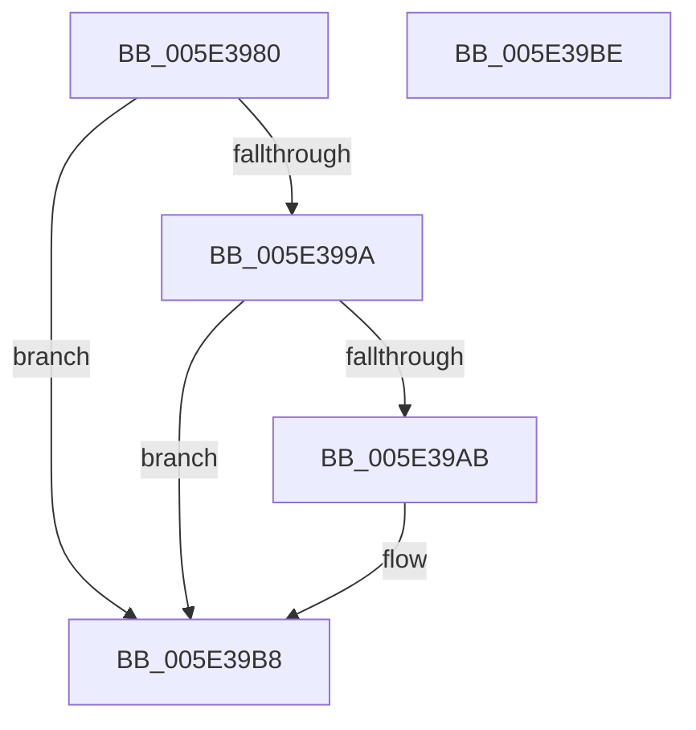

# PspJobCycleTimeNotificationDpcRoutine

- RVA: `0x005E3980`–`0x005E39BF` (길이 `63` bytes)
- VA: `0x00000001405E3980`
- 실행 섹션: `.text`
- PDB 이름 있음: `예`; PDB Function 태그: `아니요`
- unwind 정보 RVA: `0x0005CF00`
- 디코드: `20`개 명령, `63/63` bytes 표시
- 미해석 바이트: `0` (있으면 어셈블리에 `.byte`로 보존)

> 이 문서는 커널 이미지의 기계어와 PDB 기호를 분석해 생성했습니다. 4번과 5번은 함수 원형과 자료형을 바이너리 사용 방식에서 추정한 C 해석이며 원본 소스 복구 결과는 아닙니다.

## 1. Dependencies

- 직접 호출 지점: **3**; 고유 호출 대상: **3**
- 직접 호출자로 확인된 함수: **0**
- RIP 상대 이미지 참조: **0**

### Outgoing calls
- `0x005E3991` → [ObReferenceObjectSafeWithTag](../21/ObReferenceObjectSafeWithTag_function_00210EE0.md) (function, `0x00210EE0`)
- `0x005E39A2` → [PspRequestDeferredJobNotification](../49/PspRequestDeferredJobNotification_function_004938F8.md) (function, `0x004938F8`)
- `0x005E39B3` → [ObfDereferenceObjectWithTag](../2F/ObfDereferenceObjectWithTag_function_002F78E0.md) (function, `0x002F78E0`)

### Direct callers
- 이 함수 시작 RVA로 연결되는 직접 call은 확인되지 않았습니다. 간접 호출은 완전히 역산할 수 없습니다.

### Static image references
- 디코드된 RIP-relative 메모리 참조가 없습니다.

## 2. Other-region calls and transfers

- 다른 실행 섹션으로 향하는 call: **0**
- 별도 외부 분기/꼬리 이동을 확인하지 못했습니다.

## 3. Assembly (complete function range)

```asm
005E3980  40 53                           push rbx
005E3982  48 83 EC 20                     sub rsp, 0x20
005E3986  48 8B DA                        mov rbx, rdx
005E3989  BA 44 66 6C 74                  mov edx, 0x746c6644
005E398E  48 8B CB                        mov rcx, rbx
005E3991  E8 4A D5 C2 FF                  call 0x140210ee0
005E3996  84 C0                           test al, al
005E3998  74 1E                           je 0x1405e39b8
005E399A  BA 00 00 02 00                  mov edx, 0x20000
005E399F  48 8B CB                        mov rcx, rbx
005E39A2  E8 51 FF EA FF                  call 0x1404938f8
005E39A7  84 C0                           test al, al
005E39A9  75 0D                           jne 0x1405e39b8
005E39AB  BA 44 66 6C 74                  mov edx, 0x746c6644
005E39B0  48 8B CB                        mov rcx, rbx
005E39B3  E8 28 3F D1 FF                  call 0x1402f78e0
005E39B8  48 83 C4 20                     add rsp, 0x20
005E39BC  5B                              pop rbx
005E39BD  C3                              ret
005E39BE  CC                              int3
```

## 4. C-style interpretation (structured pseudocode)

```c
__int64 __fastcall PspJobCycleTimeNotificationDpcRoutine(__int64 a1, __int64 a2)
{
    __int64 result;
    __int64 v_rsp;

    v_rsp = (v_rsp) - (32);
    result = ObReferenceObjectSafeWithTag(a2, (unsigned int)(0x746C6644ULL), a3, a4);
    if ((unsigned __int8)(result) == 0) goto loc_005E39B8;
    result = PspRequestDeferredJobNotification(a2, (unsigned int)(0x20000ULL), a3, a4);
    if ((unsigned __int8)(result) == 0) {
        a2 = 0x746C6644ULL;
        a1 = a2;
        result = ObfDereferenceObjectWithTag(a1, a2, a3, a4);
    }
    v_rsp = (v_rsp) + (32);
    return result;
}
```

## 5. (Beta) C Style

```c
int64_t PspJobCycleTimeNotificationDpcRoutine(int64_t Arg1, int64_t Arg2)
{
    int64_t result;
    int64_t local_rsp;

    local_rsp = (local_rsp) - (32);
    result = ObReferenceObjectSafeWithTag(Arg2, (uint32_t)(0x746C6644ULL), a3, a4);
    if ((uint8_t)(result) == 0) goto loc_005E39B8;
    result = PspRequestDeferredJobNotification(Arg2, (uint32_t)(0x20000ULL), a3, a4);
    if ((uint8_t)(result) == 0) {
        Arg2 = 0x746C6644ULL;
        Arg1 = Arg2;
        result = ObfDereferenceObjectWithTag(Arg1, Arg2, a3, a4);
    }
    local_rsp = (local_rsp) + (32);
    return result;
}
```

## 6. Execution-region graph

[열기: 2D/3D 그래프와 함수 탐색 컨트롤 패널](../../../control-panel.html?section=text&rva=0x005E3980&view=graph)

- 2D 그래프는 위에서 아래로 흐르고, 3D 그래프는 빈 공간을 드래그해 회전합니다. Shift+드래그는 이동, 휠은 확대·축소, 함수 노드 선택은 대상 보고서 이동입니다.

### Static fallback


