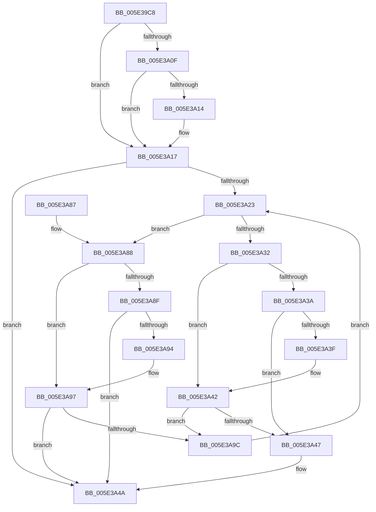

# PspJobIoRateVolumeEntryInsert

- RVA: `0x005E39C8`–`0x005E3AA1` (길이 `217` bytes)
- VA: `0x00000001405E39C8`
- 실행 섹션: `.text`
- PDB 이름 있음: `예`; PDB Function 태그: `아니요`
- unwind 정보 RVA: `0x000CF238`
- 디코드: `70`개 명령, `217/217` bytes 표시
- 미해석 바이트: `0` (있으면 어셈블리에 `.byte`로 보존)

> 이 문서는 커널 이미지의 기계어와 PDB 기호를 분석해 생성했습니다. 4번과 5번은 함수 원형과 자료형을 바이너리 사용 방식에서 추정한 C 해석이며 원본 소스 복구 결과는 아닙니다.

## 1. Dependencies

- 직접 호출 지점: **4**; 고유 호출 대상: **4**
- 직접 호출자로 확인된 함수: **1**
- RIP 상대 이미지 참조: **0**

### Outgoing calls
- `0x005E39F1` → [ExAcquireSpinLockExclusive](../24/ExAcquireSpinLockExclusive_function_00248690.md) (function, `0x00248690`)
- `0x005E3A29` → [PspIoRateEntryVolumeCompare](../49/PspIoRateEntryVolumeCompare_function_0049559C.md) (function, `0x0049559C`)
- `0x005E3A56` → [RtlRbInsertNodeEx](../2E/RtlRbInsertNodeEx_function_002E4570.md) (function, `0x002E4570`)
- `0x005E3A65` → [ExReleaseSpinLockExclusive](../2C/ExReleaseSpinLockExclusive_function_002C0EF0.md) (function, `0x002C0EF0`)

### Direct callers
- [PspSetJobIoRateControlForVolume](../../page/9F/PspSetJobIoRateControlForVolume_function_009F80A0.md) at `0x009F8163`

### Static image references
- 디코드된 RIP-relative 메모리 참조가 없습니다.

## 2. Other-region calls and transfers

- 다른 실행 섹션으로 향하는 call: **0**
- 별도 외부 분기/꼬리 이동을 확인하지 못했습니다.

## 3. Assembly (complete function range)

```asm
005E39C8  48 89 5C 24 08                  mov qword ptr [rsp + 8], rbx
005E39CD  48 89 6C 24 10                  mov qword ptr [rsp + 0x10], rbp
005E39D2  48 89 74 24 18                  mov qword ptr [rsp + 0x18], rsi
005E39D7  57                              push rdi
005E39D8  41 54                           push r12
005E39DA  41 55                           push r13
005E39DC  41 56                           push r14
005E39DE  41 57                           push r15
005E39E0  48 83 EC 20                     sub rsp, 0x20
005E39E4  4C 8B F1                        mov r14, rcx
005E39E7  4C 8B FA                        mov r15, rdx
005E39EA  48 81 C1 98 06 00 00            add rcx, 0x698
005E39F1  E8 9A 4C C6 FF                  call 0x140248690
005E39F6  4D 8B 67 18                     mov r12, qword ptr [r15 + 0x18]
005E39FA  49 8D B6 A0 06 00 00            lea rsi, [r14 + 0x6a0]
005E3A01  48 8B 1E                        mov rbx, qword ptr [rsi]
005E3A04  33 FF                           xor edi, edi
005E3A06  F6 46 08 01                     test byte ptr [rsi + 8], 1
005E3A0A  44 8A E8                        mov r13b, al
005E3A0D  74 08                           je 0x1405e3a17
005E3A0F  48 85 DB                        test rbx, rbx
005E3A12  74 03                           je 0x1405e3a17
005E3A14  48 33 DE                        xor rbx, rsi
005E3A17  0F B6 6E 08                     movzx ebp, byte ptr [rsi + 8]
005E3A1B  83 E5 01                        and ebp, 1
005E3A1E  48 85 DB                        test rbx, rbx
005E3A21  74 27                           je 0x1405e3a4a
005E3A23  48 8B D3                        mov rdx, rbx
005E3A26  49 8B CC                        mov rcx, r12
005E3A29  E8 6E 1B EB FF                  call 0x14049559c
005E3A2E  85 C0                           test eax, eax
005E3A30  78 56                           js 0x1405e3a88
005E3A32  48 8B 43 08                     mov rax, qword ptr [rbx + 8]
005E3A36  85 ED                           test ebp, ebp
005E3A38  74 08                           je 0x1405e3a42
005E3A3A  48 85 C0                        test rax, rax
005E3A3D  74 08                           je 0x1405e3a47
005E3A3F  48 33 C3                        xor rax, rbx
005E3A42  48 85 C0                        test rax, rax
005E3A45  75 55                           jne 0x1405e3a9c
005E3A47  40 B7 01                        mov dil, 1
005E3A4A  4D 8B CF                        mov r9, r15
005E3A4D  44 8A C7                        mov r8b, dil
005E3A50  48 8B D3                        mov rdx, rbx
005E3A53  48 8B CE                        mov rcx, rsi
005E3A56  E8 15 0B D0 FF                  call 0x1402e4570
005E3A5B  49 8D 8E 98 06 00 00            lea rcx, [r14 + 0x698]
005E3A62  41 8A D5                        mov dl, r13b
005E3A65  E8 86 D4 CD FF                  call 0x1402c0ef0
005E3A6A  48 8B 5C 24 50                  mov rbx, qword ptr [rsp + 0x50]
005E3A6F  48 8B 6C 24 58                  mov rbp, qword ptr [rsp + 0x58]
005E3A74  48 8B 74 24 60                  mov rsi, qword ptr [rsp + 0x60]
005E3A79  48 83 C4 20                     add rsp, 0x20
005E3A7D  41 5F                           pop r15
005E3A7F  41 5E                           pop r14
005E3A81  41 5D                           pop r13
005E3A83  41 5C                           pop r12
005E3A85  5F                              pop rdi
005E3A86  C3                              ret
005E3A87  CC                              int3
005E3A88  48 8B 03                        mov rax, qword ptr [rbx]
005E3A8B  85 ED                           test ebp, ebp
005E3A8D  74 08                           je 0x1405e3a97
005E3A8F  48 85 C0                        test rax, rax
005E3A92  74 B6                           je 0x1405e3a4a
005E3A94  48 33 C3                        xor rax, rbx
005E3A97  48 85 C0                        test rax, rax
005E3A9A  74 AE                           je 0x1405e3a4a
005E3A9C  48 8B D8                        mov rbx, rax
005E3A9F  EB 82                           jmp 0x1405e3a23
```

## 4. C-style interpretation (structured pseudocode)

```c
__int64 __fastcall PspJobIoRateVolumeEntryInsert(__int64 a1, __int64 a2)
{
    __int64 result;
    __int64 v_rbp;
    __int64 v_rbx;
    __int64 v_rdi;
    __int64 v_rsp;
    unsigned __int64 v_stack_p10;
    unsigned __int64 v_stack_p18;
    unsigned __int64 v_stack_p8;

    v_stack_p8 = v_rbx;
    v_stack_p10 = v_rbp;
    v_stack_p18 = v_rsi;
    v_rsp = (v_rsp) - (32);
    a1 = (a1) + (0x698ULL);
    result = ExAcquireSpinLockExclusive(a1, a2, a3, a4);
    v_rdi = 0;
    if (((*(unsigned __int8 *)(a1 + 1696 + 8)) & (1)) == 0) goto loc_005E3A17;
    v_rbx = *(unsigned __int64 *)(a1 + 1696);
    if (*(unsigned __int64 *)(a1 + 1696) != 0) {
        v_rbx = (*(unsigned __int64 *)(a1 + 1696)) ^ (a1 + 1696);
    }
    v_rbp = (unsigned int)((*(unsigned __int8 *)(a1 + 1696 + 8)) & (1));
    if (v_rbx == 0) goto loc_005E3A4A;
loc_005E3A23:
    result = PspIoRateEntryVolumeCompare(*(unsigned __int64 *)(a2 + 24), v_rbx, a3, a4);
    if (sign_flag) goto loc_005E3A88;
    if ((unsigned int)(v_rbp) == 0) goto loc_005E3A42;
    if (*(unsigned __int64 *)(v_rbx + 8) == 0) goto loc_005E3A47;
    result = (*(unsigned __int64 *)(v_rbx + 8)) ^ (v_rbx);
loc_005E3A42:
    if (result != 0) goto loc_005E3A9C;
loc_005E3A47:
loc_005E3A4A:
    result = RtlRbInsertNodeEx(a1 + 1696, v_rbx, 1, a2);
    result = ExReleaseSpinLockExclusive(a1 + 1688, (unsigned __int8)((unsigned __int8)(result)), 1, a2);
    v_rsp = (v_rsp) + (32);
    return result;
loc_005E3A88:
    if ((unsigned int)(v_stack_p10) == 0) goto loc_005E3A97;
    if (*(unsigned __int64 *)(v_stack_p8) == 0) goto loc_005E3A4A;
    result = (*(unsigned __int64 *)(v_stack_p8)) ^ (v_stack_p8);
loc_005E3A97:
    if (result == 0) goto loc_005E3A4A;
loc_005E3A9C:
    goto loc_005E3A23;
}
```

## 5. (Beta) C Style

```c
int64_t PspJobIoRateVolumeEntryInsert(void *Arg1, void *Arg2)
{
    uint8_t *arg1 = (uint8_t *)Arg1;
    uint8_t *arg2 = (uint8_t *)Arg2;

    int64_t result;
    int64_t local_rbp;
    int64_t local_rbx;
    int64_t local_rdi;
    int64_t local_rsp;
    uint64_t v_stack_p10;
    uint64_t v_stack_p18;
    uint64_t v_stack_p8;

    v_stack_p8 = local_rbx;
    v_stack_p10 = local_rbp;
    v_stack_p18 = local_rsi;
    local_rsp = (local_rsp) - (32);
    Arg1 = (Arg1) + (0x698ULL);
    result = ExAcquireSpinLockExclusive(Arg1, Arg2, a3, a4);
    local_rdi = 0;
    if (((*(uint8_t *)(arg1 + 0x6A0 + 0x8)) & (1)) == 0) goto loc_005E3A17;
    local_rbx = *(uint64_t *)(arg1 + 0x6A0);
    if (*(uint64_t *)(arg1 + 0x6A0) != 0) {
        local_rbx = (*(uint64_t *)(arg1 + 0x6A0)) ^ (Arg1 + 1696);
    }
    local_rbp = (uint32_t)((*(uint8_t *)(arg1 + 0x6A0 + 0x8)) & (1));
    if (local_rbx == 0) goto loc_005E3A4A;
loc_005E3A23:
    result = PspIoRateEntryVolumeCompare(*(uint64_t *)(arg2 + 0x18), local_rbx, a3, a4);
    if (sign_flag) goto loc_005E3A88;
    if ((uint32_t)(local_rbp) == 0) goto loc_005E3A42;
    if (*(uint64_t *)(local_rbx + 0x8) == 0) goto loc_005E3A47;
    result = (*(uint64_t *)(local_rbx + 0x8)) ^ (local_rbx);
loc_005E3A42:
    if (result != 0) goto loc_005E3A9C;
loc_005E3A47:
loc_005E3A4A:
    result = RtlRbInsertNodeEx(Arg1 + 1696, local_rbx, 1, Arg2);
    result = ExReleaseSpinLockExclusive(Arg1 + 1688, (uint8_t)((uint8_t)(result)), 1, Arg2);
    local_rsp = (local_rsp) + (32);
    return result;
loc_005E3A88:
    if ((uint32_t)(v_stack_p10) == 0) goto loc_005E3A97;
    if (*(uint64_t *)(v_stack_p8) == 0) goto loc_005E3A4A;
    result = (*(uint64_t *)(v_stack_p8)) ^ (v_stack_p8);
loc_005E3A97:
    if (result == 0) goto loc_005E3A4A;
loc_005E3A9C:
    goto loc_005E3A23;
}
```

### 관측된 메모리 오프셋

구조체 형식이 확인되지 않은 접근은 인자 기준의 오프셋으로만 기록했습니다.

| 기준 인자 | 오프셋 표현 | 폭 (bit) | 접근 |
|---|---:|---:|---|
| `Arg1` | `+ 0x0` | `64` | `R` |
| `Arg1` | `+ 0x8` | `8` | `R` |
| `Arg1` | `+ 0x698` | `64` | `R` |
| `Arg1` | `+ 0x6A0` | `64` | `R` |
| `Arg2` | `+ 0x18` | `64` | `R` |

## 6. Execution-region graph

[열기: 2D/3D 그래프와 함수 탐색 컨트롤 패널](../../../control-panel.html?section=text&rva=0x005E39C8&view=graph)

- 2D 그래프는 위에서 아래로 흐르고, 3D 그래프는 빈 공간을 드래그해 회전합니다. Shift+드래그는 이동, 휠은 확대·축소, 함수 노드 선택은 대상 보고서 이동입니다.

### Static fallback


