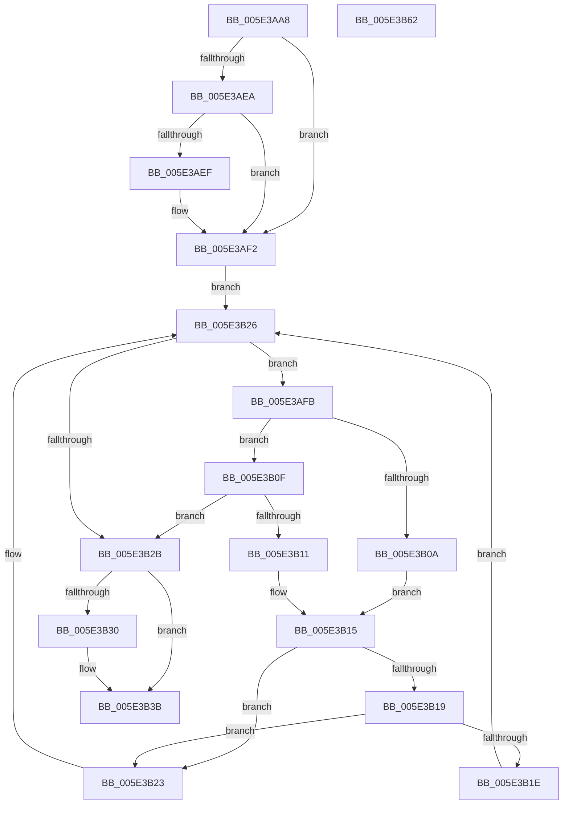

# PspJobIoRateVolumeEntryReference

- RVA: `0x005E3AA8`–`0x005E3B63` (길이 `187` bytes)
- VA: `0x00000001405E3AA8`
- 실행 섹션: `.text`
- PDB 이름 있음: `예`; PDB Function 태그: `아니요`
- unwind 정보 RVA: `0x00060300`
- 디코드: `60`개 명령, `187/187` bytes 표시
- 미해석 바이트: `0` (있으면 어셈블리에 `.byte`로 보존)

> 이 문서는 커널 이미지의 기계어와 PDB 기호를 분석해 생성했습니다. 4번과 5번은 함수 원형과 자료형을 바이너리 사용 방식에서 추정한 C 해석이며 원본 소스 복구 결과는 아닙니다.

## 1. Dependencies

- 직접 호출 지점: **4**; 고유 호출 대상: **4**
- 직접 호출자로 확인된 함수: **1**
- RIP 상대 이미지 참조: **0**

### Outgoing calls
- `0x005E3AD2` → [ExAcquireSpinLockShared](../24/ExAcquireSpinLockShared_function_0024DCE0.md) (function, `0x0024DCE0`)
- `0x005E3B01` → [PspIoRateEntryVolumeCompare](../49/PspIoRateEntryVolumeCompare_function_0049559C.md) (function, `0x0049559C`)
- `0x005E3B36` → [PspIoRateEntryIoControlReference](../46/PspIoRateEntryIoControlReference_function_0046E844.md) (function, `0x0046E844`)
- `0x005E3B41` → [ExReleaseSpinLockShared](../2F/ExReleaseSpinLockShared_function_002F0EF0.md) (function, `0x002F0EF0`)

### Direct callers
- [PsIoRateControlReference](../46/PsIoRateControlReference_function_0046E77C.md) at `0x0046E81B`

### Static image references
- 디코드된 RIP-relative 메모리 참조가 없습니다.

## 2. Other-region calls and transfers

- 다른 실행 섹션으로 향하는 call: **0**
- 별도 외부 분기/꼬리 이동을 확인하지 못했습니다.

## 3. Assembly (complete function range)

```asm
005E3AA8  48 89 5C 24 08                  mov qword ptr [rsp + 8], rbx
005E3AAD  48 89 6C 24 10                  mov qword ptr [rsp + 0x10], rbp
005E3AB2  48 89 74 24 18                  mov qword ptr [rsp + 0x18], rsi
005E3AB7  57                              push rdi
005E3AB8  41 56                           push r14
005E3ABA  41 57                           push r15
005E3ABC  48 83 EC 20                     sub rsp, 0x20
005E3AC0  48 8D A9 98 06 00 00            lea rbp, [rcx + 0x698]
005E3AC7  48 8B D9                        mov rbx, rcx
005E3ACA  48 8B CD                        mov rcx, rbp
005E3ACD  4C 8B FA                        mov r15, rdx
005E3AD0  33 FF                           xor edi, edi
005E3AD2  E8 09 A2 C6 FF                  call 0x14024dce0
005E3AD7  48 8D 8B A0 06 00 00            lea rcx, [rbx + 0x6a0]
005E3ADE  44 8A F0                        mov r14b, al
005E3AE1  F6 41 08 01                     test byte ptr [rcx + 8], 1
005E3AE5  48 8B 19                        mov rbx, qword ptr [rcx]
005E3AE8  74 08                           je 0x1405e3af2
005E3AEA  48 85 DB                        test rbx, rbx
005E3AED  74 03                           je 0x1405e3af2
005E3AEF  48 33 D9                        xor rbx, rcx
005E3AF2  0F B6 71 08                     movzx esi, byte ptr [rcx + 8]
005E3AF6  83 E6 01                        and esi, 1
005E3AF9  EB 2B                           jmp 0x1405e3b26
005E3AFB  48 8B D3                        mov rdx, rbx
005E3AFE  49 8B CF                        mov rcx, r15
005E3B01  E8 96 1A EB FF                  call 0x14049559c
005E3B06  85 C0                           test eax, eax
005E3B08  79 05                           jns 0x1405e3b0f
005E3B0A  48 8B 03                        mov rax, qword ptr [rbx]
005E3B0D  EB 06                           jmp 0x1405e3b15
005E3B0F  7E 1A                           jle 0x1405e3b2b
005E3B11  48 8B 43 08                     mov rax, qword ptr [rbx + 8]
005E3B15  85 F6                           test esi, esi
005E3B17  74 0A                           je 0x1405e3b23
005E3B19  48 85 C0                        test rax, rax
005E3B1C  74 05                           je 0x1405e3b23
005E3B1E  48 33 D8                        xor rbx, rax
005E3B21  EB 03                           jmp 0x1405e3b26
005E3B23  48 8B D8                        mov rbx, rax
005E3B26  48 85 DB                        test rbx, rbx
005E3B29  75 D0                           jne 0x1405e3afb
005E3B2B  48 85 DB                        test rbx, rbx
005E3B2E  74 0B                           je 0x1405e3b3b
005E3B30  48 8B CB                        mov rcx, rbx
005E3B33  48 8B FB                        mov rdi, rbx
005E3B36  E8 09 AD E8 FF                  call 0x14046e844
005E3B3B  41 8A D6                        mov dl, r14b
005E3B3E  48 8B CD                        mov rcx, rbp
005E3B41  E8 AA D3 D0 FF                  call 0x1402f0ef0
005E3B46  48 8B 5C 24 40                  mov rbx, qword ptr [rsp + 0x40]
005E3B4B  48 8B C7                        mov rax, rdi
005E3B4E  48 8B 6C 24 48                  mov rbp, qword ptr [rsp + 0x48]
005E3B53  48 8B 74 24 50                  mov rsi, qword ptr [rsp + 0x50]
005E3B58  48 83 C4 20                     add rsp, 0x20
005E3B5C  41 5F                           pop r15
005E3B5E  41 5E                           pop r14
005E3B60  5F                              pop rdi
005E3B61  C3                              ret
005E3B62  CC                              int3
```

## 4. C-style interpretation (structured pseudocode)

```c
__int64 __fastcall PspJobIoRateVolumeEntryReference(__int64 a1, __int64 a2)
{
    __int64 result;
    __int64 v_rbx;
    __int64 v_rdi;
    __int64 v_rsi;
    __int64 v_rsp;
    unsigned __int64 v_stack_p10;
    unsigned __int64 v_stack_p18;
    unsigned __int64 v_stack_p8;

    v_stack_p8 = v_rbx;
    v_stack_p10 = v_rbp;
    v_stack_p18 = v_rsi;
    v_rsp = (v_rsp) - (32);
    v_rdi = 0;
    result = ExAcquireSpinLockShared(a1 + 1688, a2, a3, a4);
    if (((*(unsigned __int8 *)(a1 + 1696 + 8)) & (1)) == 0) goto loc_005E3AF2;
    v_rbx = *(unsigned __int64 *)(a1 + 1696);
    if (*(unsigned __int64 *)(a1 + 1696) != 0) {
        v_rbx = (*(unsigned __int64 *)(a1 + 1696)) ^ (a1 + 1696);
    }
    v_rsi = (unsigned int)((*(unsigned __int8 *)(a1 + 1696 + 8)) & (1));
    goto loc_005E3B26;
loc_005E3AFB:
    result = PspIoRateEntryVolumeCompare(a2, v_rbx, a3, a4);
    if (!sign_flag) goto loc_005E3B0F;
    goto loc_005E3B15;
loc_005E3B0F:
    if (condition_is_less_or_equal) goto loc_005E3B2B;
loc_005E3B15:
    if ((unsigned int)(v_rsi) == 0) goto loc_005E3B23;
    if (*(unsigned __int64 *)(v_rbx + 8) == 0) goto loc_005E3B23;
    v_rbx = (v_rbx) ^ (*(unsigned __int64 *)(v_rbx + 8));
    goto loc_005E3B26;
loc_005E3B23:
loc_005E3B26:
    if (*(unsigned __int64 *)(v_rbx + 8) != 0) goto loc_005E3AFB;
loc_005E3B2B:
    result = *(unsigned __int64 *)(v_rbx + 8);
    if (*(unsigned __int64 *)(v_rbx + 8) != 0) {
        a1 = *(unsigned __int64 *)(v_rbx + 8);
        v_rdi = *(unsigned __int64 *)(v_rbx + 8);
        result = PspIoRateEntryIoControlReference(a1, v_rbx, a3, a4);
    }
    result = ExReleaseSpinLockShared(a1 + 1688, (unsigned __int8)((unsigned __int8)(result)), a3, a4);
    v_rsp = (v_rsp) + (32);
    return v_rdi;
}
```

## 5. (Beta) C Style

```c
int64_t PspJobIoRateVolumeEntryReference(void *Arg1, int64_t Arg2)
{
    uint8_t *arg1 = (uint8_t *)Arg1;

    int64_t result;
    int64_t local_rbx;
    int64_t local_rdi;
    int64_t local_rsi;
    int64_t local_rsp;
    uint64_t v_stack_p10;
    uint64_t v_stack_p18;
    uint64_t v_stack_p8;

    v_stack_p8 = local_rbx;
    v_stack_p10 = local_rbp;
    v_stack_p18 = local_rsi;
    local_rsp = (local_rsp) - (32);
    local_rdi = 0;
    result = ExAcquireSpinLockShared(Arg1 + 1688, Arg2, a3, a4);
    if (((*(uint8_t *)(arg1 + 0x6A0 + 0x8)) & (1)) == 0) goto loc_005E3AF2;
    local_rbx = *(uint64_t *)(arg1 + 0x6A0);
    if (*(uint64_t *)(arg1 + 0x6A0) != 0) {
        local_rbx = (*(uint64_t *)(arg1 + 0x6A0)) ^ (Arg1 + 1696);
    }
    local_rsi = (uint32_t)((*(uint8_t *)(arg1 + 0x6A0 + 0x8)) & (1));
    goto loc_005E3B26;
loc_005E3AFB:
    result = PspIoRateEntryVolumeCompare(Arg2, local_rbx, a3, a4);
    if (!sign_flag) goto loc_005E3B0F;
    goto loc_005E3B15;
loc_005E3B0F:
    if (condition_is_less_or_equal) goto loc_005E3B2B;
loc_005E3B15:
    if ((uint32_t)(local_rsi) == 0) goto loc_005E3B23;
    if (*(uint64_t *)(local_rbx + 0x8) == 0) goto loc_005E3B23;
    local_rbx = (local_rbx) ^ (*(uint64_t *)(local_rbx + 0x8));
    goto loc_005E3B26;
loc_005E3B23:
loc_005E3B26:
    if (*(uint64_t *)(local_rbx + 0x8) != 0) goto loc_005E3AFB;
loc_005E3B2B:
    result = *(uint64_t *)(local_rbx + 0x8);
    if (*(uint64_t *)(local_rbx + 0x8) != 0) {
        Arg1 = *(uint64_t *)(local_rbx + 0x8);
        local_rdi = *(uint64_t *)(local_rbx + 0x8);
        result = PspIoRateEntryIoControlReference(Arg1, local_rbx, a3, a4);
    }
    result = ExReleaseSpinLockShared(Arg1 + 1688, (uint8_t)((uint8_t)(result)), a3, a4);
    local_rsp = (local_rsp) + (32);
    return local_rdi;
}
```

### 관측된 메모리 오프셋

구조체 형식이 확인되지 않은 접근은 인자 기준의 오프셋으로만 기록했습니다.

| 기준 인자 | 오프셋 표현 | 폭 (bit) | 접근 |
|---|---:|---:|---|
| `Arg1` | `+ 0x0` | `64` | `R` |
| `Arg1` | `+ 0x8` | `8` | `R` |
| `Arg1` | `+ 0x698` | `64` | `R` |
| `Arg1` | `+ 0x6A0` | `64` | `R` |

## 6. Execution-region graph

[열기: 2D/3D 그래프와 함수 탐색 컨트롤 패널](../../../control-panel.html?section=text&rva=0x005E3AA8&view=graph)

- 2D 그래프는 위에서 아래로 흐르고, 3D 그래프는 빈 공간을 드래그해 회전합니다. Shift+드래그는 이동, 휠은 확대·축소, 함수 노드 선택은 대상 보고서 이동입니다.

### Static fallback


