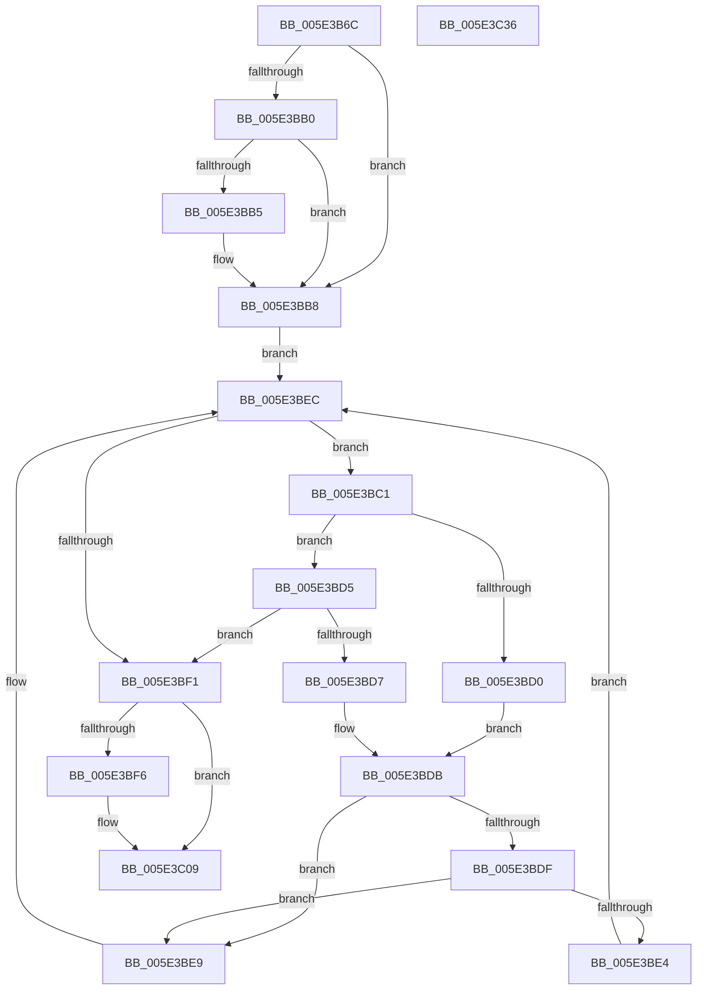

# PspJobIoRateVolumeEntryRemove

- RVA: `0x005E3B6C`–`0x005E3C37` (길이 `203` bytes)
- VA: `0x00000001405E3B6C`
- 실행 섹션: `.text`
- PDB 이름 있음: `예`; PDB Function 태그: `아니요`
- unwind 정보 RVA: `0x0005FEF8`
- 디코드: `64`개 명령, `203/203` bytes 표시
- 미해석 바이트: `0` (있으면 어셈블리에 `.byte`로 보존)

> 이 문서는 커널 이미지의 기계어와 PDB 기호를 분석해 생성했습니다. 4번과 5번은 함수 원형과 자료형을 바이너리 사용 방식에서 추정한 C 해석이며 원본 소스 복구 결과는 아닙니다.

## 1. Dependencies

- 직접 호출 지점: **4**; 고유 호출 대상: **4**
- 직접 호출자로 확인된 함수: **1**
- RIP 상대 이미지 참조: **0**

### Outgoing calls
- `0x005E3B9F` → [ExAcquireSpinLockExclusive](../24/ExAcquireSpinLockExclusive_function_00248690.md) (function, `0x00248690`)
- `0x005E3BC7` → [PspIoRateEntryVolumeCompare](../49/PspIoRateEntryVolumeCompare_function_0049559C.md) (function, `0x0049559C`)
- `0x005E3BFC` → [RtlRbRemoveNode](../2E/RtlRbRemoveNode_function_002E4C10.md) (function, `0x002E4C10`)
- `0x005E3C0F` → [ExReleaseSpinLockExclusive](../2C/ExReleaseSpinLockExclusive_function_002C0EF0.md) (function, `0x002C0EF0`)

### Direct callers
- [PspSetJobIoRateControlForVolume](../../page/9F/PspSetJobIoRateControlForVolume_function_009F80A0.md) at `0x009F8126`

### Static image references
- 디코드된 RIP-relative 메모리 참조가 없습니다.

## 2. Other-region calls and transfers

- 다른 실행 섹션으로 향하는 call: **0**
- 별도 외부 분기/꼬리 이동을 확인하지 못했습니다.

## 3. Assembly (complete function range)

```asm
005E3B6C  48 8B C4                        mov rax, rsp
005E3B6F  48 89 58 08                     mov qword ptr [rax + 8], rbx
005E3B73  48 89 68 10                     mov qword ptr [rax + 0x10], rbp
005E3B77  48 89 70 18                     mov qword ptr [rax + 0x18], rsi
005E3B7B  48 89 78 20                     mov qword ptr [rax + 0x20], rdi
005E3B7F  41 54                           push r12
005E3B81  41 56                           push r14
005E3B83  41 57                           push r15
005E3B85  48 83 EC 20                     sub rsp, 0x20
005E3B89  4C 8D B1 98 06 00 00            lea r14, [rcx + 0x698]
005E3B90  4C 8B E2                        mov r12, rdx
005E3B93  48 8D B1 A0 06 00 00            lea rsi, [rcx + 0x6a0]
005E3B9A  33 FF                           xor edi, edi
005E3B9C  49 8B CE                        mov rcx, r14
005E3B9F  E8 EC 4A C6 FF                  call 0x140248690
005E3BA4  F6 46 08 01                     test byte ptr [rsi + 8], 1
005E3BA8  44 8A F8                        mov r15b, al
005E3BAB  48 8B 1E                        mov rbx, qword ptr [rsi]
005E3BAE  74 08                           je 0x1405e3bb8
005E3BB0  48 85 DB                        test rbx, rbx
005E3BB3  74 03                           je 0x1405e3bb8
005E3BB5  48 33 DE                        xor rbx, rsi
005E3BB8  0F B6 6E 08                     movzx ebp, byte ptr [rsi + 8]
005E3BBC  83 E5 01                        and ebp, 1
005E3BBF  EB 2B                           jmp 0x1405e3bec
005E3BC1  48 8B D3                        mov rdx, rbx
005E3BC4  49 8B CC                        mov rcx, r12
005E3BC7  E8 D0 19 EB FF                  call 0x14049559c
005E3BCC  85 C0                           test eax, eax
005E3BCE  79 05                           jns 0x1405e3bd5
005E3BD0  48 8B 03                        mov rax, qword ptr [rbx]
005E3BD3  EB 06                           jmp 0x1405e3bdb
005E3BD5  7E 1A                           jle 0x1405e3bf1
005E3BD7  48 8B 43 08                     mov rax, qword ptr [rbx + 8]
005E3BDB  85 ED                           test ebp, ebp
005E3BDD  74 0A                           je 0x1405e3be9
005E3BDF  48 85 C0                        test rax, rax
005E3BE2  74 05                           je 0x1405e3be9
005E3BE4  48 33 D8                        xor rbx, rax
005E3BE7  EB 03                           jmp 0x1405e3bec
005E3BE9  48 8B D8                        mov rbx, rax
005E3BEC  48 85 DB                        test rbx, rbx
005E3BEF  75 D0                           jne 0x1405e3bc1
005E3BF1  48 85 DB                        test rbx, rbx
005E3BF4  74 13                           je 0x1405e3c09
005E3BF6  48 8B D3                        mov rdx, rbx
005E3BF9  48 8B CE                        mov rcx, rsi
005E3BFC  E8 0F 10 D0 FF                  call 0x1402e4c10
005E3C01  48 83 4B 10 FF                  or qword ptr [rbx + 0x10], 0xffffffffffffffff
005E3C06  48 8B FB                        mov rdi, rbx
005E3C09  41 8A D7                        mov dl, r15b
005E3C0C  49 8B CE                        mov rcx, r14
005E3C0F  E8 DC D2 CD FF                  call 0x1402c0ef0
005E3C14  48 8B 5C 24 40                  mov rbx, qword ptr [rsp + 0x40]
005E3C19  48 8B C7                        mov rax, rdi
005E3C1C  48 8B 7C 24 58                  mov rdi, qword ptr [rsp + 0x58]
005E3C21  48 8B 6C 24 48                  mov rbp, qword ptr [rsp + 0x48]
005E3C26  48 8B 74 24 50                  mov rsi, qword ptr [rsp + 0x50]
005E3C2B  48 83 C4 20                     add rsp, 0x20
005E3C2F  41 5F                           pop r15
005E3C31  41 5E                           pop r14
005E3C33  41 5C                           pop r12
005E3C35  C3                              ret
005E3C36  CC                              int3
```

## 4. C-style interpretation (structured pseudocode)

```c
__int64 __fastcall PspJobIoRateVolumeEntryRemove(__int64 a1, __int64 a2)
{
    __int64 result;
    __int64 v_rbp;
    __int64 v_rbx;
    __int64 v_rdi;
    __int64 v_rsp;
    unsigned __int64 v_stack_p10;
    unsigned __int64 v_stack_p18;
    unsigned __int64 v_stack_p20;
    unsigned __int64 v_stack_p8;

    *(unsigned __int64 *)(v_rsp + 8) = v_rbx;
    *(unsigned __int64 *)(v_rsp + 16) = v_rbp;
    *(unsigned __int64 *)(v_rsp + 24) = v_rsi;
    *(unsigned __int64 *)(v_rsp + 32) = v_rdi;
    v_rsp = (v_rsp) - (32);
    v_rdi = 0;
    result = ExAcquireSpinLockExclusive(a1 + 1688, a2, a3, a4);
    if (((*(unsigned __int8 *)(a1 + 1696 + 8)) & (1)) == 0) goto loc_005E3BB8;
    v_rbx = *(unsigned __int64 *)(a1 + 1696);
    if (*(unsigned __int64 *)(a1 + 1696) != 0) {
        v_rbx = (*(unsigned __int64 *)(a1 + 1696)) ^ (a1 + 1696);
    }
    v_rbp = (unsigned int)((*(unsigned __int8 *)(a1 + 1696 + 8)) & (1));
    goto loc_005E3BEC;
loc_005E3BC1:
    result = PspIoRateEntryVolumeCompare(a2, v_rbx, a3, a4);
    if (!sign_flag) goto loc_005E3BD5;
    goto loc_005E3BDB;
loc_005E3BD5:
    if (condition_is_less_or_equal) goto loc_005E3BF1;
loc_005E3BDB:
    if ((unsigned int)(v_rbp) == 0) goto loc_005E3BE9;
    if (*(unsigned __int64 *)(v_rbx + 8) == 0) goto loc_005E3BE9;
    v_rbx = (v_rbx) ^ (*(unsigned __int64 *)(v_rbx + 8));
    goto loc_005E3BEC;
loc_005E3BE9:
loc_005E3BEC:
    if (*(unsigned __int64 *)(v_rbx + 8) != 0) goto loc_005E3BC1;
loc_005E3BF1:
    result = *(unsigned __int64 *)(v_rbx + 8);
    if (*(unsigned __int64 *)(v_rbx + 8) != 0) {
        a2 = *(unsigned __int64 *)(v_rbx + 8);
        a1 = a1 + 1696;
        result = RtlRbRemoveNode(a1, a2, a3, a4);
        v_rdi = *(unsigned __int64 *)(v_rbx + 8);
    }
    result = ExReleaseSpinLockExclusive(a1 + 1688, (unsigned __int8)((unsigned __int8)(result)), a3, a4);
    v_rsp = (v_rsp) + (32);
    return v_rdi;
}
```

## 5. (Beta) C Style

```c
int64_t PspJobIoRateVolumeEntryRemove(void *Arg1, int64_t Arg2)
{
    uint8_t *arg1 = (uint8_t *)Arg1;

    int64_t result;
    int64_t local_rbp;
    int64_t local_rbx;
    int64_t local_rdi;
    int64_t local_rsp;
    uint64_t v_stack_p10;
    uint64_t v_stack_p18;
    uint64_t v_stack_p20;
    uint64_t v_stack_p8;

    *(uint64_t *)(local_rsp + 0x8) = local_rbx;
    *(uint64_t *)(local_rsp + 0x10) = local_rbp;
    *(uint64_t *)(local_rsp + 0x18) = local_rsi;
    *(uint64_t *)(local_rsp + 0x20) = local_rdi;
    local_rsp = (local_rsp) - (32);
    local_rdi = 0;
    result = ExAcquireSpinLockExclusive(Arg1 + 1688, Arg2, a3, a4);
    if (((*(uint8_t *)(arg1 + 0x6A0 + 0x8)) & (1)) == 0) goto loc_005E3BB8;
    local_rbx = *(uint64_t *)(arg1 + 0x6A0);
    if (*(uint64_t *)(arg1 + 0x6A0) != 0) {
        local_rbx = (*(uint64_t *)(arg1 + 0x6A0)) ^ (Arg1 + 1696);
    }
    local_rbp = (uint32_t)((*(uint8_t *)(arg1 + 0x6A0 + 0x8)) & (1));
    goto loc_005E3BEC;
loc_005E3BC1:
    result = PspIoRateEntryVolumeCompare(Arg2, local_rbx, a3, a4);
    if (!sign_flag) goto loc_005E3BD5;
    goto loc_005E3BDB;
loc_005E3BD5:
    if (condition_is_less_or_equal) goto loc_005E3BF1;
loc_005E3BDB:
    if ((uint32_t)(local_rbp) == 0) goto loc_005E3BE9;
    if (*(uint64_t *)(local_rbx + 0x8) == 0) goto loc_005E3BE9;
    local_rbx = (local_rbx) ^ (*(uint64_t *)(local_rbx + 0x8));
    goto loc_005E3BEC;
loc_005E3BE9:
loc_005E3BEC:
    if (*(uint64_t *)(local_rbx + 0x8) != 0) goto loc_005E3BC1;
loc_005E3BF1:
    result = *(uint64_t *)(local_rbx + 0x8);
    if (*(uint64_t *)(local_rbx + 0x8) != 0) {
        Arg2 = *(uint64_t *)(local_rbx + 0x8);
        Arg1 = Arg1 + 1696;
        result = RtlRbRemoveNode(Arg1, Arg2, a3, a4);
        local_rdi = *(uint64_t *)(local_rbx + 0x8);
    }
    result = ExReleaseSpinLockExclusive(Arg1 + 1688, (uint8_t)((uint8_t)(result)), a3, a4);
    local_rsp = (local_rsp) + (32);
    return local_rdi;
}
```

### 관측된 메모리 오프셋

구조체 형식이 확인되지 않은 접근은 인자 기준의 오프셋으로만 기록했습니다.

| 기준 인자 | 오프셋 표현 | 폭 (bit) | 접근 |
|---|---:|---:|---|
| `Arg1` | `+ 0x0` | `64` | `R` |
| `Arg1` | `+ 0x8` | `8` | `R` |
| `Arg1` | `+ 0x698` | `64` | `R` |
| `Arg1` | `+ 0x6A0` | `64` | `R` |

## 6. Execution-region graph

[열기: 2D/3D 그래프와 함수 탐색 컨트롤 패널](../../../control-panel.html?section=text&rva=0x005E3B6C&view=graph)

- 2D 그래프는 위에서 아래로 흐르고, 3D 그래프는 빈 공간을 드래그해 회전합니다. Shift+드래그는 이동, 휠은 확대·축소, 함수 노드 선택은 대상 보고서 이동입니다.

### Static fallback


