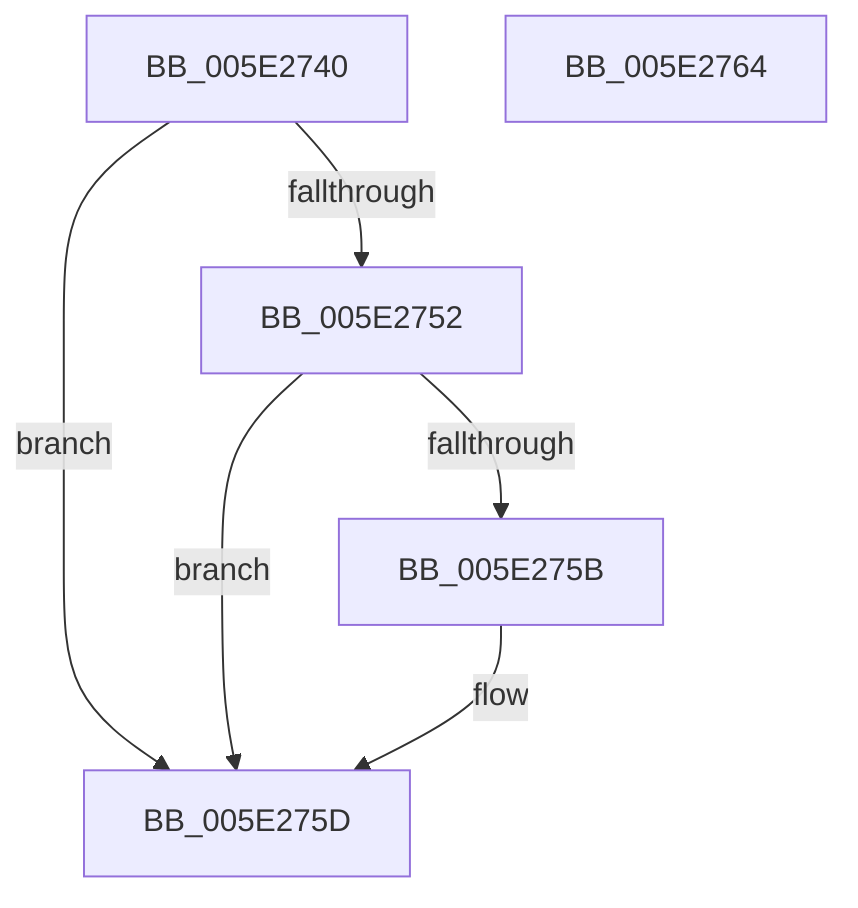

# PspJobIsAppSilo

- RVA: `0x005E2740`–`0x005E2765` (길이 `37` bytes)
- VA: `0x00000001405E2740`
- 실행 섹션: `.text`
- PDB 이름 있음: `예`; PDB Function 태그: `아니요`
- unwind 정보 RVA: `0x0005C788`
- 디코드: `12`개 명령, `37/37` bytes 표시
- 미해석 바이트: `0` (있으면 어셈블리에 `.byte`로 보존)

> 이 문서는 커널 이미지의 기계어와 PDB 기호를 분석해 생성했습니다. 4번과 5번은 함수 원형과 자료형을 바이너리 사용 방식에서 추정한 C 해석이며 원본 소스 복구 결과는 아닙니다.

## 1. Dependencies

- 직접 호출 지점: **1**; 고유 호출 대상: **1**
- 직접 호출자로 확인된 함수: **1**
- RIP 상대 이미지 참조: **0**

### Outgoing calls
- `0x005E2752` → [PsIsServerSilo](../22/PsIsServerSilo_function_00225828.md) (function, `0x00225828`)

### Direct callers
- [NtSetInformationJobObject](../../page/9F/NtSetInformationJobObject_function_009F84C0.md) at `0x009FA1C9`

### Static image references
- 디코드된 RIP-relative 메모리 참조가 없습니다.

## 2. Other-region calls and transfers

- 다른 실행 섹션으로 향하는 call: **0**
- 별도 외부 분기/꼬리 이동을 확인하지 못했습니다.

## 3. Assembly (complete function range)

```asm
005E2740  48 83 EC 28                     sub rsp, 0x28
005E2744  32 D2                           xor dl, dl
005E2746  F7 81 10 06 00 00 00 00 00 40   test dword ptr [rcx + 0x610], 0x40000000
005E2750  74 0B                           je 0x1405e275d
005E2752  E8 D1 30 C4 FF                  call 0x140225828
005E2757  84 C0                           test al, al
005E2759  75 02                           jne 0x1405e275d
005E275B  B2 01                           mov dl, 1
005E275D  8A C2                           mov al, dl
005E275F  48 83 C4 28                     add rsp, 0x28
005E2763  C3                              ret
005E2764  CC                              int3
```

## 4. C-style interpretation (structured pseudocode)

```c
__int64 __fastcall PspJobIsAppSilo(__int64 a1, unsigned __int8 a2)
{
    __int64 result;
    __int64 v_rsp;

    v_rsp = (v_rsp) - (40);
    a2 = 0;
    if (((*(unsigned int *)(a1 + 1552)) & (0x40000000ULL)) == 0) goto loc_005E275D;
    result = PsIsServerSilo(a1, a2, a3, a4);
    if ((unsigned __int8)(result) == 0) {
        a2 = 1;
    }
    v_rsp = (v_rsp) + (40);
    return a2;
}
```

## 5. (Beta) C Style

```c
int64_t PspJobIsAppSilo(void *Arg1, uint8_t Arg2)
{
    uint8_t *arg1 = (uint8_t *)Arg1;

    int64_t result;
    int64_t local_rsp;

    local_rsp = (local_rsp) - (40);
    Arg2 = 0;
    if (((*(uint32_t *)(arg1 + 0x610)) & (0x40000000ULL)) == 0) goto loc_005E275D;
    result = PsIsServerSilo(Arg1, Arg2, a3, a4);
    if ((uint8_t)(result) == 0) {
        Arg2 = 1;
    }
    local_rsp = (local_rsp) + (40);
    return Arg2;
}
```

### 관측된 메모리 오프셋

구조체 형식이 확인되지 않은 접근은 인자 기준의 오프셋으로만 기록했습니다.

| 기준 인자 | 오프셋 표현 | 폭 (bit) | 접근 |
|---|---:|---:|---|
| `Arg1` | `+ 0x610` | `32` | `R` |

## 6. Execution-region graph

[열기: 2D/3D 그래프와 함수 탐색 컨트롤 패널](../../../control-panel.html?section=text&rva=0x005E2740&view=graph)

- 2D 그래프는 위에서 아래로 흐르고, 3D 그래프는 빈 공간을 드래그해 회전합니다. Shift+드래그는 이동, 휠은 확대·축소, 함수 노드 선택은 대상 보고서 이동입니다.

### Static fallback


