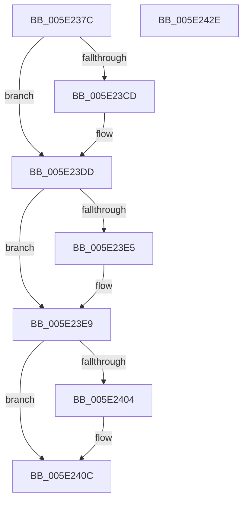

# PspLookupSyscallProviderById

- RVA: `0x005E237C`–`0x005E242F` (길이 `179` bytes)
- VA: `0x00000001405E237C`
- 실행 섹션: `.text`
- PDB 이름 있음: `예`; PDB Function 태그: `아니요`
- unwind 정보 RVA: `0x000BD140`
- 디코드: `51`개 명령, `179/179` bytes 표시
- 미해석 바이트: `0` (있으면 어셈블리에 `.byte`로 보존)

> 이 문서는 커널 이미지의 기계어와 PDB 기호를 분석해 생성했습니다. 4번과 5번은 함수 원형과 자료형을 바이너리 사용 방식에서 추정한 C 해석이며 원본 소스 복구 결과는 아닙니다.

## 1. Dependencies

- 직접 호출 지점: **6**; 고유 호출 대상: **6**
- 직접 호출자로 확인된 함수: **1**
- RIP 상대 이미지 참조: **1**

### Outgoing calls
- `0x005E23B4` → [KeAbPreAcquire](../21/KeAbPreAcquire_function_00210230.md) (function, `0x00210230`)
- `0x005E23D8` → [ExfAcquirePushLockSharedEx](../21/ExfAcquirePushLockSharedEx_function_0021044C.md) (function, `0x0021044C`)
- `0x005E23EF` → [PspLookupSyscallProviderByIdNoLock](../../page/77/PspLookupSyscallProviderByIdNoLock_function_0077E69C.md) (function, `0x0077E69C`)
- `0x005E2407` → [ExfReleasePushLockShared](../26/ExfReleasePushLockShared_function_00263440.md) (function, `0x00263440`)
- `0x005E240F` → [KeAbPostRelease](../2E/KeAbPostRelease_function_002E1600.md) (function, `0x002E1600`)
- `0x005E2414` → [KeLeaveCriticalRegion](../25/KeLeaveCriticalRegion_function_0025D8B0.md) (function, `0x0025D8B0`)

### Direct callers
- [PspSyscallProviderOptIn](../../page/77/PspSyscallProviderOptIn_function_0077E79C.md) at `0x0077E7D7`

### Static image references
- `0x005E2397` → RVA `0x00FD9BF0` (`PAGEDATA`; read)

## 2. Other-region calls and transfers

- 다른 실행 섹션으로 향하는 call: **1**
  - `0x005E23EF` → [PspLookupSyscallProviderByIdNoLock](../../page/77/PspLookupSyscallProviderByIdNoLock_function_0077E69C.md) (`.text` → `PAGE`)
- 별도 외부 분기/꼬리 이동을 확인하지 못했습니다.

## 3. Assembly (complete function range)

```asm
005E237C  48 89 5C 24 08                  mov qword ptr [rsp + 8], rbx
005E2381  48 89 6C 24 10                  mov qword ptr [rsp + 0x10], rbp
005E2386  56                              push rsi
005E2387  57                              push rdi
005E2388  41 56                           push r14
005E238A  48 83 EC 20                     sub rsp, 0x20
005E238E  65 48 8B 04 25 88 01 00 00      mov rax, qword ptr gs:[0x188]
005E2397  48 8D 2D 52 78 9F 00            lea rbp, [rip + 0x9f7852]
005E239E  48 8B FA                        mov rdi, rdx
005E23A1  48 8B F1                        mov rsi, rcx
005E23A4  45 33 C0                        xor r8d, r8d
005E23A7  33 D2                           xor edx, edx
005E23A9  48 8B CD                        mov rcx, rbp
005E23AC  66 FF 88 E4 01 00 00            dec word ptr [rax + 0x1e4]
005E23B3  90                              nop
005E23B4  E8 77 DE C2 FF                  call 0x140210230
005E23B9  48 8B D8                        mov rbx, rax
005E23BC  33 C0                           xor eax, eax
005E23BE  44 8D 70 11                     lea r14d, [rax + 0x11]
005E23C2  F0 4C 0F B1 35 25 78 9F 00      lock cmpxchg qword ptr [rip + 0x9f7825], r14
005E23CB  74 10                           je 0x1405e23dd
005E23CD  4C 8B CD                        mov r9, rbp
005E23D0  4C 8B C3                        mov r8, rbx
005E23D3  33 D2                           xor edx, edx
005E23D5  48 8B CD                        mov rcx, rbp
005E23D8  E8 6F E0 C2 FF                  call 0x14021044c
005E23DD  45 33 DB                        xor r11d, r11d
005E23E0  48 85 DB                        test rbx, rbx
005E23E3  74 04                           je 0x1405e23e9
005E23E5  C6 43 0A 01                     mov byte ptr [rbx + 0xa], 1
005E23E9  48 8B D7                        mov rdx, rdi
005E23EC  48 8B CE                        mov rcx, rsi
005E23EF  E8 A8 C2 19 00                  call 0x14077e69c
005E23F4  8B D8                           mov ebx, eax
005E23F6  49 8B C6                        mov rax, r14
005E23F9  F0 4C 0F B1 1D EE 77 9F 00      lock cmpxchg qword ptr [rip + 0x9f77ee], r11
005E2402  74 08                           je 0x1405e240c
005E2404  48 8B CD                        mov rcx, rbp
005E2407  E8 34 10 C8 FF                  call 0x140263440
005E240C  48 8B CD                        mov rcx, rbp
005E240F  E8 EC F1 CF FF                  call 0x1402e1600
005E2414  E8 97 B4 C7 FF                  call 0x14025d8b0
005E2419  48 8B 6C 24 48                  mov rbp, qword ptr [rsp + 0x48]
005E241E  8B C3                           mov eax, ebx
005E2420  48 8B 5C 24 40                  mov rbx, qword ptr [rsp + 0x40]
005E2425  48 83 C4 20                     add rsp, 0x20
005E2429  41 5E                           pop r14
005E242B  5F                              pop rdi
005E242C  5E                              pop rsi
005E242D  C3                              ret
005E242E  CC                              int3
```

## 4. C-style interpretation (structured pseudocode)

```c
__int64 __fastcall PspLookupSyscallProviderById(__int64 a1, __int64 a2, int a3)
{
    __int64 result;
    __int64 v_r11;
    __int64 v_rsp;
    unsigned __int64 v_stack_p10;
    unsigned __int64 v_stack_p8;

    v_stack_p8 = v_rbx;
    v_stack_p10 = v_rbp;
    v_rsp = (v_rsp) - (32);
    a3 = 0;
    a2 = 0;
    result = KeAbPreAcquire(v_rip + 10451026, a2, a3, a4);
    result = 0;
    if (!(condition_is_equal)) {
        a4 = v_rip + 10451026;
        a3 = 0;
        a2 = 0;
        a1 = v_rip + 10451026;
        result = ExfAcquirePushLockSharedEx(a1, a2, a3, a4);
    }
    v_r11 = 0;
    if (result != 0) {
        *(unsigned __int8 *)(result + 10) = 1;
    }
    result = PspLookupSyscallProviderByIdNoLock(a1, 0, a3, a4);
    result = result + 17;
    if (result != 0) {
        a1 = v_rip + 10451026;
        result = ExfReleasePushLockShared(a1, 0, a3, a4);
    }
    result = KeAbPostRelease(v_rip + 10451026, 0, a3, a4);
    result = KeLeaveCriticalRegion(v_rip + 10451026, 0, a3, a4);
    v_rsp = (v_rsp) + (32);
    return (unsigned int)((unsigned int)((unsigned int)((unsigned int)(result))));
}
```

## 5. (Beta) C Style

```c
int64_t PspLookupSyscallProviderById(int64_t Arg1, int64_t Arg2, int32_t Arg3)
{
    int64_t result;
    int64_t local_r11;
    int64_t local_rsp;
    uint64_t v_stack_p10;
    uint64_t v_stack_p8;

    v_stack_p8 = local_rbx;
    v_stack_p10 = local_rbp;
    local_rsp = (local_rsp) - (32);
    Arg3 = 0;
    Arg2 = 0;
    result = KeAbPreAcquire(v_rip + 10451026, Arg2, Arg3, a4);
    result = 0;
    if (!(condition_is_equal)) {
        a4 = v_rip + 10451026;
        Arg3 = 0;
        Arg2 = 0;
        Arg1 = v_rip + 10451026;
        result = ExfAcquirePushLockSharedEx(Arg1, Arg2, Arg3, a4);
    }
    local_r11 = 0;
    if (result != 0) {
        *(uint8_t *)(result + 0xA) = 1;
    }
    result = PspLookupSyscallProviderByIdNoLock(Arg1, 0, Arg3, a4);
    result = result + 17;
    if (result != 0) {
        Arg1 = v_rip + 10451026;
        result = ExfReleasePushLockShared(Arg1, 0, Arg3, a4);
    }
    result = KeAbPostRelease(v_rip + 10451026, 0, Arg3, a4);
    result = KeLeaveCriticalRegion(v_rip + 10451026, 0, Arg3, a4);
    local_rsp = (local_rsp) + (32);
    return (uint32_t)((uint32_t)((uint32_t)((uint32_t)(result))));
}
```

## 6. Execution-region graph

[열기: 2D/3D 그래프와 함수 탐색 컨트롤 패널](../../../control-panel.html?section=text&rva=0x005E237C&view=graph)

- 2D 그래프는 위에서 아래로 흐르고, 3D 그래프는 빈 공간을 드래그해 회전합니다. Shift+드래그는 이동, 휠은 확대·축소, 함수 노드 선택은 대상 보고서 이동입니다.

### Static fallback


