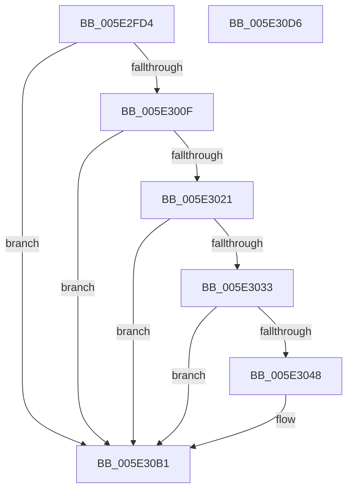

# PspProcessQosChangeNotificationInsertList

- RVA: `0x005E2FD4`–`0x005E30D7` (길이 `259` bytes)
- VA: `0x00000001405E2FD4`
- 실행 섹션: `.text`
- PDB 이름 있음: `예`; PDB Function 태그: `아니요`
- unwind 정보 RVA: `0x000BD914`
- 디코드: `56`개 명령, `259/259` bytes 표시
- 미해석 바이트: `0` (있으면 어셈블리에 `.byte`로 보존)

> 이 문서는 커널 이미지의 기계어와 PDB 기호를 분석해 생성했습니다. 4번과 5번은 함수 원형과 자료형을 바이너리 사용 방식에서 추정한 C 해석이며 원본 소스 복구 결과는 아닙니다.

## 1. Dependencies

- 직접 호출 지점: **4**; 고유 호출 대상: **4**
- 직접 호출자로 확인된 함수: **1**
- RIP 상대 이미지 참조: **3**

### Outgoing calls
- `0x005E3014` → [ObReferenceObjectSafeWithTag](../21/ObReferenceObjectSafeWithTag_function_00210EE0.md) (function, `0x00210EE0`)
- `0x005E303F` → [tlgKeywordOn](../42/tlgKeywordOn_function_0042EAA0.md) (function, `0x0042EAA0`)
- `0x005E30AC` → [tlgWriteTransfer_EtwWriteTransfer](../42/tlgWriteTransfer_EtwWriteTransfer_function_004260E0.md) (function, `0x004260E0`)
- `0x005E30BC` → [_security_check_cookie](../6A/_security_check_cookie_function_006AC640.md) (function, `0x006AC640`)

### Direct callers
- [PspEnqueueProcessQosChangeNotification](PspEnqueueProcessQosChangeNotification_function_005E2ED0.md) at `0x005E2F64`

### Static image references
- `0x005E2FE6` → RVA `0x00E0A740` (`.data`; read)
- `0x005E302A` → RVA `0x00E08640` (`.data`; read)
- `0x005E3094` → RVA `0x00052A2E` (`.rdata`; read)

## 2. Other-region calls and transfers

- 다른 실행 섹션으로 향하는 call: **0**
- 별도 외부 분기/꼬리 이동을 확인하지 못했습니다.

## 3. Assembly (complete function range)

```asm
005E2FD4  48 89 5C 24 18                  mov qword ptr [rsp + 0x18], rbx
005E2FD9  48 89 74 24 20                  mov qword ptr [rsp + 0x20], rsi
005E2FDE  57                              push rdi
005E2FDF  48 81 EC 90 00 00 00            sub rsp, 0x90
005E2FE6  48 8B 05 53 77 82 00            mov rax, qword ptr [rip + 0x827753]
005E2FED  48 33 C4                        xor rax, rsp
005E2FF0  48 89 84 24 80 00 00 00         mov qword ptr [rsp + 0x80], rax
005E2FF8  48 8D 99 28 08 00 00            lea rbx, [rcx + 0x828]
005E2FFF  48 8B FA                        mov rdi, rdx
005E3002  48 83 3B 01                     cmp qword ptr [rbx], 1
005E3006  48 8B F1                        mov rsi, rcx
005E3009  0F 85 A2 00 00 00               jne 0x1405e30b1
005E300F  BA 50 73 44 71                  mov edx, 0x71447350
005E3014  E8 C7 DE C2 FF                  call 0x140210ee0
005E3019  84 C0                           test al, al
005E301B  0F 84 90 00 00 00               je 0x1405e30b1
005E3021  48 8B 07                        mov rax, qword ptr [rdi]
005E3024  48 89 03                        mov qword ptr [rbx], rax
005E3027  48 89 1F                        mov qword ptr [rdi], rbx
005E302A  83 3D 0F 56 82 00 05            cmp dword ptr [rip + 0x82560f], 5
005E3031  76 7E                           jbe 0x1405e30b1
005E3033  BA 01 00 00 00                  mov edx, 1
005E3038  48 8D 0D 01 56 82 00            lea rcx, [rip + 0x825601]
005E303F  E8 5C BA E4 FF                  call 0x14042eaa0
005E3044  84 C0                           test al, al
005E3046  74 69                           je 0x1405e30b1
005E3048  8B 86 D0 01 00 00               mov eax, dword ptr [rsi + 0x1d0]
005E304E  48 8D 0D EB 55 82 00            lea rcx, [rip + 0x8255eb]
005E3055  83 64 24 6C 00                  and dword ptr [rsp + 0x6c], 0
005E305A  BA 04 00 00 00                  mov edx, 4
005E305F  83 64 24 7C 00                  and dword ptr [rsp + 0x7c], 0
005E3064  45 33 C9                        xor r9d, r9d
005E3067  89 44 24 30                     mov dword ptr [rsp + 0x30], eax
005E306B  45 33 C0                        xor r8d, r8d
005E306E  48 8D 44 24 30                  lea rax, [rsp + 0x30]
005E3073  89 54 24 68                     mov dword ptr [rsp + 0x68], edx
005E3077  48 89 44 24 60                  mov qword ptr [rsp + 0x60], rax
005E307C  48 8D 44 24 38                  lea rax, [rsp + 0x38]
005E3081  48 89 44 24 70                  mov qword ptr [rsp + 0x70], rax
005E3086  48 8D 44 24 40                  lea rax, [rsp + 0x40]
005E308B  48 89 44 24 28                  mov qword ptr [rsp + 0x28], rax
005E3090  89 54 24 20                     mov dword ptr [rsp + 0x20], edx
005E3094  48 8D 15 93 F9 A6 FF            lea rdx, [rip - 0x59066d]
005E309B  48 C7 44 24 38 00 00 00 01      mov qword ptr [rsp + 0x38], 0x1000000
005E30A4  C7 44 24 78 08 00 00 00         mov dword ptr [rsp + 0x78], 8
005E30AC  E8 2F 30 E4 FF                  call 0x1404260e0
005E30B1  48 8B 8C 24 80 00 00 00         mov rcx, qword ptr [rsp + 0x80]
005E30B9  48 33 CC                        xor rcx, rsp
005E30BC  E8 7F 95 0C 00                  call 0x1406ac640
005E30C1  4C 8D 9C 24 90 00 00 00         lea r11, [rsp + 0x90]
005E30C9  49 8B 5B 20                     mov rbx, qword ptr [r11 + 0x20]
005E30CD  49 8B 73 28                     mov rsi, qword ptr [r11 + 0x28]
005E30D1  49 8B E3                        mov rsp, r11
005E30D4  5F                              pop rdi
005E30D5  C3                              ret
005E30D6  CC                              int3
```

## 4. C-style interpretation (structured pseudocode)

```c
__int64 __fastcall PspProcessQosChangeNotificationInsertList(__int64 a1, __int64 a2, int a3, int a4)
{
    __int64 result;
    __int64 v_rsp;
    unsigned __int64 v_stack_m18;
    unsigned int v_stack_m1C;
    unsigned int v_stack_m20;
    unsigned __int64 v_stack_m28;
    unsigned int v_stack_m2C;
    unsigned int v_stack_m30;
    unsigned __int64 v_stack_m38;
    unsigned __int64 v_stack_m58;
    unsigned __int64 v_stack_m60;
    unsigned int v_stack_m68;
    unsigned __int64 v_stack_m70;
    unsigned int v_stack_m78;
    unsigned __int64 v_stack_m8;
    unsigned __int64 v_stack_p18;
    unsigned __int64 v_stack_p20;

    v_stack_p18 = v_rbx;
    v_stack_p20 = v_rsi;
    v_rsp = (v_rsp) - (144);
    result = (*(unsigned __int64 *)(v_rip + 8550227)) ^ (v_rsp);
    v_stack_m18 = result;
    if ((*(unsigned __int64 *)(a1 + 2088)) != 1) goto loc_005E30B1;
    result = ObReferenceObjectSafeWithTag(a1, (unsigned int)(0x71447350ULL), a3, a4);
    if ((unsigned __int8)(result) == 0) goto loc_005E30B1;
    *(unsigned __int64 *)(a1 + 2088) = *(unsigned __int64 *)(a2);
    *(unsigned __int64 *)(a2) = a1 + 2088;
    if ((*(unsigned int *)(v_rip + 8541711)) <= 5) goto loc_005E30B1;
    result = tlgKeywordOn(v_rip + 8541697, 1, a3, a4);
    if ((unsigned __int8)(result) != 0) {
        result = *(unsigned int *)(a1 + 464);
        a1 = v_rip + 8541675;
        a2 = 4;
        a4 = 0;
        v_stack_m68 = (unsigned int)(result);
        a3 = 0;
        result = v_stack_m68;
        v_stack_m30 = (unsigned int)(a2);
        v_stack_m38 = result;
        result = v_stack_m60;
        v_stack_m28 = result;
        result = v_stack_m58;
        v_stack_m70 = result;
        v_stack_m78 = (unsigned int)(a2);
        a2 = v_rip - 5834349;
        v_stack_m60 = 0x1000000ULL;
        v_stack_m20 = 8;
        result = tlgWriteTransfer_EtwWriteTransfer(a1, a2, a3, a4);
    }
    a1 = (v_stack_m18) ^ (v_rsp);
    result = _security_check_cookie(a1, a2, a3, a4);
    return result;
}
```

## 5. (Beta) C Style

```c
int64_t PspProcessQosChangeNotificationInsertList(void *Arg1, void *Arg2, int32_t Arg3, int32_t Arg4)
{
    uint8_t *arg1 = (uint8_t *)Arg1;
    uint8_t *arg2 = (uint8_t *)Arg2;

    int64_t result;
    int64_t local_rsp;
    uint64_t v_stack_m18;
    uint32_t v_stack_m1C;
    uint32_t v_stack_m20;
    uint64_t v_stack_m28;
    uint32_t v_stack_m2C;
    uint32_t v_stack_m30;
    uint64_t v_stack_m38;
    uint64_t v_stack_m58;
    uint64_t v_stack_m60;
    uint32_t v_stack_m68;
    uint64_t v_stack_m70;
    uint32_t v_stack_m78;
    uint64_t v_stack_m8;
    uint64_t v_stack_p18;
    uint64_t v_stack_p20;

    v_stack_p18 = local_rbx;
    v_stack_p20 = local_rsi;
    local_rsp = (local_rsp) - (144);
    result = (*(uint64_t *)(v_rip + 0x827753)) ^ (local_rsp);
    v_stack_m18 = result;
    if ((*(uint64_t *)(arg1 + 0x828)) != 1) goto loc_005E30B1;
    result = ObReferenceObjectSafeWithTag(Arg1, (uint32_t)(0x71447350ULL), Arg3, Arg4);
    if ((uint8_t)(result) == 0) goto loc_005E30B1;
    *(uint64_t *)(arg1 + 0x828) = *(uint64_t *)(arg2);
    *(void **)(arg2) = Arg1 + 2088;
    if ((*(uint32_t *)(v_rip + 0x82560F)) <= 5) goto loc_005E30B1;
    result = tlgKeywordOn(v_rip + 8541697, 1, Arg3, Arg4);
    if ((uint8_t)(result) != 0) {
        result = *(uint32_t *)(arg1 + 0x1D0);
        Arg1 = v_rip + 8541675;
        Arg2 = 4;
        Arg4 = 0;
        v_stack_m68 = (uint32_t)(result);
        Arg3 = 0;
        result = v_stack_m68;
        v_stack_m30 = (uint32_t)(Arg2);
        v_stack_m38 = result;
        result = v_stack_m60;
        v_stack_m28 = result;
        result = v_stack_m58;
        v_stack_m70 = result;
        v_stack_m78 = (uint32_t)(Arg2);
        Arg2 = v_rip - 5834349;
        v_stack_m60 = 0x1000000ULL;
        v_stack_m20 = 8;
        result = tlgWriteTransfer_EtwWriteTransfer(Arg1, Arg2, Arg3, Arg4);
    }
    Arg1 = (v_stack_m18) ^ (local_rsp);
    result = _security_check_cookie(Arg1, Arg2, Arg3, Arg4);
    return result;
}
```

### 관측된 메모리 오프셋

구조체 형식이 확인되지 않은 접근은 인자 기준의 오프셋으로만 기록했습니다.

| 기준 인자 | 오프셋 표현 | 폭 (bit) | 접근 |
|---|---:|---:|---|
| `Arg1` | `+ 0x0` | `64` | `R` |
| `Arg1` | `+ 0x0` | `64` | `W` |
| `Arg1` | `+ 0x1D0` | `32` | `R` |
| `Arg1` | `+ 0x828` | `64` | `R` |
| `Arg2` | `+ 0x0` | `64` | `R` |
| `Arg2` | `+ 0x0` | `64` | `W` |

## 6. Execution-region graph

[열기: 2D/3D 그래프와 함수 탐색 컨트롤 패널](../../../control-panel.html?section=text&rva=0x005E2FD4&view=graph)

- 2D 그래프는 위에서 아래로 흐르고, 3D 그래프는 빈 공간을 드래그해 회전합니다. Shift+드래그는 이동, 휠은 확대·축소, 함수 노드 선택은 대상 보고서 이동입니다.

### Static fallback


