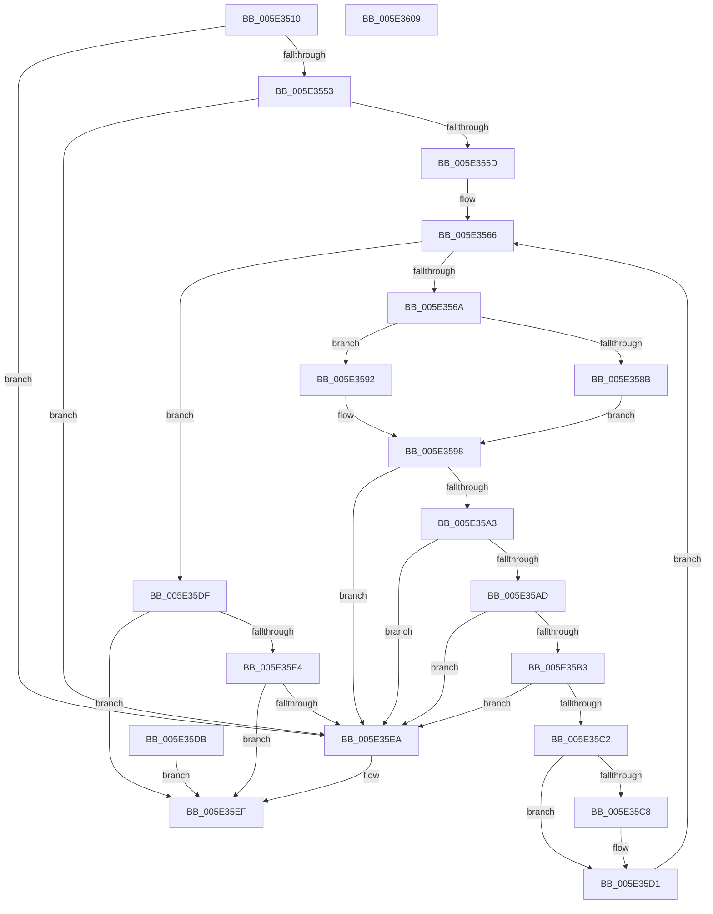

# PspProcessSuspendThreadParameters

- RVA: `0x005E3510`–`0x005E360A` (길이 `250` bytes)
- VA: `0x00000001405E3510`
- 실행 섹션: `.text`
- PDB 이름 있음: `예`; PDB Function 태그: `아니요`
- unwind 정보 RVA: `0x000CEDEC`
- 디코드: `77`개 명령, `250/250` bytes 표시
- 미해석 바이트: `0` (있으면 어셈블리에 `.byte`로 보존)

> 이 문서는 커널 이미지의 기계어와 PDB 기호를 분석해 생성했습니다. 4번과 5번은 함수 원형과 자료형을 바이너리 사용 방식에서 추정한 C 해석이며 원본 소스 복구 결과는 아닙니다.

## 1. Dependencies

- 직접 호출 지점: **2**; 고유 호출 대상: **2**
- 직접 호출자로 확인된 함수: **1**
- RIP 상대 이미지 참조: **0**

### Outgoing calls
- `0x005E358B` → [RtlCopyFromUser](../4F/RtlCopyFromUser_function_004FDAE8.md) (function, `0x004FDAE8`)
- `0x005E3592` → [RtlCopyVolatileMemory](../6B/RtlCopyVolatileMemory_function_006BC9D0.md) (function, `0x006BC9D0`)

### Direct callers
- [NtChangeThreadState](../../page/AE/NtChangeThreadState_function_00AEA210.md) at `0x00AEA2A4`

### Static image references
- 디코드된 RIP-relative 메모리 참조가 없습니다.

## 2. Other-region calls and transfers

- 다른 실행 섹션으로 향하는 call: **0**
- 별도 외부 분기/꼬리 이동을 확인하지 못했습니다.

## 3. Assembly (complete function range)

```asm
005E3510  48 89 5C 24 08                  mov qword ptr [rsp + 8], rbx
005E3515  48 89 74 24 10                  mov qword ptr [rsp + 0x10], rsi
005E351A  44 88 4C 24 20                  mov byte ptr [rsp + 0x20], r9b
005E351F  57                              push rdi
005E3520  41 54                           push r12
005E3522  41 55                           push r13
005E3524  41 56                           push r14
005E3526  41 57                           push r15
005E3528  48 83 EC 30                     sub rsp, 0x30
005E352C  45 8A E1                        mov r12b, r9b
005E352F  41 8B F8                        mov edi, r8d
005E3532  4C 8B EA                        mov r13, rdx
005E3535  44 8B F9                        mov r15d, ecx
005E3538  0F 57 C0                        xorps xmm0, xmm0
005E353B  4C 8B B4 24 80 00 00 00         mov r14, qword ptr [rsp + 0x80]
005E3543  41 0F 11 06                     movups xmmword ptr [r14], xmm0
005E3547  F7 C1 FE FF FF FF               test ecx, 0xfffffffe
005E354D  0F 85 97 00 00 00               jne 0x1405e35ea
005E3553  40 F6 C7 0F                     test dil, 0xf
005E3557  0F 85 8D 00 00 00               jne 0x1405e35ea
005E355D  C1 EF 04                        shr edi, 4
005E3560  33 DB                           xor ebx, ebx
005E3562  8B F3                           mov esi, ebx
005E3564  8B D3                           mov edx, ebx
005E3566  3B F7                           cmp esi, edi
005E3568  73 75                           jae 0x1405e35df
005E356A  0F 57 C0                        xorps xmm0, xmm0
005E356D  0F 11 44 24 20                  movups xmmword ptr [rsp + 0x20], xmm0
005E3572  8B D6                           mov edx, esi
005E3574  48 C1 E2 04                     shl rdx, 4
005E3578  49 03 D5                        add rdx, r13
005E357B  41 B8 10 00 00 00               mov r8d, 0x10
005E3581  48 8D 4C 24 20                  lea rcx, [rsp + 0x20]
005E3586  45 84 E4                        test r12b, r12b
005E3589  74 07                           je 0x1405e3592
005E358B  E8 58 A5 F1 FF                  call 0x1404fdae8
005E3590  EB 06                           jmp 0x1405e3598
005E3592  E8 39 94 0D 00                  call 0x1406bc9d0
005E3597  90                              nop
005E3598  48 F7 44 24 20 00 FF FF FF      test qword ptr [rsp + 0x20], -0x100
005E35A1  75 47                           jne 0x1405e35ea
005E35A3  0F B6 4C 24 20                  movzx ecx, byte ptr [rsp + 0x20]
005E35A8  48 85 C9                        test rcx, rcx
005E35AB  74 3D                           je 0x1405e35ea
005E35AD  48 83 F9 02                     cmp rcx, 2
005E35B1  73 37                           jae 0x1405e35ea
005E35B3  BA 01 00 00 00                  mov edx, 1
005E35B8  D3 E2                           shl edx, cl
005E35BA  45 8B 06                        mov r8d, dword ptr [r14]
005E35BD  41 85 D0                        test r8d, edx
005E35C0  75 28                           jne 0x1405e35ea
005E35C2  48 83 F9 01                     cmp rcx, 1
005E35C6  75 09                           jne 0x1405e35d1
005E35C8  48 8B 44 24 28                  mov rax, qword ptr [rsp + 0x28]
005E35CD  49 89 46 08                     mov qword ptr [r14 + 8], rax
005E35D1  41 0B D0                        or edx, r8d
005E35D4  41 89 16                        mov dword ptr [r14], edx
005E35D7  FF C6                           inc esi
005E35D9  EB 8B                           jmp 0x1405e3566
005E35DB  8B D8                           mov ebx, eax
005E35DD  EB 10                           jmp 0x1405e35ef
005E35DF  F6 C2 02                        test dl, 2
005E35E2  74 0B                           je 0x1405e35ef
005E35E4  41 F6 C7 01                     test r15b, 1
005E35E8  75 05                           jne 0x1405e35ef
005E35EA  BB 0D 00 00 C0                  mov ebx, 0xc000000d
005E35EF  8B C3                           mov eax, ebx
005E35F1  48 8B 5C 24 60                  mov rbx, qword ptr [rsp + 0x60]
005E35F6  48 8B 74 24 68                  mov rsi, qword ptr [rsp + 0x68]
005E35FB  48 83 C4 30                     add rsp, 0x30
005E35FF  41 5F                           pop r15
005E3601  41 5E                           pop r14
005E3603  41 5D                           pop r13
005E3605  41 5C                           pop r12
005E3607  5F                              pop rdi
005E3608  C3                              ret
005E3609  CC                              int3
```

## 4. C-style interpretation (structured pseudocode)

```c
__int64 __fastcall PspProcessSuspendThreadParameters(int a1, __int64 a2, int a3, unsigned __int8 a4, __int64 a5)
{
    __int64 result;
    __int64 v_rbx;
    __int64 v_rdi;
    __int64 v_rsi;
    __int64 v_rsp;
    unsigned __int64 v_stack_m30;
    unsigned __int64 v_stack_m38;
    unsigned __int64 v_stack_p10;
    unsigned __int8 v_stack_p20;
    unsigned __int64 v_stack_p8;

    v_stack_p8 = v_rbx;
    v_stack_p10 = v_rsi;
    v_stack_p20 = a4;
    v_rsp = (v_rsp) - (48);
    *(unsigned __int64 *)(a5) = v_xmm0;
    if (((a1) & (0xFFFFFFFEULL)) != 0) goto loc_005E35EA;
    if ((((unsigned __int8)((unsigned int)(a3))) & (15)) != 0) goto loc_005E35EA;
    v_rdi = (unsigned int)(((unsigned int)(a3)) >> (4));
    v_rbx = 0;
loc_005E3566:
    if (0 >= ((unsigned int)(v_rdi))) goto loc_005E35DF;
    v_stack_m38 = v_xmm0;
    a2 = (0) << (4);
    a2 = (a2) + (a2);
    if (a4 == 0) goto loc_005E3592;
    result = RtlCopyFromUser(v_stack_m38, a2, 16, a4);
    goto loc_005E3598;
loc_005E3592:
    result = RtlCopyVolatileMemory(v_stack_m38, a2, 16, a4);
loc_005E3598:
    if (((v_stack_m38) & (-256)) != 0) goto loc_005E35EA;
    if (v_stack_m38 == 0) goto loc_005E35EA;
    if (v_stack_m38 >= 2) goto loc_005E35EA;
    a2 = (unsigned int)((1) << ((unsigned __int8)(v_stack_m38)));
    if ((((unsigned int)((unsigned int)(*(unsigned int *)(a5)))) & ((unsigned int)(a2))) != 0) goto loc_005E35EA;
    if (v_stack_m38 == 1) {
        result = v_stack_m30;
        *(unsigned __int64 *)(a5 + 8) = result;
    }
    a2 = (unsigned int)((a2) | ((unsigned int)((unsigned int)(*(unsigned int *)(a5)))));
    *(unsigned int *)(a5) = (unsigned int)(a2);
    v_rsi = (unsigned int)((0) + 1);
    goto loc_005E3566;
loc_005E35DF:
    if ((((unsigned __int8)(a2)) & (2)) == 0) goto loc_005E35EF;
    if ((((unsigned __int8)((unsigned int)(a1))) & (1)) == 0) {
        v_rbx = 0xC000000DULL;
    }
    v_rsp = (v_rsp) + (48);
    return (unsigned int)((unsigned int)(v_rbx));
}
```

## 5. (Beta) C Style

```c
int64_t PspProcessSuspendThreadParameters(int32_t Arg1, int64_t Arg2, int32_t Arg3, uint8_t Arg4, void *Arg5)
{
    uint8_t *arg5 = (uint8_t *)Arg5;

    int64_t result;
    int64_t local_rbx;
    int64_t local_rdi;
    int64_t local_rsi;
    int64_t local_rsp;
    uint64_t v_stack_m30;
    uint64_t v_stack_m38;
    uint64_t v_stack_p10;
    uint8_t v_stack_p20;
    uint64_t v_stack_p8;

    v_stack_p8 = local_rbx;
    v_stack_p10 = local_rsi;
    v_stack_p20 = Arg4;
    local_rsp = (local_rsp) - (48);
    *(uint64_t *)(arg5) = v_xmm0;
    if (((Arg1) & (0xFFFFFFFEULL)) != 0) goto loc_005E35EA;
    if ((((uint8_t)((uint32_t)(Arg3))) & (15)) != 0) goto loc_005E35EA;
    local_rdi = (uint32_t)(((uint32_t)(Arg3)) >> (4));
    local_rbx = 0;
loc_005E3566:
    if (0 >= ((uint32_t)(local_rdi))) goto loc_005E35DF;
    v_stack_m38 = v_xmm0;
    Arg2 = (0) << (4);
    Arg2 = (Arg2) + (Arg2);
    if (Arg4 == 0) goto loc_005E3592;
    result = RtlCopyFromUser(v_stack_m38, Arg2, 16, Arg4);
    goto loc_005E3598;
loc_005E3592:
    result = RtlCopyVolatileMemory(v_stack_m38, Arg2, 16, Arg4);
loc_005E3598:
    if (((v_stack_m38) & (-256)) != 0) goto loc_005E35EA;
    if (v_stack_m38 == 0) goto loc_005E35EA;
    if (v_stack_m38 >= 2) goto loc_005E35EA;
    Arg2 = (uint32_t)((1) << ((uint8_t)(v_stack_m38)));
    if ((((uint32_t)((uint32_t)(*(uint32_t *)(arg5)))) & ((uint32_t)(Arg2))) != 0) goto loc_005E35EA;
    if (v_stack_m38 == 1) {
        result = v_stack_m30;
        *(uint64_t *)(arg5 + 0x8) = result;
    }
    Arg2 = (uint32_t)((Arg2) | ((uint32_t)((uint32_t)(*(uint32_t *)(arg5)))));
    *(uint32_t *)(arg5) = (uint32_t)(Arg2);
    local_rsi = (uint32_t)((0) + 1);
    goto loc_005E3566;
loc_005E35DF:
    if ((((uint8_t)(Arg2)) & (2)) == 0) goto loc_005E35EF;
    if ((((uint8_t)((uint32_t)(Arg1))) & (1)) == 0) {
        local_rbx = 0xC000000DULL;
    }
    local_rsp = (local_rsp) + (48);
    return (uint32_t)((uint32_t)(local_rbx));
}
```

### 관측된 메모리 오프셋

구조체 형식이 확인되지 않은 접근은 인자 기준의 오프셋으로만 기록했습니다.

| 기준 인자 | 오프셋 표현 | 폭 (bit) | 접근 |
|---|---:|---:|---|
| `Arg5` | `+ 0x0` | `32` | `R` |
| `Arg5` | `+ 0x0` | `32` | `W` |
| `Arg5` | `+ 0x0` | `128` | `R` |
| `Arg5` | `+ 0x8` | `64` | `W` |

## 6. Execution-region graph

[열기: 2D/3D 그래프와 함수 탐색 컨트롤 패널](../../../control-panel.html?section=text&rva=0x005E3510&view=graph)

- 2D 그래프는 위에서 아래로 흐르고, 3D 그래프는 빈 공간을 드래그해 회전합니다. Shift+드래그는 이동, 휠은 확대·축소, 함수 노드 선택은 대상 보고서 이동입니다.

### Static fallback


