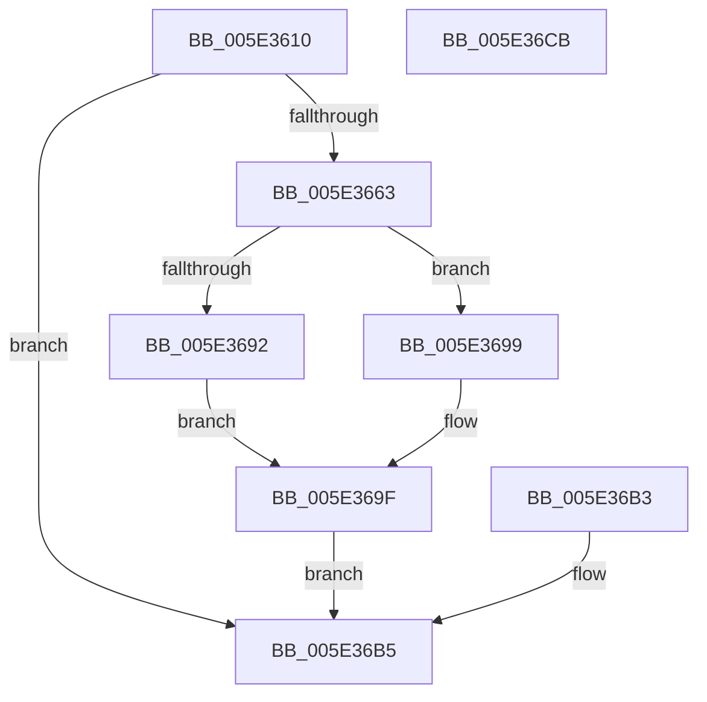

# PspProcessUserCopyAttribute

- RVA: `0x005E3610`–`0x005E36CC` (길이 `188` bytes)
- VA: `0x00000001405E3610`
- 실행 섹션: `.text`
- PDB 이름 있음: `예`; PDB Function 태그: `아니요`
- unwind 정보 RVA: `0x000CEEC0`
- 디코드: `50`개 명령, `188/188` bytes 표시
- 미해석 바이트: `0` (있으면 어셈블리에 `.byte`로 보존)

> 이 문서는 커널 이미지의 기계어와 PDB 기호를 분석해 생성했습니다. 4번과 5번은 함수 원형과 자료형을 바이너리 사용 방식에서 추정한 C 해석이며 원본 소스 복구 결과는 아닙니다.

## 1. Dependencies

- 직접 호출 지점: **2**; 고유 호출 대상: **2**
- 직접 호출자로 확인된 함수: **1**
- RIP 상대 이미지 참조: **0**

### Outgoing calls
- `0x005E3692` → [RtlCopyFromUser](../4F/RtlCopyFromUser_function_004FDAE8.md) (function, `0x004FDAE8`)
- `0x005E3699` → [RtlCopyVolatileMemory](../6B/RtlCopyVolatileMemory_function_006BC9D0.md) (function, `0x006BC9D0`)

### Direct callers
- [PspBuildCreateProcessContext](../../page/9E/PspBuildCreateProcessContext_function_009ED6E0.md) at `0x009EEC7F`

### Static image references
- 디코드된 RIP-relative 메모리 참조가 없습니다.

## 2. Other-region calls and transfers

- 다른 실행 섹션으로 향하는 call: **0**
- 별도 외부 분기/꼬리 이동을 확인하지 못했습니다.

## 3. Assembly (complete function range)

```asm
005E3610  48 89 5C 24 08                  mov qword ptr [rsp + 8], rbx
005E3615  48 89 74 24 18                  mov qword ptr [rsp + 0x18], rsi
005E361A  88 54 24 10                     mov byte ptr [rsp + 0x10], dl
005E361E  57                              push rdi
005E361F  41 56                           push r14
005E3621  41 57                           push r15
005E3623  48 83 EC 20                     sub rsp, 0x20
005E3627  49 8B D8                        mov rbx, r8
005E362A  44 8A CA                        mov r9b, dl
005E362D  33 FF                           xor edi, edi
005E362F  45 8B B0 50 02 00 00            mov r14d, dword ptr [r8 + 0x250]
005E3636  49 C1 E6 05                     shl r14, 5
005E363A  0F 10 01                        movups xmm0, xmmword ptr [rcx]
005E363D  43 0F 11 84 06 30 02 00 00      movups xmmword ptr [r14 + r8 + 0x230], xmm0
005E3646  0F 10 49 10                     movups xmm1, xmmword ptr [rcx + 0x10]
005E364A  43 0F 11 8C 06 40 02 00 00      movups xmmword ptr [r14 + r8 + 0x240], xmm1
005E3653  41 FF 80 50 02 00 00            inc dword ptr [r8 + 0x250]
005E365A  8B 01                           mov eax, dword ptr [rcx]
005E365C  48 0F BA E0 12                  bt rax, 0x12
005E3661  72 52                           jb 0x1405e36b5
005E3663  44 8B 79 08                     mov r15d, dword ptr [rcx + 8]
005E3667  41 8D 47 FF                     lea eax, [r15 - 1]
005E366B  83 E0 07                        and eax, 7
005E366E  44 2B F8                        sub r15d, eax
005E3671  41 8B B0 54 02 00 00            mov esi, dword ptr [r8 + 0x254]
005E3678  48 81 C6 58 02 00 00            add rsi, 0x258
005E367F  48 03 F3                        add rsi, rbx
005E3682  48 8B 51 10                     mov rdx, qword ptr [rcx + 0x10]
005E3686  4C 8B 41 08                     mov r8, qword ptr [rcx + 8]
005E368A  48 8B CE                        mov rcx, rsi
005E368D  45 84 C9                        test r9b, r9b
005E3690  74 07                           je 0x1405e3699
005E3692  E8 51 A4 F1 FF                  call 0x1404fdae8
005E3697  EB 06                           jmp 0x1405e369f
005E3699  E8 32 93 0D 00                  call 0x1406bc9d0
005E369E  90                              nop
005E369F  49 89 B4 1E 40 02 00 00         mov qword ptr [r14 + rbx + 0x240], rsi
005E36A7  41 8D 47 07                     lea eax, [r15 + 7]
005E36AB  01 83 54 02 00 00               add dword ptr [rbx + 0x254], eax
005E36B1  EB 02                           jmp 0x1405e36b5
005E36B3  8B F8                           mov edi, eax
005E36B5  8B C7                           mov eax, edi
005E36B7  48 8B 5C 24 40                  mov rbx, qword ptr [rsp + 0x40]
005E36BC  48 8B 74 24 50                  mov rsi, qword ptr [rsp + 0x50]
005E36C1  48 83 C4 20                     add rsp, 0x20
005E36C5  41 5F                           pop r15
005E36C7  41 5E                           pop r14
005E36C9  5F                              pop rdi
005E36CA  C3                              ret
005E36CB  CC                              int3
```

## 4. C-style interpretation (structured pseudocode)

```c
__int64 __fastcall PspProcessUserCopyAttribute(__int64 a1, unsigned __int8 a2, __int64 a3)
{
    __int64 result;
    __int64 v_r14;
    __int64 v_r15;
    __int64 v_rdi;
    __int64 v_rsi;
    __int64 v_rsp;
    unsigned __int8 v_stack_p10;
    unsigned __int64 v_stack_p18;
    unsigned __int64 v_stack_p8;

    v_stack_p8 = v_rbx;
    v_stack_p18 = v_rsi;
    v_stack_p10 = a2;
    v_rsp = (v_rsp) - (32);
    v_rdi = 0;
    v_r14 = ((unsigned int)(*(unsigned int *)(a3 + 592))) << (5);
    *(unsigned __int64 *)(v_r14 + a3 * 1 + 560) = v_xmm0;
    *(unsigned __int64 *)(v_r14 + a3 * 1 + 576) = v_xmm1;
    if (condition_is_below) goto loc_005E36B5;
    result = (unsigned int)(((unsigned int)(*(unsigned int *)(a1 + 8)) - 1) & (7));
    v_r15 = (unsigned int)(((unsigned int)(*(unsigned int *)(a1 + 8))) - ((unsigned int)(result)));
    v_rsi = ((unsigned int)(*(unsigned int *)(a3 + 596))) + (600);
    v_rsi = (v_rsi) + (a3);
    if (a2 == 0) goto loc_005E3699;
    result = RtlCopyFromUser(v_rsi, *(unsigned __int64 *)(a1 + 16), *(unsigned __int64 *)(a1 + 8), a2);
    goto loc_005E369F;
loc_005E3699:
    result = RtlCopyVolatileMemory(v_rsi, *(unsigned __int64 *)(a1 + 16), *(unsigned __int64 *)(a1 + 8), a2);
loc_005E369F:
    *(unsigned __int64 *)(v_r14 + a3 * 1 + 576) = v_rsi;
    goto loc_005E36B5;
loc_005E36B5:
    v_rsp = (v_rsp) + (32);
    return 0;
}
```

## 5. (Beta) C Style

```c
int64_t PspProcessUserCopyAttribute(void *Arg1, uint8_t Arg2, void *Arg3)
{
    uint8_t *arg1 = (uint8_t *)Arg1;
    uint8_t *arg3 = (uint8_t *)Arg3;

    int64_t result;
    int64_t local_r14;
    int64_t local_r15;
    int64_t local_rdi;
    int64_t local_rsi;
    int64_t local_rsp;
    uint8_t v_stack_p10;
    uint64_t v_stack_p18;
    uint64_t v_stack_p8;

    v_stack_p8 = local_rbx;
    v_stack_p18 = local_rsi;
    v_stack_p10 = Arg2;
    local_rsp = (local_rsp) - (32);
    local_rdi = 0;
    local_r14 = ((uint32_t)(*(uint32_t *)(arg3 + 0x250))) << (5);
    *(uint64_t *)(local_r14 + arg3 * 1 + 0x230) = v_xmm0;
    *(uint64_t *)(local_r14 + arg3 * 1 + 0x240) = v_xmm1;
    if (condition_is_below) goto loc_005E36B5;
    result = (uint32_t)(((uint32_t)(*(uint32_t *)(arg1 + 0x8)) - 1) & (7));
    local_r15 = (uint32_t)(((uint32_t)(*(uint32_t *)(arg1 + 0x8))) - ((uint32_t)(result)));
    local_rsi = ((uint32_t)(*(uint32_t *)(arg3 + 0x254))) + (600);
    local_rsi = (local_rsi) + (Arg3);
    if (Arg2 == 0) goto loc_005E3699;
    result = RtlCopyFromUser(local_rsi, *(uint64_t *)(arg1 + 0x10), *(uint64_t *)(arg1 + 0x8), Arg2);
    goto loc_005E369F;
loc_005E3699:
    result = RtlCopyVolatileMemory(local_rsi, *(uint64_t *)(arg1 + 0x10), *(uint64_t *)(arg1 + 0x8), Arg2);
loc_005E369F:
    *(uint64_t *)(local_r14 + arg3 * 1 + 0x240) = local_rsi;
    goto loc_005E36B5;
loc_005E36B5:
    local_rsp = (local_rsp) + (32);
    return 0;
}
```

### 관측된 메모리 오프셋

구조체 형식이 확인되지 않은 접근은 인자 기준의 오프셋으로만 기록했습니다.

| 기준 인자 | 오프셋 표현 | 폭 (bit) | 접근 |
|---|---:|---:|---|
| `Arg1` | `+ 0x0` | `32` | `R` |
| `Arg1` | `+ 0x0` | `128` | `R` |
| `Arg1` | `+ 0x8` | `32` | `R` |
| `Arg1` | `+ 0x8` | `64` | `R` |
| `Arg1` | `+ 0x10` | `64` | `R` |
| `Arg1` | `+ 0x10` | `128` | `R` |
| `Arg3` | `+ 0x250` | `32` | `R` |
| `Arg3` | `+ 0x250` | `32` | `R/W` |
| `Arg3` | `+ 0x254` | `32` | `R` |
| `Arg3` | `+ 0x254` | `32` | `R/W` |

## 6. Execution-region graph

[열기: 2D/3D 그래프와 함수 탐색 컨트롤 패널](../../../control-panel.html?section=text&rva=0x005E3610&view=graph)

- 2D 그래프는 위에서 아래로 흐르고, 3D 그래프는 빈 공간을 드래그해 회전합니다. Shift+드래그는 이동, 휠은 확대·축소, 함수 노드 선택은 대상 보고서 이동입니다.

### Static fallback


