# PspReadDfssConfigurationValues

- RVA: `0x005E2508`–`0x005E270C` (길이 `516` bytes)
- VA: `0x00000001405E2508`
- 실행 섹션: `.text`
- PDB 이름 있음: `예`; PDB Function 태그: `아니요`
- unwind 정보 RVA: `0x000C7E80`
- 디코드: `126`개 명령, `516/516` bytes 표시
- 미해석 바이트: `0` (있으면 어셈블리에 `.byte`로 보존)

> 이 문서는 커널 이미지의 기계어와 PDB 기호를 분석해 생성했습니다. 4번과 5번은 함수 원형과 자료형을 바이너리 사용 방식에서 추정한 C 해석이며 원본 소스 복구 결과는 아닙니다.

## 1. Dependencies

- 직접 호출 지점: **10**; 고유 호출 대상: **8**
- 직접 호출자로 확인된 함수: **2**
- RIP 상대 이미지 참조: **13**

### Outgoing calls
- `0x005E2571` → [ZwOpenKey](../6A/ZwOpenKey_function_006AD310.md) (function, `0x006AD310`)
- `0x005E25AF` → [RtlQueryImageFileKeyOption](../../page/A2/RtlQueryImageFileKeyOption_function_00A2D110.md) (function, `0x00A2D110`)
- `0x005E25F6` → [ExAllocatePool2](../../poolcode/B8/ExAllocatePool2_function_00B820F0.md) (function, `0x00B820F0`)
- `0x005E260B` → [ZwClose](../6A/ZwClose_function_006AD2B0.md) (function, `0x006AD2B0`)
- `0x005E2624` → [KeUpdateGroupSchedulingConstants](../5C/KeUpdateGroupSchedulingConstants_function_005C8E14.md) (function, `0x005C8E14`)
- `0x005E265A` → [ExSetTimerResolution](../49/ExSetTimerResolution_function_0049E7D0.md) (function, `0x0049E7D0`)
- `0x005E2667` → [ExSetTimerResolution](../49/ExSetTimerResolution_function_0049E7D0.md) (function, `0x0049E7D0`)
- `0x005E26C0` → [ZwNotifyChangeKey](../6A/ZwNotifyChangeKey_function_006AF550.md) (function, `0x006AF550`)
- `0x005E26D0` → [ZwClose](../6A/ZwClose_function_006AD2B0.md) (function, `0x006AD2B0`)
- `0x005E26E9` → [ExFreePoolWithTag](../../poolcode/B8/ExFreePoolWithTag_function_00B82870.md) (function, `0x00B82870`)

### Direct callers
- [PspDfssConfigurationChangeHandler](../../page/77/PspDfssConfigurationChangeHandler_function_0077EE80.md) at `0x0077EE84`
- [PspIsDfssEnabled](../../page/77/PspIsDfssEnabled_function_0077EFF4.md) at `0x0077F0B1`

### Static image references
- `0x005E252E` → RVA `0x00FC6EB0` (`ALMOSTRO`; read)
- `0x005E254A` → RVA `0x00B4B7F0` (`PspQuotaKeyNames`; read)
- `0x005E2584` → RVA `0x00FC5540` (`ALMOSTRO`; read)
- `0x005E25E1` → RVA `0x00FC6DE8` (`ALMOSTRO`; read)
- `0x005E25FB` → RVA `0x00FC6DE8` (`ALMOSTRO`; write)
- `0x005E2619` → RVA `0x00FC6EB0` (`ALMOSTRO`; write)
- `0x005E2629` → RVA `0x00FC52FC` (`ALMOSTRO`; read)
- `0x005E2640` → RVA `0x00FC6AA0` (`ALMOSTRO`; read)
- `0x005E264A` → RVA `0x00FC516C` (`ALMOSTRO`; read)
- `0x005E266C` → RVA `0x00FC516C` (`ALMOSTRO`; write)
- `0x005E2679` → RVA `0x0077EE80` (`PspDfssConfigurationChangeHandler`; read)
- `0x005E26E1` → RVA `0x00FC6EB0` (`ALMOSTRO`; read/write)
- `0x005E26EE` → RVA `0x00FC6DE8` (`ALMOSTRO`; read/write)

## 2. Other-region calls and transfers

- 다른 실행 섹션으로 향하는 call: **3**
  - `0x005E25AF` → [RtlQueryImageFileKeyOption](../../page/A2/RtlQueryImageFileKeyOption_function_00A2D110.md) (`.text` → `PAGE`)
  - `0x005E25F6` → [ExAllocatePool2](../../poolcode/B8/ExAllocatePool2_function_00B820F0.md) (`.text` → `POOLCODE`)
  - `0x005E26E9` → [ExFreePoolWithTag](../../poolcode/B8/ExFreePoolWithTag_function_00B82870.md) (`.text` → `POOLCODE`)
- 별도 외부 분기/꼬리 이동을 확인하지 못했습니다.

## 3. Assembly (complete function range)

```asm
005E2508  48 89 5C 24 10                  mov qword ptr [rsp + 0x10], rbx
005E250D  48 89 7C 24 18                  mov qword ptr [rsp + 0x18], rdi
005E2512  55                              push rbp
005E2513  48 8B EC                        mov rbp, rsp
005E2516  48 81 EC 80 00 00 00            sub rsp, 0x80
005E251D  48 83 65 10 00                  and qword ptr [rbp + 0x10], 0
005E2522  33 C0                           xor eax, eax
005E2524  0F 57 C0                        xorps xmm0, xmm0
005E2527  48 89 45 F0                     mov qword ptr [rbp - 0x10], rax
005E252B  89 45 F8                        mov dword ptr [rbp - 8], eax
005E252E  48 8B 05 7B 49 9E 00            mov rax, qword ptr [rip + 0x9e497b]
005E2535  0F 11 45 D0                     movups xmmword ptr [rbp - 0x30], xmm0
005E2539  0F 11 45 E0                     movups xmmword ptr [rbp - 0x20], xmm0
005E253D  48 85 C0                        test rax, rax
005E2540  75 3E                           jne 0x1405e2580
005E2542  48 21 45 D8                     and qword ptr [rbp - 0x28], rax
005E2546  4C 8D 45 D0                     lea r8, [rbp - 0x30]
005E254A  48 8D 05 9F 92 56 00            lea rax, [rip + 0x56929f]
005E2551  C7 45 D0 30 00 00 00            mov dword ptr [rbp - 0x30], 0x30
005E2558  BA 11 00 00 00                  mov edx, 0x11
005E255D  48 89 45 E0                     mov qword ptr [rbp - 0x20], rax
005E2561  48 8D 4D 10                     lea rcx, [rbp + 0x10]
005E2565  C7 45 E8 40 02 00 00            mov dword ptr [rbp - 0x18], 0x240
005E256C  F3 0F 7F 45 F0                  movdqu xmmword ptr [rbp - 0x10], xmm0
005E2571  E8 9A AD 0C 00                  call 0x1406ad310
005E2576  85 C0                           test eax, eax
005E2578  0F 88 78 01 00 00               js 0x1405e26f6
005E257E  EB 04                           jmp 0x1405e2584
005E2580  48 89 45 10                     mov qword ptr [rbp + 0x10], rax
005E2584  48 8D 1D B5 2F 9E 00            lea rbx, [rip + 0x9e2fb5]
005E258B  BF 05 00 00 00                  mov edi, 5
005E2590  48 83 64 24 28 00               and qword ptr [rsp + 0x28], 0
005E2596  41 B8 04 00 00 00               mov r8d, 4
005E259C  4C 8B 0B                        mov r9, qword ptr [rbx]
005E259F  48 8B 53 08                     mov rdx, qword ptr [rbx + 8]
005E25A3  48 8B 4D 10                     mov rcx, qword ptr [rbp + 0x10]
005E25A7  C7 44 24 20 04 00 00 00         mov dword ptr [rsp + 0x20], 4
005E25AF  E8 5C AB 44 00                  call 0x140a2d110
005E25B4  48 8B 0B                        mov rcx, qword ptr [rbx]
005E25B7  85 C0                           test eax, eax
005E25B9  79 07                           jns 0x1405e25c2
005E25BB  8B 43 10                        mov eax, dword ptr [rbx + 0x10]
005E25BE  89 01                           mov dword ptr [rcx], eax
005E25C0  EB 15                           jmp 0x1405e25d7
005E25C2  8B 43 14                        mov eax, dword ptr [rbx + 0x14]
005E25C5  39 01                           cmp dword ptr [rcx], eax
005E25C7  73 02                           jae 0x1405e25cb
005E25C9  89 01                           mov dword ptr [rcx], eax
005E25CB  48 8B 03                        mov rax, qword ptr [rbx]
005E25CE  8B 4B 18                        mov ecx, dword ptr [rbx + 0x18]
005E25D1  39 08                           cmp dword ptr [rax], ecx
005E25D3  76 02                           jbe 0x1405e25d7
005E25D5  89 08                           mov dword ptr [rax], ecx
005E25D7  48 83 C3 20                     add rbx, 0x20
005E25DB  48 83 EF 01                     sub rdi, 1
005E25DF  75 AF                           jne 0x1405e2590
005E25E1  48 39 3D 00 48 9E 00            cmp qword ptr [rip + 0x9e4800], rdi
005E25E8  75 38                           jne 0x1405e2622
005E25EA  8D 57 30                        lea edx, [rdi + 0x30]
005E25ED  41 B8 44 66 73 73               mov r8d, 0x73736644
005E25F3  8D 4F 40                        lea ecx, [rdi + 0x40]
005E25F6  E8 F5 FA 59 00                  call 0x140b820f0
005E25FB  48 89 05 E6 47 9E 00            mov qword ptr [rip + 0x9e47e6], rax
005E2602  48 85 C0                        test rax, rax
005E2605  75 0E                           jne 0x1405e2615
005E2607  48 8B 4D 10                     mov rcx, qword ptr [rbp + 0x10]
005E260B  E8 A0 AC 0C 00                  call 0x1406ad2b0
005E2610  E9 E1 00 00 00                  jmp 0x1405e26f6
005E2615  48 8B 45 10                     mov rax, qword ptr [rbp + 0x10]
005E2619  48 89 05 90 48 9E 00            mov qword ptr [rip + 0x9e4890], rax
005E2620  EB 07                           jmp 0x1405e2629
005E2622  33 C9                           xor ecx, ecx
005E2624  E8 EB 67 FE FF                  call 0x1405c8e14
005E2629  8B 05 CD 2C 9E 00               mov eax, dword ptr [rip + 0x9e2ccd]
005E262F  BF FF FF FF FF                  mov edi, 0xffffffff
005E2634  48 69 D8 10 27 00 00            imul rbx, rax, 0x2710
005E263B  48 3B DF                        cmp rbx, rdi
005E263E  77 08                           ja 0x1405e2648
005E2640  3B 1D 5A 44 9E 00               cmp ebx, dword ptr [rip + 0x9e445a]
005E2646  72 02                           jb 0x1405e264a
005E2648  8B DF                           mov ebx, edi
005E264A  8B 0D 1C 2B 9E 00               mov ecx, dword ptr [rip + 0x9e2b1c]
005E2650  3B CB                           cmp ecx, ebx
005E2652  74 1E                           je 0x1405e2672
005E2654  3B CF                           cmp ecx, edi
005E2656  74 07                           je 0x1405e265f
005E2658  33 D2                           xor edx, edx
005E265A  E8 71 C1 EB FF                  call 0x14049e7d0
005E265F  3B DF                           cmp ebx, edi
005E2661  74 09                           je 0x1405e266c
005E2663  B2 01                           mov dl, 1
005E2665  8B CB                           mov ecx, ebx
005E2667  E8 64 C1 EB FF                  call 0x14049e7d0
005E266C  89 1D FA 2A 9E 00               mov dword ptr [rip + 0x9e2afa], ebx
005E2672  4C 8B 05 6F 47 9E 00            mov r8, qword ptr [rip + 0x9e476f]
005E2679  48 8D 05 00 C8 19 00            lea rax, [rip + 0x19c800]
005E2680  48 8B 0D 29 48 9E 00            mov rcx, qword ptr [rip + 0x9e4829]
005E2687  33 D2                           xor edx, edx
005E2689  C6 44 24 48 01                  mov byte ptr [rsp + 0x48], 1
005E268E  83 64 24 40 00                  and dword ptr [rsp + 0x40], 0
005E2693  48 83 64 24 38 00               and qword ptr [rsp + 0x38], 0
005E2699  49 83 60 18 00                  and qword ptr [r8 + 0x18], 0
005E269E  44 8D 4A 01                     lea r9d, [rdx + 1]
005E26A2  49 83 20 00                     and qword ptr [r8], 0
005E26A6  49 89 40 10                     mov qword ptr [r8 + 0x10], rax
005E26AA  49 8D 40 20                     lea rax, [r8 + 0x20]
005E26AE  C6 44 24 30 00                  mov byte ptr [rsp + 0x30], 0
005E26B3  C7 44 24 28 04 00 00 00         mov dword ptr [rsp + 0x28], 4
005E26BB  48 89 44 24 20                  mov qword ptr [rsp + 0x20], rax
005E26C0  E8 8B CE 0C 00                  call 0x1406af550
005E26C5  85 C0                           test eax, eax
005E26C7  79 2D                           jns 0x1405e26f6
005E26C9  48 8B 0D E0 47 9E 00            mov rcx, qword ptr [rip + 0x9e47e0]
005E26D0  E8 DB AB 0C 00                  call 0x1406ad2b0
005E26D5  48 8B 0D 0C 47 9E 00            mov rcx, qword ptr [rip + 0x9e470c]
005E26DC  BA 44 66 73 73                  mov edx, 0x73736644
005E26E1  48 83 25 C7 47 9E 00 00         and qword ptr [rip + 0x9e47c7], 0
005E26E9  E8 82 01 5A 00                  call 0x140b82870
005E26EE  48 83 25 F2 46 9E 00 00         and qword ptr [rip + 0x9e46f2], 0
005E26F6  4C 8D 9C 24 80 00 00 00         lea r11, [rsp + 0x80]
005E26FE  49 8B 5B 18                     mov rbx, qword ptr [r11 + 0x18]
005E2702  49 8B 7B 20                     mov rdi, qword ptr [r11 + 0x20]
005E2706  49 8B E3                        mov rsp, r11
005E2709  5D                              pop rbp
005E270A  C3                              ret
005E270B  CC                              int3
```

## 4. C-style interpretation (structured pseudocode)

```c
__int64 __fastcall PspReadDfssConfigurationValues(void)
{
    __int64 result;
    __int64 v_rbx;
    __int64 v_rdi;
    __int64 v_rsp;
    unsigned int v_stack_m10;
    unsigned __int64 v_stack_m18;
    unsigned int v_stack_m20;
    unsigned __int64 v_stack_m28;
    unsigned __int64 v_stack_m30;
    unsigned __int64 v_stack_m38;
    unsigned __int8 v_stack_m40;
    unsigned int v_stack_m48;
    unsigned __int64 v_stack_m50;
    unsigned __int8 v_stack_m58;
    unsigned __int64 v_stack_m60;
    unsigned int v_stack_m68;
    unsigned __int64 v_stack_m8;
    unsigned __int64 v_stack_p10;
    unsigned __int64 v_stack_p18;
    unsigned __int64 v_stack_p8;

    v_stack_p10 = v_rbx;
    v_stack_p18 = v_rdi;
    v_rsp = (v_rsp) - (128);
    result = 0;
    v_stack_m18 = 0;
    v_stack_m10 = 0;
    v_stack_m38 = v_xmm0;
    v_stack_m28 = v_xmm0;
    if (*(unsigned __int64 *)(v_rip + 10373499) != 0) goto loc_005E2580;
    v_stack_m38 = 48;
    v_stack_m28 = v_rip + 5673631;
    v_stack_m20 = 576;
    v_stack_m18 = v_xmm0;
    result = ZwOpenKey(v_stack_p8, 17, v_stack_m38, a4);
    if (sign_flag) goto loc_005E26F6;
    goto loc_005E2584;
loc_005E2580:
    v_stack_p8 = result;
loc_005E2584:
loc_005E2590:
    v_stack_m68 = 4;
    result = RtlQueryImageFileKeyOption(v_stack_p8, *(unsigned __int64 *)(v_rip + 10366901 + 8), 4, *(unsigned __int64 *)(v_rip + 10366901));
    if (!sign_flag) goto loc_005E25C2;
    *(unsigned int *)(*(unsigned __int64 *)(v_rip + 10366901)) = (unsigned int)((unsigned int)(*(unsigned int *)(v_rip + 10366901 + 16)));
    goto loc_005E25D7;
loc_005E25C2:
    if ((*(unsigned int *)(*(unsigned __int64 *)(v_rip + 10366901))) < ((unsigned int)((unsigned int)(*(unsigned int *)(v_rip + 10366901 + 20))))) {
        *(unsigned int *)(*(unsigned __int64 *)(v_rip + 10366901)) = (unsigned int)((unsigned int)(*(unsigned int *)(v_rip + 10366901 + 20)));
    }
    if ((*(unsigned int *)(*(unsigned __int64 *)(v_rip + 10366901))) >= = ((unsigned int)((unsigned int)(*(unsigned int *)(v_rip + 10366901 + 24))))) {
        *(unsigned int *)(*(unsigned __int64 *)(v_rip + 10366901)) = (unsigned int)((unsigned int)(*(unsigned int *)(v_rip + 10366901 + 24)));
    }
    v_rbx = (v_rip + 10366901) + (32);
    v_rdi = (5) - (1);
    if (condition_is_not_equal) goto loc_005E2590;
    if ((*(unsigned __int64 *)(v_rip + 10373120)) != v_rdi) goto loc_005E2622;
    result = ExAllocatePool2(v_rdi + 64, v_rdi + 48, (unsigned int)(0x73736644ULL), *(unsigned __int64 *)(v_rip + 10366901));
    *(unsigned __int64 *)(v_rip + 10373094) = result;
    if (result != 0) goto loc_005E2615;
    result = ZwClose(v_stack_p8, v_rdi + 48, (unsigned int)(0x73736644ULL), *(unsigned __int64 *)(v_rip + 10366901));
    goto loc_005E26F6;
loc_005E2615:
    *(unsigned __int64 *)(v_rip + 10373264) = v_stack_p8;
    goto loc_005E2629;
loc_005E2622:
    a1 = 0;
    result = KeUpdateGroupSchedulingConstants(a1, v_rdi + 48, (unsigned int)(0x73736644ULL), *(unsigned __int64 *)(v_rip + 10366901));
loc_005E2629:
    v_rbx = (v_rbx) * ((unsigned int)(*(unsigned int *)(v_rip + 10366157)));
    if (v_rbx > ((unsigned int)(0xFFFFFFFFULL))) goto loc_005E2648;
    if (((unsigned int)(v_rbx)) >= (*(unsigned int *)(v_rip + 10372186))) {
        v_rbx = (unsigned int)((unsigned int)(0xFFFFFFFFULL));
    }
    if (((unsigned int)((unsigned int)(*(unsigned int *)(v_rip + 10365724)))) == ((unsigned int)(v_rbx))) goto loc_005E2672;
    result = (unsigned int)(*(unsigned int *)(v_rip + 10366157));
    if (((unsigned int)((unsigned int)(*(unsigned int *)(v_rip + 10365724)))) != ((unsigned int)((unsigned int)(0xFFFFFFFFULL)))) {
        a2 = 0;
        result = ExSetTimerResolution((unsigned int)(*(unsigned int *)(v_rip + 10365724)), a2, (unsigned int)(0x73736644ULL), *(unsigned __int64 *)(v_rip + 10366901));
    }
    if (((unsigned int)(v_rbx)) != ((unsigned int)((unsigned int)(0xFFFFFFFFULL)))) {
        a2 = 1;
        a1 = (unsigned int)(v_rbx);
        result = ExSetTimerResolution(a1, a2, (unsigned int)(0x73736644ULL), *(unsigned __int64 *)(v_rip + 10366901));
    }
    *(unsigned int *)(v_rip + 10365690) = (unsigned int)(v_rbx);
loc_005E2672:
    a2 = 0;
    v_stack_m40 = 1;
    *(unsigned __int64 *)(*(unsigned __int64 *)(v_rip + 10372975) + 16) = v_rip + 1689600;
    v_stack_m58 = 0;
    v_stack_m60 = 4;
    v_stack_m68 = *(unsigned __int64 *)(v_rip + 10372975) + 32;
    result = ZwNotifyChangeKey(*(unsigned __int64 *)(v_rip + 10373161), a2, *(unsigned __int64 *)(v_rip + 10372975), a2 + 1);
    if (sign_flag) {
        a1 = *(unsigned __int64 *)(v_rip + 10373088);
        result = ZwClose(a1, a2, *(unsigned __int64 *)(v_rip + 10372975), a2 + 1);
        a1 = *(unsigned __int64 *)(v_rip + 10372876);
        a2 = 0x73736644ULL;
        result = ExFreePoolWithTag(a1, a2, *(unsigned __int64 *)(v_rip + 10372975), a2 + 1);
    }
    return result;
}
```

## 5. (Beta) C Style

```c
void PspReadDfssConfigurationValues(void)
{
    int64_t result;
    int64_t local_rbx;
    int64_t local_rdi;
    int64_t local_rsp;
    uint32_t v_stack_m10;
    uint64_t v_stack_m18;
    uint32_t v_stack_m20;
    uint64_t v_stack_m28;
    uint64_t v_stack_m30;
    uint64_t v_stack_m38;
    uint8_t v_stack_m40;
    uint32_t v_stack_m48;
    uint64_t v_stack_m50;
    uint8_t v_stack_m58;
    uint64_t v_stack_m60;
    uint32_t v_stack_m68;
    uint64_t v_stack_m8;
    uint64_t v_stack_p10;
    uint64_t v_stack_p18;
    uint64_t v_stack_p8;

    v_stack_p10 = local_rbx;
    v_stack_p18 = local_rdi;
    local_rsp = (local_rsp) - (128);
    result = 0;
    v_stack_m18 = 0;
    v_stack_m10 = 0;
    v_stack_m38 = v_xmm0;
    v_stack_m28 = v_xmm0;
    if (*(uint64_t *)(v_rip + 0x9E497B) != 0) goto loc_005E2580;
    v_stack_m38 = 48;
    v_stack_m28 = v_rip + 5673631;
    v_stack_m20 = 576;
    v_stack_m18 = v_xmm0;
    result = ZwOpenKey(v_stack_p8, 17, v_stack_m38, a4);
    if (sign_flag) goto loc_005E26F6;
    goto loc_005E2584;
loc_005E2580:
    v_stack_p8 = result;
loc_005E2584:
loc_005E2590:
    v_stack_m68 = 4;
    result = RtlQueryImageFileKeyOption(v_stack_p8, *(uint64_t *)(v_rip + 0x9E2FB5 + 0x8), 4, *(uint64_t *)(v_rip + 0x9E2FB5));
    if (!sign_flag) goto loc_005E25C2;
    *(uint32_t *)(*(uint64_t *)(v_rip + 0x9E2FB5)) = (uint32_t)((uint32_t)(*(uint32_t *)(v_rip + 0x9E2FB5 + 0x10)));
    goto loc_005E25D7;
loc_005E25C2:
    if ((*(uint32_t *)(*(uint64_t *)(v_rip + 0x9E2FB5))) < ((uint32_t)((uint32_t)(*(uint32_t *)(v_rip + 0x9E2FB5 + 0x14))))) {
        *(uint32_t *)(*(uint64_t *)(v_rip + 0x9E2FB5)) = (uint32_t)((uint32_t)(*(uint32_t *)(v_rip + 0x9E2FB5 + 0x14)));
    }
    if ((*(uint32_t *)(*(uint64_t *)(v_rip + 0x9E2FB5))) >= = ((uint32_t)((uint32_t)(*(uint32_t *)(v_rip + 0x9E2FB5 + 0x18))))) {
        *(uint32_t *)(*(uint64_t *)(v_rip + 0x9E2FB5)) = (uint32_t)((uint32_t)(*(uint32_t *)(v_rip + 0x9E2FB5 + 0x18)));
    }
    local_rbx = (v_rip + 10366901) + (32);
    local_rdi = (5) - (1);
    if (condition_is_not_equal) goto loc_005E2590;
    if ((*(uint64_t *)(v_rip + 0x9E4800)) != local_rdi) goto loc_005E2622;
    result = ExAllocatePool2(local_rdi + 64, local_rdi + 48, (uint32_t)(0x73736644ULL), *(uint64_t *)(v_rip + 0x9E2FB5));
    *(uint64_t *)(v_rip + 0x9E47E6) = result;
    if (result != 0) goto loc_005E2615;
    result = ZwClose(v_stack_p8, local_rdi + 48, (uint32_t)(0x73736644ULL), *(uint64_t *)(v_rip + 0x9E2FB5));
    goto loc_005E26F6;
loc_005E2615:
    *(uint64_t *)(v_rip + 0x9E4890) = v_stack_p8;
    goto loc_005E2629;
loc_005E2622:
    a1 = 0;
    result = KeUpdateGroupSchedulingConstants(a1, local_rdi + 48, (uint32_t)(0x73736644ULL), *(uint64_t *)(v_rip + 0x9E2FB5));
loc_005E2629:
    local_rbx = (local_rbx) * ((uint32_t)(*(uint32_t *)(v_rip + 0x9E2CCD)));
    if (local_rbx > ((uint32_t)(0xFFFFFFFFULL))) goto loc_005E2648;
    if (((uint32_t)(local_rbx)) >= (*(uint32_t *)(v_rip + 0x9E445A))) {
        local_rbx = (uint32_t)((uint32_t)(0xFFFFFFFFULL));
    }
    if (((uint32_t)((uint32_t)(*(uint32_t *)(v_rip + 0x9E2B1C)))) == ((uint32_t)(local_rbx))) goto loc_005E2672;
    result = (uint32_t)(*(uint32_t *)(v_rip + 0x9E2CCD));
    if (((uint32_t)((uint32_t)(*(uint32_t *)(v_rip + 0x9E2B1C)))) != ((uint32_t)((uint32_t)(0xFFFFFFFFULL)))) {
        a2 = 0;
        result = ExSetTimerResolution((uint32_t)(*(uint32_t *)(v_rip + 0x9E2B1C)), a2, (uint32_t)(0x73736644ULL), *(uint64_t *)(v_rip + 0x9E2FB5));
    }
    if (((uint32_t)(local_rbx)) != ((uint32_t)((uint32_t)(0xFFFFFFFFULL)))) {
        a2 = 1;
        a1 = (uint32_t)(local_rbx);
        result = ExSetTimerResolution(a1, a2, (uint32_t)(0x73736644ULL), *(uint64_t *)(v_rip + 0x9E2FB5));
    }
    *(uint32_t *)(v_rip + 0x9E2AFA) = (uint32_t)(local_rbx);
loc_005E2672:
    a2 = 0;
    v_stack_m40 = 1;
    *(uint64_t *)(*(uint64_t *)(v_rip + 0x9E476F) + 0x10) = v_rip + 1689600;
    v_stack_m58 = 0;
    v_stack_m60 = 4;
    v_stack_m68 = *(uint64_t *)(v_rip + 0x9E476F) + 32;
    result = ZwNotifyChangeKey(*(uint64_t *)(v_rip + 0x9E4829), a2, *(uint64_t *)(v_rip + 0x9E476F), a2 + 1);
    if (sign_flag) {
        a1 = *(uint64_t *)(v_rip + 0x9E47E0);
        result = ZwClose(a1, a2, *(uint64_t *)(v_rip + 0x9E476F), a2 + 1);
        a1 = *(uint64_t *)(v_rip + 0x9E470C);
        a2 = 0x73736644ULL;
        result = ExFreePoolWithTag(a1, a2, *(uint64_t *)(v_rip + 0x9E476F), a2 + 1);
    }
    return result;
}
```

## 6. Execution-region graph

[열기: 2D/3D 그래프와 함수 탐색 컨트롤 패널](../../../control-panel.html?section=text&rva=0x005E2508&view=graph)

- 2D 그래프는 위에서 아래로 흐르고, 3D 그래프는 빈 공간을 드래그해 회전합니다. Shift+드래그는 이동, 휠은 확대·축소, 함수 노드 선택은 대상 보고서 이동입니다.

### Static fallback

```mermaid
flowchart TD
  bb_005E2508[BB_005E2508]
  bb_005E2542[BB_005E2542]
  bb_005E257E[BB_005E257E]
  bb_005E2580[BB_005E2580]
  bb_005E2584[BB_005E2584]
  bb_005E2590[BB_005E2590]
  bb_005E25BB[BB_005E25BB]
  bb_005E25C2[BB_005E25C2]
  bb_005E25C9[BB_005E25C9]
  bb_005E25CB[BB_005E25CB]
  bb_005E25D5[BB_005E25D5]
  bb_005E25D7[BB_005E25D7]
  bb_005E25E1[BB_005E25E1]
  bb_005E25EA[BB_005E25EA]
  bb_005E2607[BB_005E2607]
  bb_005E2615[BB_005E2615]
  bb_005E2622[BB_005E2622]
  bb_005E2629[BB_005E2629]
  bb_005E2640[BB_005E2640]
  bb_005E2648[BB_005E2648]
  bb_005E264A[BB_005E264A]
  bb_005E2654[BB_005E2654]
  bb_005E2658[BB_005E2658]
  bb_005E265F[BB_005E265F]
  bb_005E2663[BB_005E2663]
  bb_005E266C[BB_005E266C]
  bb_005E2672[BB_005E2672]
  bb_005E26C9[BB_005E26C9]
  bb_005E26F6[BB_005E26F6]
  bb_005E270B[BB_005E270B]
  bb_005E2508 -->|branch| bb_005E2580
  bb_005E2508 -->|fallthrough| bb_005E2542
  bb_005E2542 -->|branch| bb_005E26F6
  bb_005E2542 -->|fallthrough| bb_005E257E
  bb_005E257E -->|branch| bb_005E2584
  bb_005E2580 -->|flow| bb_005E2584
  bb_005E2584 -->|flow| bb_005E2590
  bb_005E2590 -->|branch| bb_005E25C2
  bb_005E2590 -->|fallthrough| bb_005E25BB
  bb_005E25BB -->|branch| bb_005E25D7
  bb_005E25C2 -->|branch| bb_005E25CB
  bb_005E25C2 -->|fallthrough| bb_005E25C9
  bb_005E25C9 -->|flow| bb_005E25CB
  bb_005E25CB -->|branch| bb_005E25D7
  bb_005E25CB -->|fallthrough| bb_005E25D5
  bb_005E25D5 -->|flow| bb_005E25D7
  bb_005E25D7 -->|branch| bb_005E2590
  bb_005E25D7 -->|fallthrough| bb_005E25E1
  bb_005E25E1 -->|branch| bb_005E2622
  bb_005E25E1 -->|fallthrough| bb_005E25EA
  bb_005E25EA -->|branch| bb_005E2615
  bb_005E25EA -->|fallthrough| bb_005E2607
  bb_005E2607 -->|branch| bb_005E26F6
  bb_005E2615 -->|branch| bb_005E2629
  bb_005E2622 -->|flow| bb_005E2629
  bb_005E2629 -->|branch| bb_005E2648
  bb_005E2629 -->|fallthrough| bb_005E2640
  bb_005E2640 -->|branch| bb_005E264A
  bb_005E2640 -->|fallthrough| bb_005E2648
  bb_005E2648 -->|flow| bb_005E264A
  bb_005E264A -->|branch| bb_005E2672
  bb_005E264A -->|fallthrough| bb_005E2654
  bb_005E2654 -->|branch| bb_005E265F
  bb_005E2654 -->|fallthrough| bb_005E2658
  bb_005E2658 -->|flow| bb_005E265F
  bb_005E265F -->|branch| bb_005E266C
  bb_005E265F -->|fallthrough| bb_005E2663
  bb_005E2663 -->|flow| bb_005E266C
  bb_005E266C -->|flow| bb_005E2672
  bb_005E2672 -->|branch| bb_005E26F6
  bb_005E2672 -->|fallthrough| bb_005E26C9
  bb_005E26C9 -->|flow| bb_005E26F6
```


