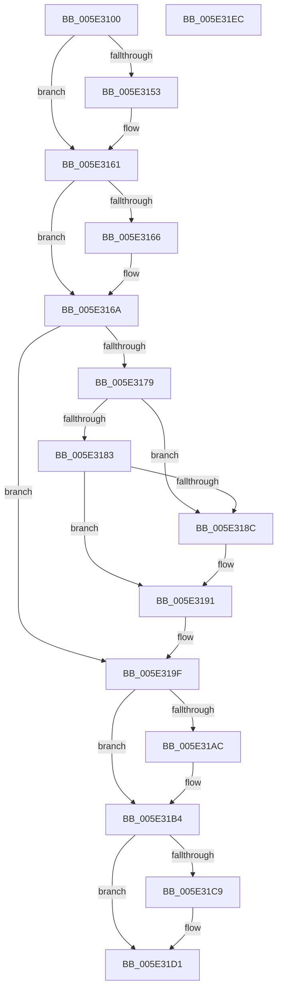

# PspRefreshProcessUserPresencePpmPolicyCallback

- RVA: `0x005E3100`–`0x005E31ED` (길이 `237` bytes)
- VA: `0x00000001405E3100`
- 실행 섹션: `.text`
- PDB 이름 있음: `예`; PDB Function 태그: `아니요`
- unwind 정보 RVA: `0x00060300`
- 디코드: `66`개 명령, `237/237` bytes 표시
- 미해석 바이트: `0` (있으면 어셈블리에 `.byte`로 보존)

> 이 문서는 커널 이미지의 기계어와 PDB 기호를 분석해 생성했습니다. 4번과 5번은 함수 원형과 자료형을 바이너리 사용 방식에서 추정한 C 해석이며 원본 소스 복구 결과는 아닙니다.

## 1. Dependencies

- 직접 호출 지점: **7**; 고유 호출 대상: **7**
- 직접 호출자로 확인된 함수: **0**
- RIP 상대 이미지 참조: **2**

### Outgoing calls
- `0x005E3143` → [KeAbPreAcquire](../21/KeAbPreAcquire_function_00210230.md) (function, `0x00210230`)
- `0x005E315C` → [ExfAcquirePushLockExclusiveEx](../20/ExfAcquirePushLockExclusiveEx_function_0020FC90.md) (function, `0x0020FC90`)
- `0x005E319A` → [KeSetProcessPpmPolicy](../3C/KeSetProcessPpmPolicy_function_003C1CCC.md) (function, `0x003C1CCC`)
- `0x005E31AF` → [ExfTryToWakePushLock](../26/ExfTryToWakePushLock_function_00265DD0.md) (function, `0x00265DD0`)
- `0x005E31B7` → [KeAbPostRelease](../2E/KeAbPostRelease_function_002E1600.md) (function, `0x002E1600`)
- `0x005E31BF` → [KiLeaveCriticalRegionUnsafe](../25/KiLeaveCriticalRegionUnsafe_function_0025F010.md) (function, `0x0025F010`)
- `0x005E31CC` → [PspEnqueueProcessQosChangeNotification](PspEnqueueProcessQosChangeNotification_function_005E2ED0.md) (function, `0x005E2ED0`)

### Direct callers
- 이 함수 시작 RVA로 연결되는 직접 call은 확인되지 않았습니다. 간접 호출은 완전히 역산할 수 없습니다.

### Static image references
- `0x005E3179` → RVA `0x00F06634` (`.data`; read)
- `0x005E3183` → RVA `0x00F06630` (`.data`; read)

## 2. Other-region calls and transfers

- 다른 실행 섹션으로 향하는 call: **0**
- 별도 외부 분기/꼬리 이동을 확인하지 못했습니다.

## 3. Assembly (complete function range)

```asm
005E3100  48 89 5C 24 08                  mov qword ptr [rsp + 8], rbx
005E3105  48 89 6C 24 10                  mov qword ptr [rsp + 0x10], rbp
005E310A  48 89 74 24 18                  mov qword ptr [rsp + 0x18], rsi
005E310F  57                              push rdi
005E3110  41 56                           push r14
005E3112  41 57                           push r15
005E3114  48 83 EC 20                     sub rsp, 0x20
005E3118  65 4C 8B 3C 25 88 01 00 00      mov r15, qword ptr gs:[0x188]
005E3121  48 8D B9 18 08 00 00            lea rdi, [rcx + 0x818]
005E3128  48 8B E9                        mov rbp, rcx
005E312B  48 83 CB FF                     or rbx, 0xffffffffffffffff
005E312F  45 33 C0                        xor r8d, r8d
005E3132  33 D2                           xor edx, edx
005E3134  48 8B CF                        mov rcx, rdi
005E3137  45 32 F6                        xor r14b, r14b
005E313A  66 41 01 9F E4 01 00 00         add word ptr [r15 + 0x1e4], bx
005E3142  90                              nop
005E3143  E8 E8 D0 C2 FF                  call 0x140210230
005E3148  F0 48 0F BA 2F 00               lock bts qword ptr [rdi], 0
005E314E  48 8B F0                        mov rsi, rax
005E3151  73 0E                           jae 0x1405e3161
005E3153  4C 8B C7                        mov r8, rdi
005E3156  48 8B D0                        mov rdx, rax
005E3159  48 8B CF                        mov rcx, rdi
005E315C  E8 2F CB C2 FF                  call 0x14020fc90
005E3161  48 85 F6                        test rsi, rsi
005E3164  74 04                           je 0x1405e316a
005E3166  C6 46 0A 01                     mov byte ptr [rsi + 0xa], 1
005E316A  8B 8D 20 08 00 00               mov ecx, dword ptr [rbp + 0x820]
005E3170  BA 09 00 00 00                  mov edx, 9
005E3175  3B CA                           cmp ecx, edx
005E3177  75 26                           jne 0x1405e319f
005E3179  8A 05 B5 34 92 00               mov al, byte ptr [rip + 0x9234b5]
005E317F  84 C0                           test al, al
005E3181  75 09                           jne 0x1405e318c
005E3183  83 3D A6 34 92 00 00            cmp dword ptr [rip + 0x9234a6], 0
005E318A  74 05                           je 0x1405e3191
005E318C  BA 07 00 00 00                  mov edx, 7
005E3191  3B D1                           cmp edx, ecx
005E3193  48 8B CD                        mov rcx, rbp
005E3196  41 0F 95 C6                     setne r14b
005E319A  E8 2D EB DD FF                  call 0x1403c1ccc
005E319F  F0 48 0F C1 1F                  lock xadd qword ptr [rdi], rbx
005E31A4  80 E3 06                        and bl, 6
005E31A7  80 FB 02                        cmp bl, 2
005E31AA  75 08                           jne 0x1405e31b4
005E31AC  48 8B CF                        mov rcx, rdi
005E31AF  E8 1C 2C C8 FF                  call 0x140265dd0
005E31B4  48 8B CF                        mov rcx, rdi
005E31B7  E8 44 E4 CF FF                  call 0x1402e1600
005E31BC  49 8B CF                        mov rcx, r15
005E31BF  E8 4C BE C7 FF                  call 0x14025f010
005E31C4  45 84 F6                        test r14b, r14b
005E31C7  74 08                           je 0x1405e31d1
005E31C9  48 8B CD                        mov rcx, rbp
005E31CC  E8 FF FC FF FF                  call 0x1405e2ed0
005E31D1  48 8B 5C 24 40                  mov rbx, qword ptr [rsp + 0x40]
005E31D6  33 C0                           xor eax, eax
005E31D8  48 8B 6C 24 48                  mov rbp, qword ptr [rsp + 0x48]
005E31DD  48 8B 74 24 50                  mov rsi, qword ptr [rsp + 0x50]
005E31E2  48 83 C4 20                     add rsp, 0x20
005E31E6  41 5F                           pop r15
005E31E8  41 5E                           pop r14
005E31EA  5F                              pop rdi
005E31EB  C3                              ret
005E31EC  CC                              int3
```

## 4. C-style interpretation (structured pseudocode)

```c
__int64 __fastcall PspRefreshProcessUserPresencePpmPolicyCallback(__int64 a1, int a2, int a3)
{
    __int64 result;
    __int64 v_r14;
    __int64 v_rbx;
    __int64 v_rsp;
    unsigned __int64 v_stack_p10;
    unsigned __int64 v_stack_p18;
    unsigned __int64 v_stack_p8;

    v_stack_p8 = v_rbx;
    v_stack_p10 = v_rbp;
    v_stack_p18 = v_rsi;
    v_rsp = (v_rsp) - (32);
    v_rbx = (v_rbx) | (-1);
    a3 = 0;
    a2 = 0;
    v_r14 = 0;
    result = KeAbPreAcquire(a1 + 2072, a2, a3, a4);
    if (!(condition_is_above_or_equal)) {
        a3 = a1 + 2072;
        a2 = result;
        a1 = a1 + 2072;
        result = ExfAcquirePushLockExclusiveEx(a1, a2, a3, a4);
    }
    if (result != 0) {
        *(unsigned __int8 *)(result + 10) = 1;
    }
    if (((unsigned int)((unsigned int)(*(unsigned int *)(a1 + 2080)))) != 9) goto loc_005E319F;
    if ((unsigned __int8)(*(unsigned __int8 *)(v_rip + 9581749)) != 0) goto loc_005E318C;
    if ((*(unsigned int *)(v_rip + 9581734)) != 0) {
        a2 = 7;
    }
    v_r14 = (a2 != ((unsigned int)((unsigned int)(*(unsigned int *)(a1 + 2080))))) ? 1 : 0;
    result = KeSetProcessPpmPolicy(a1, a2, a3, a4);
loc_005E319F:
    v_rbx = (unsigned __int8)((v_rbx) & (6));
    if (((unsigned __int8)(v_rbx)) == 2) {
        a1 = a1 + 2072;
        result = ExfTryToWakePushLock(a1, a2, a3, a4);
    }
    result = KeAbPostRelease(a1 + 2072, a2, a3, a4);
    result = KiLeaveCriticalRegionUnsafe(*(unsigned __int64 *)(gs_base + (0 + 392)), a2, a3, a4);
    if ((unsigned __int8)(v_r14) != 0) {
        a1 = a1;
        result = PspEnqueueProcessQosChangeNotification(a1, a2, a3, a4);
    }
    result = 0;
    v_rsp = (v_rsp) + (32);
    return result;
}
```

## 5. (Beta) C Style

```c
int64_t PspRefreshProcessUserPresencePpmPolicyCallback(void *Arg1, int32_t Arg2, int32_t Arg3)
{
    uint8_t *arg1 = (uint8_t *)Arg1;

    int64_t result;
    int64_t local_r14;
    int64_t local_rbx;
    int64_t local_rsp;
    uint64_t v_stack_p10;
    uint64_t v_stack_p18;
    uint64_t v_stack_p8;

    v_stack_p8 = local_rbx;
    v_stack_p10 = local_rbp;
    v_stack_p18 = local_rsi;
    local_rsp = (local_rsp) - (32);
    local_rbx = (local_rbx) | (-1);
    Arg3 = 0;
    Arg2 = 0;
    local_r14 = 0;
    result = KeAbPreAcquire(Arg1 + 2072, Arg2, Arg3, a4);
    if (!(condition_is_above_or_equal)) {
        Arg3 = Arg1 + 2072;
        Arg2 = result;
        Arg1 = Arg1 + 2072;
        result = ExfAcquirePushLockExclusiveEx(Arg1, Arg2, Arg3, a4);
    }
    if (result != 0) {
        *(uint8_t *)(result + 0xA) = 1;
    }
    if (((uint32_t)((uint32_t)(*(uint32_t *)(arg1 + 0x820)))) != 9) goto loc_005E319F;
    if ((uint8_t)(*(uint8_t *)(v_rip + 0x9234B5)) != 0) goto loc_005E318C;
    if ((*(uint32_t *)(v_rip + 0x9234A6)) != 0) {
        Arg2 = 7;
    }
    local_r14 = (Arg2 != ((uint32_t)((uint32_t)(*(uint32_t *)(arg1 + 0x820))))) ? 1 : 0;
    result = KeSetProcessPpmPolicy(Arg1, Arg2, Arg3, a4);
loc_005E319F:
    local_rbx = (uint8_t)((local_rbx) & (6));
    if (((uint8_t)(local_rbx)) == 2) {
        Arg1 = Arg1 + 2072;
        result = ExfTryToWakePushLock(Arg1, Arg2, Arg3, a4);
    }
    result = KeAbPostRelease(Arg1 + 2072, Arg2, Arg3, a4);
    result = KiLeaveCriticalRegionUnsafe(*(uint64_t *)(gs_base + (0 + 0x188)), Arg2, Arg3, a4);
    if ((uint8_t)(local_r14) != 0) {
        Arg1 = Arg1;
        result = PspEnqueueProcessQosChangeNotification(Arg1, Arg2, Arg3, a4);
    }
    result = 0;
    local_rsp = (local_rsp) + (32);
    return result;
}
```

### 관측된 메모리 오프셋

구조체 형식이 확인되지 않은 접근은 인자 기준의 오프셋으로만 기록했습니다.

| 기준 인자 | 오프셋 표현 | 폭 (bit) | 접근 |
|---|---:|---:|---|
| `Arg1` | `+ 0x0` | `64` | `R/W` |
| `Arg1` | `+ 0x818` | `64` | `R` |
| `Arg1` | `+ 0x820` | `32` | `R` |

## 6. Execution-region graph

[열기: 2D/3D 그래프와 함수 탐색 컨트롤 패널](../../../control-panel.html?section=text&rva=0x005E3100&view=graph)

- 2D 그래프는 위에서 아래로 흐르고, 3D 그래프는 빈 공간을 드래그해 회전합니다. Shift+드래그는 이동, 휠은 확대·축소, 함수 노드 선택은 대상 보고서 이동입니다.

### Static fallback


