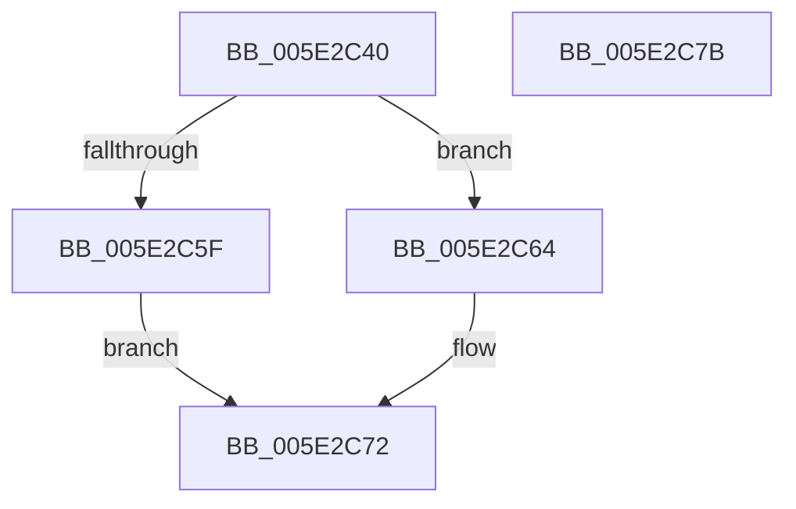

# PspRegisterResource

- RVA: `0x005E2C40`–`0x005E2C7C` (길이 `60` bytes)
- VA: `0x00000001405E2C40`
- 실행 섹션: `.text`
- PDB 이름 있음: `예`; PDB Function 태그: `아니요`
- unwind 정보 RVA: `0x000DB714`
- 디코드: `14`개 명령, `60/60` bytes 표시
- 미해석 바이트: `0` (있으면 어셈블리에 `.byte`로 보존)

> 이 문서는 커널 이미지의 기계어와 PDB 기호를 분석해 생성했습니다. 4번과 5번은 함수 원형과 자료형을 바이너리 사용 방식에서 추정한 C 해석이며 원본 소스 복구 결과는 아닙니다.

## 1. Dependencies

- 직접 호출 지점: **0**; 고유 호출 대상: **0**
- 직접 호출자로 확인된 함수: **1**
- RIP 상대 이미지 참조: **1**

### Outgoing calls
- 직접 디코드된 call 명령이 없습니다.

### Direct callers
- [PsInitializeQuotaSystem](../../init/C4/PsInitializeQuotaSystem_function_00C46364.md) at `0x00C4637A`
- [PsInitializeQuotaSystem](../../init/C4/PsInitializeQuotaSystem_function_00C46364.md) at `0x00C46384`
- [PsInitializeQuotaSystem](../../init/C4/PsInitializeQuotaSystem_function_00C46364.md) at `0x00C46394`
- [PsInitializeQuotaSystem](../../init/C4/PsInitializeQuotaSystem_function_00C46364.md) at `0x00C463A2`

### Static image references
- `0x005E2C43` → RVA `0x00000000` (`image boundary/outside`; read)

## 2. Other-region calls and transfers

- 다른 실행 섹션으로 향하는 call: **0**
- 별도 외부 분기/꼬리 이동을 확인하지 못했습니다.

## 3. Assembly (complete function range)

```asm
005E2C40  4C 63 C9                        movsxd r9, ecx
005E2C43  48 8D 0D B6 D3 A1 FF            lea rcx, [rip - 0x5e2c4a]
005E2C4A  42 88 94 C9 50 73 FC 00         mov byte ptr [rcx + r9*8 + 0xfc7350], dl
005E2C52  46 89 84 C9 54 73 FC 00         mov dword ptr [rcx + r9*8 + 0xfc7354], r8d
005E2C5A  F6 C2 02                        test dl, 2
005E2C5D  75 05                           jne 0x1405e2c64
005E2C5F  83 C8 FF                        or eax, 0xffffffff
005E2C62  EB 0E                           jmp 0x1405e2c72
005E2C64  42 8B 84 89 F8 9D FD 00         mov eax, dword ptr [rcx + r9*4 + 0xfd9df8]
005E2C6C  83 E0 E4                        and eax, 0xffffffe4
005E2C6F  83 C8 64                        or eax, 0x64
005E2C72  42 89 84 89 F8 9D FD 00         mov dword ptr [rcx + r9*4 + 0xfd9df8], eax
005E2C7A  C3                              ret
005E2C7B  CC                              int3
```

## 4. C-style interpretation (structured pseudocode)

```c
__int64 __fastcall PspRegisterResource(int a1, unsigned __int8 a2, int a3)
{
    __int64 result;

    *(unsigned __int8 *)(v_rip - 6171722 + (int)(a1) * 8 + 16544592) = a2;
    *(unsigned int *)(v_rip - 6171722 + (int)(a1) * 8 + 16544596) = a3;
    if (((a2) & (2)) != 0) goto loc_005E2C64;
    result = (unsigned int)((result) | (0xFFFFFFFFULL));
    goto loc_005E2C72;
loc_005E2C64:
    result = (unsigned int)(((unsigned int)(*(unsigned int *)(v_rip - 6171722 + (int)(a1) * 4 + 16621048))) & (0xFFFFFFE4ULL));
    result = (unsigned int)((result) | (100));
loc_005E2C72:
    *(unsigned int *)(v_rip - 6171722 + (int)(a1) * 4 + 16621048) = (unsigned int)(result);
    return result;
}
```

## 5. (Beta) C Style

```c
int64_t PspRegisterResource(int32_t Arg1, uint8_t Arg2, int32_t Arg3)
{
    int64_t result;

    *(uint8_t *)(v_rip - 0x5E2C4A + (int32_t)(Arg1) * 8 + 0xFC7350) = Arg2;
    *(uint32_t *)(v_rip - 0x5E2C4A + (int32_t)(Arg1) * 8 + 0xFC7354) = Arg3;
    if (((Arg2) & (2)) != 0) goto loc_005E2C64;
    result = (uint32_t)((result) | (0xFFFFFFFFULL));
    goto loc_005E2C72;
loc_005E2C64:
    result = (uint32_t)(((uint32_t)(*(uint32_t *)(v_rip - 0x5E2C4A + (int32_t)(Arg1) * 4 + 0xFD9DF8))) & (0xFFFFFFE4ULL));
    result = (uint32_t)((result) | (100));
loc_005E2C72:
    *(uint32_t *)(v_rip - 0x5E2C4A + (int32_t)(Arg1) * 4 + 0xFD9DF8) = (uint32_t)(result);
    return result;
}
```

## 6. Execution-region graph

[열기: 2D/3D 그래프와 함수 탐색 컨트롤 패널](../../../control-panel.html?section=text&rva=0x005E2C40&view=graph)

- 2D 그래프는 위에서 아래로 흐르고, 3D 그래프는 빈 공간을 드래그해 회전합니다. Shift+드래그는 이동, 휠은 확대·축소, 함수 노드 선택은 대상 보고서 이동입니다.

### Static fallback


