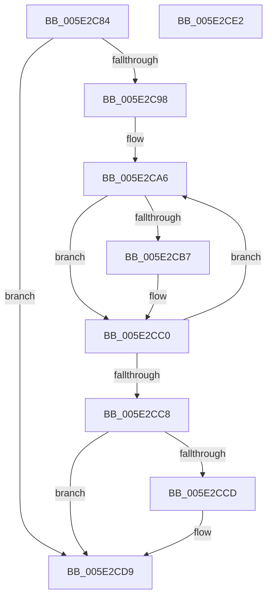

# PspReleaseReturnedQuota

- RVA: `0x005E2C84`–`0x005E2CE3` (길이 `95` bytes)
- VA: `0x00000001405E2C84`
- 실행 섹션: `.text`
- PDB 이름 있음: `예`; PDB Function 태그: `아니요`
- unwind 정보 RVA: `0x0005CF00`
- 디코드: `32`개 명령, `95/95` bytes 표시
- 미해석 바이트: `0` (있으면 어셈블리에 `.byte`로 보존)

> 이 문서는 커널 이미지의 기계어와 PDB 기호를 분석해 생성했습니다. 4번과 5번은 함수 원형과 자료형을 바이너리 사용 방식에서 추정한 C 해석이며 원본 소스 복구 결과는 아닙니다.

## 1. Dependencies

- 직접 호출 지점: **1**; 고유 호출 대상: **1**
- 직접 호출자로 확인된 함수: **1**
- RIP 상대 이미지 참조: **0**

### Outgoing calls
- `0x005E2CD4` → [guard_dispatch_icall](../6B/guard_dispatch_icall_function_006BAAD0.md) (function, `0x006BAAD0`)

### Direct callers
- [PspExpandQuota](../39/PspExpandQuota_function_00390660.md) at `0x0039073B`

### Static image references
- 디코드된 RIP-relative 메모리 참조가 없습니다.

## 2. Other-region calls and transfers

- 다른 실행 섹션으로 향하는 call: **0**
- 별도 외부 분기/꼬리 이동을 확인하지 못했습니다.

## 3. Assembly (complete function range)

```asm
005E2C84  40 53                           push rbx
005E2C86  48 83 EC 20                     sub rsp, 0x20
005E2C8A  4C 8D 52 28                     lea r10, [rdx + 0x28]
005E2C8E  33 DB                           xor ebx, ebx
005E2C90  4D 8B 02                        mov r8, qword ptr [r10]
005E2C93  4D 3B C2                        cmp r8, r10
005E2C96  74 41                           je 0x1405e2cd9
005E2C98  48 63 C1                        movsxd rax, ecx
005E2C9B  44 8D 4B 04                     lea r9d, [rbx + 4]
005E2C9F  4C 2B C8                        sub r9, rax
005E2CA2  49 C1 E1 07                     shl r9, 7
005E2CA6  33 C0                           xor eax, eax
005E2CA8  49 87 40 F8                     xchg qword ptr [r8 - 8], rax
005E2CAC  48 03 D8                        add rbx, rax
005E2CAF  43 83 7C 01 B0 00               cmp dword ptr [r9 + r8 - 0x50], 0
005E2CB5  75 09                           jne 0x1405e2cc0
005E2CB7  33 C0                           xor eax, eax
005E2CB9  49 87 40 F0                     xchg qword ptr [r8 - 0x10], rax
005E2CBD  48 03 D8                        add rbx, rax
005E2CC0  4D 8B 00                        mov r8, qword ptr [r8]
005E2CC3  4D 3B C2                        cmp r8, r10
005E2CC6  75 DE                           jne 0x1405e2ca6
005E2CC8  48 85 DB                        test rbx, rbx
005E2CCB  74 0C                           je 0x1405e2cd9
005E2CCD  48 8B 42 20                     mov rax, qword ptr [rdx + 0x20]
005E2CD1  48 8B D3                        mov rdx, rbx
005E2CD4  E8 F7 7D 0D 00                  call 0x1406baad0
005E2CD9  48 8B C3                        mov rax, rbx
005E2CDC  48 83 C4 20                     add rsp, 0x20
005E2CE0  5B                              pop rbx
005E2CE1  C3                              ret
005E2CE2  CC                              int3
```

## 4. C-style interpretation (structured pseudocode)

```c
__int64 __fastcall PspReleaseReturnedQuota(int a1, __int64 a2)
{
    __int64 result;
    __int64 v_rbx;
    __int64 v_rsp;

    v_rsp = (v_rsp) - (32);
    v_rbx = 0;
    if ((*(unsigned __int64 *)(a2 + 40)) == (a2 + 40)) goto loc_005E2CD9;
    a4 = (v_rbx + 4) - ((int)(a1));
    a4 = (a4) << (7);
loc_005E2CA6:
    result = 0;
    v_rbx = (v_rbx) + (0);
    if ((*(unsigned int *)(a4 + *(unsigned __int64 *)(a2 + 40) * 1 - 80)) == 0) {
        result = 0;
        v_rbx = (v_rbx) + (0);
    }
    if ((*(unsigned __int64 *)(*(unsigned __int64 *)(a2 + 40))) != (a2 + 40)) goto loc_005E2CA6;
    if (v_rbx != 0) {
        result = *(unsigned __int64 *)(a2 + 32);
        a2 = v_rbx;
        result = guard_dispatch_icall(a1, a2, *(unsigned __int64 *)(*(unsigned __int64 *)(a2 + 40)), a4);
    }
    v_rsp = (v_rsp) + (32);
    return v_rbx;
}
```

## 5. (Beta) C Style

```c
int64_t PspReleaseReturnedQuota(int32_t Arg1, void *Arg2)
{
    uint8_t *arg2 = (uint8_t *)Arg2;

    int64_t result;
    int64_t local_rbx;
    int64_t local_rsp;

    local_rsp = (local_rsp) - (32);
    local_rbx = 0;
    if ((*(uint64_t *)(arg2 + 0x28)) == (Arg2 + 40)) goto loc_005E2CD9;
    a4 = (local_rbx + 4) - ((int32_t)(Arg1));
    a4 = (a4) << (7);
loc_005E2CA6:
    result = 0;
    local_rbx = (local_rbx) + (0);
    if ((*(uint32_t *)(a4 + *(uint64_t *)(arg2 + 0x28) * 1 - 0x50)) == 0) {
        result = 0;
        local_rbx = (local_rbx) + (0);
    }
    if ((*(uint64_t *)(*(uint64_t *)(arg2 + 0x28))) != (Arg2 + 40)) goto loc_005E2CA6;
    if (local_rbx != 0) {
        result = *(uint64_t *)(arg2 + 0x20);
        Arg2 = local_rbx;
        result = guard_dispatch_icall(Arg1, Arg2, *(uint64_t *)(*(uint64_t *)(arg2 + 0x28)), a4);
    }
    local_rsp = (local_rsp) + (32);
    return local_rbx;
}
```

### 관측된 메모리 오프셋

구조체 형식이 확인되지 않은 접근은 인자 기준의 오프셋으로만 기록했습니다.

| 기준 인자 | 오프셋 표현 | 폭 (bit) | 접근 |
|---|---:|---:|---|
| `Arg2` | `+ 0x0` | `64` | `R` |
| `Arg2` | `+ 0x20` | `64` | `R` |
| `Arg2` | `+ 0x28` | `64` | `R` |

## 6. Execution-region graph

[열기: 2D/3D 그래프와 함수 탐색 컨트롤 패널](../../../control-panel.html?section=text&rva=0x005E2C84&view=graph)

- 2D 그래프는 위에서 아래로 흐르고, 3D 그래프는 빈 공간을 드래그해 회전합니다. Shift+드래그는 이동, 휠은 확대·축소, 함수 노드 선택은 대상 보고서 이동입니다.

### Static fallback


