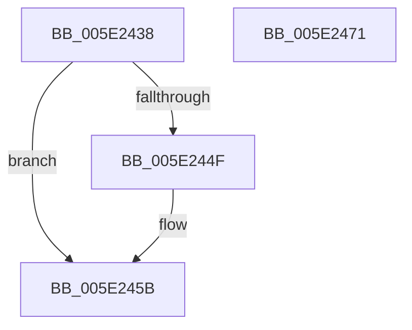

# PspReleaseSyscallProviderRegistrationLockExclusive

- RVA: `0x005E2438`–`0x005E2472` (길이 `58` bytes)
- VA: `0x00000001405E2438`
- 실행 섹션: `.text`
- PDB 이름 있음: `예`; PDB Function 태그: `아니요`
- unwind 정보 RVA: `0x0005C788`
- 디코드: `14`개 명령, `58/58` bytes 표시
- 미해석 바이트: `0` (있으면 어셈블리에 `.byte`로 보존)

> 이 문서는 커널 이미지의 기계어와 PDB 기호를 분석해 생성했습니다. 4번과 5번은 함수 원형과 자료형을 바이너리 사용 방식에서 추정한 C 해석이며 원본 소스 복구 결과는 아닙니다.

## 1. Dependencies

- 직접 호출 지점: **3**; 고유 호출 대상: **3**
- 직접 호출자로 확인된 함수: **2**
- RIP 상대 이미지 참조: **2**

### Outgoing calls
- `0x005E2456` → [ExfTryToWakePushLock](../26/ExfTryToWakePushLock_function_00265DD0.md) (function, `0x00265DD0`)
- `0x005E2462` → [KeAbPostRelease](../2E/KeAbPostRelease_function_002E1600.md) (function, `0x002E1600`)
- `0x005E2467` → [KeLeaveCriticalRegion](../25/KeLeaveCriticalRegion_function_0025D8B0.md) (function, `0x0025D8B0`)

### Direct callers
- [PsRegisterSyscallProvider](../../page/77/PsRegisterSyscallProvider_function_0077E140.md) at `0x0077E2A7`
- [PspDestroySyscallProvider](../../page/77/PspDestroySyscallProvider_function_0077E454.md) at `0x0077E47B`

### Static image references
- `0x005E2440` → RVA `0x00FD9BF0` (`PAGEDATA`; read/write)
- `0x005E244F` → RVA `0x00FD9BF0` (`PAGEDATA`; read)

## 2. Other-region calls and transfers

- 다른 실행 섹션으로 향하는 call: **0**
- 별도 외부 분기/꼬리 이동을 확인하지 못했습니다.

## 3. Assembly (complete function range)

```asm
005E2438  48 83 EC 28                     sub rsp, 0x28
005E243C  48 83 C8 FF                     or rax, 0xffffffffffffffff
005E2440  F0 48 0F C1 05 A7 77 9F 00      lock xadd qword ptr [rip + 0x9f77a7], rax
005E2449  24 06                           and al, 6
005E244B  3C 02                           cmp al, 2
005E244D  75 0C                           jne 0x1405e245b
005E244F  48 8D 0D 9A 77 9F 00            lea rcx, [rip + 0x9f779a]
005E2456  E8 75 39 C8 FF                  call 0x140265dd0
005E245B  48 8D 0D 8E 77 9F 00            lea rcx, [rip + 0x9f778e]
005E2462  E8 99 F1 CF FF                  call 0x1402e1600
005E2467  E8 44 B4 C7 FF                  call 0x14025d8b0
005E246C  48 83 C4 28                     add rsp, 0x28
005E2470  C3                              ret
005E2471  CC                              int3
```

## 4. C-style interpretation (structured pseudocode)

```c
__int64 __fastcall PspReleaseSyscallProviderRegistrationLockExclusive(void)
{
    __int64 result;
    __int64 v_rsp;

    v_rsp = (v_rsp) - (40);
    result = (result) | (-1);
    result = (unsigned __int8)((result) & (6));
    if (((unsigned __int8)(result)) == 2) {
        a1 = v_rip + 10450842;
        result = ExfTryToWakePushLock(a1, a2, a3, a4);
    }
    result = KeAbPostRelease(v_rip + 10450830, a2, a3, a4);
    result = KeLeaveCriticalRegion(v_rip + 10450830, a2, a3, a4);
    v_rsp = (v_rsp) + (40);
    return result;
}
```

## 5. (Beta) C Style

```c
void PspReleaseSyscallProviderRegistrationLockExclusive(void)
{
    int64_t result;
    int64_t local_rsp;

    local_rsp = (local_rsp) - (40);
    result = (result) | (-1);
    result = (uint8_t)((result) & (6));
    if (((uint8_t)(result)) == 2) {
        a1 = v_rip + 10450842;
        result = ExfTryToWakePushLock(a1, a2, a3, a4);
    }
    result = KeAbPostRelease(v_rip + 10450830, a2, a3, a4);
    result = KeLeaveCriticalRegion(v_rip + 10450830, a2, a3, a4);
    local_rsp = (local_rsp) + (40);
    return result;
}
```

## 6. Execution-region graph

[열기: 2D/3D 그래프와 함수 탐색 컨트롤 패널](../../../control-panel.html?section=text&rva=0x005E2438&view=graph)

- 2D 그래프는 위에서 아래로 흐르고, 3D 그래프는 빈 공간을 드래그해 회전합니다. Shift+드래그는 이동, 휠은 확대·축소, 함수 노드 선택은 대상 보고서 이동입니다.

### Static fallback


