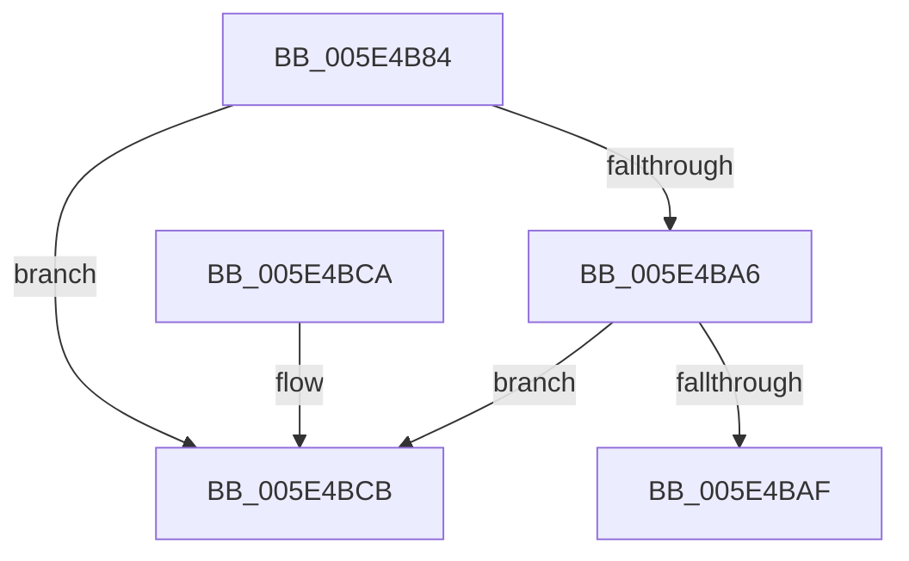

# PspRemovePartitionFromGlobalList

- RVA: `0x005E4B84`–`0x005E4BD2` (길이 `78` bytes)
- VA: `0x00000001405E4B84`
- 실행 섹션: `.text`
- PDB 이름 있음: `예`; PDB Function 태그: `아니요`
- unwind 정보 RVA: `0x0005DAC8`
- 디코드: `23`개 명령, `78/78` bytes 표시
- 미해석 바이트: `0` (있으면 어셈블리에 `.byte`로 보존)

> 이 문서는 커널 이미지의 기계어와 PDB 기호를 분석해 생성했습니다. 4번과 5번은 함수 원형과 자료형을 바이너리 사용 방식에서 추정한 C 해석이며 원본 소스 복구 결과는 아닙니다.

## 1. Dependencies

- 직접 호출 지점: **2**; 고유 호출 대상: **2**
- 직접 호출자로 확인된 함수: **1**
- RIP 상대 이미지 참조: **1**

### Outgoing calls
- `0x005E4B94` → [ExAcquireSpinLockExclusive](../24/ExAcquireSpinLockExclusive_function_00248690.md) (function, `0x00248690`)
- `0x005E4BBF` → [ExReleaseSpinLockExclusive](../2C/ExReleaseSpinLockExclusive_function_002C0EF0.md) (function, `0x002C0EF0`)

### Direct callers
- [PspDeletePartition](../../page/78/PspDeletePartition_function_00788400.md) at `0x0078842A`

### Static image references
- `0x005E4B8D` → RVA `0x00F05D60` (`.data`; read)

## 2. Other-region calls and transfers

- 다른 실행 섹션으로 향하는 call: **0**
- 별도 외부 분기/꼬리 이동을 확인하지 못했습니다.

## 3. Assembly (complete function range)

```asm
005E4B84  40 53                           push rbx
005E4B86  48 83 EC 20                     sub rsp, 0x20
005E4B8A  48 8B D9                        mov rbx, rcx
005E4B8D  48 8D 0D CC 11 92 00            lea rcx, [rip + 0x9211cc]
005E4B94  E8 F7 3A C6 FF                  call 0x140248690
005E4B99  48 83 C3 38                     add rbx, 0x38
005E4B9D  4C 8B 03                        mov r8, qword ptr [rbx]
005E4BA0  49 39 58 08                     cmp qword ptr [r8 + 8], rbx
005E4BA4  75 25                           jne 0x1405e4bcb
005E4BA6  48 8B 53 08                     mov rdx, qword ptr [rbx + 8]
005E4BAA  48 39 1A                        cmp qword ptr [rdx], rbx
005E4BAD  75 1C                           jne 0x1405e4bcb
005E4BAF  4C 89 02                        mov qword ptr [rdx], r8
005E4BB2  48 8D 0D A7 11 92 00            lea rcx, [rip + 0x9211a7]
005E4BB9  49 89 50 08                     mov qword ptr [r8 + 8], rdx
005E4BBD  8A D0                           mov dl, al
005E4BBF  E8 2C C3 CD FF                  call 0x1402c0ef0
005E4BC4  48 83 C4 20                     add rsp, 0x20
005E4BC8  5B                              pop rbx
005E4BC9  C3                              ret
005E4BCA  CC                              int3
005E4BCB  B9 03 00 00 00                  mov ecx, 3
005E4BD0  CD 29                           int 0x29
```

## 4. C-style interpretation (structured pseudocode)

```c
__int64 __fastcall PspRemovePartitionFromGlobalList(__int64 a1)
{
    __int64 result;
    __int64 v_rbx;
    __int64 v_rsp;

    v_rsp = (v_rsp) - (32);
    result = ExAcquireSpinLockExclusive(v_rip + 9572812, a2, a3, a4);
    v_rbx = (a1) + (56);
    if ((*(unsigned __int64 *)(*(unsigned __int64 *)(v_rbx) + 8)) != v_rbx) goto loc_005E4BCB;
    if ((*(unsigned __int64 *)(*(unsigned __int64 *)(v_rbx + 8))) != v_rbx) goto loc_005E4BCB;
    *(unsigned __int64 *)(*(unsigned __int64 *)(v_rbx + 8)) = *(unsigned __int64 *)(v_rbx);
    *(unsigned __int64 *)(*(unsigned __int64 *)(v_rbx) + 8) = *(unsigned __int64 *)(v_rbx + 8);
    result = ExReleaseSpinLockExclusive(v_rip + 9572775, (unsigned __int8)(result), *(unsigned __int64 *)(v_rbx), a4);
    v_rsp = (v_rsp) + (32);
    return result;
loc_005E4BCB:
    return result;
}
```

## 5. (Beta) C Style

```c
int64_t PspRemovePartitionFromGlobalList(void *Arg1)
{
    uint8_t *arg1 = (uint8_t *)Arg1;

    int64_t result;
    int64_t local_rbx;
    int64_t local_rsp;

    local_rsp = (local_rsp) - (32);
    result = ExAcquireSpinLockExclusive(v_rip + 9572812, a2, a3, a4);
    local_rbx = (Arg1) + (56);
    if ((*(uint64_t *)(*(uint64_t *)(local_rbx) + 0x8)) != local_rbx) goto loc_005E4BCB;
    if ((*(uint64_t *)(*(uint64_t *)(local_rbx + 0x8))) != local_rbx) goto loc_005E4BCB;
    *(uint64_t *)(*(uint64_t *)(local_rbx + 0x8)) = *(uint64_t *)(local_rbx);
    *(uint64_t *)(*(uint64_t *)(local_rbx) + 0x8) = *(uint64_t *)(local_rbx + 0x8);
    result = ExReleaseSpinLockExclusive(v_rip + 9572775, (uint8_t)(result), *(uint64_t *)(local_rbx), a4);
    local_rsp = (local_rsp) + (32);
    return result;
loc_005E4BCB:
    return result;
}
```

### 관측된 메모리 오프셋

구조체 형식이 확인되지 않은 접근은 인자 기준의 오프셋으로만 기록했습니다.

| 기준 인자 | 오프셋 표현 | 폭 (bit) | 접근 |
|---|---:|---:|---|
| `Arg1` | `+ 0x0` | `64` | `R` |
| `Arg1` | `+ 0x8` | `64` | `R` |

## 6. Execution-region graph

[열기: 2D/3D 그래프와 함수 탐색 컨트롤 패널](../../../control-panel.html?section=text&rva=0x005E4B84&view=graph)

- 2D 그래프는 위에서 아래로 흐르고, 3D 그래프는 빈 공간을 드래그해 회전합니다. Shift+드래그는 이동, 휠은 확대·축소, 함수 노드 선택은 대상 보고서 이동입니다.

### Static fallback


