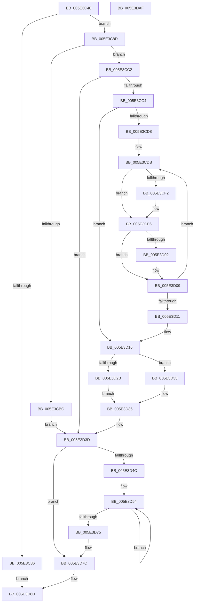

# PspSetProcessTimerDelayForKTimers

- RVA: `0x005E3C40`–`0x005E3DB0` (길이 `368` bytes)
- VA: `0x00000001405E3C40`
- 실행 섹션: `.text`
- PDB 이름 있음: `예`; PDB Function 태그: `아니요`
- unwind 정보 RVA: `0x000BEDC8`
- 디코드: `104`개 명령, `368/368` bytes 표시
- 미해석 바이트: `0` (있으면 어셈블리에 `.byte`로 보존)

> 이 문서는 커널 이미지의 기계어와 PDB 기호를 분석해 생성했습니다. 4번과 5번은 함수 원형과 자료형을 바이너리 사용 방식에서 추정한 C 해석이며 원본 소스 복구 결과는 아닙니다.

## 1. Dependencies

- 직접 호출 지점: **5**; 고유 호출 대상: **5**
- 직접 호출자로 확인된 함수: **1**
- RIP 상대 이미지 참조: **0**

### Outgoing calls
- `0x005E3C75` → [KeAcquireSpinLockRaiseToDpc](../20/KeAcquireSpinLockRaiseToDpc_function_00208470.md) (function, `0x00208470`)
- `0x005E3CE5` → [KiAcquireKobjectLockSafe](../25/KiAcquireKobjectLockSafe_function_00251C90.md) (function, `0x00251C90`)
- `0x005E3D68` → [ExpTimerAdjust](../65/ExpTimerAdjust_function_006593CC.md) (function, `0x006593CC`)
- `0x005E3D85` → [KeAdjustTimerDelayProcess](../5B/KeAdjustTimerDelayProcess_function_005B9658.md) (function, `0x005B9658`)
- `0x005E3D90` → [KeReleaseSpinLock](../39/KeReleaseSpinLock_function_00392BA0.md) (function, `0x00392BA0`)

### Direct callers
- [PspApplyTimerDelayProcess](PspApplyTimerDelayProcess_function_005E3784.md) at `0x005E38E1`
- [PspApplyTimerDelayProcess](PspApplyTimerDelayProcess_function_005E3784.md) at `0x005E3911`

### Static image references
- 디코드된 RIP-relative 메모리 참조가 없습니다.

## 2. Other-region calls and transfers

- 다른 실행 섹션으로 향하는 call: **0**
- 별도 외부 분기/꼬리 이동을 확인하지 못했습니다.

## 3. Assembly (complete function range)

```asm
005E3C40  48 89 5C 24 20                  mov qword ptr [rsp + 0x20], rbx
005E3C45  55                              push rbp
005E3C46  56                              push rsi
005E3C47  57                              push rdi
005E3C48  41 54                           push r12
005E3C4A  41 55                           push r13
005E3C4C  41 56                           push r14
005E3C4E  41 57                           push r15
005E3C50  48 83 EC 30                     sub rsp, 0x30
005E3C54  48 8B 81 F0 06 00 00            mov rax, qword ptr [rcx + 0x6f0]
005E3C5B  48 8D A9 08 07 00 00            lea rbp, [rcx + 0x708]
005E3C62  25 FF FF FF 3F                  and eax, 0x3fffffff
005E3C67  48 8B F9                        mov rdi, rcx
005E3C6A  48 8B CD                        mov rcx, rbp
005E3C6D  69 F0 10 27 00 00               imul esi, eax, 0x2710
005E3C73  33 DB                           xor ebx, ebx
005E3C75  E8 F6 47 C2 FF                  call 0x140208470
005E3C7A  44 8A E0                        mov r12b, al
005E3C7D  88 44 24 70                     mov byte ptr [rsp + 0x70], al
005E3C81  3B 77 44                        cmp esi, dword ptr [rdi + 0x44]
005E3C84  75 07                           jne 0x1405e3c8d
005E3C86  8A D0                           mov dl, al
005E3C88  E9 00 01 00 00                  jmp 0x1405e3d8d
005E3C8D  49 BD 08 00 00 00 80 F7 FF FF   movabs r13, 0xfffff78000000008
005E3C97  48 B8 14 00 00 00 80 F7 FF FF   movabs rax, 0xfffff78000000014
005E3CA1  4D 8B 6D 00                     mov r13, qword ptr [r13]
005E3CA5  48 8B 00                        mov rax, qword ptr [rax]
005E3CA8  8B 4F 44                        mov ecx, dword ptr [rdi + 0x44]
005E3CAB  4C 89 6C 24 78                  mov qword ptr [rsp + 0x78], r13
005E3CB0  48 89 84 24 80 00 00 00         mov qword ptr [rsp + 0x80], rax
005E3CB8  3B F1                           cmp esi, ecx
005E3CBA  76 06                           jbe 0x1405e3cc2
005E3CBC  8B DE                           mov ebx, esi
005E3CBE  2B D9                           sub ebx, ecx
005E3CC0  EB 7B                           jmp 0x1405e3d3d
005E3CC2  73 79                           jae 0x1405e3d3d
005E3CC4  4C 8D A7 10 07 00 00            lea r12, [rdi + 0x710]
005E3CCB  48 83 CD FF                     or rbp, 0xffffffffffffffff
005E3CCF  4D 8B 34 24                     mov r14, qword ptr [r12]
005E3CD3  4D 3B F4                        cmp r14, r12
005E3CD6  74 3E                           je 0x1405e3d16
005E3CD8  4C 8B EB                        mov r13, rbx
005E3CDB  4D 8D BE E0 FE FF FF            lea r15, [r14 - 0x120]
005E3CE2  49 8B CF                        mov rcx, r15
005E3CE5  E8 A6 DF C6 FF                  call 0x140251c90
005E3CEA  41 8A 47 03                     mov al, byte ptr [r15 + 3]
005E3CEE  24 40                           and al, 0x40
005E3CF0  74 04                           je 0x1405e3cf6
005E3CF2  4D 8B 6F 18                     mov r13, qword ptr [r15 + 0x18]
005E3CF6  F0 41 81 27 7F FF FF FF         lock and dword ptr [r15], 0xffffff7f
005E3CFE  84 C0                           test al, al
005E3D00  74 07                           je 0x1405e3d09
005E3D02  4C 3B ED                        cmp r13, rbp
005E3D05  49 0F 42 ED                     cmovb rbp, r13
005E3D09  4D 8B 36                        mov r14, qword ptr [r14]
005E3D0C  4D 3B F4                        cmp r14, r12
005E3D0F  75 CA                           jne 0x1405e3cdb
005E3D11  4C 8B 6C 24 78                  mov r13, qword ptr [rsp + 0x78]
005E3D16  8B 5F 44                        mov ebx, dword ptr [rdi + 0x44]
005E3D19  48 8B C5                        mov rax, rbp
005E3D1C  44 8A 64 24 70                  mov r12b, byte ptr [rsp + 0x70]
005E3D21  2B DE                           sub ebx, esi
005E3D23  48 2B C3                        sub rax, rbx
005E3D26  49 3B C5                        cmp rax, r13
005E3D29  73 08                           jae 0x1405e3d33
005E3D2B  49 8B DD                        mov rbx, r13
005E3D2E  48 2B DD                        sub rbx, rbp
005E3D31  EB 03                           jmp 0x1405e3d36
005E3D33  48 F7 DB                        neg rbx
005E3D36  48 8D AF 08 07 00 00            lea rbp, [rdi + 0x708]
005E3D3D  4C 8D BF 10 07 00 00            lea r15, [rdi + 0x710]
005E3D44  4D 8B 37                        mov r14, qword ptr [r15]
005E3D47  4D 3B F7                        cmp r14, r15
005E3D4A  74 30                           je 0x1405e3d7c
005E3D4C  48 8B AC 24 80 00 00 00         mov rbp, qword ptr [rsp + 0x80]
005E3D54  49 8D 8E E0 FE FF FF            lea rcx, [r14 - 0x120]
005E3D5B  4C 89 6C 24 20                  mov qword ptr [rsp + 0x20], r13
005E3D60  4C 8B CD                        mov r9, rbp
005E3D63  4C 8B C3                        mov r8, rbx
005E3D66  8B D6                           mov edx, esi
005E3D68  E8 5F 56 07 00                  call 0x1406593cc
005E3D6D  4D 8B 36                        mov r14, qword ptr [r14]
005E3D70  4D 3B F7                        cmp r14, r15
005E3D73  75 DF                           jne 0x1405e3d54
005E3D75  48 8D AF 08 07 00 00            lea rbp, [rdi + 0x708]
005E3D7C  44 8B C6                        mov r8d, esi
005E3D7F  48 8B D3                        mov rdx, rbx
005E3D82  48 8B CF                        mov rcx, rdi
005E3D85  E8 CE 58 FD FF                  call 0x1405b9658
005E3D8A  41 8A D4                        mov dl, r12b
005E3D8D  48 8B CD                        mov rcx, rbp
005E3D90  E8 0B EE DA FF                  call 0x140392ba0
005E3D95  48 8B 9C 24 88 00 00 00         mov rbx, qword ptr [rsp + 0x88]
005E3D9D  33 C0                           xor eax, eax
005E3D9F  48 83 C4 30                     add rsp, 0x30
005E3DA3  41 5F                           pop r15
005E3DA5  41 5E                           pop r14
005E3DA7  41 5D                           pop r13
005E3DA9  41 5C                           pop r12
005E3DAB  5F                              pop rdi
005E3DAC  5E                              pop rsi
005E3DAD  5D                              pop rbp
005E3DAE  C3                              ret
005E3DAF  CC                              int3
```

## 4. C-style interpretation (structured pseudocode)

```c
__int64 __fastcall PspSetProcessTimerDelayForKTimers(__int64 a1)
{
    __int64 result;
    __int64 v_r13;
    __int64 v_rbp;
    __int64 v_rbx;
    __int64 v_rsi;
    __int64 v_rsp;
    unsigned __int64 v_stack_m48;
    unsigned __int64 v_stack_p10;
    unsigned __int64 v_stack_p18;
    unsigned __int64 v_stack_p20;
    unsigned __int8 v_stack_p8;

    v_stack_p20 = v_rbx;
    v_rsp = (v_rsp) - (48);
    result = (unsigned int)((*(unsigned __int64 *)(a1 + 1776)) & (0x3FFFFFFFULL));
    v_rsi = (unsigned int)((v_rsi) * ((unsigned int)(result)));
    v_rbx = 0;
    result = KeAcquireSpinLockRaiseToDpc(a1 + 1800, a2, a3, a4);
    v_stack_p8 = (unsigned __int8)(result);
    if (((unsigned int)(v_rsi)) != (*(unsigned int *)(a1 + 68))) goto loc_005E3C8D;
    goto loc_005E3D8D;
loc_005E3C8D:
    v_stack_p10 = *(unsigned __int64 *)(v_r13);
    v_stack_p18 = *(unsigned __int64 *)(result);
    if (((unsigned int)(v_rsi)) <= ((unsigned int)((unsigned int)(*(unsigned int *)(a1 + 68))))) goto loc_005E3CC2;
    v_rbx = (unsigned int)(((unsigned int)((unsigned int)(v_rsi))) - ((unsigned int)((unsigned int)(*(unsigned int *)(a1 + 68)))));
    goto loc_005E3D3D;
loc_005E3CC2:
    if (condition_is_above_or_equal) goto loc_005E3D3D;
    v_rbp = (a1 + 1800) | (-1);
    if ((*(unsigned __int64 *)(a1 + 1808)) == (a1 + 1808)) goto loc_005E3D16;
loc_005E3CDB:
    result = KiAcquireKobjectLockSafe(*(unsigned __int64 *)(a1 + 1808) - 288, (unsigned __int8)(result), a3, a4);
    result = (unsigned __int8)((*(unsigned __int8 *)(*(unsigned __int64 *)(a1 + 1808) - 288 + 3)) & (64));
    v_r13 = v_rbx;
    if (!(condition_is_equal)) {
        v_r13 = *(unsigned __int64 *)(*(unsigned __int64 *)(a1 + 1808) - 288 + 24);
    }
    if ((unsigned __int8)(result) != 0) {
        if (v_r13 < v_rbp) { v_rbp = v_r13; }
    }
    if ((*(unsigned __int64 *)(*(unsigned __int64 *)(a1 + 1808))) != (a1 + 1808)) goto loc_005E3CDB;
loc_005E3D16:
    v_rbx = (unsigned int)(((unsigned int)(*(unsigned int *)(a1 + 68))) - ((unsigned int)(v_rsi)));
    result = (v_rbp) - (v_rbx);
    if (result >= v_stack_p10) goto loc_005E3D33;
    v_rbx = (v_stack_p10) - (v_rbp);
    goto loc_005E3D36;
loc_005E3D33:
    v_rbx = -(v_rbx);
loc_005E3D36:
loc_005E3D3D:
    if ((*(unsigned __int64 *)(a1 + 1808)) == (a1 + 1808)) goto loc_005E3D7C;
loc_005E3D54:
    v_stack_m48 = v_stack_p10;
    result = ExpTimerAdjust(*(unsigned __int64 *)(a1 + 1808) - 288, (unsigned int)((unsigned int)(v_rsi)), v_rbx, v_stack_p18);
    if ((*(unsigned __int64 *)(*(unsigned __int64 *)(a1 + 1808))) != (a1 + 1808)) goto loc_005E3D54;
loc_005E3D7C:
    result = KeAdjustTimerDelayProcess(a1, v_rbx, (unsigned int)((unsigned int)(v_rsi)), v_stack_p18);
loc_005E3D8D:
    result = KeReleaseSpinLock(a1 + 1800, (unsigned __int8)(v_stack_p8), (unsigned int)((unsigned int)(v_rsi)), v_stack_p18);
    result = 0;
    v_rsp = (v_rsp) + (48);
    return result;
}
```

## 5. (Beta) C Style

```c
int64_t PspSetProcessTimerDelayForKTimers(void *Arg1)
{
    uint8_t *arg1 = (uint8_t *)Arg1;

    int64_t result;
    int64_t local_r13;
    int64_t local_rbp;
    int64_t local_rbx;
    int64_t local_rsi;
    int64_t local_rsp;
    uint64_t v_stack_m48;
    uint64_t v_stack_p10;
    uint64_t v_stack_p18;
    uint64_t v_stack_p20;
    uint8_t v_stack_p8;

    v_stack_p20 = local_rbx;
    local_rsp = (local_rsp) - (48);
    result = (uint32_t)((*(uint64_t *)(arg1 + 0x6F0)) & (0x3FFFFFFFULL));
    local_rsi = (uint32_t)((local_rsi) * ((uint32_t)(result)));
    local_rbx = 0;
    result = KeAcquireSpinLockRaiseToDpc(Arg1 + 1800, a2, a3, a4);
    v_stack_p8 = (uint8_t)(result);
    if (((uint32_t)(local_rsi)) != (*(uint32_t *)(arg1 + 0x44))) goto loc_005E3C8D;
    goto loc_005E3D8D;
loc_005E3C8D:
    v_stack_p10 = *(uint64_t *)(local_r13);
    v_stack_p18 = *(uint64_t *)(result);
    if (((uint32_t)(local_rsi)) <= ((uint32_t)((uint32_t)(*(uint32_t *)(arg1 + 0x44))))) goto loc_005E3CC2;
    local_rbx = (uint32_t)(((uint32_t)((uint32_t)(local_rsi))) - ((uint32_t)((uint32_t)(*(uint32_t *)(arg1 + 0x44)))));
    goto loc_005E3D3D;
loc_005E3CC2:
    if (condition_is_above_or_equal) goto loc_005E3D3D;
    local_rbp = (Arg1 + 1800) | (-1);
    if ((*(uint64_t *)(arg1 + 0x710)) == (Arg1 + 1808)) goto loc_005E3D16;
loc_005E3CDB:
    result = KiAcquireKobjectLockSafe(*(uint64_t *)(arg1 + 0x710) - 288, (uint8_t)(result), a3, a4);
    result = (uint8_t)((*(uint8_t *)(*(uint64_t *)(arg1 + 0x710) - 0x120 + 0x3)) & (64));
    local_r13 = local_rbx;
    if (!(condition_is_equal)) {
        local_r13 = *(uint64_t *)(*(uint64_t *)(arg1 + 0x710) - 0x120 + 0x18);
    }
    if ((uint8_t)(result) != 0) {
        if (local_r13 < local_rbp) { local_rbp = local_r13; }
    }
    if ((*(uint64_t *)(*(uint64_t *)(arg1 + 0x710))) != (Arg1 + 1808)) goto loc_005E3CDB;
loc_005E3D16:
    local_rbx = (uint32_t)(((uint32_t)(*(uint32_t *)(arg1 + 0x44))) - ((uint32_t)(local_rsi)));
    result = (local_rbp) - (local_rbx);
    if (result >= v_stack_p10) goto loc_005E3D33;
    local_rbx = (v_stack_p10) - (local_rbp);
    goto loc_005E3D36;
loc_005E3D33:
    local_rbx = -(local_rbx);
loc_005E3D36:
loc_005E3D3D:
    if ((*(uint64_t *)(arg1 + 0x710)) == (Arg1 + 1808)) goto loc_005E3D7C;
loc_005E3D54:
    v_stack_m48 = v_stack_p10;
    result = ExpTimerAdjust(*(uint64_t *)(arg1 + 0x710) - 288, (uint32_t)((uint32_t)(local_rsi)), local_rbx, v_stack_p18);
    if ((*(uint64_t *)(*(uint64_t *)(arg1 + 0x710))) != (Arg1 + 1808)) goto loc_005E3D54;
loc_005E3D7C:
    result = KeAdjustTimerDelayProcess(Arg1, local_rbx, (uint32_t)((uint32_t)(local_rsi)), v_stack_p18);
loc_005E3D8D:
    result = KeReleaseSpinLock(Arg1 + 1800, (uint8_t)(v_stack_p8), (uint32_t)((uint32_t)(local_rsi)), v_stack_p18);
    result = 0;
    local_rsp = (local_rsp) + (48);
    return result;
}
```

### 관측된 메모리 오프셋

구조체 형식이 확인되지 않은 접근은 인자 기준의 오프셋으로만 기록했습니다.

| 기준 인자 | 오프셋 표현 | 폭 (bit) | 접근 |
|---|---:|---:|---|
| `Arg1` | `+ 0x0` | `64` | `R` |
| `Arg1` | `+ 0x44` | `32` | `R` |
| `Arg1` | `+ 0x6F0` | `64` | `R` |
| `Arg1` | `+ 0x708` | `64` | `R` |
| `Arg1` | `+ 0x710` | `64` | `R` |

## 6. Execution-region graph

[열기: 2D/3D 그래프와 함수 탐색 컨트롤 패널](../../../control-panel.html?section=text&rva=0x005E3C40&view=graph)

- 2D 그래프는 위에서 아래로 흐르고, 3D 그래프는 빈 공간을 드래그해 회전합니다. Shift+드래그는 이동, 휠은 확대·축소, 함수 노드 선택은 대상 보고서 이동입니다.

### Static fallback


