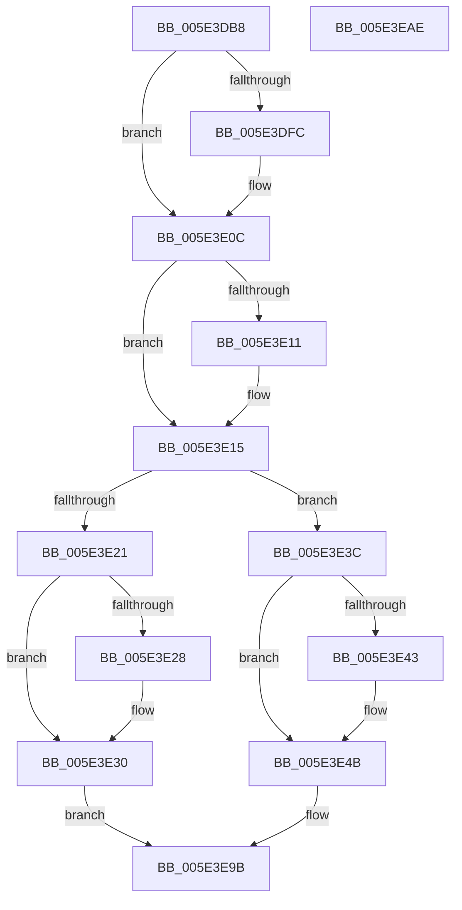

# PspSetProcessTimerDelayForWin32

- RVA: `0x005E3DB8`–`0x005E3EAF` (길이 `247` bytes)
- VA: `0x00000001405E3DB8`
- 실행 섹션: `.text`
- PDB 이름 있음: `예`; PDB Function 태그: `아니요`
- unwind 정보 RVA: `0x000CF1D8`
- 디코드: `71`개 명령, `247/247` bytes 표시
- 미해석 바이트: `0` (있으면 어셈블리에 `.byte`로 보존)

> 이 문서는 커널 이미지의 기계어와 PDB 기호를 분석해 생성했습니다. 4번과 5번은 함수 원형과 자료형을 바이너리 사용 방식에서 추정한 C 해석이며 원본 소스 복구 결과는 아닙니다.

## 1. Dependencies

- 직접 호출 지점: **8**; 고유 호출 대상: **6**
- 직접 호출자로 확인된 함수: **1**
- RIP 상대 이미지 참조: **0**

### Outgoing calls
- `0x005E3DE7` → [KeAbPreAcquire](../21/KeAbPreAcquire_function_00210230.md) (function, `0x00210230`)
- `0x005E3E07` → [ExfAcquirePushLockSharedEx](../21/ExfAcquirePushLockSharedEx_function_0021044C.md) (function, `0x0021044C`)
- `0x005E3E2B` → [ExfReleasePushLockShared](../26/ExfReleasePushLockShared_function_00263440.md) (function, `0x00263440`)
- `0x005E3E33` → [KeAbPostRelease](../2E/KeAbPostRelease_function_002E1600.md) (function, `0x002E1600`)
- `0x005E3E46` → [ExfReleasePushLockShared](../26/ExfReleasePushLockShared_function_00263440.md) (function, `0x00263440`)
- `0x005E3E4E` → [KeAbPostRelease](../2E/KeAbPostRelease_function_002E1600.md) (function, `0x002E1600`)
- `0x005E3E5D` → [PsGetProcessSessionIdEx](../22/PsGetProcessSessionIdEx_function_0022F8F0.md) (function, `0x0022F8F0`)
- `0x005E3E96` → [PsInvokeWin32Callout](../../page/91/PsInvokeWin32Callout_function_009133C0.md) (function, `0x009133C0`)

### Direct callers
- [PspApplyTimerDelayProcess](PspApplyTimerDelayProcess_function_005E3784.md) at `0x005E38E9`
- [PspApplyTimerDelayProcess](PspApplyTimerDelayProcess_function_005E3784.md) at `0x005E3919`

### Static image references
- 디코드된 RIP-relative 메모리 참조가 없습니다.

## 2. Other-region calls and transfers

- 다른 실행 섹션으로 향하는 call: **1**
  - `0x005E3E96` → [PsInvokeWin32Callout](../../page/91/PsInvokeWin32Callout_function_009133C0.md) (`.text` → `PAGE`)
- 별도 외부 분기/꼬리 이동을 확인하지 못했습니다.

## 3. Assembly (complete function range)

```asm
005E3DB8  48 8B C4                        mov rax, rsp
005E3DBB  48 89 58 18                     mov qword ptr [rax + 0x18], rbx
005E3DBF  48 89 68 20                     mov qword ptr [rax + 0x20], rbp
005E3DC3  56                              push rsi
005E3DC4  57                              push rdi
005E3DC5  41 56                           push r14
005E3DC7  48 83 EC 40                     sub rsp, 0x40
005E3DCB  48 8D 99 C8 01 00 00            lea rbx, [rcx + 0x1c8]
005E3DD2  48 8B F1                        mov rsi, rcx
005E3DD5  33 ED                           xor ebp, ebp
005E3DD7  48 8B CB                        mov rcx, rbx
005E3DDA  45 33 C0                        xor r8d, r8d
005E3DDD  48 89 68 C8                     mov qword ptr [rax - 0x38], rbp
005E3DE1  33 D2                           xor edx, edx
005E3DE3  48 89 68 D0                     mov qword ptr [rax - 0x30], rbp
005E3DE7  E8 44 C4 C2 FF                  call 0x140210230
005E3DEC  48 8B F8                        mov rdi, rax
005E3DEF  44 8D 75 11                     lea r14d, [rbp + 0x11]
005E3DF3  33 C0                           xor eax, eax
005E3DF5  F0 4C 0F B1 33                  lock cmpxchg qword ptr [rbx], r14
005E3DFA  74 10                           je 0x1405e3e0c
005E3DFC  4C 8B CB                        mov r9, rbx
005E3DFF  4C 8B C7                        mov r8, rdi
005E3E02  33 D2                           xor edx, edx
005E3E04  48 8B CB                        mov rcx, rbx
005E3E07  E8 40 C6 C2 FF                  call 0x14021044c
005E3E0C  48 85 FF                        test rdi, rdi
005E3E0F  74 04                           je 0x1405e3e15
005E3E11  C6 47 0A 01                     mov byte ptr [rdi + 0xa], 1
005E3E15  49 8B C6                        mov rax, r14
005E3E18  48 39 AE 98 02 00 00            cmp qword ptr [rsi + 0x298], rbp
005E3E1F  75 1B                           jne 0x1405e3e3c
005E3E21  F0 48 0F B1 2B                  lock cmpxchg qword ptr [rbx], rbp
005E3E26  74 08                           je 0x1405e3e30
005E3E28  48 8B CB                        mov rcx, rbx
005E3E2B  E8 10 F6 C7 FF                  call 0x140263440
005E3E30  48 8B CB                        mov rcx, rbx
005E3E33  E8 C8 D7 CF FF                  call 0x1402e1600
005E3E38  33 C0                           xor eax, eax
005E3E3A  EB 5F                           jmp 0x1405e3e9b
005E3E3C  F0 48 0F B1 2B                  lock cmpxchg qword ptr [rbx], rbp
005E3E41  74 08                           je 0x1405e3e4b
005E3E43  48 8B CB                        mov rcx, rbx
005E3E46  E8 F5 F5 C7 FF                  call 0x140263440
005E3E4B  48 8B CB                        mov rcx, rbx
005E3E4E  E8 AD D7 CF FF                  call 0x1402e1600
005E3E53  48 8B 9E F0 06 00 00            mov rbx, qword ptr [rsi + 0x6f0]
005E3E5A  48 8B CE                        mov rcx, rsi
005E3E5D  E8 8E BA C4 FF                  call 0x14022f8f0
005E3E62  B9 FF FF FF 3F                  mov ecx, 0x3fffffff
005E3E67  89 44 24 60                     mov dword ptr [rsp + 0x60], eax
005E3E6B  8B C3                           mov eax, ebx
005E3E6D  48 89 74 24 30                  mov qword ptr [rsp + 0x30], rsi
005E3E72  23 C1                           and eax, ecx
005E3E74  48 C1 EB 1E                     shr rbx, 0x1e
005E3E78  23 D9                           and ebx, ecx
005E3E7A  89 44 24 38                     mov dword ptr [rsp + 0x38], eax
005E3E7E  41 B8 01 00 00 00               mov r8d, 1
005E3E84  89 5C 24 3C                     mov dword ptr [rsp + 0x3c], ebx
005E3E88  4C 8D 4C 24 60                  lea r9, [rsp + 0x60]
005E3E8D  48 8D 54 24 20                  lea rdx, [rsp + 0x20]
005E3E92  41 8D 48 28                     lea ecx, [r8 + 0x28]
005E3E96  E8 25 F5 32 00                  call 0x1409133c0
005E3E9B  48 8B 5C 24 70                  mov rbx, qword ptr [rsp + 0x70]
005E3EA0  48 8B 6C 24 78                  mov rbp, qword ptr [rsp + 0x78]
005E3EA5  48 83 C4 40                     add rsp, 0x40
005E3EA9  41 5E                           pop r14
005E3EAB  5F                              pop rdi
005E3EAC  5E                              pop rsi
005E3EAD  C3                              ret
005E3EAE  CC                              int3
```

## 4. C-style interpretation (structured pseudocode)

```c
__int64 __fastcall PspSetProcessTimerDelayForWin32(__int64 a1, int a2, int a3)
{
    __int64 result;
    __int64 v_rbp;
    __int64 v_rbx;
    __int64 v_rsp;
    unsigned int v_stack_m1C;
    unsigned int v_stack_m20;
    unsigned __int64 v_stack_m28;
    unsigned __int64 v_stack_m38;
    unsigned __int64 v_stack_p18;
    unsigned __int64 v_stack_p20;
    unsigned int v_stack_p8;

    *(unsigned __int64 *)(v_rsp + 24) = v_rbx;
    *(unsigned __int64 *)(v_rsp + 32) = v_rbp;
    v_rsp = (v_rsp) - (64);
    v_rbp = 0;
    a3 = 0;
    *(unsigned __int64 *)(v_rsp - 56) = 0;
    a2 = 0;
    *(unsigned __int64 *)(v_rsp - 48) = 0;
    result = KeAbPreAcquire(a1 + 456, a2, a3, a4);
    result = 0;
    if (!(condition_is_equal)) {
        a4 = a1 + 456;
        a3 = 0;
        a2 = 0;
        a1 = a1 + 456;
        result = ExfAcquirePushLockSharedEx(a1, a2, a3, a4);
    }
    if (result != 0) {
        *(unsigned __int8 *)(result + 10) = 1;
    }
    if ((*(unsigned __int64 *)(a1 + 664)) != 0) goto loc_005E3E3C;
    result = v_rbp + 17;
    if ((*(unsigned __int64 *)(a1 + 664)) != 0) {
        a1 = a1 + 456;
        result = ExfReleasePushLockShared(a1, a2, a3, a4);
    }
    result = KeAbPostRelease(a1 + 456, a2, a3, a4);
    result = 0;
    goto loc_005E3E9B;
loc_005E3E3C:
    if (!(condition_is_equal)) {
        a1 = a1 + 456;
        result = ExfReleasePushLockShared(a1, a2, a3, a4);
    }
    result = KeAbPostRelease(a1 + 456, a2, a3, a4);
    result = PsGetProcessSessionIdEx(a1, a2, a3, a4);
    v_stack_p8 = (unsigned int)(result);
    v_stack_m28 = a1;
    result = (unsigned int)(((unsigned int)((unsigned int)(*(unsigned __int64 *)(a1 + 1776)))) & ((unsigned int)((unsigned int)(0x3FFFFFFFULL))));
    v_rbx = (*(unsigned __int64 *)(a1 + 1776)) >> (30);
    v_rbx = (unsigned int)((v_rbx) & ((unsigned int)((unsigned int)(0x3FFFFFFFULL))));
    v_stack_m20 = (unsigned int)(result);
    v_stack_m1C = (unsigned int)(v_rbx);
    result = PsInvokeWin32Callout(1 + 40, v_stack_m38, 1, v_stack_p8);
loc_005E3E9B:
    v_rsp = (v_rsp) + (64);
    return result;
}
```

## 5. (Beta) C Style

```c
int64_t PspSetProcessTimerDelayForWin32(void *Arg1, int32_t Arg2, int32_t Arg3)
{
    uint8_t *arg1 = (uint8_t *)Arg1;

    int64_t result;
    int64_t local_rbp;
    int64_t local_rbx;
    int64_t local_rsp;
    uint32_t v_stack_m1C;
    uint32_t v_stack_m20;
    uint64_t v_stack_m28;
    uint64_t v_stack_m38;
    uint64_t v_stack_p18;
    uint64_t v_stack_p20;
    uint32_t v_stack_p8;

    *(uint64_t *)(local_rsp + 0x18) = local_rbx;
    *(uint64_t *)(local_rsp + 0x20) = local_rbp;
    local_rsp = (local_rsp) - (64);
    local_rbp = 0;
    Arg3 = 0;
    *(uint64_t *)(local_rsp - 0x38) = 0;
    Arg2 = 0;
    *(uint64_t *)(local_rsp - 0x30) = 0;
    result = KeAbPreAcquire(Arg1 + 456, Arg2, Arg3, a4);
    result = 0;
    if (!(condition_is_equal)) {
        a4 = Arg1 + 456;
        Arg3 = 0;
        Arg2 = 0;
        Arg1 = Arg1 + 456;
        result = ExfAcquirePushLockSharedEx(Arg1, Arg2, Arg3, a4);
    }
    if (result != 0) {
        *(uint8_t *)(result + 0xA) = 1;
    }
    if ((*(uint64_t *)(arg1 + 0x298)) != 0) goto loc_005E3E3C;
    result = local_rbp + 17;
    if ((*(uint64_t *)(arg1 + 0x298)) != 0) {
        Arg1 = Arg1 + 456;
        result = ExfReleasePushLockShared(Arg1, Arg2, Arg3, a4);
    }
    result = KeAbPostRelease(Arg1 + 456, Arg2, Arg3, a4);
    result = 0;
    goto loc_005E3E9B;
loc_005E3E3C:
    if (!(condition_is_equal)) {
        Arg1 = Arg1 + 456;
        result = ExfReleasePushLockShared(Arg1, Arg2, Arg3, a4);
    }
    result = KeAbPostRelease(Arg1 + 456, Arg2, Arg3, a4);
    result = PsGetProcessSessionIdEx(Arg1, Arg2, Arg3, a4);
    v_stack_p8 = (uint32_t)(result);
    v_stack_m28 = Arg1;
    result = (uint32_t)(((uint32_t)((uint32_t)(*(uint64_t *)(arg1 + 0x6F0)))) & ((uint32_t)((uint32_t)(0x3FFFFFFFULL))));
    local_rbx = (*(uint64_t *)(arg1 + 0x6F0)) >> (30);
    local_rbx = (uint32_t)((local_rbx) & ((uint32_t)((uint32_t)(0x3FFFFFFFULL))));
    v_stack_m20 = (uint32_t)(result);
    v_stack_m1C = (uint32_t)(local_rbx);
    result = PsInvokeWin32Callout(1 + 40, v_stack_m38, 1, v_stack_p8);
loc_005E3E9B:
    local_rsp = (local_rsp) + (64);
    return result;
}
```

### 관측된 메모리 오프셋

구조체 형식이 확인되지 않은 접근은 인자 기준의 오프셋으로만 기록했습니다.

| 기준 인자 | 오프셋 표현 | 폭 (bit) | 접근 |
|---|---:|---:|---|
| `Arg1` | `+ 0x0` | `64` | `R` |
| `Arg1` | `+ 0x1C8` | `64` | `R` |
| `Arg1` | `+ 0x298` | `64` | `R` |
| `Arg1` | `+ 0x6F0` | `64` | `R` |

## 6. Execution-region graph

[열기: 2D/3D 그래프와 함수 탐색 컨트롤 패널](../../../control-panel.html?section=text&rva=0x005E3DB8&view=graph)

- 2D 그래프는 위에서 아래로 흐르고, 3D 그래프는 빈 공간을 드래그해 회전합니다. Shift+드래그는 이동, 휠은 확대·축소, 함수 노드 선택은 대상 보고서 이동입니다.

### Static fallback


