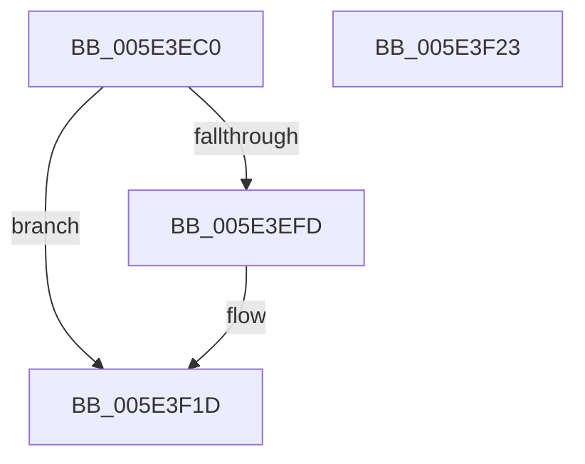

# PspTimerDelayProcess

- RVA: `0x005E3EC0`–`0x005E3F24` (길이 `100` bytes)
- VA: `0x00000001405E3EC0`
- 실행 섹션: `.text`
- PDB 이름 있음: `예`; PDB Function 태그: `아니요`
- unwind 정보 RVA: `0x0007F554`
- 디코드: `27`개 명령, `100/100` bytes 표시
- 미해석 바이트: `0` (있으면 어셈블리에 `.byte`로 보존)

> 이 문서는 커널 이미지의 기계어와 PDB 기호를 분석해 생성했습니다. 4번과 5번은 함수 원형과 자료형을 바이너리 사용 방식에서 추정한 C 해석이며 원본 소스 복구 결과는 아닙니다.

## 1. Dependencies

- 직접 호출 지점: **3**; 고유 호출 대상: **3**
- 직접 호출자로 확인된 함수: **0**
- RIP 상대 이미지 참조: **1**

### Outgoing calls
- `0x005E3EF4` → [ObReferenceObjectByHandleWithTag](../../page/86/ObReferenceObjectByHandleWithTag_function_00869610.md) (function, `0x00869610`)
- `0x005E3F05` → [PspApplyTimerDelayProcess](PspApplyTimerDelayProcess_function_005E3784.md) (function, `0x005E3784`)
- `0x005E3F16` → [ObfDereferenceObjectWithTag](../2F/ObfDereferenceObjectWithTag_function_002F78E0.md) (function, `0x002F78E0`)

### Direct callers
- 이 함수 시작 RVA로 연결되는 직접 call은 확인되지 않았습니다. 간접 호출은 완전히 역산할 수 없습니다.

### Static image references
- `0x005E3ED1` → RVA `0x00FC6A98` (`ALMOSTRO`; read)

## 2. Other-region calls and transfers

- 다른 실행 섹션으로 향하는 call: **1**
  - `0x005E3EF4` → [ObReferenceObjectByHandleWithTag](../../page/86/ObReferenceObjectByHandleWithTag_function_00869610.md) (`.text` → `PAGE`)
- 별도 외부 분기/꼬리 이동을 확인하지 못했습니다.

## 3. Assembly (complete function range)

```asm
005E3EC0  4C 8B DC                        mov r11, rsp
005E3EC3  53                              push rbx
005E3EC4  48 83 EC 40                     sub rsp, 0x40
005E3EC8  49 83 63 E8 00                  and qword ptr [r11 - 0x18], 0
005E3ECD  49 8D 43 18                     lea rax, [r11 + 0x18]
005E3ED1  4C 8B 05 C0 2B 9E 00            mov r8, qword ptr [rip + 0x9e2bc0]
005E3ED8  48 8B DA                        mov rbx, rdx
005E3EDB  49 83 63 18 00                  and qword ptr [r11 + 0x18], 0
005E3EE0  45 33 C9                        xor r9d, r9d
005E3EE3  49 89 43 E0                     mov qword ptr [r11 - 0x20], rax
005E3EE7  BA FF FF 1F 00                  mov edx, 0x1fffff
005E3EEC  C7 44 24 20 50 73 4A 62         mov dword ptr [rsp + 0x20], 0x624a7350
005E3EF4  E8 17 57 28 00                  call 0x140869610
005E3EF9  85 C0                           test eax, eax
005E3EFB  78 20                           js 0x1405e3f1d
005E3EFD  48 8B 4C 24 60                  mov rcx, qword ptr [rsp + 0x60]
005E3F02  48 8B D3                        mov rdx, rbx
005E3F05  E8 7A F8 FF FF                  call 0x1405e3784
005E3F0A  48 8B 4C 24 60                  mov rcx, qword ptr [rsp + 0x60]
005E3F0F  BA 50 73 4A 62                  mov edx, 0x624a7350
005E3F14  8B D8                           mov ebx, eax
005E3F16  E8 C5 39 D1 FF                  call 0x1402f78e0
005E3F1B  8B C3                           mov eax, ebx
005E3F1D  48 83 C4 40                     add rsp, 0x40
005E3F21  5B                              pop rbx
005E3F22  C3                              ret
005E3F23  CC                              int3
```

## 4. C-style interpretation (structured pseudocode)

```c
__int64 __fastcall PspTimerDelayProcess(__int64 a1, __int64 a2, __int64 a3, int a4)
{
    __int64 result;
    __int64 v_rbx;
    __int64 v_rsp;
    unsigned int v_stack_m28;
    unsigned __int64 v_stack_p18;

    v_rsp = (v_rsp) - (64);
    a4 = 0;
    *(unsigned __int64 *)(v_rsp - 32) = v_rsp + 24;
    v_stack_m28 = 0x624A7350ULL;
    result = ObReferenceObjectByHandleWithTag(a1, (unsigned int)(0x1FFFFFULL), *(unsigned __int64 *)(v_rip + 10365888), a4);
    v_rbx = a2;
    if (!(sign_flag)) {
        a1 = v_stack_p18;
        a2 = a2;
        result = PspApplyTimerDelayProcess(a1, a2, *(unsigned __int64 *)(v_rip + 10365888), a4);
        a1 = v_stack_p18;
        a2 = 0x624A7350ULL;
        v_rbx = (unsigned int)(result);
        result = ObfDereferenceObjectWithTag(a1, a2, *(unsigned __int64 *)(v_rip + 10365888), a4);
        result = (unsigned int)(v_rbx);
    }
    v_rsp = (v_rsp) + (64);
    return result;
}
```

## 5. (Beta) C Style

```c
int64_t PspTimerDelayProcess(int64_t Arg1, int64_t Arg2, int64_t Arg3, int32_t Arg4)
{
    int64_t result;
    int64_t local_rbx;
    int64_t local_rsp;
    uint32_t v_stack_m28;
    uint64_t v_stack_p18;

    local_rsp = (local_rsp) - (64);
    Arg4 = 0;
    *(uint64_t *)(local_rsp - 0x20) = local_rsp + 24;
    v_stack_m28 = 0x624A7350ULL;
    result = ObReferenceObjectByHandleWithTag(Arg1, (uint32_t)(0x1FFFFFULL), *(uint64_t *)(v_rip + 0x9E2BC0), Arg4);
    local_rbx = Arg2;
    if (!(sign_flag)) {
        Arg1 = v_stack_p18;
        Arg2 = Arg2;
        result = PspApplyTimerDelayProcess(Arg1, Arg2, *(uint64_t *)(v_rip + 0x9E2BC0), Arg4);
        Arg1 = v_stack_p18;
        Arg2 = 0x624A7350ULL;
        local_rbx = (uint32_t)(result);
        result = ObfDereferenceObjectWithTag(Arg1, Arg2, *(uint64_t *)(v_rip + 0x9E2BC0), Arg4);
        result = (uint32_t)(local_rbx);
    }
    local_rsp = (local_rsp) + (64);
    return result;
}
```

## 6. Execution-region graph

[열기: 2D/3D 그래프와 함수 탐색 컨트롤 패널](../../../control-panel.html?section=text&rva=0x005E3EC0&view=graph)

- 2D 그래프는 위에서 아래로 흐르고, 3D 그래프는 빈 공간을 드래그해 회전합니다. Shift+드래그는 이동, 휠은 확대·축소, 함수 노드 선택은 대상 보고서 이동입니다.

### Static fallback


