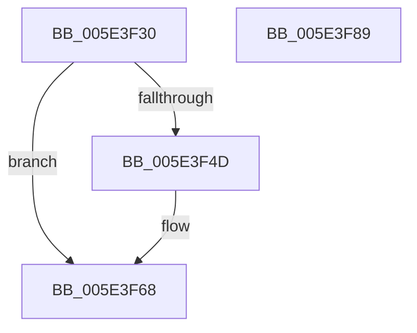

# PspTimerDelayWorkerRoutine

- RVA: `0x005E3F30`–`0x005E3F8A` (길이 `90` bytes)
- VA: `0x00000001405E3F30`
- 실행 섹션: `.text`
- PDB 이름 있음: `예`; PDB Function 태그: `아니요`
- unwind 정보 RVA: `0x0005CF00`
- 디코드: `24`개 명령, `90/90` bytes 표시
- 미해석 바이트: `0` (있으면 어셈블리에 `.byte`로 보존)

> 이 문서는 커널 이미지의 기계어와 PDB 기호를 분석해 생성했습니다. 4번과 5번은 함수 원형과 자료형을 바이너리 사용 방식에서 추정한 C 해석이며 원본 소스 복구 결과는 아닙니다.

## 1. Dependencies

- 직접 호출 지점: **5**; 고유 호출 대상: **5**
- 직접 호출자로 확인된 함수: **0**
- RIP 상대 이미지 참조: **0**

### Outgoing calls
- `0x005E3F44` → [ExAcquireRundownProtection](../21/ExAcquireRundownProtection_function_00216620.md) (function, `0x00216620`)
- `0x005E3F53` → [PspApplyTimerDelayProcess](PspApplyTimerDelayProcess_function_005E3784.md) (function, `0x005E3784`)
- `0x005E3F63` → [ExReleaseRundownProtection](../34/ExReleaseRundownProtection_function_00349E80.md) (function, `0x00349E80`)
- `0x005E3F71` → [ObfDereferenceObjectWithTag](../2F/ObfDereferenceObjectWithTag_function_002F78E0.md) (function, `0x002F78E0`)
- `0x005E3F7E` → [ExFreePoolWithTag](../../poolcode/B8/ExFreePoolWithTag_function_00B82870.md) (function, `0x00B82870`)

### Direct callers
- 이 함수 시작 RVA로 연결되는 직접 call은 확인되지 않았습니다. 간접 호출은 완전히 역산할 수 없습니다.

### Static image references
- 디코드된 RIP-relative 메모리 참조가 없습니다.

## 2. Other-region calls and transfers

- 다른 실행 섹션으로 향하는 call: **1**
  - `0x005E3F7E` → [ExFreePoolWithTag](../../poolcode/B8/ExFreePoolWithTag_function_00B82870.md) (`.text` → `POOLCODE`)
- 별도 외부 분기/꼬리 이동을 확인하지 못했습니다.

## 3. Assembly (complete function range)

```asm
005E3F30  40 53                           push rbx
005E3F32  48 83 EC 20                     sub rsp, 0x20
005E3F36  48 8B D9                        mov rbx, rcx
005E3F39  48 8B 49 20                     mov rcx, qword ptr [rcx + 0x20]
005E3F3D  48 81 C1 E8 01 00 00            add rcx, 0x1e8
005E3F44  E8 D7 26 C3 FF                  call 0x140216620
005E3F49  84 C0                           test al, al
005E3F4B  74 1B                           je 0x1405e3f68
005E3F4D  48 8B 4B 20                     mov rcx, qword ptr [rbx + 0x20]
005E3F51  33 D2                           xor edx, edx
005E3F53  E8 2C F8 FF FF                  call 0x1405e3784
005E3F58  48 8B 4B 20                     mov rcx, qword ptr [rbx + 0x20]
005E3F5C  48 81 C1 E8 01 00 00            add rcx, 0x1e8
005E3F63  E8 18 5F D6 FF                  call 0x140349e80
005E3F68  48 8B 4B 20                     mov rcx, qword ptr [rbx + 0x20]
005E3F6C  BA 50 73 4A 62                  mov edx, 0x624a7350
005E3F71  E8 6A 39 D1 FF                  call 0x1402f78e0
005E3F76  BA 54 69 44 65                  mov edx, 0x65446954
005E3F7B  48 8B CB                        mov rcx, rbx
005E3F7E  E8 ED E8 59 00                  call 0x140b82870
005E3F83  48 83 C4 20                     add rsp, 0x20
005E3F87  5B                              pop rbx
005E3F88  C3                              ret
005E3F89  CC                              int3
```

## 4. C-style interpretation (structured pseudocode)

```c
__int64 __fastcall PspTimerDelayWorkerRoutine(__int64 a1, int a2)
{
    __int64 result;
    __int64 v_rsp;

    v_rsp = (v_rsp) - (32);
    a1 = (*(unsigned __int64 *)(a1 + 32)) + (488);
    result = ExAcquireRundownProtection(a1, a2, a3, a4);
    if ((unsigned __int8)(result) != 0) {
        a1 = *(unsigned __int64 *)(a1 + 32);
        a2 = 0;
        result = PspApplyTimerDelayProcess(a1, a2, a3, a4);
        a1 = *(unsigned __int64 *)(a1 + 32);
        a1 = (a1) + (488);
        result = ExReleaseRundownProtection(a1, a2, a3, a4);
    }
    result = ObfDereferenceObjectWithTag(*(unsigned __int64 *)(a1 + 32), (unsigned int)(0x624A7350ULL), a3, a4);
    result = ExFreePoolWithTag(a1, (unsigned int)(0x65446954ULL), a3, a4);
    v_rsp = (v_rsp) + (32);
    return result;
}
```

## 5. (Beta) C Style

```c
int64_t PspTimerDelayWorkerRoutine(void *Arg1, int32_t Arg2)
{
    uint8_t *arg1 = (uint8_t *)Arg1;

    int64_t result;
    int64_t local_rsp;

    local_rsp = (local_rsp) - (32);
    Arg1 = (*(uint64_t *)(arg1 + 0x20)) + (488);
    result = ExAcquireRundownProtection(Arg1, Arg2, a3, a4);
    if ((uint8_t)(result) != 0) {
        Arg1 = *(uint64_t *)(arg1 + 0x20);
        Arg2 = 0;
        result = PspApplyTimerDelayProcess(Arg1, Arg2, a3, a4);
        Arg1 = *(uint64_t *)(arg1 + 0x20);
        Arg1 = (Arg1) + (488);
        result = ExReleaseRundownProtection(Arg1, Arg2, a3, a4);
    }
    result = ObfDereferenceObjectWithTag(*(uint64_t *)(arg1 + 0x20), (uint32_t)(0x624A7350ULL), a3, a4);
    result = ExFreePoolWithTag(Arg1, (uint32_t)(0x65446954ULL), a3, a4);
    local_rsp = (local_rsp) + (32);
    return result;
}
```

### 관측된 메모리 오프셋

구조체 형식이 확인되지 않은 접근은 인자 기준의 오프셋으로만 기록했습니다.

| 기준 인자 | 오프셋 표현 | 폭 (bit) | 접근 |
|---|---:|---:|---|
| `Arg1` | `+ 0x20` | `64` | `R` |

## 6. Execution-region graph

[열기: 2D/3D 그래프와 함수 탐색 컨트롤 패널](../../../control-panel.html?section=text&rva=0x005E3F30&view=graph)

- 2D 그래프는 위에서 아래로 흐르고, 3D 그래프는 빈 공간을 드래그해 회전합니다. Shift+드래그는 이동, 휠은 확대·축소, 함수 노드 선택은 대상 보고서 이동입니다.

### Static fallback


