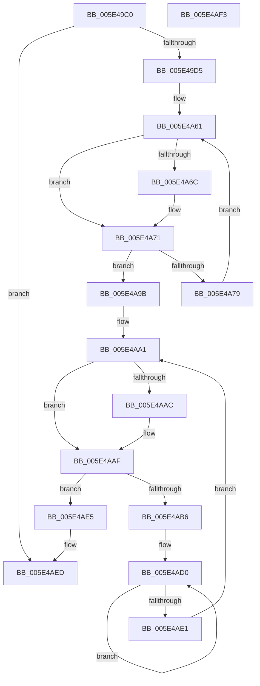

# PspVsmLogBugCheckCallback

- RVA: `0x005E49C0`–`0x005E4AF4` (길이 `308` bytes)
- VA: `0x00000001405E49C0`
- 실행 섹션: `.text`
- PDB 이름 있음: `예`; PDB Function 태그: `아니요`
- unwind 정보 RVA: `0x0005CF00`
- 디코드: `67`개 명령, `308/308` bytes 표시
- 미해석 바이트: `0` (있으면 어셈블리에 `.byte`로 보존)

> 이 문서는 커널 이미지의 기계어와 PDB 기호를 분석해 생성했습니다. 4번과 5번은 함수 원형과 자료형을 바이너리 사용 방식에서 추정한 C 해석이며 원본 소스 복구 결과는 아닙니다.

## 1. Dependencies

- 직접 호출 지점: **2**; 고유 호출 대상: **2**
- 직접 호출자로 확인된 함수: **0**
- RIP 상대 이미지 참조: **11**

### Outgoing calls
- `0x005E4A04` → [memset](../6C/memset_function_006C6C40.md) (function, `0x006C6C40`)
- `0x005E4AE8` → [WheaLogInternalEvent](../66/WheaLogInternalEvent_function_006605B0.md) (function, `0x006605B0`)

### Direct callers
- 이 함수 시작 RVA로 연결되는 직접 call은 확인되지 않았습니다. 간접 호출은 완전히 역산할 수 없습니다.

### Static image references
- `0x005E49C8` → RVA `0x00FC6D08` (`ALMOSTRO`; read)
- `0x005E49D5` → RVA `0x0002C440` (`.rdata`; read)
- `0x005E49DE` → RVA `0x00F05E00` (`.data`; read)
- `0x005E4A10` → RVA `0x00F05DE0` (`.data`; read)
- `0x005E4A1A` → RVA `0x00F05DE0` (`.data`; write)
- `0x005E4A24` → RVA `0x00F05DE4` (`.data`; write)
- `0x005E4A2E` → RVA `0x00F05DE8` (`.data`; write)
- `0x005E4A39` → RVA `0x00F05DF4` (`.data`; write)
- `0x005E4A43` → RVA `0x00F05DF0` (`.data`; write)
- `0x005E4A4D` → RVA `0x00F05DF8` (`.data`; write)
- `0x005E4A57` → RVA `0x00F05DFC` (`.data`; write)

## 2. Other-region calls and transfers

- 다른 실행 섹션으로 향하는 call: **0**
- 별도 외부 분기/꼬리 이동을 확인하지 못했습니다.

## 3. Assembly (complete function range)

```asm
005E49C0  40 53                           push rbx
005E49C2  48 83 EC 20                     sub rsp, 0x20
005E49C6  33 DB                           xor ebx, ebx
005E49C8  48 39 1D 39 23 9E 00            cmp qword ptr [rip + 0x9e2339], rbx
005E49CF  0F 84 18 01 00 00               je 0x1405e4aed
005E49D5  0F 10 05 64 7A A4 FF            movups xmm0, xmmword ptr [rip - 0x5b859c]
005E49DC  33 D2                           xor edx, edx
005E49DE  48 8D 0D 1B 14 92 00            lea rcx, [rip + 0x92141b]
005E49E5  F3 41 0F 7F 40 10               movdqu xmmword ptr [r8 + 0x10], xmm0
005E49EB  48 8B 05 16 23 9E 00            mov rax, qword ptr [rip + 0x9e2316]
005E49F2  49 89 40 20                     mov qword ptr [r8 + 0x20], rax
005E49F6  41 C7 40 28 00 20 00 00         mov dword ptr [r8 + 0x28], 0x2000
005E49FE  41 B8 00 01 00 00               mov r8d, 0x100
005E4A04  E8 37 22 0E 00                  call 0x1406c6c40
005E4A09  4C 8B 05 F8 22 9E 00            mov r8, qword ptr [rip + 0x9e22f8]
005E4A10  4C 8D 1D C9 13 92 00            lea r11, [rip + 0x9213c9]
005E4A17  44 8B CB                        mov r9d, ebx
005E4A1A  C7 05 BC 13 92 00 57 68 4C 67   mov dword ptr [rip + 0x9213bc], 0x674c6857
005E4A24  C7 05 B6 13 92 00 01 00 00 00   mov dword ptr [rip + 0x9213b6], 1
005E4A2E  48 C7 05 AF 13 92 00 20 01 00 00  mov qword ptr [rip + 0x9213af], 0x120
005E4A39  C7 05 B1 13 92 00 6B 00 00 80   mov dword ptr [rip + 0x9213b1], 0x8000006b
005E4A43  C7 05 A3 13 92 00 6B 00 00 80   mov dword ptr [rip + 0x9213a3], 0x8000006b
005E4A4D  C7 05 A1 13 92 00 18 00 00 00   mov dword ptr [rip + 0x9213a1], 0x18
005E4A57  C7 05 9B 13 92 00 00 01 00 00   mov dword ptr [rip + 0x92139b], 0x100
005E4A61  41 8B 40 0C                     mov eax, dword ptr [r8 + 0xc]
005E4A65  8B D0                           mov edx, eax
005E4A67  83 F8 26                        cmp eax, 0x26
005E4A6A  72 05                           jb 0x1405e4a71
005E4A6C  BA 26 00 00 00                  mov edx, 0x26
005E4A71  41 8B C9                        mov ecx, r9d
005E4A74  48 3B CA                        cmp rcx, rdx
005E4A77  73 22                           jae 0x1405e4a9b
005E4A79  41 8B 84 C8 94 04 00 00         mov eax, dword ptr [r8 + rcx*8 + 0x494]
005E4A81  41 FF C1                        inc r9d
005E4A84  41 89 44 8B 60                  mov dword ptr [r11 + rcx*4 + 0x60], eax
005E4A89  41 8A 84 C8 90 04 00 00         mov al, byte ptr [r8 + rcx*8 + 0x490]
005E4A91  42 88 84 19 F8 00 00 00         mov byte ptr [rcx + r11 + 0xf8], al
005E4A99  EB C6                           jmp 0x1405e4a61
005E4A9B  41 BA 08 00 00 00               mov r10d, 8
005E4AA1  41 8B 40 08                     mov eax, dword ptr [r8 + 8]
005E4AA5  8B C8                           mov ecx, eax
005E4AA7  41 3B C2                        cmp eax, r10d
005E4AAA  72 03                           jb 0x1405e4aaf
005E4AAC  49 8B CA                        mov rcx, r10
005E4AAF  8B C3                           mov eax, ebx
005E4AB1  48 3B C1                        cmp rax, rcx
005E4AB4  73 2F                           jae 0x1405e4ae5
005E4AB6  48 8D 14 C5 02 00 00 00         lea rdx, [rax*8 + 2]
005E4ABE  4D 8B CA                        mov r9, r10
005E4AC1  48 03 D0                        add rdx, rax
005E4AC4  49 8D 4B 20                     lea rcx, [r11 + 0x20]
005E4AC8  48 8D 0C C1                     lea rcx, [rcx + rax*8]
005E4ACC  49 8D 14 D0                     lea rdx, [r8 + rdx*8]
005E4AD0  8A 02                           mov al, byte ptr [rdx]
005E4AD2  48 8D 52 02                     lea rdx, [rdx + 2]
005E4AD6  88 01                           mov byte ptr [rcx], al
005E4AD8  48 FF C1                        inc rcx
005E4ADB  49 83 E9 01                     sub r9, 1
005E4ADF  75 EF                           jne 0x1405e4ad0
005E4AE1  FF C3                           inc ebx
005E4AE3  EB BC                           jmp 0x1405e4aa1
005E4AE5  49 8B CB                        mov rcx, r11
005E4AE8  E8 C3 BA 07 00                  call 0x1406605b0
005E4AED  48 83 C4 20                     add rsp, 0x20
005E4AF1  5B                              pop rbx
005E4AF2  C3                              ret
005E4AF3  CC                              int3
```

## 4. C-style interpretation (structured pseudocode)

```c
__int64 __fastcall PspVsmLogBugCheckCallback(__int64 a1, int a2, __int64 a3)
{
    __int64 result;
    __int64 v_rbx;
    __int64 v_rsp;

    v_rsp = (v_rsp) - (32);
    v_rbx = 0;
    if ((*(unsigned __int64 *)(v_rip + 10363705)) == 0) goto loc_005E4AED;
    a2 = 0;
    *(unsigned __int64 *)(a3 + 16) = v_xmm0;
    *(unsigned __int64 *)(a3 + 32) = *(unsigned __int64 *)(v_rip + 10363670);
    *(unsigned int *)(a3 + 40) = 0x2000ULL;
    result = memset(v_rip + 9573403, a2, 256, a4);
    *(unsigned int *)(v_rip + 9573308) = 0x674C6857ULL;
    *(unsigned int *)(v_rip + 9573302) = 1;
    *(unsigned __int64 *)(v_rip + 9573295) = 288;
    *(unsigned int *)(v_rip + 9573297) = 0x8000006BULL;
    *(unsigned int *)(v_rip + 9573283) = 0x8000006BULL;
    *(unsigned int *)(v_rip + 9573281) = 24;
    *(unsigned int *)(v_rip + 9573275) = 256;
loc_005E4A61:
    if (((unsigned int)((unsigned int)(*(unsigned int *)(*(unsigned __int64 *)(v_rip + 10363640) + 12)))) >= 38) {
        a2 = 38;
    }
    if (0 >= a2) goto loc_005E4A9B;
    a4 = (unsigned int)((0) + 1);
    *(unsigned int *)(v_rip + 9573321 + 0 * 4 + 96) = (unsigned int)((unsigned int)(*(unsigned int *)(*(unsigned __int64 *)(v_rip + 10363640) + 0 * 8 + 1172)));
    *(unsigned __int8 *)(0 + v_rip + 9573321 * 1 + 248) = (unsigned __int8)(*(unsigned __int8 *)(*(unsigned __int64 *)(v_rip + 10363640) + 0 * 8 + 1168));
    goto loc_005E4A61;
loc_005E4A9B:
loc_005E4AA1:
    if (((unsigned int)((unsigned int)(*(unsigned int *)(*(unsigned __int64 *)(v_rip + 10363640) + 8)))) >= 8) {
        a1 = 8;
    }
    if (0 >= a1) goto loc_005E4AE5;
    a2 = (0 * 8 + 2) + (0);
loc_005E4AD0:
    *(unsigned __int8 *)(v_rip + 9573321 + 32 + 0 * 8) = (unsigned __int8)(*(unsigned __int8 *)(*(unsigned __int64 *)(v_rip + 10363640) + a2 * 8));
    a1 = (v_rip + 9573321 + 32 + 0 * 8) + 1;
    a4 = (8) - (1);
    if (condition_is_not_equal) goto loc_005E4AD0;
    v_rbx = (unsigned int)((v_rbx) + 1);
    goto loc_005E4AA1;
loc_005E4AE5:
    result = WheaLogInternalEvent(v_rip + 9573321, *(unsigned __int64 *)(v_rip + 10363640) + a2 * 8 + 2, *(unsigned __int64 *)(v_rip + 10363640), a4);
loc_005E4AED:
    v_rsp = (v_rsp) + (32);
    return result;
}
```

## 5. (Beta) C Style

```c
int64_t PspVsmLogBugCheckCallback(int64_t Arg1, int32_t Arg2, void *Arg3)
{
    uint8_t *arg3 = (uint8_t *)Arg3;

    int64_t result;
    int64_t local_rbx;
    int64_t local_rsp;

    local_rsp = (local_rsp) - (32);
    local_rbx = 0;
    if ((*(uint64_t *)(v_rip + 0x9E2339)) == 0) goto loc_005E4AED;
    Arg2 = 0;
    *(uint64_t *)(arg3 + 0x10) = v_xmm0;
    *(uint64_t *)(arg3 + 0x20) = *(uint64_t *)(v_rip + 0x9E2316);
    *(uint32_t *)(arg3 + 0x28) = 0x2000ULL;
    result = memset(v_rip + 9573403, Arg2, 256, a4);
    *(uint32_t *)(v_rip + 0x9213BC) = 0x674C6857ULL;
    *(uint32_t *)(v_rip + 0x9213B6) = 1;
    *(uint64_t *)(v_rip + 0x9213AF) = 288;
    *(uint32_t *)(v_rip + 0x9213B1) = 0x8000006BULL;
    *(uint32_t *)(v_rip + 0x9213A3) = 0x8000006BULL;
    *(uint32_t *)(v_rip + 0x9213A1) = 24;
    *(uint32_t *)(v_rip + 0x92139B) = 256;
loc_005E4A61:
    if (((uint32_t)((uint32_t)(*(uint32_t *)(*(uint64_t *)(v_rip + 0x9E22F8) + 0xC)))) >= 38) {
        Arg2 = 38;
    }
    if (0 >= Arg2) goto loc_005E4A9B;
    a4 = (uint32_t)((0) + 1);
    *(uint32_t *)(v_rip + 0x9213C9 + 0x0 * 4 + 0x60) = (uint32_t)((uint32_t)(*(uint32_t *)(*(uint64_t *)(v_rip + 0x9E22F8) + 0x0 * 8 + 0x494)));
    *(uint8_t *)(0 + v_rip + 0x9213C9 * 1 + 0xF8) = (uint8_t)(*(uint8_t *)(*(uint64_t *)(v_rip + 0x9E22F8) + 0x0 * 8 + 0x490));
    goto loc_005E4A61;
loc_005E4A9B:
loc_005E4AA1:
    if (((uint32_t)((uint32_t)(*(uint32_t *)(*(uint64_t *)(v_rip + 0x9E22F8) + 0x8)))) >= 8) {
        Arg1 = 8;
    }
    if (0 >= Arg1) goto loc_005E4AE5;
    Arg2 = (0 * 8 + 2) + (0);
loc_005E4AD0:
    *(uint8_t *)(v_rip + 0x9213C9 + 0x20 + 0x0 * 8) = (uint8_t)(*(uint8_t *)(*(uint64_t *)(v_rip + 0x9E22F8) + Arg2 * 8));
    Arg1 = (v_rip + 9573321 + 32 + 0 * 8) + 1;
    a4 = (8) - (1);
    if (condition_is_not_equal) goto loc_005E4AD0;
    local_rbx = (uint32_t)((local_rbx) + 1);
    goto loc_005E4AA1;
loc_005E4AE5:
    result = WheaLogInternalEvent(v_rip + 9573321, *(uint64_t *)(v_rip + 0x9E22F8) + Arg2 * 8 + 2, *(uint64_t *)(v_rip + 0x9E22F8), a4);
loc_005E4AED:
    local_rsp = (local_rsp) + (32);
    return result;
}
```

### 관측된 메모리 오프셋

구조체 형식이 확인되지 않은 접근은 인자 기준의 오프셋으로만 기록했습니다.

| 기준 인자 | 오프셋 표현 | 폭 (bit) | 접근 |
|---|---:|---:|---|
| `Arg3` | `+ 0x10` | `128` | `W` |
| `Arg3` | `+ 0x20` | `64` | `W` |
| `Arg3` | `+ 0x28` | `32` | `W` |

## 6. Execution-region graph

[열기: 2D/3D 그래프와 함수 탐색 컨트롤 패널](../../../control-panel.html?section=text&rva=0x005E49C0&view=graph)

- 2D 그래프는 위에서 아래로 흐르고, 3D 그래프는 빈 공간을 드래그해 회전합니다. Shift+드래그는 이동, 휠은 확대·축소, 함수 노드 선택은 대상 보고서 이동입니다.

### Static fallback


