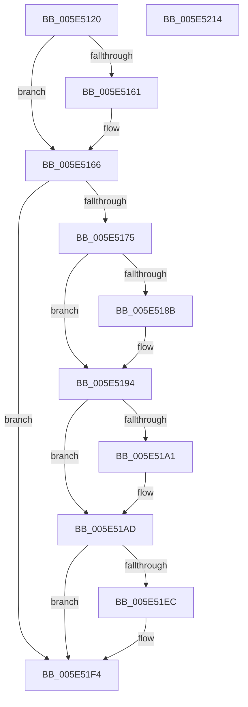

# RawVerifyVolume

- RVA: `0x005E5120`–`0x005E5215` (길이 `245` bytes)
- VA: `0x00000001405E5120`
- 실행 섹션: `.text`
- PDB 이름 있음: `예`; PDB Function 태그: `아니요`
- unwind 정보 RVA: `0x0005E6B4`
- 디코드: `68`개 명령, `245/245` bytes 표시
- 미해석 바이트: `0` (있으면 어셈블리에 `.byte`로 보존)

> 이 문서는 커널 이미지의 기계어와 PDB 기호를 분석해 생성했습니다. 4번과 5번은 함수 원형과 자료형을 바이너리 사용 방식에서 추정한 C 해석이며 원본 소스 복구 결과는 아닙니다.

## 1. Dependencies

- 직접 호출 지점: **10**; 고유 호출 대상: **6**
- 직접 호출자로 확인된 함수: **1**
- RIP 상대 이미지 참조: **0**

### Outgoing calls
- `0x005E514E` → [KeAcquireQueuedSpinLock](../27/KeAcquireQueuedSpinLock_function_00273D80.md) (function, `0x00273D80`)
- `0x005E516B` → [KeReleaseQueuedSpinLock](../27/KeReleaseQueuedSpinLock_function_00272540.md) (function, `0x00272540`)
- `0x005E517F` → [ExAcquireFastMutex](../20/ExAcquireFastMutex_function_0020E5A0.md) (function, `0x0020E5A0`)
- `0x005E5197` → [ExReleaseFastMutex](../25/ExReleaseFastMutex_function_002519C0.md) (function, `0x002519C0`)
- `0x005E51A8` → [ExWaitForRundownProtectionReleaseCacheAware](../46/ExWaitForRundownProtectionReleaseCacheAware_function_004643A0.md) (function, `0x004643A0`)
- `0x005E51B0` → [ExAcquireFastMutex](../20/ExAcquireFastMutex_function_0020E5A0.md) (function, `0x0020E5A0`)
- `0x005E51B8` → [KeAcquireQueuedSpinLock](../27/KeAcquireQueuedSpinLock_function_00273D80.md) (function, `0x00273D80`)
- `0x005E51C4` → [KeReleaseQueuedSpinLock](../27/KeReleaseQueuedSpinLock_function_00272540.md) (function, `0x00272540`)
- `0x005E51E3` → [RawInitiateDeleteVolume](../48/RawInitiateDeleteVolume_function_0048FDFC.md) (function, `0x0048FDFC`)
- `0x005E51EF` → [ExReleaseFastMutex](../25/ExReleaseFastMutex_function_002519C0.md) (function, `0x002519C0`)

### Direct callers
- [sub_00B2D562](../../page/B2/Unknown_function_00B2D562.md) at `0x00B2D568`

### Static image references
- 디코드된 RIP-relative 메모리 참조가 없습니다.

## 2. Other-region calls and transfers

- 다른 실행 섹션으로 향하는 call: **0**
- 별도 외부 분기/꼬리 이동을 확인하지 못했습니다.

## 3. Assembly (complete function range)

```asm
005E5120  48 8B C4                        mov rax, rsp
005E5123  48 89 58 08                     mov qword ptr [rax + 8], rbx
005E5127  48 89 68 10                     mov qword ptr [rax + 0x10], rbp
005E512B  48 89 70 18                     mov qword ptr [rax + 0x18], rsi
005E512F  48 89 78 20                     mov qword ptr [rax + 0x20], rdi
005E5133  41 56                           push r14
005E5135  48 83 EC 20                     sub rsp, 0x20
005E5139  48 8B D9                        mov rbx, rcx
005E513C  41 BE 09 00 00 00               mov r14d, 9
005E5142  41 8B CE                        mov ecx, r14d
005E5145  48 8B FA                        mov rdi, rdx
005E5148  40 32 F6                        xor sil, sil
005E514B  40 32 ED                        xor bpl, bpl
005E514E  E8 2D EC C8 FF                  call 0x140273d80
005E5153  48 8B 4B 08                     mov rcx, qword ptr [rbx + 8]
005E5157  F6 41 04 01                     test byte ptr [rcx + 4], 1
005E515B  48 8D 59 1C                     lea rbx, [rcx + 0x1c]
005E515F  74 05                           je 0x1405e5166
005E5161  FF 03                           inc dword ptr [rbx]
005E5163  40 B6 01                        mov sil, 1
005E5166  8A D0                           mov dl, al
005E5168  49 8B CE                        mov rcx, r14
005E516B  E8 D0 D3 C8 FF                  call 0x140272540
005E5170  40 84 F6                        test sil, sil
005E5173  74 7F                           je 0x1405e51f4
005E5175  48 8D B7 F0 00 00 00            lea rsi, [rdi + 0xf0]
005E517C  48 8B CE                        mov rcx, rsi
005E517F  E8 1C 94 C2 FF                  call 0x14020e5a0
005E5184  8B 47 78                        mov eax, dword ptr [rdi + 0x78]
005E5187  A8 02                           test al, 2
005E5189  75 09                           jne 0x1405e5194
005E518B  83 C8 02                        or eax, 2
005E518E  40 B5 01                        mov bpl, 1
005E5191  89 47 78                        mov dword ptr [rdi + 0x78], eax
005E5194  48 8B CE                        mov rcx, rsi
005E5197  E8 24 C8 C6 FF                  call 0x1402519c0
005E519C  40 84 ED                        test bpl, bpl
005E519F  74 0C                           je 0x1405e51ad
005E51A1  48 8B 8F E8 00 00 00            mov rcx, qword ptr [rdi + 0xe8]
005E51A8  E8 F3 F1 E7 FF                  call 0x1404643a0
005E51AD  48 8B CE                        mov rcx, rsi
005E51B0  E8 EB 93 C2 FF                  call 0x14020e5a0
005E51B5  49 8B CE                        mov rcx, r14
005E51B8  E8 C3 EB C8 FF                  call 0x140273d80
005E51BD  FF 0B                           dec dword ptr [rbx]
005E51BF  8A D0                           mov dl, al
005E51C1  49 8B CE                        mov rcx, r14
005E51C4  E8 77 D3 C8 FF                  call 0x140272540
005E51C9  48 8B 87 C8 00 00 00            mov rax, qword ptr [rdi + 0xc8]
005E51D0  48 8B CF                        mov rcx, rdi
005E51D3  4C 8B 40 10                     mov r8, qword ptr [rax + 0x10]
005E51D7  41 83 60 30 FD                  and dword ptr [r8 + 0x30], 0xfffffffd
005E51DC  45 33 C0                        xor r8d, r8d
005E51DF  41 8D 50 01                     lea edx, [r8 + 1]
005E51E3  E8 14 AC EA FF                  call 0x14048fdfc
005E51E8  84 C0                           test al, al
005E51EA  75 08                           jne 0x1405e51f4
005E51EC  48 8B CE                        mov rcx, rsi
005E51EF  E8 CC C7 C6 FF                  call 0x1402519c0
005E51F4  48 8B 5C 24 30                  mov rbx, qword ptr [rsp + 0x30]
005E51F9  B8 12 00 00 C0                  mov eax, 0xc0000012
005E51FE  48 8B 6C 24 38                  mov rbp, qword ptr [rsp + 0x38]
005E5203  48 8B 74 24 40                  mov rsi, qword ptr [rsp + 0x40]
005E5208  48 8B 7C 24 48                  mov rdi, qword ptr [rsp + 0x48]
005E520D  48 83 C4 20                     add rsp, 0x20
005E5211  41 5E                           pop r14
005E5213  C3                              ret
005E5214  CC                              int3
```

## 4. C-style interpretation (structured pseudocode)

```c
__int64 __fastcall RawVerifyVolume(__int64 a1, __int64 a2)
{
    __int64 result;
    __int64 v_rbp;
    __int64 v_rsi;
    __int64 v_rsp;
    unsigned __int64 v_stack_p10;
    unsigned __int64 v_stack_p18;
    unsigned __int64 v_stack_p20;
    unsigned __int64 v_stack_p8;

    *(unsigned __int64 *)(v_rsp + 8) = v_rbx;
    *(unsigned __int64 *)(v_rsp + 16) = v_rbp;
    *(unsigned __int64 *)(v_rsp + 24) = v_rsi;
    *(unsigned __int64 *)(v_rsp + 32) = v_rdi;
    v_rsp = (v_rsp) - (32);
    v_rsi = 0;
    v_rbp = 0;
    result = KeAcquireQueuedSpinLock(9, a2, a3, a4);
    if (((*(unsigned __int8 *)(*(unsigned __int64 *)(a1 + 8) + 4)) & (1)) != 0) {
        v_rsi = 1;
    }
    result = KeReleaseQueuedSpinLock(9, (unsigned __int8)(result), a3, a4);
    if ((unsigned __int8)(v_rsi) == 0) goto loc_005E51F4;
    result = ExAcquireFastMutex(a2 + 240, (unsigned __int8)(result), a3, a4);
    result = (unsigned int)(*(unsigned int *)(a2 + 120));
    if ((((unsigned __int8)((unsigned int)(*(unsigned int *)(a2 + 120)))) & (2)) == 0) {
        result = (unsigned int)(((unsigned int)(*(unsigned int *)(a2 + 120))) | (2));
        v_rbp = 1;
        *(unsigned int *)(a2 + 120) = (unsigned int)(result);
    }
    result = ExReleaseFastMutex(a2 + 240, (unsigned __int8)(result), a3, a4);
    if ((unsigned __int8)(v_rbp) != 0) {
        a1 = *(unsigned __int64 *)(a2 + 232);
        result = ExWaitForRundownProtectionReleaseCacheAware(a1, (unsigned __int8)(result), a3, a4);
    }
    result = ExAcquireFastMutex(a2 + 240, (unsigned __int8)(result), a3, a4);
    result = KeAcquireQueuedSpinLock(9, (unsigned __int8)(result), a3, a4);
    result = KeReleaseQueuedSpinLock(9, (unsigned __int8)(result), a3, a4);
    a3 = 0;
    result = RawInitiateDeleteVolume(a2, a3 + 1, a3, a4);
    if ((unsigned __int8)(result) == 0) {
        a1 = a2 + 240;
        result = ExReleaseFastMutex(a1, a3 + 1, a3, a4);
    }
    v_rsp = (v_rsp) + (32);
    return (unsigned int)(0xC0000012ULL);
}
```

## 5. (Beta) C Style

```c
int64_t RawVerifyVolume(void *Arg1, void *Arg2)
{
    uint8_t *arg1 = (uint8_t *)Arg1;
    uint8_t *arg2 = (uint8_t *)Arg2;

    int64_t result;
    int64_t local_rbp;
    int64_t local_rsi;
    int64_t local_rsp;
    uint64_t v_stack_p10;
    uint64_t v_stack_p18;
    uint64_t v_stack_p20;
    uint64_t v_stack_p8;

    *(uint64_t *)(local_rsp + 0x8) = local_rbx;
    *(uint64_t *)(local_rsp + 0x10) = local_rbp;
    *(uint64_t *)(local_rsp + 0x18) = local_rsi;
    *(uint64_t *)(local_rsp + 0x20) = local_rdi;
    local_rsp = (local_rsp) - (32);
    local_rsi = 0;
    local_rbp = 0;
    result = KeAcquireQueuedSpinLock(9, Arg2, a3, a4);
    if (((*(uint8_t *)(*(uint64_t *)(arg1 + 0x8) + 0x4)) & (1)) != 0) {
        local_rsi = 1;
    }
    result = KeReleaseQueuedSpinLock(9, (uint8_t)(result), a3, a4);
    if ((uint8_t)(local_rsi) == 0) goto loc_005E51F4;
    result = ExAcquireFastMutex(Arg2 + 240, (uint8_t)(result), a3, a4);
    result = (uint32_t)(*(uint32_t *)(arg2 + 0x78));
    if ((((uint8_t)((uint32_t)(*(uint32_t *)(arg2 + 0x78)))) & (2)) == 0) {
        result = (uint32_t)(((uint32_t)(*(uint32_t *)(arg2 + 0x78))) | (2));
        local_rbp = 1;
        *(uint32_t *)(arg2 + 0x78) = (uint32_t)(result);
    }
    result = ExReleaseFastMutex(Arg2 + 240, (uint8_t)(result), a3, a4);
    if ((uint8_t)(local_rbp) != 0) {
        Arg1 = *(uint64_t *)(arg2 + 0xE8);
        result = ExWaitForRundownProtectionReleaseCacheAware(Arg1, (uint8_t)(result), a3, a4);
    }
    result = ExAcquireFastMutex(Arg2 + 240, (uint8_t)(result), a3, a4);
    result = KeAcquireQueuedSpinLock(9, (uint8_t)(result), a3, a4);
    result = KeReleaseQueuedSpinLock(9, (uint8_t)(result), a3, a4);
    a3 = 0;
    result = RawInitiateDeleteVolume(Arg2, a3 + 1, a3, a4);
    if ((uint8_t)(result) == 0) {
        Arg1 = Arg2 + 240;
        result = ExReleaseFastMutex(Arg1, a3 + 1, a3, a4);
    }
    local_rsp = (local_rsp) + (32);
    return (uint32_t)(0xC0000012ULL);
}
```

### 관측된 메모리 오프셋

구조체 형식이 확인되지 않은 접근은 인자 기준의 오프셋으로만 기록했습니다.

| 기준 인자 | 오프셋 표현 | 폭 (bit) | 접근 |
|---|---:|---:|---|
| `Arg1` | `+ 0x8` | `64` | `R` |
| `Arg2` | `+ 0x78` | `32` | `R` |
| `Arg2` | `+ 0x78` | `32` | `W` |
| `Arg2` | `+ 0xC8` | `64` | `R` |
| `Arg2` | `+ 0xE8` | `64` | `R` |
| `Arg2` | `+ 0xF0` | `64` | `R` |

## 6. Execution-region graph

[열기: 2D/3D 그래프와 함수 탐색 컨트롤 패널](../../../control-panel.html?section=text&rva=0x005E5120&view=graph)

- 2D 그래프는 위에서 아래로 흐르고, 3D 그래프는 빈 공간을 드래그해 회전합니다. Shift+드래그는 이동, 휠은 확대·축소, 함수 노드 선택은 대상 보고서 이동입니다.

### Static fallback


