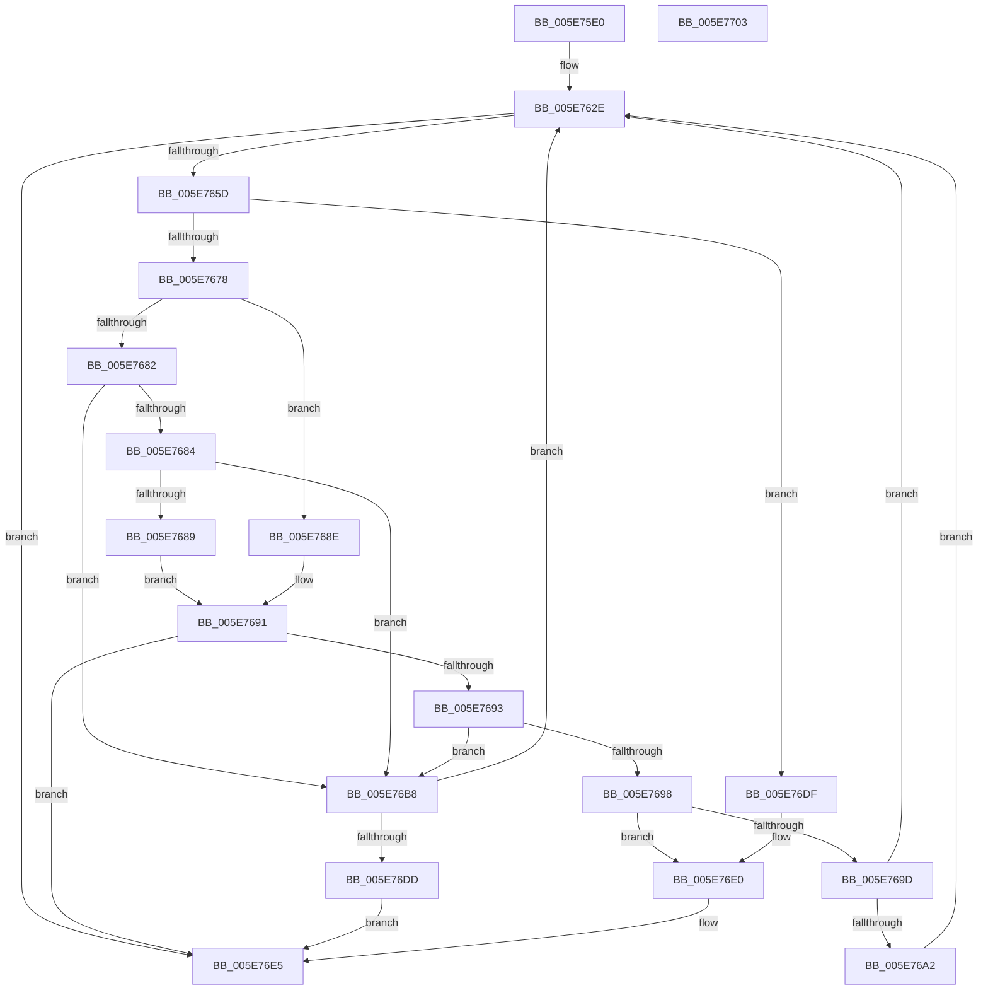

# RtlAssert

- RVA: `0x005E75E0`–`0x005E7704` (길이 `292` bytes)
- VA: `0x00000001405E75E0`
- 실행 섹션: `.text`
- PDB 이름 있음: `예`; PDB Function 태그: `아니요`
- unwind 정보 RVA: `0x000CF9FC`
- 디코드: `81`개 명령, `292/292` bytes 표시
- 미해석 바이트: `0` (있으면 어셈블리에 `.byte`로 보존)

> 이 문서는 커널 이미지의 기계어와 PDB 기호를 분석해 생성했습니다. 4번과 5번은 함수 원형과 자료형을 바이너리 사용 방식에서 추정한 C 해석이며 원본 소스 복구 결과는 아닙니다.

## 1. Dependencies

- 직접 호출 지점: **7**; 고유 호출 대상: **6**
- 직접 호출자로 확인된 함수: **18**
- RIP 상대 이미지 참조: **5**

### Outgoing calls
- `0x005E7611` → [RtlCaptureContext](../4F/RtlCaptureContext_function_004FE570.md) (function, `0x004FE570`)
- `0x005E764B` → [DbgPrintEx](../35/DbgPrintEx_function_00359290.md) (function, `0x00359290`)
- `0x005E766F` → [DbgPrompt](DbgPrompt_function_005E5880.md) (function, `0x005E5880`)
- `0x005E76AE` → [ZwTerminateThread](../6A/ZwTerminateThread_function_006ADB30.md) (function, `0x006ADB30`)
- `0x005E76C9` → [DbgPrintEx](../35/DbgPrintEx_function_00359290.md) (function, `0x00359290`)
- `0x005E76E0` → [RtlpTerminateCurrentProcess](../../page/78/RtlpTerminateCurrentProcess_function_0078F7AC.md) (function, `0x0078F7AC`)
- `0x005E76F0` → [_security_check_cookie](../6A/_security_check_cookie_function_006AC640.md) (function, `0x006AC640`)

### Direct callers
- [KsepStringSplitMultiString](../../page/74/KsepStringSplitMultiString_function_0074AB48.md) at `0x0074AC32`
- [KsepStringSplitMultiString](../../page/74/KsepStringSplitMultiString_function_0074AB48.md) at `0x0074AD14`
- [KsepRegistryCreateKey](../../page/74/KsepRegistryCreateKey_function_0074B008.md) at `0x0074B09E`
- [KsepRegistryCreateKey](../../page/74/KsepRegistryCreateKey_function_0074B008.md) at `0x0074B0ED`
- [KsepRegistryCreateKey](../../page/74/KsepRegistryCreateKey_function_0074B008.md) at `0x0074B13C`
- [KsepRegistryQueryDWORD](../../page/74/KsepRegistryQueryDWORD_function_0074B348.md) at `0x0074B3C7`
- [KsepRegistryQueryDWORD](../../page/74/KsepRegistryQueryDWORD_function_0074B348.md) at `0x0074B414`
- [KsepRegistryQuerySZ](../../page/74/KsepRegistryQuerySZ_function_0074B58C.md) at `0x0074B613`
- [KsepRegistryQuerySZ](../../page/74/KsepRegistryQuerySZ_function_0074B58C.md) at `0x0074B663`
- [KsepRegistryQuerySZ](../../page/74/KsepRegistryQuerySZ_function_0074B58C.md) at `0x0074B6BB`
- [KsepRegistryQuerySZ](../../page/74/KsepRegistryQuerySZ_function_0074B58C.md) at `0x0074B745`
- [KsepRegistryQueryValue](../../page/74/KsepRegistryQueryValue_function_0074B7F8.md) at `0x0074B87F`
- [KsepRegistryQueryValue](../../page/74/KsepRegistryQueryValue_function_0074B7F8.md) at `0x0074B8CF`
- [KsepRegistryQueryValue](../../page/74/KsepRegistryQueryValue_function_0074B7F8.md) at `0x0074B927`
- [KsepRegistryQueryValue](../../page/74/KsepRegistryQueryValue_function_0074B7F8.md) at `0x0074B9B1`
- [KsepStringDuplicateUnicode](../../page/95/KsepStringDuplicateUnicode_function_00958D78.md) at `0x00958E24`
- [KsepGetShimCallbacksForDriver](../../page/95/KsepGetShimCallbacksForDriver_function_00958E64.md) at `0x00958F29`
- [KsepStringFree](../../page/95/KsepStringFree_function_0095A1B8.md) at `0x0095A22A`
- [KsepStringConcatenate](../../page/95/KsepStringConcatenate_function_0095A8A0.md) at `0x0095AA23`
- [KsepStringConcatenate](../../page/95/KsepStringConcatenate_function_0095A8A0.md) at `0x0095AA6C`
- [KsepStringConcatenate](../../page/95/KsepStringConcatenate_function_0095A8A0.md) at `0x0095AAB5`
- [KsepStringTransform](../../page/95/KsepStringTransform_function_0095B318.md) at `0x0095B3F3`
- [KsepStringTransform](../../page/95/KsepStringTransform_function_0095B318.md) at `0x0095B442`
- [sub_00B26BF6](../../page/B2/Unknown_function_00B26BF6.md) at `0x00B26CC2`
- [sub_00B27116](../../page/B2/Unknown_function_00B27116.md) at `0x00B27172`
- [sub_00B27692](../../page/B2/Unknown_function_00B27692.md) at `0x00B276DB`
- [sub_00B27692](../../page/B2/Unknown_function_00B27692.md) at `0x00B2772F`
- [sub_00B2774E](../../page/B2/Unknown_function_00B2774E.md) at `0x00B2779B`
- [sub_00B27812](../../page/B2/Unknown_function_00B27812.md) at `0x00B2785F`
- [KsepEngineInitialize](../../init/C3/KsepEngineInitialize_function_00C3B4A0.md) at `0x00C3B4F5`
- [KseShimDatabaseBootInitialize](../../init/C3/KseShimDatabaseBootInitialize_function_00C3C124.md) at `0x00C3C1A8`
- [KseShimDatabaseBootInitialize](../../init/C3/KseShimDatabaseBootInitialize_function_00C3C124.md) at `0x00C3C1F7`
- [KsepEngineReadFlags](../../init/C3/KsepEngineReadFlags_function_00C3C310.md) at `0x00C3C38A`

### Static image references
- `0x005E75EE` → RVA `0x00E0A740` (`.data`; read)
- `0x005E7619` → RVA `0x006C7800` (` ?? ::FNODOBFM::`string'`; read)
- `0x005E7639` → RVA `0x006CC770` (` ?? ::FNODOBFM::`string'`; read)
- `0x005E7668` → RVA `0x006CC710` (` ?? ::FNODOBFM::`string'`; read)
- `0x005E76BF` → RVA `0x006CC6E0` (` ?? ::FNODOBFM::`string'`; read)

## 2. Other-region calls and transfers

- 다른 실행 섹션으로 향하는 call: **1**
  - `0x005E76E0` → [RtlpTerminateCurrentProcess](../../page/78/RtlpTerminateCurrentProcess_function_0078F7AC.md) (`.text` → `PAGE`)
- 별도 외부 분기/꼬리 이동을 확인하지 못했습니다.

## 3. Assembly (complete function range)

```asm
005E75E0  40 53                           push rbx
005E75E2  55                              push rbp
005E75E3  56                              push rsi
005E75E4  57                              push rdi
005E75E5  41 57                           push r15
005E75E7  48 81 EC 30 05 00 00            sub rsp, 0x530
005E75EE  48 8B 05 4B 31 82 00            mov rax, qword ptr [rip + 0x82314b]
005E75F5  48 33 C4                        xor rax, rsp
005E75F8  48 89 84 24 20 05 00 00         mov qword ptr [rsp + 0x520], rax
005E7600  48 8B F9                        mov rdi, rcx
005E7603  49 8B D9                        mov rbx, r9
005E7606  48 8D 4C 24 50                  lea rcx, [rsp + 0x50]
005E760B  41 8B E8                        mov ebp, r8d
005E760E  48 8B F2                        mov rsi, rdx
005E7611  E8 5A 6F F1 FF                  call 0x1404fe570
005E7616  48 85 DB                        test rbx, rbx
005E7619  48 8D 05 E0 01 0E 00            lea rax, [rip + 0xe01e0]
005E7620  49 BF D4 02 00 00 80 F7 FF FF   movabs r15, 0xfffff780000002d4
005E762A  48 0F 44 D8                     cmove rbx, rax
005E762E  33 D2                           xor edx, edx
005E7630  89 6C 24 30                     mov dword ptr [rsp + 0x30], ebp
005E7634  48 89 74 24 28                  mov qword ptr [rsp + 0x28], rsi
005E7639  4C 8D 05 30 51 0E 00            lea r8, [rip + 0xe5130]
005E7640  4C 8B CB                        mov r9, rbx
005E7643  48 89 7C 24 20                  mov qword ptr [rsp + 0x20], rdi
005E7648  8D 4A 65                        lea ecx, [rdx + 0x65]
005E764B  E8 40 1C D7 FF                  call 0x140359290
005E7650  41 8A 07                        mov al, byte ptr [r15]
005E7653  24 03                           and al, 3
005E7655  3C 03                           cmp al, 3
005E7657  0F 85 88 00 00 00               jne 0x1405e76e5
005E765D  41 B8 02 00 00 00               mov r8d, 2
005E7663  48 8D 54 24 40                  lea rdx, [rsp + 0x40]
005E7668  48 8D 0D A1 50 0E 00            lea rcx, [rip + 0xe50a1]
005E766F  E8 0C E2 FF FF                  call 0x1405e5880
005E7674  85 C0                           test eax, eax
005E7676  74 67                           je 0x1405e76df
005E7678  0F BE 4C 24 40                  movsx ecx, byte ptr [rsp + 0x40]
005E767D  83 F9 62                        cmp ecx, 0x62
005E7680  7F 0C                           jg 0x1405e768e
005E7682  74 34                           je 0x1405e76b8
005E7684  83 E9 42                        sub ecx, 0x42
005E7687  74 2F                           je 0x1405e76b8
005E7689  83 E9 07                        sub ecx, 7
005E768C  EB 03                           jmp 0x1405e7691
005E768E  83 E9 69                        sub ecx, 0x69
005E7691  74 52                           je 0x1405e76e5
005E7693  83 E9 06                        sub ecx, 6
005E7696  74 20                           je 0x1405e76b8
005E7698  83 E9 01                        sub ecx, 1
005E769B  74 43                           je 0x1405e76e0
005E769D  83 F9 04                        cmp ecx, 4
005E76A0  75 8C                           jne 0x1405e762e
005E76A2  BA 01 00 00 C0                  mov edx, 0xc0000001
005E76A7  48 C7 C1 FE FF FF FF            mov rcx, 0xfffffffffffffffe
005E76AE  E8 7D 64 0C 00                  call 0x1406adb30
005E76B3  E9 76 FF FF FF                  jmp 0x1405e762e
005E76B8  33 D2                           xor edx, edx
005E76BA  4C 8D 4C 24 50                  lea r9, [rsp + 0x50]
005E76BF  4C 8D 05 1A 50 0E 00            lea r8, [rip + 0xe501a]
005E76C6  8D 4A 65                        lea ecx, [rdx + 0x65]
005E76C9  E8 C2 1B D7 FF                  call 0x140359290
005E76CE  CC                              int3
005E76CF  8A 44 24 40                     mov al, byte ptr [rsp + 0x40]
005E76D3  2C 4F                           sub al, 0x4f
005E76D5  A8 DF                           test al, 0xdf
005E76D7  0F 85 51 FF FF FF               jne 0x1405e762e
005E76DD  EB 06                           jmp 0x1405e76e5
005E76DF  CC                              int3
005E76E0  E8 C7 80 1A 00                  call 0x14078f7ac
005E76E5  48 8B 8C 24 20 05 00 00         mov rcx, qword ptr [rsp + 0x520]
005E76ED  48 33 CC                        xor rcx, rsp
005E76F0  E8 4B 4F 0C 00                  call 0x1406ac640
005E76F5  48 81 C4 30 05 00 00            add rsp, 0x530
005E76FC  41 5F                           pop r15
005E76FE  5F                              pop rdi
005E76FF  5E                              pop rsi
005E7700  5D                              pop rbp
005E7701  5B                              pop rbx
005E7702  C3                              ret
005E7703  CC                              int3
```

## 4. C-style interpretation (structured pseudocode)

```c
__int64 __fastcall RtlAssert(__int64 a1, __int64 a2, int a3, __int64 a4)
{
    __int64 result;
    __int64 v_rsp;
    unsigned __int64 v_stack_m38;
    unsigned __int64 v_stack_m508;
    unsigned __int64 v_stack_m518;
    unsigned int v_stack_m528;
    unsigned __int64 v_stack_m530;
    unsigned __int64 v_stack_m538;

    v_rsp = (v_rsp) - (0x530ULL);
    result = (*(unsigned __int64 *)(v_rip + 8532299)) ^ (v_rsp);
    v_stack_m38 = result;
    result = RtlCaptureContext(v_stack_m508, a2, a3, a4);
    if (a4 == 0) { a4 = v_rip + 917984; }
loc_005E762E:
    a2 = 0;
    v_stack_m528 = (unsigned int)((unsigned int)(a3));
    v_stack_m530 = 0;
    v_stack_m538 = a1;
    result = DbgPrintEx(a2 + 101, a2, v_rip + 938288, a4);
    result = (unsigned __int8)((*(unsigned __int8 *)(v_r15)) & (3));
    if (((unsigned __int8)(result)) != 3) goto loc_005E76E5;
    result = DbgPrompt(v_rip + 938145, v_stack_m518, 2, a4);
    if ((unsigned int)(result) == 0) goto loc_005E76DF;
    if (((unsigned int)((__int8)(v_stack_m518))) > 98) goto loc_005E768E;
    if (((unsigned int)((__int8)(v_stack_m518))) == 98) goto loc_005E76B8;
    a1 = (unsigned int)(((__int8)(v_stack_m518)) - (66));
    if (condition_is_equal) goto loc_005E76B8;
    a1 = (unsigned int)((a1) - (7));
    goto loc_005E7691;
loc_005E768E:
    a1 = (unsigned int)((a1) - (105));
loc_005E7691:
    if (condition_is_equal) goto loc_005E76E5;
    a1 = (unsigned int)((a1) - (6));
    if (condition_is_equal) goto loc_005E76B8;
    a1 = (unsigned int)((a1) - (1));
    if (condition_is_equal) goto loc_005E76E0;
    if (((unsigned int)(a1)) != 4) goto loc_005E762E;
    result = ZwTerminateThread(-2, (unsigned int)(0xC0000001ULL), 2, a4);
    goto loc_005E762E;
loc_005E76B8:
    a2 = 0;
    result = DbgPrintEx(a2 + 101, a2, v_rip + 938010, v_stack_m508);
    result = (unsigned __int8)((v_stack_m518) - (79));
    if ((((unsigned __int8)(result)) & (223)) != 0) goto loc_005E762E;
    goto loc_005E76E5;
loc_005E76DF:
loc_005E76E0:
    result = RtlpTerminateCurrentProcess(a2 + 101, a2, v_rip + 938010, v_stack_m508);
loc_005E76E5:
    a1 = (v_stack_m38) ^ (v_rsp);
    result = _security_check_cookie(a1, a2, v_rip + 938010, v_stack_m508);
    v_rsp = (v_rsp) + (0x530ULL);
    return result;
}
```

## 5. (Beta) C Style

```c
int64_t RtlAssert(int64_t Arg1, int64_t Arg2, int32_t Arg3, int64_t Arg4)
{
    int64_t result;
    int64_t local_rsp;
    uint64_t v_stack_m38;
    uint64_t v_stack_m508;
    uint64_t v_stack_m518;
    uint32_t v_stack_m528;
    uint64_t v_stack_m530;
    uint64_t v_stack_m538;

    local_rsp = (local_rsp) - (0x530ULL);
    result = (*(uint64_t *)(v_rip + 0x82314B)) ^ (local_rsp);
    v_stack_m38 = result;
    result = RtlCaptureContext(v_stack_m508, Arg2, Arg3, Arg4);
    if (Arg4 == 0) { Arg4 = v_rip + 917984; }
loc_005E762E:
    Arg2 = 0;
    v_stack_m528 = (uint32_t)((uint32_t)(Arg3));
    v_stack_m530 = 0;
    v_stack_m538 = Arg1;
    result = DbgPrintEx(Arg2 + 101, Arg2, v_rip + 938288, Arg4);
    result = (uint8_t)((*(uint8_t *)(local_r15)) & (3));
    if (((uint8_t)(result)) != 3) goto loc_005E76E5;
    result = DbgPrompt(v_rip + 938145, v_stack_m518, 2, Arg4);
    if ((uint32_t)(result) == 0) goto loc_005E76DF;
    if (((uint32_t)((int8_t)(v_stack_m518))) > 98) goto loc_005E768E;
    if (((uint32_t)((int8_t)(v_stack_m518))) == 98) goto loc_005E76B8;
    Arg1 = (uint32_t)(((int8_t)(v_stack_m518)) - (66));
    if (condition_is_equal) goto loc_005E76B8;
    Arg1 = (uint32_t)((Arg1) - (7));
    goto loc_005E7691;
loc_005E768E:
    Arg1 = (uint32_t)((Arg1) - (105));
loc_005E7691:
    if (condition_is_equal) goto loc_005E76E5;
    Arg1 = (uint32_t)((Arg1) - (6));
    if (condition_is_equal) goto loc_005E76B8;
    Arg1 = (uint32_t)((Arg1) - (1));
    if (condition_is_equal) goto loc_005E76E0;
    if (((uint32_t)(Arg1)) != 4) goto loc_005E762E;
    result = ZwTerminateThread(-2, (uint32_t)(0xC0000001ULL), 2, Arg4);
    goto loc_005E762E;
loc_005E76B8:
    Arg2 = 0;
    result = DbgPrintEx(Arg2 + 101, Arg2, v_rip + 938010, v_stack_m508);
    result = (uint8_t)((v_stack_m518) - (79));
    if ((((uint8_t)(result)) & (223)) != 0) goto loc_005E762E;
    goto loc_005E76E5;
loc_005E76DF:
loc_005E76E0:
    result = RtlpTerminateCurrentProcess(Arg2 + 101, Arg2, v_rip + 938010, v_stack_m508);
loc_005E76E5:
    Arg1 = (v_stack_m38) ^ (local_rsp);
    result = _security_check_cookie(Arg1, Arg2, v_rip + 938010, v_stack_m508);
    local_rsp = (local_rsp) + (0x530ULL);
    return result;
}
```

## 6. Execution-region graph

[열기: 2D/3D 그래프와 함수 탐색 컨트롤 패널](../../../control-panel.html?section=text&rva=0x005E75E0&view=graph)

- 2D 그래프는 위에서 아래로 흐르고, 3D 그래프는 빈 공간을 드래그해 회전합니다. Shift+드래그는 이동, 휠은 확대·축소, 함수 노드 선택은 대상 보고서 이동입니다.

### Static fallback


