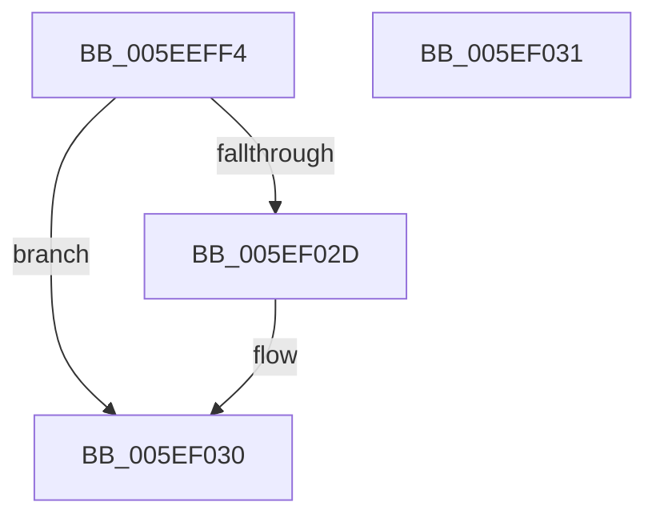

# RtlCalculateUnwindInfoSizeForKernelScp

- RVA: `0x005EEFF4`–`0x005EF032` (길이 `62` bytes)
- VA: `0x00000001405EEFF4`
- 실행 섹션: `.text`
- PDB 이름 있음: `예`; PDB Function 태그: `예`
- unwind 정보 RVA: `0x000DB714`
- 디코드: `19`개 명령, `62/62` bytes 표시
- 미해석 바이트: `0` (있으면 어셈블리에 `.byte`로 보존)

> 이 문서는 커널 이미지의 기계어와 PDB 기호를 분석해 생성했습니다. 4번과 5번은 함수 원형과 자료형을 바이너리 사용 방식에서 추정한 C 해석이며 원본 소스 복구 결과는 아닙니다.

## 1. Dependencies

- 직접 호출 지점: **0**; 고유 호출 대상: **0**
- 직접 호출자로 확인된 함수: **2**
- RIP 상대 이미지 참조: **0**

### Outgoing calls
- 직접 디코드된 call 명령이 없습니다.

### Direct callers
- [RtlCopyKernelScpUnwindInfo](RtlCopyKernelScpUnwindInfo_function_005EF038.md) at `0x005EF0A8`
- [RtlCreateKernelScpFunctionTable](RtlCreateKernelScpFunctionTable_function_005EF118.md) at `0x005EF1B7`

### Static image references
- 디코드된 RIP-relative 메모리 참조가 없습니다.

## 2. Other-region calls and transfers

- 다른 실행 섹션으로 향하는 call: **0**
- 별도 외부 분기/꼬리 이동을 확인하지 못했습니다.

## 3. Assembly (complete function range)

```asm
005EEFF4  44 8B 4A 08                     mov r9d, dword ptr [rdx + 8]
005EEFF8  4D 8B D0                        mov r10, r8
005EEFFB  4C 03 C9                        add r9, rcx
005EEFFE  41 B8 00 00 00 00               mov r8d, 0
005EF004  41 0F B6 41 02                  movzx eax, byte ptr [r9 + 2]
005EF009  A8 01                           test al, 1
005EF00B  8D 0C 45 04 00 00 00            lea ecx, [rax*2 + 4]
005EF012  8D 51 02                        lea edx, [rcx + 2]
005EF015  0F 44 D1                        cmove edx, ecx
005EF018  41 8A 09                        mov cl, byte ptr [r9]
005EF01B  F6 C1 18                        test cl, 0x18
005EF01E  44 0F 45 C2                     cmovne r8d, edx
005EF022  8D 42 08                        lea eax, [rdx + 8]
005EF025  0F 44 C2                        cmove eax, edx
005EF028  4D 85 D2                        test r10, r10
005EF02B  74 03                           je 0x1405ef030
005EF02D  45 89 02                        mov dword ptr [r10], r8d
005EF030  C3                              ret
005EF031  CC                              int3
```

## 4. C-style interpretation (structured pseudocode)

```c
__int64 __fastcall RtlCalculateUnwindInfoSizeForKernelScp(__int64 a1, __int64 a2, __int64 a3)
{
    __int64 result;

    a4 = ((unsigned int)(*(unsigned int *)(a2 + 8))) + (a1);
    a2 = *(unsigned __int8 *)(a4 + 2) * 2 + 4 + 2;
    if ((((unsigned __int8)(*(unsigned __int8 *)(a4 + 2))) & (1)) == 0) { a2 = (unsigned int)(*(unsigned __int8 *)(a4 + 2) * 2 + 4); }
    a3 = 0;
    if ((((unsigned __int8)(*(unsigned __int8 *)(a4))) & (24)) != 0) { a3 = (unsigned int)(a2); }
    result = a2 + 8;
    if ((((unsigned __int8)(*(unsigned __int8 *)(a4))) & (24)) == 0) { result = (unsigned int)(a2); }
    if (a3 != 0) {
        *(unsigned int *)(a3) = (unsigned int)(a3);
    }
    return result;
}
```

## 5. (Beta) C Style

```c
int64_t RtlCalculateUnwindInfoSizeForKernelScp(int64_t Arg1, void *Arg2, int64_t Arg3)
{
    uint8_t *arg2 = (uint8_t *)Arg2;

    int64_t result;

    a4 = ((uint32_t)(*(uint32_t *)(arg2 + 0x8))) + (Arg1);
    Arg2 = *(uint8_t *)(a4 + 0x2) * 2 + 4 + 2;
    if ((((uint8_t)(*(uint8_t *)(a4 + 0x2))) & (1)) == 0) { Arg2 = (uint32_t)(*(uint8_t *)(a4 + 0x2) * 2 + 4); }
    Arg3 = 0;
    if ((((uint8_t)(*(uint8_t *)(a4))) & (24)) != 0) { Arg3 = (uint32_t)(Arg2); }
    result = Arg2 + 8;
    if ((((uint8_t)(*(uint8_t *)(a4))) & (24)) == 0) { result = (uint32_t)(Arg2); }
    if (Arg3 != 0) {
        *(uint32_t *)(Arg3) = (uint32_t)(Arg3);
    }
    return result;
}
```

### 관측된 메모리 오프셋

구조체 형식이 확인되지 않은 접근은 인자 기준의 오프셋으로만 기록했습니다.

| 기준 인자 | 오프셋 표현 | 폭 (bit) | 접근 |
|---|---:|---:|---|
| `Arg2` | `+ 0x8` | `32` | `R` |

## 6. Execution-region graph

[열기: 2D/3D 그래프와 함수 탐색 컨트롤 패널](../../../control-panel.html?section=text&rva=0x005EEFF4&view=graph)

- 2D 그래프는 위에서 아래로 흐르고, 3D 그래프는 빈 공간을 드래그해 회전합니다. Shift+드래그는 이동, 휠은 확대·축소, 함수 노드 선택은 대상 보고서 이동입니다.

### Static fallback


