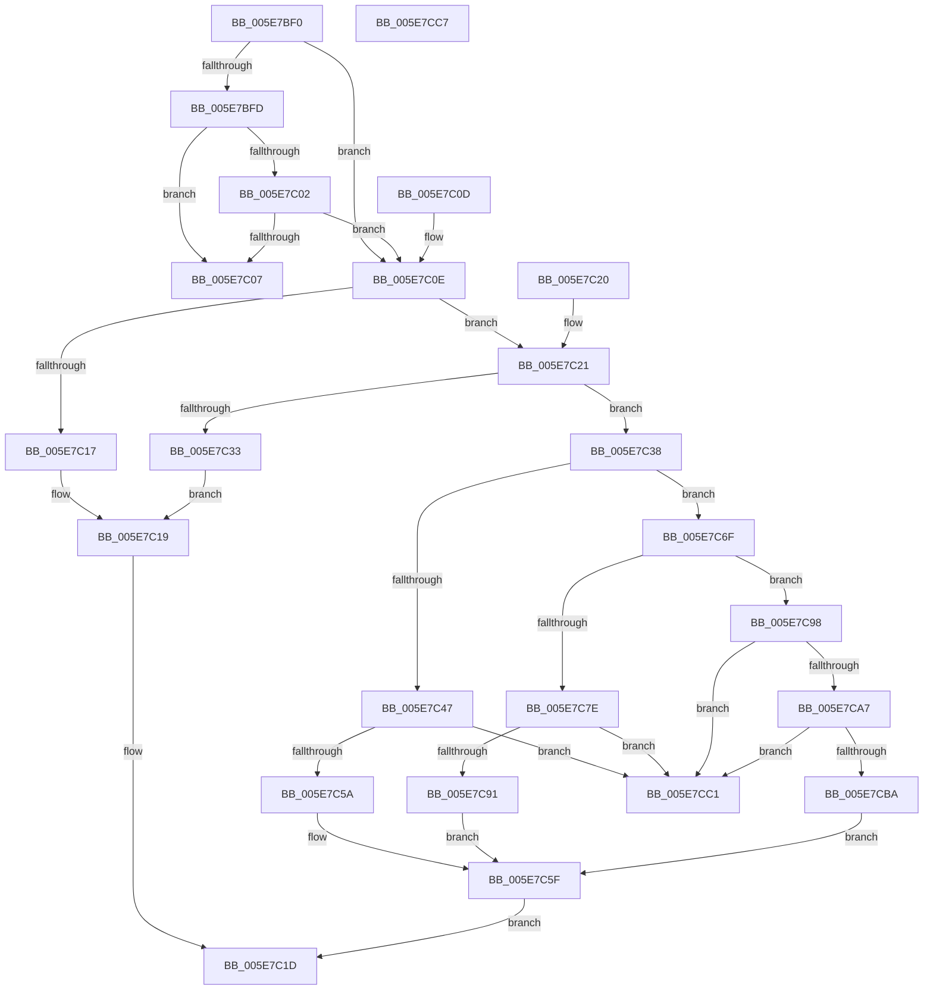

# RtlCmEncodeMemIoResource

- RVA: `0x005E7BF0`–`0x005E7CC8` (길이 `216` bytes)
- VA: `0x00000001405E7BF0`
- 실행 섹션: `.text`
- PDB 이름 있음: `예`; PDB Function 태그: `아니요`
- unwind 정보 RVA: `0x000DB714`
- 디코드: `66`개 명령, `216/216` bytes 표시
- 미해석 바이트: `0` (있으면 어셈블리에 `.byte`로 보존)

> 이 문서는 커널 이미지의 기계어와 PDB 기호를 분석해 생성했습니다. 4번과 5번은 함수 원형과 자료형을 바이너리 사용 방식에서 추정한 C 해석이며 원본 소스 복구 결과는 아닙니다.

## 1. Dependencies

- 직접 호출 지점: **0**; 고유 호출 대상: **0**
- 직접 호출자로 확인된 함수: **3**
- RIP 상대 이미지 참조: **0**

### Outgoing calls
- 직접 디코드된 call 명령이 없습니다.

### Direct callers
- [VslGetSecurePciDeviceBootConfiguration](../58/VslGetSecurePciDeviceBootConfiguration_function_0058E650.md) at `0x0058E722`
- [HalpReportResourceUsage](../../init/C1/HalpReportResourceUsage_function_00C1F034.md) at `0x00C1F31F`
- [IopInitializeResourceMap](../../init/C3/IopInitializeResourceMap_function_00C33198.md) at `0x00C33430`

### Static image references
- 디코드된 RIP-relative 메모리 참조가 없습니다.

## 2. Other-region calls and transfers

- 다른 실행 섹션으로 향하는 call: **0**
- 별도 외부 분기/꼬리 이동을 확인하지 못했습니다.

## 3. Assembly (complete function range)

```asm
005E7BF0  8D 42 FD                        lea eax, [rdx - 3]
005E7BF3  41 BA FF FF FF FF               mov r10d, 0xffffffff
005E7BF9  A8 FB                           test al, 0xfb
005E7BFB  74 11                           je 0x1405e7c0e
005E7BFD  80 FA 01                        cmp dl, 1
005E7C00  75 05                           jne 0x1405e7c07
005E7C02  4D 3B C2                        cmp r8, r10
005E7C05  76 07                           jbe 0x1405e7c0e
005E7C07  B8 0D 00 00 C0                  mov eax, 0xc000000d
005E7C0C  C3                              ret
005E7C0D  CC                              int3
005E7C0E  4C 89 49 04                     mov qword ptr [rcx + 4], r9
005E7C12  80 FA 01                        cmp dl, 1
005E7C15  75 0A                           jne 0x1405e7c21
005E7C17  88 11                           mov byte ptr [rcx], dl
005E7C19  44 89 41 0C                     mov dword ptr [rcx + 0xc], r8d
005E7C1D  33 C0                           xor eax, eax
005E7C1F  C3                              ret
005E7C20  CC                              int3
005E7C21  BA FF F1 00 00                  mov edx, 0xf1ff
005E7C26  66 23 51 02                     and dx, word ptr [rcx + 2]
005E7C2A  66 89 51 02                     mov word ptr [rcx + 2], dx
005E7C2E  4D 3B C2                        cmp r8, r10
005E7C31  77 05                           ja 0x1405e7c38
005E7C33  C6 01 03                        mov byte ptr [rcx], 3
005E7C36  EB E1                           jmp 0x1405e7c19
005E7C38  48 B8 00 FF FF FF FF 00 00 00   movabs rax, 0xffffffff00
005E7C42  4C 3B C0                        cmp r8, rax
005E7C45  77 28                           ja 0x1405e7c6f
005E7C47  4D 8B C8                        mov r9, r8
005E7C4A  49 C1 E9 08                     shr r9, 8
005E7C4E  41 8B C1                        mov eax, r9d
005E7C51  48 C1 E0 08                     shl rax, 8
005E7C55  4C 3B C0                        cmp r8, rax
005E7C58  75 67                           jne 0x1405e7cc1
005E7C5A  B8 00 02 00 00                  mov eax, 0x200
005E7C5F  66 0B D0                        or dx, ax
005E7C62  C6 01 07                        mov byte ptr [rcx], 7
005E7C65  66 89 51 02                     mov word ptr [rcx + 2], dx
005E7C69  44 89 49 0C                     mov dword ptr [rcx + 0xc], r9d
005E7C6D  EB AE                           jmp 0x1405e7c1d
005E7C6F  48 B8 00 00 FF FF FF FF 00 00   movabs rax, 0xffffffff0000
005E7C79  4C 3B C0                        cmp r8, rax
005E7C7C  77 1A                           ja 0x1405e7c98
005E7C7E  4D 8B C8                        mov r9, r8
005E7C81  49 C1 E9 10                     shr r9, 0x10
005E7C85  41 8B C1                        mov eax, r9d
005E7C88  48 C1 E0 10                     shl rax, 0x10
005E7C8C  4C 3B C0                        cmp r8, rax
005E7C8F  75 30                           jne 0x1405e7cc1
005E7C91  B8 00 04 00 00                  mov eax, 0x400
005E7C96  EB C7                           jmp 0x1405e7c5f
005E7C98  48 B8 00 00 00 00 FF FF FF FF   movabs rax, 0xffffffff00000000
005E7CA2  4C 3B C0                        cmp r8, rax
005E7CA5  77 1A                           ja 0x1405e7cc1
005E7CA7  4D 8B C8                        mov r9, r8
005E7CAA  49 C1 E9 20                     shr r9, 0x20
005E7CAE  49 8B C1                        mov rax, r9
005E7CB1  48 C1 E0 20                     shl rax, 0x20
005E7CB5  4C 3B C0                        cmp r8, rax
005E7CB8  75 07                           jne 0x1405e7cc1
005E7CBA  B8 00 08 00 00                  mov eax, 0x800
005E7CBF  EB 9E                           jmp 0x1405e7c5f
005E7CC1  B8 01 00 00 C0                  mov eax, 0xc0000001
005E7CC6  C3                              ret
005E7CC7  CC                              int3
```

## 4. C-style interpretation (structured pseudocode)

```c
__int64 __fastcall RtlCmEncodeMemIoResource(__int64 a1, __int64 a2, __int64 a3, __int64 a4)
{
    __int64 result;

    if ((((unsigned __int8)(a2 - 3)) & (251)) == 0) goto loc_005E7C0E;
    if (((unsigned __int8)(a2)) != 1) goto loc_005E7C07;
    if (a3 <= ((unsigned int)(0xFFFFFFFFULL))) goto loc_005E7C0E;
loc_005E7C07:
    return (unsigned int)(0xC000000DULL);
loc_005E7C0E:
    *(unsigned __int64 *)(a1 + 4) = a4;
    if (((unsigned __int8)(a2)) != 1) goto loc_005E7C21;
    *(unsigned __int8 *)(a1) = (unsigned __int8)(a2);
loc_005E7C19:
    *(unsigned int *)(a1 + 12) = (unsigned int)(a3);
loc_005E7C1D:
    result = 0;
    return result;
loc_005E7C21:
    a2 = (unsigned __int16)(((unsigned int)(0xF1FFULL)) & (*(unsigned __int16 *)(a1 + 2)));
    *(unsigned __int16 *)(a1 + 2) = (unsigned __int16)(a2);
    if (a3 > ((unsigned int)(0xFFFFFFFFULL))) goto loc_005E7C38;
    *(unsigned __int8 *)(a1) = 3;
    goto loc_005E7C19;
loc_005E7C38:
    if (a3 > 0) goto loc_005E7C6F;
    a4 = (a3) >> (8);
    result = ((unsigned int)((unsigned int)(a4))) << (8);
    if (a3 != result) goto loc_005E7CC1;
loc_005E7C5F:
    a2 = (unsigned __int16)((a2) | (512));
    *(unsigned __int8 *)(a1) = 7;
    *(unsigned __int16 *)(a1 + 2) = (unsigned __int16)(a2);
    *(unsigned int *)(a1 + 12) = (unsigned int)(a4);
    goto loc_005E7C1D;
loc_005E7C6F:
    if (a3 > 512) goto loc_005E7C98;
    a4 = (a3) >> (16);
    result = ((unsigned int)((unsigned int)(a4))) << (16);
    if (a3 != result) goto loc_005E7CC1;
    goto loc_005E7C5F;
loc_005E7C98:
    if (a3 > ((unsigned int)(0x400ULL))) goto loc_005E7CC1;
    a4 = (a3) >> (32);
    result = (a4) << (32);
    if (a3 != result) goto loc_005E7CC1;
    goto loc_005E7C5F;
loc_005E7CC1:
    return (unsigned int)(0xC0000001ULL);
}
```

## 5. (Beta) C Style

```c
int64_t RtlCmEncodeMemIoResource(void *Arg1, void *Arg2, int64_t Arg3, int64_t Arg4)
{
    uint8_t *arg1 = (uint8_t *)Arg1;
    uint8_t *arg2 = (uint8_t *)Arg2;

    int64_t result;

    if ((((uint8_t)(Arg2 - 3)) & (251)) == 0) goto loc_005E7C0E;
    if (((uint8_t)(Arg2)) != 1) goto loc_005E7C07;
    if (Arg3 <= ((uint32_t)(0xFFFFFFFFULL))) goto loc_005E7C0E;
loc_005E7C07:
    return (uint32_t)(0xC000000DULL);
loc_005E7C0E:
    *(uint64_t *)(arg1 + 0x4) = Arg4;
    if (((uint8_t)(Arg2)) != 1) goto loc_005E7C21;
    *(uint8_t *)(arg1) = (uint8_t)(Arg2);
loc_005E7C19:
    *(uint32_t *)(arg1 + 0xC) = (uint32_t)(Arg3);
loc_005E7C1D:
    result = 0;
    return result;
loc_005E7C21:
    Arg2 = (uint16_t)(((uint32_t)(0xF1FFULL)) & (*(uint16_t *)(arg1 + 0x2)));
    *(uint16_t *)(arg1 + 0x2) = (uint16_t)(Arg2);
    if (Arg3 > ((uint32_t)(0xFFFFFFFFULL))) goto loc_005E7C38;
    *(uint8_t *)(arg1) = 3;
    goto loc_005E7C19;
loc_005E7C38:
    if (Arg3 > 0) goto loc_005E7C6F;
    Arg4 = (Arg3) >> (8);
    result = ((uint32_t)((uint32_t)(Arg4))) << (8);
    if (Arg3 != result) goto loc_005E7CC1;
loc_005E7C5F:
    Arg2 = (uint16_t)((Arg2) | (512));
    *(uint8_t *)(arg1) = 7;
    *(uint16_t *)(arg1 + 0x2) = (uint16_t)(Arg2);
    *(uint32_t *)(arg1 + 0xC) = (uint32_t)(Arg4);
    goto loc_005E7C1D;
loc_005E7C6F:
    if (Arg3 > 512) goto loc_005E7C98;
    Arg4 = (Arg3) >> (16);
    result = ((uint32_t)((uint32_t)(Arg4))) << (16);
    if (Arg3 != result) goto loc_005E7CC1;
    goto loc_005E7C5F;
loc_005E7C98:
    if (Arg3 > ((uint32_t)(0x400ULL))) goto loc_005E7CC1;
    Arg4 = (Arg3) >> (32);
    result = (Arg4) << (32);
    if (Arg3 != result) goto loc_005E7CC1;
    goto loc_005E7C5F;
loc_005E7CC1:
    return (uint32_t)(0xC0000001ULL);
}
```

### 관측된 메모리 오프셋

구조체 형식이 확인되지 않은 접근은 인자 기준의 오프셋으로만 기록했습니다.

| 기준 인자 | 오프셋 표현 | 폭 (bit) | 접근 |
|---|---:|---:|---|
| `Arg1` | `+ 0x0` | `8` | `W` |
| `Arg1` | `+ 0x2` | `16` | `R` |
| `Arg1` | `+ 0x2` | `16` | `W` |
| `Arg1` | `+ 0x4` | `64` | `W` |
| `Arg1` | `+ 0xC` | `32` | `W` |
| `Arg2` | `- 0x3` | `32` | `R` |

## 6. Execution-region graph

[열기: 2D/3D 그래프와 함수 탐색 컨트롤 패널](../../../control-panel.html?section=text&rva=0x005E7BF0&view=graph)

- 2D 그래프는 위에서 아래로 흐르고, 3D 그래프는 빈 공간을 드래그해 회전합니다. Shift+드래그는 이동, 휠은 확대·축소, 함수 노드 선택은 대상 보고서 이동입니다.

### Static fallback


