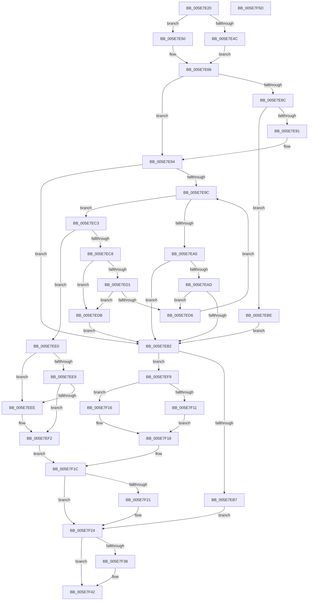

# RtlCompareExchangePointerMapping

- RVA: `0x005E7E20`–`0x005E7F5E` (길이 `318` bytes)
- VA: `0x00000001405E7E20`
- 실행 섹션: `.text`
- PDB 이름 있음: `예`; PDB Function 태그: `아니요`
- unwind 정보 RVA: `0x00060300`
- 디코드: `100`개 명령, `318/318` bytes 표시
- 미해석 바이트: `0` (있으면 어셈블리에 `.byte`로 보존)

> 이 문서는 커널 이미지의 기계어와 PDB 기호를 분석해 생성했습니다. 4번과 5번은 함수 원형과 자료형을 바이너리 사용 방식에서 추정한 C 해석이며 원본 소스 복구 결과는 아닙니다.

## 1. Dependencies

- 직접 호출 지점: **5**; 고유 호출 대상: **5**
- 직접 호출자로 확인된 함수: **0**
- RIP 상대 이미지 참조: **3**

### Outgoing calls
- `0x005E7E5E` → [ExAllocatePool2](../../poolcode/B8/ExAllocatePool2_function_00B820F0.md) (function, `0x00B820F0`)
- `0x005E7E6D` → [RtlpAcquirePropStoreLockExclusive](RtlpAcquirePropStoreLockExclusive_function_005E84C4.md) (function, `0x005E84C4`)
- `0x005E7F07` → [RtlRbInsertNodeEx](../2E/RtlRbInsertNodeEx_function_002E4570.md) (function, `0x002E4570`)
- `0x005E7F2E` → [RtlpReleasePropStoreLockExclusive](RtlpReleasePropStoreLockExclusive_function_005E857C.md) (function, `0x005E857C`)
- `0x005E7F3D` → [ExFreePoolWithTag](../../poolcode/B8/ExFreePoolWithTag_function_00B82870.md) (function, `0x00B82870`)

### Direct callers
- 이 함수 시작 RVA로 연결되는 직접 call은 확인되지 않았습니다. 간접 호출은 완전히 역산할 수 없습니다.

### Static image references
- `0x005E7E66` → RVA `0x00E67B18` (`.data`; read)
- `0x005E7E72` → RVA `0x00E0C5C8` (`.data`; read)
- `0x005E7E79` → RVA `0x00E0C5C0` (`.data`; read)

## 2. Other-region calls and transfers

- 다른 실행 섹션으로 향하는 call: **2**
  - `0x005E7E5E` → [ExAllocatePool2](../../poolcode/B8/ExAllocatePool2_function_00B820F0.md) (`.text` → `POOLCODE`)
  - `0x005E7F3D` → [ExFreePoolWithTag](../../poolcode/B8/ExFreePoolWithTag_function_00B82870.md) (`.text` → `POOLCODE`)
- 별도 외부 분기/꼬리 이동을 확인하지 못했습니다.

## 3. Assembly (complete function range)

```asm
005E7E20  48 89 5C 24 08                  mov qword ptr [rsp + 8], rbx
005E7E25  48 89 6C 24 10                  mov qword ptr [rsp + 0x10], rbp
005E7E2A  48 89 74 24 18                  mov qword ptr [rsp + 0x18], rsi
005E7E2F  57                              push rdi
005E7E30  41 56                           push r14
005E7E32  41 57                           push r15
005E7E34  48 83 EC 20                     sub rsp, 0x20
005E7E38  4D 8B F1                        mov r14, r9
005E7E3B  49 8B D8                        mov rbx, r8
005E7E3E  48 8B F2                        mov rsi, rdx
005E7E41  48 8B E9                        mov rbp, rcx
005E7E44  44 0F 20 C0                     mov rax, cr8
005E7E48  3C 02                           cmp al, 2
005E7E4A  76 04                           jbe 0x1405e7e50
005E7E4C  33 FF                           xor edi, edi
005E7E4E  EB 16                           jmp 0x1405e7e66
005E7E50  BA 28 00 00 00                  mov edx, 0x28
005E7E55  41 B8 52 50 72 70               mov r8d, 0x70725052
005E7E5B  8D 4A 18                        lea ecx, [rdx + 0x18]
005E7E5E  E8 8D A2 59 00                  call 0x140b820f0
005E7E63  48 8B F8                        mov rdi, rax
005E7E66  48 8D 0D AB FC 87 00            lea rcx, [rip + 0x87fcab]
005E7E6D  E8 52 06 00 00                  call 0x1405e84c4
005E7E72  F6 05 4F 47 82 00 01            test byte ptr [rip + 0x82474f], 1
005E7E79  4C 8D 15 40 47 82 00            lea r10, [rip + 0x824740]
005E7E80  48 8B 15 39 47 82 00            mov rdx, qword ptr [rip + 0x824739]
005E7E87  44 8A F8                        mov r15b, al
005E7E8A  74 08                           je 0x1405e7e94
005E7E8C  48 85 D2                        test rdx, rdx
005E7E8F  74 2D                           je 0x1405e7ebe
005E7E91  49 33 D2                        xor rdx, r10
005E7E94  45 32 C0                        xor r8b, r8b
005E7E97  48 85 D2                        test rdx, rdx
005E7E9A  74 16                           je 0x1405e7eb2
005E7E9C  48 8B C5                        mov rax, rbp
005E7E9F  48 2B 42 18                     sub rax, qword ptr [rdx + 0x18]
005E7EA3  79 1E                           jns 0x1405e7ec3
005E7EA5  48 8B 02                        mov rax, qword ptr [rdx]
005E7EA8  48 85 C0                        test rax, rax
005E7EAB  74 05                           je 0x1405e7eb2
005E7EAD  48 33 C2                        xor rax, rdx
005E7EB0  75 24                           jne 0x1405e7ed6
005E7EB2  48 85 FF                        test rdi, rdi
005E7EB5  75 42                           jne 0x1405e7ef9
005E7EB7  BB 9A 00 00 C0                  mov ebx, 0xc000009a
005E7EBC  EB 66                           jmp 0x1405e7f24
005E7EBE  45 32 C0                        xor r8b, r8b
005E7EC1  EB EF                           jmp 0x1405e7eb2
005E7EC3  48 85 C0                        test rax, rax
005E7EC6  7E 18                           jle 0x1405e7ee0
005E7EC8  48 8B 42 08                     mov rax, qword ptr [rdx + 8]
005E7ECC  48 85 C0                        test rax, rax
005E7ECF  74 0A                           je 0x1405e7edb
005E7ED1  48 33 C2                        xor rax, rdx
005E7ED4  74 05                           je 0x1405e7edb
005E7ED6  48 8B D0                        mov rdx, rax
005E7ED9  EB C1                           jmp 0x1405e7e9c
005E7EDB  41 B0 01                        mov r8b, 1
005E7EDE  EB D2                           jmp 0x1405e7eb2
005E7EE0  48 8B 42 20                     mov rax, qword ptr [rdx + 0x20]
005E7EE4  48 85 DB                        test rbx, rbx
005E7EE7  74 05                           je 0x1405e7eee
005E7EE9  48 3B 03                        cmp rax, qword ptr [rbx]
005E7EEC  75 04                           jne 0x1405e7ef2
005E7EEE  48 89 72 20                     mov qword ptr [rdx + 0x20], rsi
005E7EF2  BB 00 00 00 40                  mov ebx, 0x40000000
005E7EF7  EB 23                           jmp 0x1405e7f1c
005E7EF9  4C 8B CF                        mov r9, rdi
005E7EFC  48 89 6F 18                     mov qword ptr [rdi + 0x18], rbp
005E7F00  49 8B CA                        mov rcx, r10
005E7F03  48 89 77 20                     mov qword ptr [rdi + 0x20], rsi
005E7F07  E8 64 C6 CF FF                  call 0x1402e4570
005E7F0C  48 85 DB                        test rbx, rbx
005E7F0F  74 05                           je 0x1405e7f16
005E7F11  48 8B 03                        mov rax, qword ptr [rbx]
005E7F14  EB 02                           jmp 0x1405e7f18
005E7F16  33 C0                           xor eax, eax
005E7F18  33 FF                           xor edi, edi
005E7F1A  33 DB                           xor ebx, ebx
005E7F1C  4D 85 F6                        test r14, r14
005E7F1F  74 03                           je 0x1405e7f24
005E7F21  49 89 06                        mov qword ptr [r14], rax
005E7F24  41 8A D7                        mov dl, r15b
005E7F27  48 8D 0D EA FB 87 00            lea rcx, [rip + 0x87fbea]
005E7F2E  E8 49 06 00 00                  call 0x1405e857c
005E7F33  48 85 FF                        test rdi, rdi
005E7F36  74 0A                           je 0x1405e7f42
005E7F38  33 D2                           xor edx, edx
005E7F3A  48 8B CF                        mov rcx, rdi
005E7F3D  E8 2E A9 59 00                  call 0x140b82870
005E7F42  48 8B 6C 24 48                  mov rbp, qword ptr [rsp + 0x48]
005E7F47  8B C3                           mov eax, ebx
005E7F49  48 8B 5C 24 40                  mov rbx, qword ptr [rsp + 0x40]
005E7F4E  48 8B 74 24 50                  mov rsi, qword ptr [rsp + 0x50]
005E7F53  48 83 C4 20                     add rsp, 0x20
005E7F57  41 5F                           pop r15
005E7F59  41 5E                           pop r14
005E7F5B  5F                              pop rdi
005E7F5C  C3                              ret
005E7F5D  CC                              int3
```

## 4. C-style interpretation (structured pseudocode)

```c
__int64 __fastcall RtlCompareExchangePointerMapping(__int64 a1, __int64 a2, __int64 a3, __int64 a4)
{
    __int64 result;
    __int64 v_rbx;
    __int64 v_rdi;
    __int64 v_rsp;
    unsigned __int64 v_stack_p10;
    unsigned __int64 v_stack_p18;
    unsigned __int64 v_stack_p8;

    v_stack_p8 = v_rbx;
    v_stack_p10 = v_rbp;
    v_stack_p18 = v_rsi;
    v_rsp = (v_rsp) - (32);
    if (((unsigned __int8)(v_cr8)) <= 2) goto loc_005E7E50;
    v_rdi = 0;
    goto loc_005E7E66;
loc_005E7E50:
    result = ExAllocatePool2(40 + 24, 40, (unsigned int)(0x70725052ULL), a4);
loc_005E7E66:
    result = RtlpAcquirePropStoreLockExclusive(v_rip + 8912043, 40, (unsigned int)(0x70725052ULL), a4);
    if (((*(unsigned __int8 *)(v_rip + 8537935)) & (1)) == 0) goto loc_005E7E94;
    if (*(unsigned __int64 *)(v_rip + 8537913) == 0) goto loc_005E7EBE;
    a2 = (*(unsigned __int64 *)(v_rip + 8537913)) ^ (v_rip + 8537920);
loc_005E7E94:
    a3 = 0;
    if (a2 == 0) goto loc_005E7EB2;
loc_005E7E9C:
    result = (a1) - (*(unsigned __int64 *)(a2 + 24));
    if (!sign_flag) goto loc_005E7EC3;
    if (*(unsigned __int64 *)(a2) == 0) goto loc_005E7EB2;
    result = (*(unsigned __int64 *)(a2)) ^ (a2);
    if (condition_is_not_equal) goto loc_005E7ED6;
loc_005E7EB2:
    if (result != 0) goto loc_005E7EF9;
    goto loc_005E7F24;
loc_005E7EBE:
    a3 = 0;
    goto loc_005E7EB2;
loc_005E7EC3:
    if (condition_is_less_or_equal) goto loc_005E7EE0;
    if (*(unsigned __int64 *)(a2 + 8) == 0) goto loc_005E7EDB;
    result = (*(unsigned __int64 *)(a2 + 8)) ^ (a2);
    if (condition_is_equal) goto loc_005E7EDB;
loc_005E7ED6:
    goto loc_005E7E9C;
loc_005E7EDB:
    goto loc_005E7EB2;
loc_005E7EE0:
    if ((unsigned int)(0xC000009AULL) == 0) goto loc_005E7EEE;
    if ((*(unsigned __int64 *)(result + 32)) == (*(unsigned __int64 *)((unsigned int)(0xC000009AULL)))) {
        *(unsigned __int64 *)(result + 32) = a2;
    }
    goto loc_005E7F1C;
loc_005E7EF9:
    *(unsigned __int64 *)(result + 24) = a1;
    *(unsigned __int64 *)(result + 32) = a2;
    result = RtlRbInsertNodeEx(v_rip + 8537920, result, 1, result);
    if ((unsigned int)(0x40000000ULL) == 0) goto loc_005E7F16;
    goto loc_005E7F18;
loc_005E7F16:
    result = 0;
loc_005E7F18:
    v_rdi = 0;
    v_rbx = 0;
loc_005E7F1C:
    if (a4 != 0) {
        *(unsigned __int64 *)(a4) = 0;
    }
    result = RtlpReleasePropStoreLockExclusive(v_rip + 8911850, (unsigned __int8)((unsigned __int8)(result)), 1, result);
    if (0 != 0) {
        a2 = 0;
        a1 = 0;
        result = ExFreePoolWithTag(a1, a2, 1, result);
    }
    v_rsp = (v_rsp) + (32);
    return 0;
}
```

## 5. (Beta) C Style

```c
int64_t RtlCompareExchangePointerMapping(int64_t Arg1, int64_t Arg2, int64_t Arg3, int64_t Arg4)
{
    int64_t result;
    int64_t local_rbx;
    int64_t local_rdi;
    int64_t local_rsp;
    uint64_t v_stack_p10;
    uint64_t v_stack_p18;
    uint64_t v_stack_p8;

    v_stack_p8 = local_rbx;
    v_stack_p10 = local_rbp;
    v_stack_p18 = local_rsi;
    local_rsp = (local_rsp) - (32);
    if (((uint8_t)(v_cr8)) <= 2) goto loc_005E7E50;
    local_rdi = 0;
    goto loc_005E7E66;
loc_005E7E50:
    result = ExAllocatePool2(40 + 24, 40, (uint32_t)(0x70725052ULL), Arg4);
loc_005E7E66:
    result = RtlpAcquirePropStoreLockExclusive(v_rip + 8912043, 40, (uint32_t)(0x70725052ULL), Arg4);
    if (((*(uint8_t *)(v_rip + 0x82474F)) & (1)) == 0) goto loc_005E7E94;
    if (*(uint64_t *)(v_rip + 0x824739) == 0) goto loc_005E7EBE;
    Arg2 = (*(uint64_t *)(v_rip + 0x824739)) ^ (v_rip + 8537920);
loc_005E7E94:
    Arg3 = 0;
    if (Arg2 == 0) goto loc_005E7EB2;
loc_005E7E9C:
    result = (Arg1) - (*(uint64_t *)(Arg2 + 0x18));
    if (!sign_flag) goto loc_005E7EC3;
    if (*(uint64_t *)(Arg2) == 0) goto loc_005E7EB2;
    result = (*(uint64_t *)(Arg2)) ^ (Arg2);
    if (condition_is_not_equal) goto loc_005E7ED6;
loc_005E7EB2:
    if (result != 0) goto loc_005E7EF9;
    goto loc_005E7F24;
loc_005E7EBE:
    Arg3 = 0;
    goto loc_005E7EB2;
loc_005E7EC3:
    if (condition_is_less_or_equal) goto loc_005E7EE0;
    if (*(uint64_t *)(Arg2 + 0x8) == 0) goto loc_005E7EDB;
    result = (*(uint64_t *)(Arg2 + 0x8)) ^ (Arg2);
    if (condition_is_equal) goto loc_005E7EDB;
loc_005E7ED6:
    goto loc_005E7E9C;
loc_005E7EDB:
    goto loc_005E7EB2;
loc_005E7EE0:
    if ((uint32_t)(0xC000009AULL) == 0) goto loc_005E7EEE;
    if ((*(uint64_t *)(result + 0x20)) == (*(uint64_t *)((uint32_t)(0xC000009AULL)))) {
        *(uint64_t *)(result + 0x20) = Arg2;
    }
    goto loc_005E7F1C;
loc_005E7EF9:
    *(uint64_t *)(result + 0x18) = Arg1;
    *(uint64_t *)(result + 0x20) = Arg2;
    result = RtlRbInsertNodeEx(v_rip + 8537920, result, 1, result);
    if ((uint32_t)(0x40000000ULL) == 0) goto loc_005E7F16;
    goto loc_005E7F18;
loc_005E7F16:
    result = 0;
loc_005E7F18:
    local_rdi = 0;
    local_rbx = 0;
loc_005E7F1C:
    if (Arg4 != 0) {
        *(uint64_t *)(Arg4) = 0;
    }
    result = RtlpReleasePropStoreLockExclusive(v_rip + 8911850, (uint8_t)((uint8_t)(result)), 1, result);
    if (0 != 0) {
        Arg2 = 0;
        Arg1 = 0;
        result = ExFreePoolWithTag(Arg1, Arg2, 1, result);
    }
    local_rsp = (local_rsp) + (32);
    return 0;
}
```

## 6. Execution-region graph

[열기: 2D/3D 그래프와 함수 탐색 컨트롤 패널](../../../control-panel.html?section=text&rva=0x005E7E20&view=graph)

- 2D 그래프는 위에서 아래로 흐르고, 3D 그래프는 빈 공간을 드래그해 회전합니다. Shift+드래그는 이동, 휠은 확대·축소, 함수 노드 선택은 대상 보고서 이동입니다.

### Static fallback


