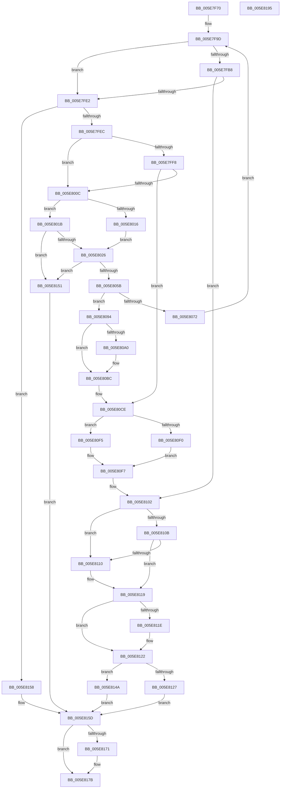

# RtlCompareExchangePropertyStore

- RVA: `0x005E7F70`–`0x005E8196` (길이 `550` bytes)
- VA: `0x00000001405E7F70`
- 실행 섹션: `.text`
- PDB 이름 있음: `예`; PDB Function 태그: `아니요`
- unwind 정보 RVA: `0x000CFB2C`
- 디코드: `143`개 명령, `550/550` bytes 표시
- 미해석 바이트: `0` (있으면 어셈블리에 `.byte`로 보존)

> 이 문서는 커널 이미지의 기계어와 PDB 기호를 분석해 생성했습니다. 4번과 5번은 함수 원형과 자료형을 바이너리 사용 방식에서 추정한 C 해석이며 원본 소스 복구 결과는 아닙니다.

## 1. Dependencies

- 직접 호출 지점: **11**; 고유 호출 대상: **7**
- 직접 호출자로 확인된 함수: **0**
- RIP 상대 이미지 참조: **8**

### Outgoing calls
- `0x005E7FA4` → [RtlpAcquirePropStoreLockExclusive](RtlpAcquirePropStoreLockExclusive_function_005E84C4.md) (function, `0x005E84C4`)
- `0x005E7FD4` → [bsearch](../50/bsearch_function_00500430.md) (function, `0x00500430`)
- `0x005E8030` → [RtlpReleasePropStoreLockExclusive](RtlpReleasePropStoreLockExclusive_function_005E857C.md) (function, `0x005E857C`)
- `0x005E804A` → [ExAllocatePool2](../../poolcode/B8/ExAllocatePool2_function_00B820F0.md) (function, `0x00B820F0`)
- `0x005E8062` → [RtlpAcquirePropStoreLockExclusive](RtlpAcquirePropStoreLockExclusive_function_005E84C4.md) (function, `0x005E84C4`)
- `0x005E807B` → [RtlpReleasePropStoreLockExclusive](RtlpReleasePropStoreLockExclusive_function_005E857C.md) (function, `0x005E857C`)
- `0x005E8085` → [ExFreePoolWithTag](../../poolcode/B8/ExFreePoolWithTag_function_00B82870.md) (function, `0x00B82870`)
- `0x005E80B4` → [memcpy](../6C/memcpy_function_006C6840.md) (function, `0x006C6840`)
- `0x005E8141` → [qsort](../50/qsort_function_005009F0.md) (function, `0x005009F0`)
- `0x005E8167` → [RtlpReleasePropStoreLockExclusive](RtlpReleasePropStoreLockExclusive_function_005E857C.md) (function, `0x005E857C`)
- `0x005E8176` → [ExFreePoolWithTag](../../poolcode/B8/ExFreePoolWithTag_function_00B82870.md) (function, `0x00B82870`)

### Direct callers
- 이 함수 시작 RVA로 연결되는 직접 call은 확인되지 않았습니다. 간접 호출은 완전히 역산할 수 없습니다.

### Static image references
- `0x005E7F9D` → RVA `0x00E67B1C` (`.data`; read)
- `0x005E7FA9` → RVA `0x00F05C10` (`.data`; read)
- `0x005E7FB8` → RVA `0x00F05C1C` (`.data`; read)
- `0x005E7FBF` → RVA `0x005E8560` (`RtlpComparePropertyEntry`; read)
- `0x005E8000` → RVA `0x00F05C18` (`.data`; read)
- `0x005E80C1` → RVA `0x00F05C10` (`.data`; write)
- `0x005E80C8` → RVA `0x00F05C18` (`.data`; write)
- `0x005E80E1` → RVA `0x00F05C1C` (`.data`; write)

## 2. Other-region calls and transfers

- 다른 실행 섹션으로 향하는 call: **3**
  - `0x005E804A` → [ExAllocatePool2](../../poolcode/B8/ExAllocatePool2_function_00B820F0.md) (`.text` → `POOLCODE`)
  - `0x005E8085` → [ExFreePoolWithTag](../../poolcode/B8/ExFreePoolWithTag_function_00B82870.md) (`.text` → `POOLCODE`)
  - `0x005E8176` → [ExFreePoolWithTag](../../poolcode/B8/ExFreePoolWithTag_function_00B82870.md) (`.text` → `POOLCODE`)
- 별도 외부 분기/꼬리 이동을 확인하지 못했습니다.

## 3. Assembly (complete function range)

```asm
005E7F70  48 89 5C 24 18                  mov qword ptr [rsp + 0x18], rbx
005E7F75  48 89 54 24 10                  mov qword ptr [rsp + 0x10], rdx
005E7F7A  48 89 4C 24 08                  mov qword ptr [rsp + 8], rcx
005E7F7F  55                              push rbp
005E7F80  56                              push rsi
005E7F81  57                              push rdi
005E7F82  41 54                           push r12
005E7F84  41 55                           push r13
005E7F86  41 56                           push r14
005E7F88  41 57                           push r15
005E7F8A  48 83 EC 30                     sub rsp, 0x30
005E7F8E  45 33 E4                        xor r12d, r12d
005E7F91  4D 8B E9                        mov r13, r9
005E7F94  45 33 FF                        xor r15d, r15d
005E7F97  4D 8B F0                        mov r14, r8
005E7F9A  48 8B F9                        mov rdi, rcx
005E7F9D  48 8D 0D 78 FB 87 00            lea rcx, [rip + 0x87fb78]
005E7FA4  E8 1B 05 00 00                  call 0x1405e84c4
005E7FA9  48 8B 15 60 DC 91 00            mov rdx, qword ptr [rip + 0x91dc60]
005E7FB0  40 8A E8                        mov bpl, al
005E7FB3  48 85 D2                        test rdx, rdx
005E7FB6  74 2A                           je 0x1405e7fe2
005E7FB8  44 8B 05 5D DC 91 00            mov r8d, dword ptr [rip + 0x91dc5d]
005E7FBF  48 8D 05 9A 05 00 00            lea rax, [rip + 0x59a]
005E7FC6  41 B9 18 00 00 00               mov r9d, 0x18
005E7FCC  48 89 44 24 20                  mov qword ptr [rsp + 0x20], rax
005E7FD1  48 8B CF                        mov rcx, rdi
005E7FD4  E8 57 84 F1 FF                  call 0x140500430
005E7FD9  48 85 C0                        test rax, rax
005E7FDC  0F 85 20 01 00 00               jne 0x1405e8102
005E7FE2  40 80 FD 02                     cmp bpl, 2
005E7FE6  0F 87 6C 01 00 00               ja 0x1405e8158
005E7FEC  48 8B 1D 1D DC 91 00            mov rbx, qword ptr [rip + 0x91dc1d]
005E7FF3  48 85 DB                        test rbx, rbx
005E7FF6  74 14                           je 0x1405e800c
005E7FF8  8B 05 1E DC 91 00               mov eax, dword ptr [rip + 0x91dc1e]
005E7FFE  FF C0                           inc eax
005E8000  3B 05 12 DC 91 00               cmp eax, dword ptr [rip + 0x91dc12]
005E8006  0F 85 C2 00 00 00               jne 0x1405e80ce
005E800C  8B 3D 06 DC 91 00               mov edi, dword ptr [rip + 0x91dc06]
005E8012  85 FF                           test edi, edi
005E8014  75 05                           jne 0x1405e801b
005E8016  8D 77 10                        lea esi, [rdi + 0x10]
005E8019  EB 0B                           jmp 0x1405e8026
005E801B  8D 34 3F                        lea esi, [rdi + rdi]
005E801E  3B F7                           cmp esi, edi
005E8020  0F 82 2B 01 00 00               jb 0x1405e8151
005E8026  40 8A D5                        mov dl, bpl
005E8029  48 8D 0D EC FA 87 00            lea rcx, [rip + 0x87faec]
005E8030  E8 47 05 00 00                  call 0x1405e857c
005E8035  8B C6                           mov eax, esi
005E8037  B9 40 00 00 00                  mov ecx, 0x40
005E803C  41 B8 52 50 72 70               mov r8d, 0x70725052
005E8042  48 8D 14 40                     lea rdx, [rax + rax*2]
005E8046  48 C1 E2 03                     shl rdx, 3
005E804A  E8 A1 A0 59 00                  call 0x140b820f0
005E804F  48 8B D8                        mov rbx, rax
005E8052  48 85 C0                        test rax, rax
005E8055  0F 84 F6 00 00 00               je 0x1405e8151
005E805B  48 8D 0D BA FA 87 00            lea rcx, [rip + 0x87faba]
005E8062  E8 5D 04 00 00                  call 0x1405e84c4
005E8067  3B 3D AB DB 91 00               cmp edi, dword ptr [rip + 0x91dbab]
005E806D  40 8A E8                        mov bpl, al
005E8070  74 22                           je 0x1405e8094
005E8072  8A D0                           mov dl, al
005E8074  48 8D 0D A1 FA 87 00            lea rcx, [rip + 0x87faa1]
005E807B  E8 FC 04 00 00                  call 0x1405e857c
005E8080  33 D2                           xor edx, edx
005E8082  48 8B CB                        mov rcx, rbx
005E8085  E8 E6 A7 59 00                  call 0x140b82870
005E808A  48 8B 7C 24 70                  mov rdi, qword ptr [rsp + 0x70]
005E808F  E9 09 FF FF FF                  jmp 0x1405e7f9d
005E8094  48 8B 3D 75 DB 91 00            mov rdi, qword ptr [rip + 0x91db75]
005E809B  48 85 FF                        test rdi, rdi
005E809E  74 1C                           je 0x1405e80bc
005E80A0  8B 05 76 DB 91 00               mov eax, dword ptr [rip + 0x91db76]
005E80A6  48 8B D7                        mov rdx, rdi
005E80A9  48 8B CB                        mov rcx, rbx
005E80AC  4C 8D 04 40                     lea r8, [rax + rax*2]
005E80B0  49 C1 E0 03                     shl r8, 3
005E80B4  E8 87 E7 0D 00                  call 0x1406c6840
005E80B9  4C 8B FF                        mov r15, rdi
005E80BC  48 8B 7C 24 70                  mov rdi, qword ptr [rsp + 0x70]
005E80C1  48 89 1D 48 DB 91 00            mov qword ptr [rip + 0x91db48], rbx
005E80C8  89 35 4A DB 91 00               mov dword ptr [rip + 0x91db4a], esi
005E80CE  8B 15 48 DB 91 00               mov edx, dword ptr [rip + 0x91db48]
005E80D4  41 BC 01 00 00 00               mov r12d, 1
005E80DA  48 8D 0C 52                     lea rcx, [rdx + rdx*2]
005E80DE  41 03 D4                        add edx, r12d
005E80E1  89 15 35 DB 91 00               mov dword ptr [rip + 0x91db35], edx
005E80E7  48 8D 04 CB                     lea rax, [rbx + rcx*8]
005E80EB  4D 85 F6                        test r14, r14
005E80EE  74 05                           je 0x1405e80f5
005E80F0  49 8B 0E                        mov rcx, qword ptr [r14]
005E80F3  EB 02                           jmp 0x1405e80f7
005E80F5  33 C9                           xor ecx, ecx
005E80F7  48 89 48 10                     mov qword ptr [rax + 0x10], rcx
005E80FB  0F 10 07                        movups xmm0, xmmword ptr [rdi]
005E80FE  F3 0F 7F 00                     movdqu xmmword ptr [rax], xmm0
005E8102  48 8B 48 10                     mov rcx, qword ptr [rax + 0x10]
005E8106  4D 85 F6                        test r14, r14
005E8109  74 05                           je 0x1405e8110
005E810B  49 3B 0E                        cmp rcx, qword ptr [r14]
005E810E  75 09                           jne 0x1405e8119
005E8110  48 8B 54 24 78                  mov rdx, qword ptr [rsp + 0x78]
005E8115  48 89 50 10                     mov qword ptr [rax + 0x10], rdx
005E8119  4D 85 ED                        test r13, r13
005E811C  74 04                           je 0x1405e8122
005E811E  49 89 4D 00                     mov qword ptr [r13], rcx
005E8122  45 85 E4                        test r12d, r12d
005E8125  74 23                           je 0x1405e814a
005E8127  8B 15 EF DA 91 00               mov edx, dword ptr [rip + 0x91daef]
005E812D  4C 8D 0D 2C 04 00 00            lea r9, [rip + 0x42c]
005E8134  48 8B 0D D5 DA 91 00            mov rcx, qword ptr [rip + 0x91dad5]
005E813B  41 B8 18 00 00 00               mov r8d, 0x18
005E8141  E8 AA 88 F1 FF                  call 0x1405009f0
005E8146  33 DB                           xor ebx, ebx
005E8148  EB 13                           jmp 0x1405e815d
005E814A  BB 00 00 00 40                  mov ebx, 0x40000000
005E814F  EB 0C                           jmp 0x1405e815d
005E8151  BB 17 00 00 C0                  mov ebx, 0xc0000017
005E8156  EB 05                           jmp 0x1405e815d
005E8158  BB 9A 00 00 C0                  mov ebx, 0xc000009a
005E815D  40 8A D5                        mov dl, bpl
005E8160  48 8D 0D B5 F9 87 00            lea rcx, [rip + 0x87f9b5]
005E8167  E8 10 04 00 00                  call 0x1405e857c
005E816C  4D 85 FF                        test r15, r15
005E816F  74 0A                           je 0x1405e817b
005E8171  33 D2                           xor edx, edx
005E8173  49 8B CF                        mov rcx, r15
005E8176  E8 F5 A6 59 00                  call 0x140b82870
005E817B  8B C3                           mov eax, ebx
005E817D  48 8B 9C 24 80 00 00 00         mov rbx, qword ptr [rsp + 0x80]
005E8185  48 83 C4 30                     add rsp, 0x30
005E8189  41 5F                           pop r15
005E818B  41 5E                           pop r14
005E818D  41 5D                           pop r13
005E818F  41 5C                           pop r12
005E8191  5F                              pop rdi
005E8192  5E                              pop rsi
005E8193  5D                              pop rbp
005E8194  C3                              ret
005E8195  CC                              int3
```

## 4. C-style interpretation (structured pseudocode)

```c
__int64 __fastcall RtlCompareExchangePropertyStore(__int64 a1, __int64 a2, __int64 a3, __int64 a4)
{
    __int64 result;
    __int64 v_r12;
    __int64 v_r15;
    __int64 v_rbx;
    __int64 v_rsp;
    unsigned __int64 v_stack_m48;
    unsigned __int64 v_stack_p10;
    unsigned __int64 v_stack_p18;
    unsigned __int64 v_stack_p8;

    v_stack_p18 = v_rbx;
    v_stack_p10 = a2;
    v_stack_p8 = a1;
    v_rsp = (v_rsp) - (48);
    v_r12 = 0;
    v_r15 = 0;
loc_005E7F9D:
    result = RtlpAcquirePropStoreLockExclusive(v_rip + 8911736, a2, a3, a4);
    if (*(unsigned __int64 *)(v_rip + 9559136) == 0) goto loc_005E7FE2;
    v_stack_m48 = v_rip + 1434;
    result = bsearch(a1, *(unsigned __int64 *)(v_rip + 9559136), (unsigned int)(*(unsigned int *)(v_rip + 9559133)), 24);
    if (result != 0) goto loc_005E8102;
loc_005E7FE2:
    if (((unsigned __int8)((unsigned __int8)(result))) > 2) goto loc_005E8158;
    if (*(unsigned __int64 *)(v_rip + 9559069) == 0) goto loc_005E800C;
    result = (unsigned int)(((unsigned int)(*(unsigned int *)(v_rip + 9559070))) + 1);
    if (((unsigned int)(result)) != (*(unsigned int *)(v_rip + 9559058))) goto loc_005E80CE;
loc_005E800C:
    if ((unsigned int)((unsigned int)(*(unsigned int *)(v_rip + 9559046))) != 0) goto loc_005E801B;
    goto loc_005E8026;
loc_005E801B:
    if (((unsigned int)((unsigned int)(*(unsigned int *)(v_rip + 9559046)) + (unsigned int)(*(unsigned int *)(v_rip + 9559046)) * 1)) < ((unsigned int)((unsigned int)(*(unsigned int *)(v_rip + 9559046))))) goto loc_005E8151;
loc_005E8026:
    result = RtlpReleasePropStoreLockExclusive(v_rip + 8911596, (unsigned __int8)((unsigned __int8)(result)), (unsigned int)(*(unsigned int *)(v_rip + 9559133)), 24);
    a2 = ((unsigned int)((unsigned int)((unsigned int)(*(unsigned int *)(v_rip + 9559046)) + (unsigned int)(*(unsigned int *)(v_rip + 9559046)) * 1)) + (unsigned int)((unsigned int)((unsigned int)(*(unsigned int *)(v_rip + 9559046)) + (unsigned int)(*(unsigned int *)(v_rip + 9559046)) * 1)) * 2) << (3);
    result = ExAllocatePool2(64, a2, (unsigned int)(0x70725052ULL), 24);
    if (result == 0) goto loc_005E8151;
    result = RtlpAcquirePropStoreLockExclusive(v_rip + 8911546, a2, (unsigned int)(0x70725052ULL), 24);
    if (((unsigned int)((unsigned int)(*(unsigned int *)(v_rip + 9559046)))) == (*(unsigned int *)(v_rip + 9558955))) goto loc_005E8094;
    result = RtlpReleasePropStoreLockExclusive(v_rip + 8911521, (unsigned __int8)(result), (unsigned int)(0x70725052ULL), 24);
    a2 = 0;
    result = ExFreePoolWithTag(result, a2, (unsigned int)(0x70725052ULL), 24);
    goto loc_005E7F9D;
loc_005E8094:
    if (*(unsigned __int64 *)(v_rip + 9558901) != 0) {
        result = *(unsigned int *)(v_rip + 9558902);
        a2 = *(unsigned __int64 *)(v_rip + 9558901);
        a1 = result;
        a3 = result + result * 2;
        a3 = (a3) << (3);
        result = memcpy(a1, a2, a3, 24);
        v_r15 = *(unsigned __int64 *)(v_rip + 9558901);
    }
    *(unsigned __int64 *)(v_rip + 9558856) = result;
    *(unsigned int *)(v_rip + 9558858) = (unsigned int)((unsigned int)(*(unsigned int *)(v_rip + 9559046)) + (unsigned int)(*(unsigned int *)(v_rip + 9559046)) * 1);
loc_005E80CE:
    a2 = (unsigned int)(((unsigned int)(*(unsigned int *)(v_rip + 9558856))) + (1));
    *(unsigned int *)(v_rip + 9558837) = (unsigned int)(a2);
    if (a3 == 0) goto loc_005E80F5;
    goto loc_005E80F7;
loc_005E80F5:
    a1 = 0;
loc_005E80F7:
    *(unsigned __int64 *)(result + (unsigned int)(*(unsigned int *)(v_rip + 9558856)) + (unsigned int)(*(unsigned int *)(v_rip + 9558856)) * 2 * 8 + 16) = 0;
    *(unsigned __int64 *)(result + (unsigned int)(*(unsigned int *)(v_rip + 9558856)) + (unsigned int)(*(unsigned int *)(v_rip + 9558856)) * 2 * 8) = v_xmm0;
loc_005E8102:
    if (a3 == 0) goto loc_005E8110;
    if ((*(unsigned __int64 *)(result + (unsigned int)(*(unsigned int *)(v_rip + 9558856)) + (unsigned int)(*(unsigned int *)(v_rip + 9558856)) * 2 * 8 + 16)) == (*(unsigned __int64 *)(a3))) {
        a2 = v_stack_p10;
        *(unsigned __int64 *)(result + (unsigned int)(*(unsigned int *)(v_rip + 9558856)) + (unsigned int)(*(unsigned int *)(v_rip + 9558856)) * 2 * 8 + 16) = a2;
    }
    if (a4 != 0) {
        *(unsigned __int64 *)(a4) = *(unsigned __int64 *)(result + (unsigned int)(*(unsigned int *)(v_rip + 9558856)) + (unsigned int)(*(unsigned int *)(v_rip + 9558856)) * 2 * 8 + 16);
    }
    if (1 == 0) goto loc_005E814A;
    result = qsort(*(unsigned __int64 *)(v_rip + 9558741), (unsigned int)(*(unsigned int *)(v_rip + 9558767)), 24, v_rip + 1068);
    v_rbx = 0;
    goto loc_005E815D;
loc_005E814A:
    goto loc_005E815D;
loc_005E8151:
    goto loc_005E815D;
loc_005E8158:
loc_005E815D:
    result = RtlpReleasePropStoreLockExclusive(v_rip + 8911285, (unsigned __int8)((unsigned __int8)(result)), 24, v_rip + 1068);
    if (v_r15 != 0) {
        a2 = 0;
        a1 = v_r15;
        result = ExFreePoolWithTag(a1, a2, 24, v_rip + 1068);
    }
    v_rsp = (v_rsp) + (48);
    return (unsigned int)((unsigned int)((unsigned int)(0xC000009AULL)));
}
```

## 5. (Beta) C Style

```c
int64_t RtlCompareExchangePropertyStore(int64_t Arg1, int64_t Arg2, int64_t Arg3, int64_t Arg4)
{
    int64_t result;
    int64_t local_r12;
    int64_t local_r15;
    int64_t local_rbx;
    int64_t local_rsp;
    uint64_t v_stack_m48;
    uint64_t v_stack_p10;
    uint64_t v_stack_p18;
    uint64_t v_stack_p8;

    v_stack_p18 = local_rbx;
    v_stack_p10 = Arg2;
    v_stack_p8 = Arg1;
    local_rsp = (local_rsp) - (48);
    local_r12 = 0;
    local_r15 = 0;
loc_005E7F9D:
    result = RtlpAcquirePropStoreLockExclusive(v_rip + 8911736, Arg2, Arg3, Arg4);
    if (*(uint64_t *)(v_rip + 0x91DC60) == 0) goto loc_005E7FE2;
    v_stack_m48 = v_rip + 1434;
    result = bsearch(Arg1, *(uint64_t *)(v_rip + 0x91DC60), (uint32_t)(*(uint32_t *)(v_rip + 0x91DC5D)), 24);
    if (result != 0) goto loc_005E8102;
loc_005E7FE2:
    if (((uint8_t)((uint8_t)(result))) > 2) goto loc_005E8158;
    if (*(uint64_t *)(v_rip + 0x91DC1D) == 0) goto loc_005E800C;
    result = (uint32_t)(((uint32_t)(*(uint32_t *)(v_rip + 0x91DC1E))) + 1);
    if (((uint32_t)(result)) != (*(uint32_t *)(v_rip + 0x91DC12))) goto loc_005E80CE;
loc_005E800C:
    if ((uint32_t)((uint32_t)(*(uint32_t *)(v_rip + 0x91DC06))) != 0) goto loc_005E801B;
    goto loc_005E8026;
loc_005E801B:
    if (((uint32_t)((uint32_t)(*(uint32_t *)(v_rip + 0x91DC06)) + (uint32_t)(*(uint32_t *)(v_rip + 0x91DC06)) * 1)) < ((uint32_t)((uint32_t)(*(uint32_t *)(v_rip + 0x91DC06))))) goto loc_005E8151;
loc_005E8026:
    result = RtlpReleasePropStoreLockExclusive(v_rip + 8911596, (uint8_t)((uint8_t)(result)), (uint32_t)(*(uint32_t *)(v_rip + 0x91DC5D)), 24);
    Arg2 = ((uint32_t)((uint32_t)((uint32_t)(*(uint32_t *)(v_rip + 0x91DC06)) + (uint32_t)(*(uint32_t *)(v_rip + 0x91DC06)) * 1)) + (uint32_t)((uint32_t)((uint32_t)(*(uint32_t *)(v_rip + 0x91DC06)) + (uint32_t)(*(uint32_t *)(v_rip + 0x91DC06)) * 1)) * 2) << (3);
    result = ExAllocatePool2(64, Arg2, (uint32_t)(0x70725052ULL), 24);
    if (result == 0) goto loc_005E8151;
    result = RtlpAcquirePropStoreLockExclusive(v_rip + 8911546, Arg2, (uint32_t)(0x70725052ULL), 24);
    if (((uint32_t)((uint32_t)(*(uint32_t *)(v_rip + 0x91DC06)))) == (*(uint32_t *)(v_rip + 0x91DBAB))) goto loc_005E8094;
    result = RtlpReleasePropStoreLockExclusive(v_rip + 8911521, (uint8_t)(result), (uint32_t)(0x70725052ULL), 24);
    Arg2 = 0;
    result = ExFreePoolWithTag(result, Arg2, (uint32_t)(0x70725052ULL), 24);
    goto loc_005E7F9D;
loc_005E8094:
    if (*(uint64_t *)(v_rip + 0x91DB75) != 0) {
        result = *(uint32_t *)(v_rip + 0x91DB76);
        Arg2 = *(uint64_t *)(v_rip + 0x91DB75);
        Arg1 = result;
        Arg3 = result + result * 2;
        Arg3 = (Arg3) << (3);
        result = memcpy(Arg1, Arg2, Arg3, 24);
        local_r15 = *(uint64_t *)(v_rip + 0x91DB75);
    }
    *(uint64_t *)(v_rip + 0x91DB48) = result;
    *(uint32_t *)(v_rip + 0x91DB4A) = (uint32_t)((uint32_t)(*(uint32_t *)(v_rip + 0x91DC06)) + (uint32_t)(*(uint32_t *)(v_rip + 0x91DC06)) * 1);
loc_005E80CE:
    Arg2 = (uint32_t)(((uint32_t)(*(uint32_t *)(v_rip + 0x91DB48))) + (1));
    *(uint32_t *)(v_rip + 0x91DB35) = (uint32_t)(Arg2);
    if (Arg3 == 0) goto loc_005E80F5;
    goto loc_005E80F7;
loc_005E80F5:
    Arg1 = 0;
loc_005E80F7:
    *(uint64_t *)(result + (uint32_t)(*(uint32_t *)(v_rip + 0x91DB48)) + (uint32_t)(*(uint32_t *)(v_rip + 0x91DB48)) * 2 * 8 + 0x10) = 0;
    *(uint64_t *)(result + (uint32_t)(*(uint32_t *)(v_rip + 0x91DB48)) + (uint32_t)(*(uint32_t *)(v_rip + 0x91DB48)) * 2 * 8) = v_xmm0;
loc_005E8102:
    if (Arg3 == 0) goto loc_005E8110;
    if ((*(uint64_t *)(result + (uint32_t)(*(uint32_t *)(v_rip + 0x91DB48)) + (uint32_t)(*(uint32_t *)(v_rip + 0x91DB48)) * 2 * 8 + 0x10)) == (*(uint64_t *)(Arg3))) {
        Arg2 = v_stack_p10;
        *(uint64_t *)(result + (uint32_t)(*(uint32_t *)(v_rip + 0x91DB48)) + (uint32_t)(*(uint32_t *)(v_rip + 0x91DB48)) * 2 * 8 + 0x10) = Arg2;
    }
    if (Arg4 != 0) {
        *(uint64_t *)(Arg4) = *(uint64_t *)(result + (uint32_t)(*(uint32_t *)(v_rip + 0x91DB48)) + (uint32_t)(*(uint32_t *)(v_rip + 0x91DB48)) * 2 * 8 + 0x10);
    }
    if (1 == 0) goto loc_005E814A;
    result = qsort(*(uint64_t *)(v_rip + 0x91DAD5), (uint32_t)(*(uint32_t *)(v_rip + 0x91DAEF)), 24, v_rip + 1068);
    local_rbx = 0;
    goto loc_005E815D;
loc_005E814A:
    goto loc_005E815D;
loc_005E8151:
    goto loc_005E815D;
loc_005E8158:
loc_005E815D:
    result = RtlpReleasePropStoreLockExclusive(v_rip + 8911285, (uint8_t)((uint8_t)(result)), 24, v_rip + 1068);
    if (local_r15 != 0) {
        Arg2 = 0;
        Arg1 = local_r15;
        result = ExFreePoolWithTag(Arg1, Arg2, 24, v_rip + 1068);
    }
    local_rsp = (local_rsp) + (48);
    return (uint32_t)((uint32_t)((uint32_t)(0xC000009AULL)));
}
```

## 6. Execution-region graph

[열기: 2D/3D 그래프와 함수 탐색 컨트롤 패널](../../../control-panel.html?section=text&rva=0x005E7F70&view=graph)

- 2D 그래프는 위에서 아래로 흐르고, 3D 그래프는 빈 공간을 드래그해 회전합니다. Shift+드래그는 이동, 휠은 확대·축소, 함수 노드 선택은 대상 보고서 이동입니다.

### Static fallback


