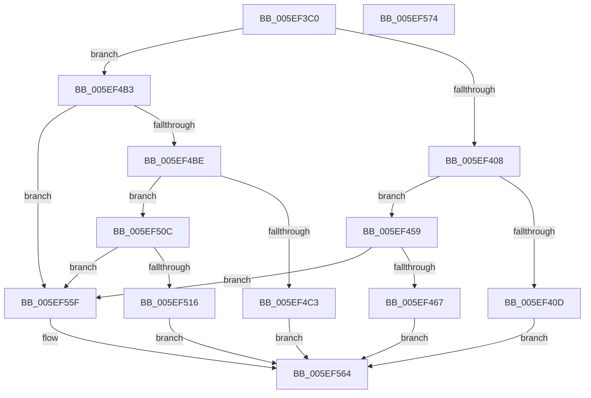

# RtlCompressBufferProgress

- RVA: `0x005EF3C0`–`0x005EF575` (길이 `437` bytes)
- VA: `0x00000001405EF3C0`
- 실행 섹션: `.text`
- PDB 이름 있음: `예`; PDB Function 태그: `아니요`
- unwind 정보 RVA: `0x0008A4C8`
- 디코드: `92`개 명령, `437/437` bytes 표시
- 미해석 바이트: `0` (있으면 어셈블리에 `.byte`로 보존)

> 이 문서는 커널 이미지의 기계어와 PDB 기호를 분석해 생성했습니다. 4번과 5번은 함수 원형과 자료형을 바이너리 사용 방식에서 추정한 C 해석이며 원본 소스 복구 결과는 아닙니다.

## 1. Dependencies

- 직접 호출 지점: **4**; 고유 호출 대상: **4**
- 직접 호출자로 확인된 함수: **1**
- RIP 상대 이미지 참조: **0**

### Outgoing calls
- `0x005EF44F` → [RtlCompressBufferXpressLzStandard](../41/RtlCompressBufferXpressLzStandard_function_0041A060.md) (function, `0x0041A060`)
- `0x005EF4A9` → [RtlCompressBufferXpressLzMax](../41/RtlCompressBufferXpressLzMax_function_0041A840.md) (function, `0x0041A840`)
- `0x005EF505` → [RtlCompressBufferXpressHuffStandard](../26/RtlCompressBufferXpressHuffStandard_function_0026BA60.md) (function, `0x0026BA60`)
- `0x005EF558` → [RtlCompressBufferXpressHuffMax](../26/RtlCompressBufferXpressHuffMax_function_0026CA10.md) (function, `0x0026CA10`)

### Direct callers
- [PopAddPagesToCompressedPageSet](../../pagelk/B6/PopAddPagesToCompressedPageSet_function_00B6C804.md) at `0x00B6C9A1`

### Static image references
- 디코드된 RIP-relative 메모리 참조가 없습니다.

## 2. Other-region calls and transfers

- 다른 실행 섹션으로 향하는 call: **0**
- 별도 외부 분기/꼬리 이동을 확인하지 못했습니다.

## 3. Assembly (complete function range)

```asm
005EF3C0  48 89 5C 24 08                  mov qword ptr [rsp + 8], rbx
005EF3C5  48 89 74 24 10                  mov qword ptr [rsp + 0x10], rsi
005EF3CA  57                              push rdi
005EF3CB  48 83 EC 50                     sub rsp, 0x50
005EF3CF  4C 8B 94 24 90 00 00 00         mov r10, qword ptr [rsp + 0x90]
005EF3D7  44 0F B7 D9                     movzx r11d, cx
005EF3DB  B8 FF 00 00 00                  mov eax, 0xff
005EF3E0  49 83 C2 07                     add r10, 7
005EF3E4  66 44 23 D8                     and r11w, ax
005EF3E8  49 83 E2 F8                     and r10, 0xfffffffffffffff8
005EF3EC  B8 00 FF 00 00                  mov eax, 0xff00
005EF3F1  49 8B D9                        mov rbx, r9
005EF3F4  66 23 C8                        and cx, ax
005EF3F7  41 8B F8                        mov edi, r8d
005EF3FA  48 8B F2                        mov rsi, rdx
005EF3FD  66 41 83 FB 03                  cmp r11w, 3
005EF402  0F 85 AB 00 00 00               jne 0x1405ef4b3
005EF408  66 85 C9                        test cx, cx
005EF40B  75 4C                           jne 0x1405ef459
005EF40D  48 8B 84 24 A0 00 00 00         mov rax, qword ptr [rsp + 0xa0]
005EF415  41 B9 00 00 01 00               mov r9d, 0x10000
005EF41B  C7 44 24 40 00 10 00 00         mov dword ptr [rsp + 0x40], 0x1000
005EF423  4C 8B C3                        mov r8, rbx
005EF426  48 89 44 24 38                  mov qword ptr [rsp + 0x38], rax
005EF42B  8B D7                           mov edx, edi
005EF42D  48 8B 84 24 98 00 00 00         mov rax, qword ptr [rsp + 0x98]
005EF435  48 8B CE                        mov rcx, rsi
005EF438  48 89 44 24 30                  mov qword ptr [rsp + 0x30], rax
005EF43D  48 8B 84 24 88 00 00 00         mov rax, qword ptr [rsp + 0x88]
005EF445  4C 89 54 24 28                  mov qword ptr [rsp + 0x28], r10
005EF44A  48 89 44 24 20                  mov qword ptr [rsp + 0x20], rax
005EF44F  E8 0C AC E2 FF                  call 0x14041a060
005EF454  E9 0B 01 00 00                  jmp 0x1405ef564
005EF459  B8 00 01 00 00                  mov eax, 0x100
005EF45E  66 3B C8                        cmp cx, ax
005EF461  0F 85 F8 00 00 00               jne 0x1405ef55f
005EF467  48 8B 84 24 A0 00 00 00         mov rax, qword ptr [rsp + 0xa0]
005EF46F  41 B9 00 00 01 00               mov r9d, 0x10000
005EF475  C7 44 24 40 00 10 00 00         mov dword ptr [rsp + 0x40], 0x1000
005EF47D  4C 8B C3                        mov r8, rbx
005EF480  48 89 44 24 38                  mov qword ptr [rsp + 0x38], rax
005EF485  8B D7                           mov edx, edi
005EF487  48 8B 84 24 98 00 00 00         mov rax, qword ptr [rsp + 0x98]
005EF48F  48 8B CE                        mov rcx, rsi
005EF492  48 89 44 24 30                  mov qword ptr [rsp + 0x30], rax
005EF497  48 8B 84 24 88 00 00 00         mov rax, qword ptr [rsp + 0x88]
005EF49F  4C 89 54 24 28                  mov qword ptr [rsp + 0x28], r10
005EF4A4  48 89 44 24 20                  mov qword ptr [rsp + 0x20], rax
005EF4A9  E8 92 B3 E2 FF                  call 0x14041a840
005EF4AE  E9 B1 00 00 00                  jmp 0x1405ef564
005EF4B3  66 41 83 FB 04                  cmp r11w, 4
005EF4B8  0F 85 A1 00 00 00               jne 0x1405ef55f
005EF4BE  66 85 C9                        test cx, cx
005EF4C1  75 49                           jne 0x1405ef50c
005EF4C3  48 8B 84 24 A0 00 00 00         mov rax, qword ptr [rsp + 0xa0]
005EF4CB  41 B9 00 00 01 00               mov r9d, 0x10000
005EF4D1  C7 44 24 40 00 10 00 00         mov dword ptr [rsp + 0x40], 0x1000
005EF4D9  4C 8B C3                        mov r8, rbx
005EF4DC  48 89 44 24 38                  mov qword ptr [rsp + 0x38], rax
005EF4E1  8B D7                           mov edx, edi
005EF4E3  48 8B 84 24 98 00 00 00         mov rax, qword ptr [rsp + 0x98]
005EF4EB  48 8B CE                        mov rcx, rsi
005EF4EE  48 89 44 24 30                  mov qword ptr [rsp + 0x30], rax
005EF4F3  48 8B 84 24 88 00 00 00         mov rax, qword ptr [rsp + 0x88]
005EF4FB  4C 89 54 24 28                  mov qword ptr [rsp + 0x28], r10
005EF500  48 89 44 24 20                  mov qword ptr [rsp + 0x20], rax
005EF505  E8 56 C5 C7 FF                  call 0x14026ba60
005EF50A  EB 58                           jmp 0x1405ef564
005EF50C  B8 00 01 00 00                  mov eax, 0x100
005EF511  66 3B C8                        cmp cx, ax
005EF514  75 49                           jne 0x1405ef55f
005EF516  48 8B 84 24 A0 00 00 00         mov rax, qword ptr [rsp + 0xa0]
005EF51E  41 B9 00 00 01 00               mov r9d, 0x10000
005EF524  C7 44 24 40 00 10 00 00         mov dword ptr [rsp + 0x40], 0x1000
005EF52C  4C 8B C3                        mov r8, rbx
005EF52F  48 89 44 24 38                  mov qword ptr [rsp + 0x38], rax
005EF534  8B D7                           mov edx, edi
005EF536  48 8B 84 24 98 00 00 00         mov rax, qword ptr [rsp + 0x98]
005EF53E  48 8B CE                        mov rcx, rsi
005EF541  48 89 44 24 30                  mov qword ptr [rsp + 0x30], rax
005EF546  48 8B 84 24 88 00 00 00         mov rax, qword ptr [rsp + 0x88]
005EF54E  4C 89 54 24 28                  mov qword ptr [rsp + 0x28], r10
005EF553  48 89 44 24 20                  mov qword ptr [rsp + 0x20], rax
005EF558  E8 B3 D4 C7 FF                  call 0x14026ca10
005EF55D  EB 05                           jmp 0x1405ef564
005EF55F  B8 5F 02 00 C0                  mov eax, 0xc000025f
005EF564  48 8B 5C 24 60                  mov rbx, qword ptr [rsp + 0x60]
005EF569  48 8B 74 24 68                  mov rsi, qword ptr [rsp + 0x68]
005EF56E  48 83 C4 50                     add rsp, 0x50
005EF572  5F                              pop rdi
005EF573  C3                              ret
005EF574  CC                              int3
```

## 4. C-style interpretation (structured pseudocode)

```c
__int64 __fastcall RtlCompressBufferProgress(unsigned __int16 a1, __int64 a2, int a3, __int64 a4, __int64 a5, __int64 a6, __int64 a7, __int64 a8, __int64 a9)
{
    __int64 result;
    __int64 v_r10;
    __int64 v_r11;
    __int64 v_rsp;
    unsigned int v_stack_m18;
    unsigned __int64 v_stack_m20;
    unsigned __int64 v_stack_m28;
    unsigned __int64 v_stack_m30;
    unsigned __int64 v_stack_m38;
    unsigned __int64 v_stack_p10;
    unsigned __int64 v_stack_p8;

    v_stack_p8 = v_rbx;
    v_stack_p10 = v_rsi;
    v_rsp = (v_rsp) - (80);
    v_r10 = (a7) + (7);
    v_r11 = (unsigned __int16)((a1) & (255));
    v_r10 = (v_r10) & (-8);
    a1 = (unsigned __int16)((a1) & ((unsigned __int16)((unsigned int)(0xFF00ULL))));
    if (((unsigned __int16)(v_r11)) != 3) goto loc_005EF4B3;
    if (a1 != 0) goto loc_005EF459;
    v_stack_m18 = 0x1000ULL;
    v_stack_m20 = a9;
    v_stack_m28 = a8;
    v_stack_m30 = v_r10;
    v_stack_m38 = a6;
    result = RtlCompressBufferXpressLzStandard(a2, (unsigned int)((unsigned int)((unsigned int)(a3))), a4, (unsigned int)(0x10000ULL));
    goto loc_005EF564;
loc_005EF459:
    if (((unsigned __int16)(a2)) != 256) goto loc_005EF55F;
    v_stack_m18 = 0x1000ULL;
    v_stack_m20 = a9;
    v_stack_m28 = a8;
    v_stack_m30 = v_r10;
    v_stack_m38 = a6;
    result = RtlCompressBufferXpressLzMax(a2, (unsigned int)((unsigned int)((unsigned int)(a3))), a4, (unsigned int)(0x10000ULL));
    goto loc_005EF564;
loc_005EF4B3:
    if (((unsigned __int16)(v_r11)) != 4) goto loc_005EF55F;
    if ((unsigned __int16)(a2) != 0) goto loc_005EF50C;
    v_stack_m18 = 0x1000ULL;
    v_stack_m20 = a9;
    v_stack_m28 = a8;
    v_stack_m30 = v_r10;
    v_stack_m38 = a6;
    result = RtlCompressBufferXpressHuffStandard(a2, (unsigned int)((unsigned int)((unsigned int)(a3))), a4, (unsigned int)(0x10000ULL));
    goto loc_005EF564;
loc_005EF50C:
    if (((unsigned __int16)(a2)) != 256) goto loc_005EF55F;
    v_stack_m18 = 0x1000ULL;
    v_stack_m20 = a9;
    v_stack_m28 = a8;
    v_stack_m30 = v_r10;
    v_stack_m38 = a6;
    result = RtlCompressBufferXpressHuffMax(a2, (unsigned int)((unsigned int)((unsigned int)(a3))), a4, (unsigned int)(0x10000ULL));
    goto loc_005EF564;
loc_005EF55F:
loc_005EF564:
    v_rsp = (v_rsp) + (80);
    return (unsigned int)(0xC000025FULL);
}
```

## 5. (Beta) C Style

```c
int64_t RtlCompressBufferProgress(uint16_t Arg1, int64_t Arg2, int32_t Arg3, int64_t Arg4, uint64_t Arg5, int64_t Arg6, int64_t Arg7, int64_t Arg8, int64_t Arg9)
{
    int64_t result;
    int64_t local_r10;
    int64_t local_r11;
    int64_t local_rsp;
    uint32_t v_stack_m18;
    uint64_t v_stack_m20;
    uint64_t v_stack_m28;
    uint64_t v_stack_m30;
    uint64_t v_stack_m38;
    uint64_t v_stack_p10;
    uint64_t v_stack_p8;

    v_stack_p8 = local_rbx;
    v_stack_p10 = local_rsi;
    local_rsp = (local_rsp) - (80);
    local_r10 = (Arg7) + (7);
    local_r11 = (uint16_t)((Arg1) & (255));
    local_r10 = (local_r10) & (-8);
    Arg1 = (uint16_t)((Arg1) & ((uint16_t)((uint32_t)(0xFF00ULL))));
    if (((uint16_t)(local_r11)) != 3) goto loc_005EF4B3;
    if (Arg1 != 0) goto loc_005EF459;
    v_stack_m18 = 0x1000ULL;
    v_stack_m20 = Arg9;
    v_stack_m28 = Arg8;
    v_stack_m30 = local_r10;
    v_stack_m38 = Arg6;
    result = RtlCompressBufferXpressLzStandard(Arg2, (uint32_t)((uint32_t)((uint32_t)(Arg3))), Arg4, (uint32_t)(0x10000ULL));
    goto loc_005EF564;
loc_005EF459:
    if (((uint16_t)(Arg2)) != 256) goto loc_005EF55F;
    v_stack_m18 = 0x1000ULL;
    v_stack_m20 = Arg9;
    v_stack_m28 = Arg8;
    v_stack_m30 = local_r10;
    v_stack_m38 = Arg6;
    result = RtlCompressBufferXpressLzMax(Arg2, (uint32_t)((uint32_t)((uint32_t)(Arg3))), Arg4, (uint32_t)(0x10000ULL));
    goto loc_005EF564;
loc_005EF4B3:
    if (((uint16_t)(local_r11)) != 4) goto loc_005EF55F;
    if ((uint16_t)(Arg2) != 0) goto loc_005EF50C;
    v_stack_m18 = 0x1000ULL;
    v_stack_m20 = Arg9;
    v_stack_m28 = Arg8;
    v_stack_m30 = local_r10;
    v_stack_m38 = Arg6;
    result = RtlCompressBufferXpressHuffStandard(Arg2, (uint32_t)((uint32_t)((uint32_t)(Arg3))), Arg4, (uint32_t)(0x10000ULL));
    goto loc_005EF564;
loc_005EF50C:
    if (((uint16_t)(Arg2)) != 256) goto loc_005EF55F;
    v_stack_m18 = 0x1000ULL;
    v_stack_m20 = Arg9;
    v_stack_m28 = Arg8;
    v_stack_m30 = local_r10;
    v_stack_m38 = Arg6;
    result = RtlCompressBufferXpressHuffMax(Arg2, (uint32_t)((uint32_t)((uint32_t)(Arg3))), Arg4, (uint32_t)(0x10000ULL));
    goto loc_005EF564;
loc_005EF55F:
loc_005EF564:
    local_rsp = (local_rsp) + (80);
    return (uint32_t)(0xC000025FULL);
}
```

## 6. Execution-region graph

[열기: 2D/3D 그래프와 함수 탐색 컨트롤 패널](../../../control-panel.html?section=text&rva=0x005EF3C0&view=graph)

- 2D 그래프는 위에서 아래로 흐르고, 3D 그래프는 빈 공간을 드래그해 회전합니다. Shift+드래그는 이동, 휠은 확대·축소, 함수 노드 선택은 대상 보고서 이동입니다.

### Static fallback


