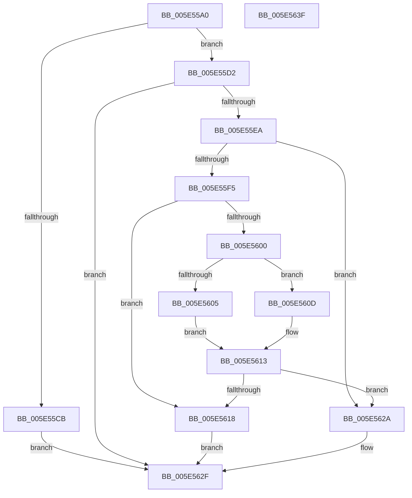

# RtlConvertHostPerfCounterToPerfCounter

- RVA: `0x005E55A0`–`0x005E5640` (길이 `160` bytes)
- VA: `0x00000001405E55A0`
- 실행 섹션: `.text`
- PDB 이름 있음: `예`; PDB Function 태그: `아니요`
- unwind 정보 RVA: `0x00086C28`
- 디코드: `50`개 명령, `160/160` bytes 표시
- 미해석 바이트: `0` (있으면 어셈블리에 `.byte`로 보존)

> 이 문서는 커널 이미지의 기계어와 PDB 기호를 분석해 생성했습니다. 4번과 5번은 함수 원형과 자료형을 바이너리 사용 방식에서 추정한 C 해석이며 원본 소스 복구 결과는 아닙니다.

## 1. Dependencies

- 직접 호출 지점: **1**; 고유 호출 대상: **1**
- 직접 호출자로 확인된 함수: **0**
- RIP 상대 이미지 참조: **0**

### Outgoing calls
- `0x005E55E1` → [RtlGetMultiTimePrecise](../4A/RtlGetMultiTimePrecise_function_004A1A30.md) (function, `0x004A1A30`)

### Direct callers
- 이 함수 시작 RVA로 연결되는 직접 call은 확인되지 않았습니다. 간접 호출은 완전히 역산할 수 없습니다.

### Static image references
- 디코드된 RIP-relative 메모리 참조가 없습니다.

## 2. Other-region calls and transfers

- 다른 실행 섹션으로 향하는 call: **0**
- 별도 외부 분기/꼬리 이동을 확인하지 못했습니다.

## 3. Assembly (complete function range)

```asm
005E55A0  48 89 5C 24 08                  mov qword ptr [rsp + 8], rbx
005E55A5  48 89 74 24 10                  mov qword ptr [rsp + 0x10], rsi
005E55AA  57                              push rdi
005E55AB  48 83 EC 40                     sub rsp, 0x40
005E55AF  33 C0                           xor eax, eax
005E55B1  0F 57 C0                        xorps xmm0, xmm0
005E55B4  21 44 24 60                     and dword ptr [rsp + 0x60], eax
005E55B8  49 8B F0                        mov rsi, r8
005E55BB  48 8B FA                        mov rdi, rdx
005E55BE  48 8B D9                        mov rbx, rcx
005E55C1  0F 11 44 24 20                  movups xmmword ptr [rsp + 0x20], xmm0
005E55C6  4D 85 C0                        test r8, r8
005E55C9  75 07                           jne 0x1405e55d2
005E55CB  B8 0D 00 00 C0                  mov eax, 0xc000000d
005E55D0  EB 5D                           jmp 0x1405e562f
005E55D2  4C 8D 44 24 60                  lea r8, [rsp + 0x60]
005E55D7  BA 03 00 00 00                  mov edx, 3
005E55DC  48 8D 4C 24 20                  lea rcx, [rsp + 0x20]
005E55E1  E8 4A C4 EB FF                  call 0x1404a1a30
005E55E6  85 C0                           test eax, eax
005E55E8  78 45                           js 0x1405e562f
005E55EA  8B 44 24 60                     mov eax, dword ptr [rsp + 0x60]
005E55EE  83 E0 03                        and eax, 3
005E55F1  3C 03                           cmp al, 3
005E55F3  75 35                           jne 0x1405e562a
005E55F5  48 8B 4C 24 28                  mov rcx, qword ptr [rsp + 0x28]
005E55FA  48 83 FF FF                     cmp rdi, -1
005E55FE  74 18                           je 0x1405e5618
005E5600  48 3B D9                        cmp rbx, rcx
005E5603  73 08                           jae 0x1405e560d
005E5605  48 8B C1                        mov rax, rcx
005E5608  48 2B C3                        sub rax, rbx
005E560B  EB 06                           jmp 0x1405e5613
005E560D  48 8B C3                        mov rax, rbx
005E5610  48 2B C1                        sub rax, rcx
005E5613  48 3B C7                        cmp rax, rdi
005E5616  73 12                           jae 0x1405e562a
005E5618  48 8B 44 24 20                  mov rax, qword ptr [rsp + 0x20]
005E561D  48 2B C1                        sub rax, rcx
005E5620  48 03 C3                        add rax, rbx
005E5623  48 89 06                        mov qword ptr [rsi], rax
005E5626  33 C0                           xor eax, eax
005E5628  EB 05                           jmp 0x1405e562f
005E562A  B8 01 00 00 C0                  mov eax, 0xc0000001
005E562F  48 8B 5C 24 50                  mov rbx, qword ptr [rsp + 0x50]
005E5634  48 8B 74 24 58                  mov rsi, qword ptr [rsp + 0x58]
005E5639  48 83 C4 40                     add rsp, 0x40
005E563D  5F                              pop rdi
005E563E  C3                              ret
005E563F  CC                              int3
```

## 4. C-style interpretation (structured pseudocode)

```c
__int64 __fastcall RtlConvertHostPerfCounterToPerfCounter(__int64 a1, __int64 a2, __int64 a3)
{
    __int64 result;
    __int64 v_rsp;
    unsigned __int64 v_stack_m20;
    unsigned __int64 v_stack_m28;
    unsigned __int64 v_stack_p10;
    unsigned int v_stack_p18;
    unsigned __int64 v_stack_p8;

    v_stack_p8 = v_rbx;
    v_stack_p10 = v_rsi;
    v_rsp = (v_rsp) - (64);
    result = 0;
    v_stack_m28 = v_xmm0;
    if (a3 != 0) goto loc_005E55D2;
    goto loc_005E562F;
loc_005E55D2:
    result = RtlGetMultiTimePrecise(v_stack_m28, 3, v_stack_p18, a4);
    if (sign_flag) goto loc_005E562F;
    result = (unsigned int)(((unsigned int)(v_stack_p18)) & (3));
    if (((unsigned __int8)(result)) != 3) goto loc_005E562A;
    if (a2 == -1) goto loc_005E5618;
    if (a1 >= v_stack_m20) goto loc_005E560D;
    result = (v_stack_m20) - (a1);
    goto loc_005E5613;
loc_005E560D:
    result = (a1) - (v_stack_m20);
loc_005E5613:
    if (result >= a2) goto loc_005E562A;
loc_005E5618:
    result = (v_stack_m28) - (v_stack_m20);
    result = (result) + (a1);
    *(unsigned __int64 *)(a3) = result;
    result = 0;
    goto loc_005E562F;
loc_005E562A:
loc_005E562F:
    v_rsp = (v_rsp) + (64);
    return (unsigned int)(0xC0000001ULL);
}
```

## 5. (Beta) C Style

```c
int64_t RtlConvertHostPerfCounterToPerfCounter(int64_t Arg1, int64_t Arg2, void *Arg3)
{
    uint8_t *arg3 = (uint8_t *)Arg3;

    int64_t result;
    int64_t local_rsp;
    uint64_t v_stack_m20;
    uint64_t v_stack_m28;
    uint64_t v_stack_p10;
    uint32_t v_stack_p18;
    uint64_t v_stack_p8;

    v_stack_p8 = local_rbx;
    v_stack_p10 = local_rsi;
    local_rsp = (local_rsp) - (64);
    result = 0;
    v_stack_m28 = v_xmm0;
    if (Arg3 != NULL) goto loc_005E55D2;
    goto loc_005E562F;
loc_005E55D2:
    result = RtlGetMultiTimePrecise(v_stack_m28, 3, v_stack_p18, a4);
    if (sign_flag) goto loc_005E562F;
    result = (uint32_t)(((uint32_t)(v_stack_p18)) & (3));
    if (((uint8_t)(result)) != 3) goto loc_005E562A;
    if (Arg2 == -1) goto loc_005E5618;
    if (Arg1 >= v_stack_m20) goto loc_005E560D;
    result = (v_stack_m20) - (Arg1);
    goto loc_005E5613;
loc_005E560D:
    result = (Arg1) - (v_stack_m20);
loc_005E5613:
    if (result >= Arg2) goto loc_005E562A;
loc_005E5618:
    result = (v_stack_m28) - (v_stack_m20);
    result = (result) + (Arg1);
    *(uint64_t *)(arg3) = result;
    result = 0;
    goto loc_005E562F;
loc_005E562A:
loc_005E562F:
    local_rsp = (local_rsp) + (64);
    return (uint32_t)(0xC0000001ULL);
}
```

### 관측된 메모리 오프셋

구조체 형식이 확인되지 않은 접근은 인자 기준의 오프셋으로만 기록했습니다.

| 기준 인자 | 오프셋 표현 | 폭 (bit) | 접근 |
|---|---:|---:|---|
| `Arg3` | `+ 0x0` | `64` | `W` |

## 6. Execution-region graph

[열기: 2D/3D 그래프와 함수 탐색 컨트롤 패널](../../../control-panel.html?section=text&rva=0x005E55A0&view=graph)

- 2D 그래프는 위에서 아래로 흐르고, 3D 그래프는 빈 공간을 드래그해 회전합니다. Shift+드래그는 이동, 휠은 확대·축소, 함수 노드 선택은 대상 보고서 이동입니다.

### Static fallback


