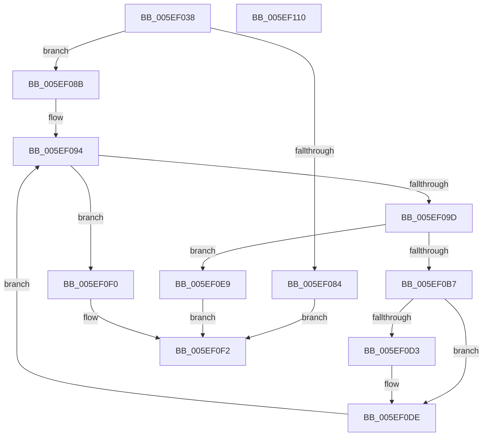

# RtlCopyKernelScpUnwindInfo

- RVA: `0x005EF038`–`0x005EF111` (길이 `217` bytes)
- VA: `0x00000001405EF038`
- 실행 섹션: `.text`
- PDB 이름 있음: `예`; PDB Function 태그: `아니요`
- unwind 정보 RVA: `0x000BF414`
- 디코드: `71`개 명령, `217/217` bytes 표시
- 미해석 바이트: `0` (있으면 어셈블리에 `.byte`로 보존)

> 이 문서는 커널 이미지의 기계어와 PDB 기호를 분석해 생성했습니다. 4번과 5번은 함수 원형과 자료형을 바이너리 사용 방식에서 추정한 C 해석이며 원본 소스 복구 결과는 아닙니다.

## 1. Dependencies

- 직접 호출 지점: **3**; 고유 호출 대상: **3**
- 직접 호출자로 확인된 함수: **1**
- RIP 상대 이미지 참조: **0**

### Outgoing calls
- `0x005EF077` → [RtlpGetKernelScpFunctionTable](RtlpGetKernelScpFunctionTable_function_005EF210.md) (function, `0x005EF210`)
- `0x005EF0A8` → [RtlCalculateUnwindInfoSizeForKernelScp](RtlCalculateUnwindInfoSizeForKernelScp_function_005EEFF4.md) (function, `0x005EEFF4`)
- `0x005EF0C6` → [memcpy](../6C/memcpy_function_006C6840.md) (function, `0x006C6840`)

### Direct callers
- [MiApplyDynamicFixupsToKernelAndHal](../../init/C6/MiApplyDynamicFixupsToKernelAndHal_function_00C65EBC.md) at `0x00C65F66`

### Static image references
- 디코드된 RIP-relative 메모리 참조가 없습니다.

## 2. Other-region calls and transfers

- 다른 실행 섹션으로 향하는 call: **0**
- 별도 외부 분기/꼬리 이동을 확인하지 못했습니다.

## 3. Assembly (complete function range)

```asm
005EF038  48 8B C4                        mov rax, rsp
005EF03B  48 89 58 08                     mov qword ptr [rax + 8], rbx
005EF03F  48 89 68 10                     mov qword ptr [rax + 0x10], rbp
005EF043  48 89 70 20                     mov qword ptr [rax + 0x20], rsi
005EF047  57                              push rdi
005EF048  41 54                           push r12
005EF04A  41 55                           push r13
005EF04C  41 56                           push r14
005EF04E  41 57                           push r15
005EF050  48 83 EC 40                     sub rsp, 0x40
005EF054  83 60 C8 00                     and dword ptr [rax - 0x38], 0
005EF058  4D 8B E1                        mov r12, r9
005EF05B  83 60 18 00                     and dword ptr [rax + 0x18], 0
005EF05F  48 8D 40 18                     lea rax, [rax + 0x18]
005EF063  45 8B 08                        mov r9d, dword ptr [r8]
005EF066  49 8B F8                        mov rdi, r8
005EF069  4D 8B C4                        mov r8, r12
005EF06C  48 89 44 24 20                  mov qword ptr [rsp + 0x20], rax
005EF071  4C 8B EA                        mov r13, rdx
005EF074  4C 8B F9                        mov r15, rcx
005EF077  E8 94 01 00 00                  call 0x1405ef210
005EF07C  48 8B F0                        mov rsi, rax
005EF07F  48 85 C0                        test rax, rax
005EF082  75 07                           jne 0x1405ef08b
005EF084  B8 25 02 00 C0                  mov eax, 0xc0000225
005EF089  EB 67                           jmp 0x1405ef0f2
005EF08B  8B 1F                           mov ebx, dword ptr [rdi]
005EF08D  33 ED                           xor ebp, ebp
005EF08F  48 03 DF                        add rbx, rdi
005EF092  33 FF                           xor edi, edi
005EF094  3B BC 24 80 00 00 00            cmp edi, dword ptr [rsp + 0x80]
005EF09B  73 53                           jae 0x1405ef0f0
005EF09D  4C 8D 44 24 30                  lea r8, [rsp + 0x30]
005EF0A2  48 8B D6                        mov rdx, rsi
005EF0A5  49 8B CF                        mov rcx, r15
005EF0A8  E8 47 FF FF FF                  call 0x1405eeff4
005EF0AD  03 E8                           add ebp, eax
005EF0AF  81 FD F4 01 00 00               cmp ebp, 0x1f4
005EF0B5  77 32                           ja 0x1405ef0e9
005EF0B7  8B 56 08                        mov edx, dword ptr [rsi + 8]
005EF0BA  48 8B CB                        mov rcx, rbx
005EF0BD  49 03 D7                        add rdx, r15
005EF0C0  44 8B C0                        mov r8d, eax
005EF0C3  44 8B F0                        mov r14d, eax
005EF0C6  E8 75 77 0D 00                  call 0x1406c6840
005EF0CB  8B 44 24 30                     mov eax, dword ptr [rsp + 0x30]
005EF0CF  85 C0                           test eax, eax
005EF0D1  74 0B                           je 0x1405ef0de
005EF0D3  8B C8                           mov ecx, eax
005EF0D5  41 8B C5                        mov eax, r13d
005EF0D8  41 2B C4                        sub eax, r12d
005EF0DB  01 04 19                        add dword ptr [rcx + rbx], eax
005EF0DE  49 03 DE                        add rbx, r14
005EF0E1  48 83 C6 0C                     add rsi, 0xc
005EF0E5  FF C7                           inc edi
005EF0E7  EB AB                           jmp 0x1405ef094
005EF0E9  B8 05 00 00 80                  mov eax, 0x80000005
005EF0EE  EB 02                           jmp 0x1405ef0f2
005EF0F0  33 C0                           xor eax, eax
005EF0F2  4C 8D 5C 24 40                  lea r11, [rsp + 0x40]
005EF0F7  49 8B 5B 30                     mov rbx, qword ptr [r11 + 0x30]
005EF0FB  49 8B 6B 38                     mov rbp, qword ptr [r11 + 0x38]
005EF0FF  49 8B 73 48                     mov rsi, qword ptr [r11 + 0x48]
005EF103  49 8B E3                        mov rsp, r11
005EF106  41 5F                           pop r15
005EF108  41 5E                           pop r14
005EF10A  41 5D                           pop r13
005EF10C  41 5C                           pop r12
005EF10E  5F                              pop rdi
005EF10F  C3                              ret
005EF110  CC                              int3
```

## 4. C-style interpretation (structured pseudocode)

```c
__int64 __fastcall RtlCopyKernelScpUnwindInfo(__int64 a1, __int64 a2, __int64 a3, __int64 a4)
{
    __int64 result;
    __int64 v_rbp;
    __int64 v_rbx;
    __int64 v_rdi;
    __int64 v_rsi;
    __int64 v_rsp;
    unsigned __int64 v_stack_m28;
    unsigned __int64 v_stack_m38;
    unsigned __int64 v_stack_m48;
    unsigned int v_stack_p18;

    *(unsigned __int64 *)(v_rsp + 8) = v_rbx;
    *(unsigned __int64 *)(v_rsp + 16) = v_rbp;
    *(unsigned __int64 *)(v_rsp + 32) = v_rsi;
    v_rsp = (v_rsp) - (64);
    v_stack_m48 = v_rsp + 24;
    result = RtlpGetKernelScpFunctionTable(a1, a2, a4, (unsigned int)(*(unsigned int *)(a3)));
    if (result != 0) goto loc_005EF08B;
    goto loc_005EF0F2;
loc_005EF08B:
    v_rbp = 0;
    v_rbx = ((unsigned int)(*(unsigned int *)(a3))) + (a3);
    v_rdi = 0;
loc_005EF094:
    if (0 >= v_stack_p18) goto loc_005EF0F0;
    result = RtlCalculateUnwindInfoSizeForKernelScp(a1, result, v_stack_m38, (unsigned int)(*(unsigned int *)(a3)));
    v_rbp = (unsigned int)((v_rbp) + ((unsigned int)(result)));
    if (((unsigned int)(v_rbp)) > 500) goto loc_005EF0E9;
    a2 = ((unsigned int)(*(unsigned int *)(result + 8))) + (a1);
    result = memcpy(v_rbx, a2, (unsigned int)((unsigned int)(result)), (unsigned int)(*(unsigned int *)(a3)));
    result = (unsigned int)(v_stack_m38);
    if ((unsigned int)((unsigned int)(v_stack_m38)) != 0) {
        a1 = (unsigned int)((unsigned int)(v_stack_m38));
        result = (unsigned int)(a2);
        result = (unsigned int)((result) - ((unsigned int)(a4)));
    }
    v_rbx = (v_rbx) + ((unsigned int)((unsigned int)(result)));
    v_rsi = (result) + (12);
    v_rdi = (unsigned int)((v_rdi) + 1);
    goto loc_005EF094;
loc_005EF0E9:
    goto loc_005EF0F2;
loc_005EF0F0:
    result = 0;
loc_005EF0F2:
    return result;
}
```

## 5. (Beta) C Style

```c
int64_t RtlCopyKernelScpUnwindInfo(int64_t Arg1, int64_t Arg2, void *Arg3, int64_t Arg4)
{
    uint8_t *arg3 = (uint8_t *)Arg3;

    int64_t result;
    int64_t local_rbp;
    int64_t local_rbx;
    int64_t local_rdi;
    int64_t local_rsi;
    int64_t local_rsp;
    uint64_t v_stack_m28;
    uint64_t v_stack_m38;
    uint64_t v_stack_m48;
    uint32_t v_stack_p18;

    *(uint64_t *)(local_rsp + 0x8) = local_rbx;
    *(uint64_t *)(local_rsp + 0x10) = local_rbp;
    *(uint64_t *)(local_rsp + 0x20) = local_rsi;
    local_rsp = (local_rsp) - (64);
    v_stack_m48 = local_rsp + 24;
    result = RtlpGetKernelScpFunctionTable(Arg1, Arg2, Arg4, (uint32_t)(*(uint32_t *)(arg3)));
    if (result != 0) goto loc_005EF08B;
    goto loc_005EF0F2;
loc_005EF08B:
    local_rbp = 0;
    local_rbx = ((uint32_t)(*(uint32_t *)(arg3))) + (Arg3);
    local_rdi = 0;
loc_005EF094:
    if (0 >= v_stack_p18) goto loc_005EF0F0;
    result = RtlCalculateUnwindInfoSizeForKernelScp(Arg1, result, v_stack_m38, (uint32_t)(*(uint32_t *)(arg3)));
    local_rbp = (uint32_t)((local_rbp) + ((uint32_t)(result)));
    if (((uint32_t)(local_rbp)) > 500) goto loc_005EF0E9;
    Arg2 = ((uint32_t)(*(uint32_t *)(result + 0x8))) + (Arg1);
    result = memcpy(local_rbx, Arg2, (uint32_t)((uint32_t)(result)), (uint32_t)(*(uint32_t *)(arg3)));
    result = (uint32_t)(v_stack_m38);
    if ((uint32_t)((uint32_t)(v_stack_m38)) != 0) {
        Arg1 = (uint32_t)((uint32_t)(v_stack_m38));
        result = (uint32_t)(Arg2);
        result = (uint32_t)((result) - ((uint32_t)(Arg4)));
    }
    local_rbx = (local_rbx) + ((uint32_t)((uint32_t)(result)));
    local_rsi = (result) + (12);
    local_rdi = (uint32_t)((local_rdi) + 1);
    goto loc_005EF094;
loc_005EF0E9:
    goto loc_005EF0F2;
loc_005EF0F0:
    result = 0;
loc_005EF0F2:
    return result;
}
```

### 관측된 메모리 오프셋

구조체 형식이 확인되지 않은 접근은 인자 기준의 오프셋으로만 기록했습니다.

| 기준 인자 | 오프셋 표현 | 폭 (bit) | 접근 |
|---|---:|---:|---|
| `Arg3` | `+ 0x0` | `32` | `R` |

## 6. Execution-region graph

[열기: 2D/3D 그래프와 함수 탐색 컨트롤 패널](../../../control-panel.html?section=text&rva=0x005EF038&view=graph)

- 2D 그래프는 위에서 아래로 흐르고, 3D 그래프는 빈 공간을 드래그해 회전합니다. Shift+드래그는 이동, 휠은 확대·축소, 함수 노드 선택은 대상 보고서 이동입니다.

### Static fallback


