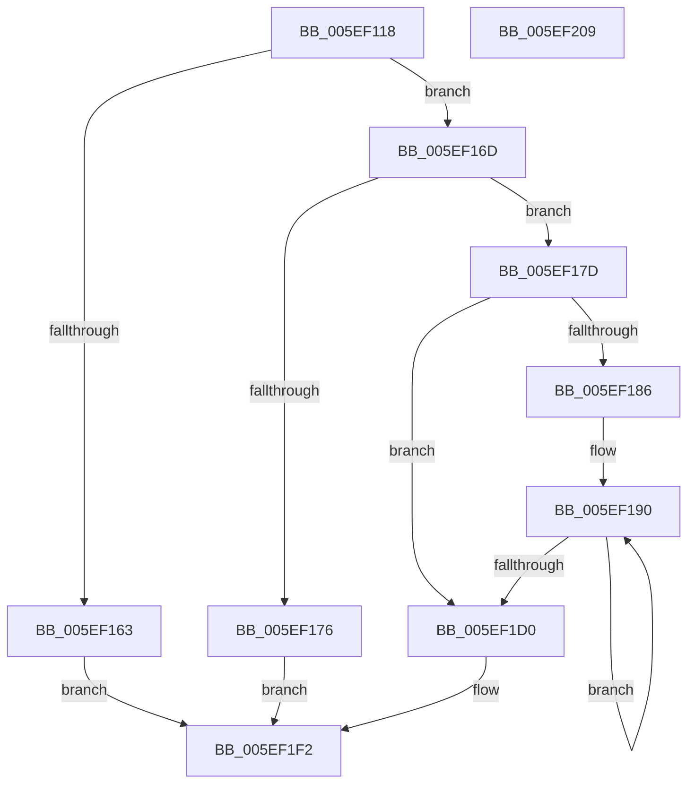

# RtlCreateKernelScpFunctionTable

- RVA: `0x005EF118`–`0x005EF20A` (길이 `242` bytes)
- VA: `0x00000001405EF118`
- 실행 섹션: `.text`
- PDB 이름 있음: `예`; PDB Function 태그: `아니요`
- unwind 정보 RVA: `0x0009F100`
- 디코드: `74`개 명령, `242/242` bytes 표시
- 미해석 바이트: `0` (있으면 어셈블리에 `.byte`로 보존)

> 이 문서는 커널 이미지의 기계어와 PDB 기호를 분석해 생성했습니다. 4번과 5번은 함수 원형과 자료형을 바이너리 사용 방식에서 추정한 C 해석이며 원본 소스 복구 결과는 아닙니다.

## 1. Dependencies

- 직접 호출 지점: **2**; 고유 호출 대상: **2**
- 직접 호출자로 확인된 함수: **1**
- RIP 상대 이미지 참조: **6**

### Outgoing calls
- `0x005EF156` → [RtlpGetKernelScpFunctionTable](RtlpGetKernelScpFunctionTable_function_005EF210.md) (function, `0x005EF210`)
- `0x005EF1B7` → [RtlCalculateUnwindInfoSizeForKernelScp](RtlCalculateUnwindInfoSizeForKernelScp_function_005EEFF4.md) (function, `0x005EEFF4`)

### Direct callers
- [MiInitializeKernelScp](../../init/C6/MiInitializeKernelScp_function_00C664B8.md) at `0x00C664E5`

### Static image references
- `0x005EF133` → RVA `0x00FC6B28` (`ALMOSTRO`; read)
- `0x005EF186` → RVA `0x01201A74` (`CFGRO`; read)
- `0x005EF1D6` → RVA `0x01201A70` (`CFGRO`; read)
- `0x005EF1DD` → RVA `0x01201848` (`CFGRO`; write)
- `0x005EF1E3` → RVA `0x00E013D0` (`.data`; write)
- `0x005EF1EB` → RVA `0x00E013C8` (`.data`; write)

## 2. Other-region calls and transfers

- 다른 실행 섹션으로 향하는 call: **0**
- 별도 외부 분기/꼬리 이동을 확인하지 못했습니다.

## 3. Assembly (complete function range)

```asm
005EF118  48 8B C4                        mov rax, rsp
005EF11B  48 89 58 10                     mov qword ptr [rax + 0x10], rbx
005EF11F  48 89 68 18                     mov qword ptr [rax + 0x18], rbp
005EF123  48 89 48 08                     mov qword ptr [rax + 8], rcx
005EF127  56                              push rsi
005EF128  57                              push rdi
005EF129  41 54                           push r12
005EF12B  41 56                           push r14
005EF12D  41 57                           push r15
005EF12F  48 83 EC 30                     sub rsp, 0x30
005EF133  48 8B 2D EE 79 9D 00            mov rbp, qword ptr [rip + 0x9d79ee]
005EF13A  45 8B C8                        mov r9d, r8d
005EF13D  83 60 08 00                     and dword ptr [rax + 8], 0
005EF141  48 8D 40 08                     lea rax, [rax + 8]
005EF145  4C 8B C2                        mov r8, rdx
005EF148  48 89 44 24 20                  mov qword ptr [rsp + 0x20], rax
005EF14D  48 8B FA                        mov rdi, rdx
005EF150  48 8B CD                        mov rcx, rbp
005EF153  48 8B D5                        mov rdx, rbp
005EF156  E8 B5 00 00 00                  call 0x1405ef210
005EF15B  4C 8B F0                        mov r14, rax
005EF15E  48 85 C0                        test rax, rax
005EF161  75 0A                           jne 0x1405ef16d
005EF163  B8 25 02 00 C0                  mov eax, 0xc0000225
005EF168  E9 85 00 00 00                  jmp 0x1405ef1f2
005EF16D  8B 5C 24 60                     mov ebx, dword ptr [rsp + 0x60]
005EF171  83 FB 32                        cmp ebx, 0x32
005EF174  76 07                           jbe 0x1405ef17d
005EF176  B8 05 00 00 80                  mov eax, 0x80000005
005EF17B  EB 75                           jmp 0x1405ef1f2
005EF17D  8B 37                           mov esi, dword ptr [rdi]
005EF17F  48 03 F7                        add rsi, rdi
005EF182  85 DB                           test ebx, ebx
005EF184  74 4A                           je 0x1405ef1d0
005EF186  4C 8D 3D E7 28 C1 00            lea r15, [rip + 0xc128e7]
005EF18D  4C 8B E3                        mov r12, rbx
005EF190  41 8B 06                        mov eax, dword ptr [r14]
005EF193  45 33 C0                        xor r8d, r8d
005EF196  2B C7                           sub eax, edi
005EF198  49 8B D6                        mov rdx, r14
005EF19B  03 C5                           add eax, ebp
005EF19D  48 8B CD                        mov rcx, rbp
005EF1A0  41 89 47 FC                     mov dword ptr [r15 - 4], eax
005EF1A4  41 8B 46 04                     mov eax, dword ptr [r14 + 4]
005EF1A8  2B C7                           sub eax, edi
005EF1AA  03 C5                           add eax, ebp
005EF1AC  41 89 07                        mov dword ptr [r15], eax
005EF1AF  8B C6                           mov eax, esi
005EF1B1  2B C7                           sub eax, edi
005EF1B3  41 89 47 04                     mov dword ptr [r15 + 4], eax
005EF1B7  E8 38 FE FF FF                  call 0x1405eeff4
005EF1BC  44 8B D8                        mov r11d, eax
005EF1BF  4D 8D 7F 0C                     lea r15, [r15 + 0xc]
005EF1C3  49 03 F3                        add rsi, r11
005EF1C6  49 83 C6 0C                     add r14, 0xc
005EF1CA  49 83 EC 01                     sub r12, 1
005EF1CE  75 C0                           jne 0x1405ef190
005EF1D0  8D 04 5B                        lea eax, [rbx + rbx*2]
005EF1D3  C1 E0 02                        shl eax, 2
005EF1D6  48 8D 0D 93 28 C1 00            lea rcx, [rip + 0xc12893]
005EF1DD  89 05 65 26 C1 00               mov dword ptr [rip + 0xc12665], eax
005EF1E3  89 05 E7 21 81 00               mov dword ptr [rip + 0x8121e7], eax
005EF1E9  33 C0                           xor eax, eax
005EF1EB  48 89 0D D6 21 81 00            mov qword ptr [rip + 0x8121d6], rcx
005EF1F2  48 8B 5C 24 68                  mov rbx, qword ptr [rsp + 0x68]
005EF1F7  48 8B 6C 24 70                  mov rbp, qword ptr [rsp + 0x70]
005EF1FC  48 83 C4 30                     add rsp, 0x30
005EF200  41 5F                           pop r15
005EF202  41 5E                           pop r14
005EF204  41 5C                           pop r12
005EF206  5F                              pop rdi
005EF207  5E                              pop rsi
005EF208  C3                              ret
005EF209  CC                              int3
```

## 4. C-style interpretation (structured pseudocode)

```c
__int64 __fastcall RtlCreateKernelScpFunctionTable(__int64 a1, __int64 a2, int a3)
{
    __int64 result;
    __int64 v_r12;
    __int64 v_r14;
    __int64 v_rsi;
    __int64 v_rsp;
    unsigned __int64 v_stack_m38;
    unsigned __int64 v_stack_p10;
    unsigned __int64 v_stack_p18;
    unsigned int v_stack_p8;

    *(unsigned __int64 *)(v_rsp + 16) = v_rbx;
    *(unsigned __int64 *)(v_rsp + 24) = v_rbp;
    *(unsigned __int64 *)(v_rsp + 8) = a1;
    v_rsp = (v_rsp) - (48);
    v_stack_m38 = v_rsp + 8;
    result = RtlpGetKernelScpFunctionTable(*(unsigned __int64 *)(v_rip + 10320366), *(unsigned __int64 *)(v_rip + 10320366), a2, (unsigned int)(a3));
    if (result != 0) goto loc_005EF16D;
    goto loc_005EF1F2;
loc_005EF16D:
    if (((unsigned int)((unsigned int)(v_stack_p8))) <= 50) goto loc_005EF17D;
    goto loc_005EF1F2;
loc_005EF17D:
    v_rsi = ((unsigned int)(*(unsigned int *)(a2))) + (a2);
    if ((unsigned int)((unsigned int)(v_stack_p8)) == 0) goto loc_005EF1D0;
loc_005EF190:
    a3 = 0;
    result = (unsigned int)(((unsigned int)(*(unsigned int *)(result))) - ((unsigned int)(a2)));
    result = (unsigned int)((result) + ((unsigned int)(*(unsigned __int64 *)(v_rip + 10320366))));
    *(unsigned int *)(v_rip + 12658919 - 4) = (unsigned int)(result);
    result = (unsigned int)(((unsigned int)(*(unsigned int *)(result + 4))) - ((unsigned int)(a2)));
    result = (unsigned int)((result) + ((unsigned int)(*(unsigned __int64 *)(v_rip + 10320366))));
    *(unsigned int *)(v_rip + 12658919) = (unsigned int)(result);
    result = (unsigned int)(((unsigned int)((unsigned int)(v_rsi))) - ((unsigned int)(a2)));
    *(unsigned int *)(v_rip + 12658919 + 4) = (unsigned int)(result);
    result = RtlCalculateUnwindInfoSizeForKernelScp(*(unsigned __int64 *)(v_rip + 10320366), result, a3, (unsigned int)(a3));
    v_rsi = (v_rsi) + ((unsigned int)((unsigned int)(result)));
    v_r14 = (result) + (12);
    v_r12 = ((unsigned int)(v_stack_p8)) - (1);
    if (condition_is_not_equal) goto loc_005EF190;
loc_005EF1D0:
    result = (unsigned int)(((unsigned int)(v_stack_p8) + (unsigned int)(v_stack_p8) * 2) << (2));
    *(unsigned int *)(v_rip + 12658277) = (unsigned int)(result);
    *(unsigned int *)(v_rip + 8462823) = (unsigned int)(result);
    result = 0;
    *(unsigned __int64 *)(v_rip + 8462806) = v_rip + 12658835;
loc_005EF1F2:
    v_rsp = (v_rsp) + (48);
    return result;
}
```

## 5. (Beta) C Style

```c
int64_t RtlCreateKernelScpFunctionTable(int64_t Arg1, void *Arg2, int32_t Arg3)
{
    uint8_t *arg2 = (uint8_t *)Arg2;

    int64_t result;
    int64_t local_r12;
    int64_t local_r14;
    int64_t local_rsi;
    int64_t local_rsp;
    uint64_t v_stack_m38;
    uint64_t v_stack_p10;
    uint64_t v_stack_p18;
    uint32_t v_stack_p8;

    *(uint64_t *)(local_rsp + 0x10) = local_rbx;
    *(uint64_t *)(local_rsp + 0x18) = local_rbp;
    *(uint64_t *)(local_rsp + 0x8) = Arg1;
    local_rsp = (local_rsp) - (48);
    v_stack_m38 = local_rsp + 8;
    result = RtlpGetKernelScpFunctionTable(*(uint64_t *)(v_rip + 0x9D79EE), *(uint64_t *)(v_rip + 0x9D79EE), Arg2, (uint32_t)(Arg3));
    if (result != 0) goto loc_005EF16D;
    goto loc_005EF1F2;
loc_005EF16D:
    if (((uint32_t)((uint32_t)(v_stack_p8))) <= 50) goto loc_005EF17D;
    goto loc_005EF1F2;
loc_005EF17D:
    local_rsi = ((uint32_t)(*(uint32_t *)(arg2))) + (Arg2);
    if ((uint32_t)((uint32_t)(v_stack_p8)) == 0) goto loc_005EF1D0;
loc_005EF190:
    Arg3 = 0;
    result = (uint32_t)(((uint32_t)(*(uint32_t *)(result))) - ((uint32_t)(Arg2)));
    result = (uint32_t)((result) + ((uint32_t)(*(uint64_t *)(v_rip + 0x9D79EE))));
    *(uint32_t *)(v_rip + 0xC128E7 - 0x4) = (uint32_t)(result);
    result = (uint32_t)(((uint32_t)(*(uint32_t *)(result + 0x4))) - ((uint32_t)(Arg2)));
    result = (uint32_t)((result) + ((uint32_t)(*(uint64_t *)(v_rip + 0x9D79EE))));
    *(uint32_t *)(v_rip + 0xC128E7) = (uint32_t)(result);
    result = (uint32_t)(((uint32_t)((uint32_t)(local_rsi))) - ((uint32_t)(Arg2)));
    *(uint32_t *)(v_rip + 0xC128E7 + 0x4) = (uint32_t)(result);
    result = RtlCalculateUnwindInfoSizeForKernelScp(*(uint64_t *)(v_rip + 0x9D79EE), result, Arg3, (uint32_t)(Arg3));
    local_rsi = (local_rsi) + ((uint32_t)((uint32_t)(result)));
    local_r14 = (result) + (12);
    local_r12 = ((uint32_t)(v_stack_p8)) - (1);
    if (condition_is_not_equal) goto loc_005EF190;
loc_005EF1D0:
    result = (uint32_t)(((uint32_t)(v_stack_p8) + (uint32_t)(v_stack_p8) * 2) << (2));
    *(uint32_t *)(v_rip + 0xC12665) = (uint32_t)(result);
    *(uint32_t *)(v_rip + 0x8121E7) = (uint32_t)(result);
    result = 0;
    *(uint64_t *)(v_rip + 0x8121D6) = v_rip + 12658835;
loc_005EF1F2:
    local_rsp = (local_rsp) + (48);
    return result;
}
```

### 관측된 메모리 오프셋

구조체 형식이 확인되지 않은 접근은 인자 기준의 오프셋으로만 기록했습니다.

| 기준 인자 | 오프셋 표현 | 폭 (bit) | 접근 |
|---|---:|---:|---|
| `Arg2` | `+ 0x0` | `32` | `R` |

## 6. Execution-region graph

[열기: 2D/3D 그래프와 함수 탐색 컨트롤 패널](../../../control-panel.html?section=text&rva=0x005EF118&view=graph)

- 2D 그래프는 위에서 아래로 흐르고, 3D 그래프는 빈 공간을 드래그해 회전합니다. Shift+드래그는 이동, 휠은 확대·축소, 함수 노드 선택은 대상 보고서 이동입니다.

### Static fallback


