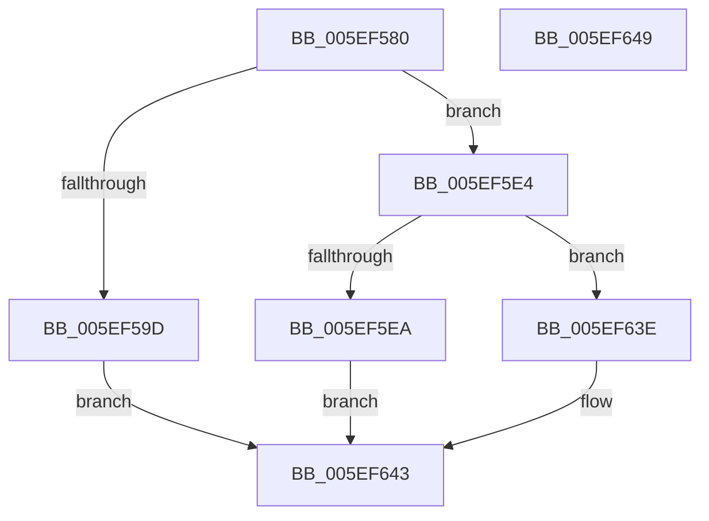

# RtlDecompressBufferProgress

- RVA: `0x005EF580`–`0x005EF64A` (길이 `202` bytes)
- VA: `0x00000001405EF580`
- 실행 섹션: `.text`
- PDB 이름 있음: `예`; PDB Function 태그: `아니요`
- unwind 정보 RVA: `0x00071A74`
- 디코드: `44`개 명령, `202/202` bytes 표시
- 미해석 바이트: `0` (있으면 어셈블리에 `.byte`로 보존)

> 이 문서는 커널 이미지의 기계어와 PDB 기호를 분석해 생성했습니다. 4번과 5번은 함수 원형과 자료형을 바이너리 사용 방식에서 추정한 C 해석이며 원본 소스 복구 결과는 아닙니다.

## 1. Dependencies

- 직접 호출 지점: **2**; 고유 호출 대상: **2**
- 직접 호출자로 확인된 함수: **1**
- RIP 상대 이미지 참조: **0**

### Outgoing calls
- `0x005EF5DD` → [RtlDecompressBufferXpressLzProgress](RtlDecompressBufferXpressLzProgress_function_005EFC90.md) (function, `0x005EFC90`)
- `0x005EF637` → [RtlDecompressBufferXpressHuffProgress](RtlDecompressBufferXpressHuffProgress_function_005EF650.md) (function, `0x005EF650`)

### Direct callers
- [PopDecompressHiberBlocks](../../pagelk/B6/PopDecompressHiberBlocks_function_00B6D074.md) at `0x00B6D476`

### Static image references
- 디코드된 RIP-relative 메모리 참조가 없습니다.

## 2. Other-region calls and transfers

- 다른 실행 섹션으로 향하는 call: **0**
- 별도 외부 분기/꼬리 이동을 확인하지 못했습니다.

## 3. Assembly (complete function range)

```asm
005EF580  40 53                           push rbx
005EF582  48 83 EC 50                     sub rsp, 0x50
005EF586  B8 FF 00 00 00                  mov eax, 0xff
005EF58B  4D 8B D1                        mov r10, r9
005EF58E  66 23 C8                        and cx, ax
005EF591  45 8B D8                        mov r11d, r8d
005EF594  48 8B DA                        mov rbx, rdx
005EF597  66 83 F9 03                     cmp cx, 3
005EF59B  75 47                           jne 0x1405ef5e4
005EF59D  48 8B 84 24 A0 00 00 00         mov rax, qword ptr [rsp + 0xa0]
005EF5A5  4D 8B C2                        mov r8, r10
005EF5A8  44 8B 8C 24 80 00 00 00         mov r9d, dword ptr [rsp + 0x80]
005EF5B0  41 8B D3                        mov edx, r11d
005EF5B3  C7 44 24 38 00 10 00 00         mov dword ptr [rsp + 0x38], 0x1000
005EF5BB  48 8B CB                        mov rcx, rbx
005EF5BE  48 89 44 24 30                  mov qword ptr [rsp + 0x30], rax
005EF5C3  48 8B 84 24 98 00 00 00         mov rax, qword ptr [rsp + 0x98]
005EF5CB  48 89 44 24 28                  mov qword ptr [rsp + 0x28], rax
005EF5D0  48 8B 84 24 88 00 00 00         mov rax, qword ptr [rsp + 0x88]
005EF5D8  48 89 44 24 20                  mov qword ptr [rsp + 0x20], rax
005EF5DD  E8 AE 06 00 00                  call 0x1405efc90
005EF5E2  EB 5F                           jmp 0x1405ef643
005EF5E4  66 83 F9 04                     cmp cx, 4
005EF5E8  75 54                           jne 0x1405ef63e
005EF5EA  48 8B 84 24 A0 00 00 00         mov rax, qword ptr [rsp + 0xa0]
005EF5F2  4D 8B C2                        mov r8, r10
005EF5F5  44 8B 8C 24 80 00 00 00         mov r9d, dword ptr [rsp + 0x80]
005EF5FD  41 8B D3                        mov edx, r11d
005EF600  C7 44 24 40 00 10 00 00         mov dword ptr [rsp + 0x40], 0x1000
005EF608  48 8B CB                        mov rcx, rbx
005EF60B  48 89 44 24 38                  mov qword ptr [rsp + 0x38], rax
005EF610  48 8B 84 24 98 00 00 00         mov rax, qword ptr [rsp + 0x98]
005EF618  48 89 44 24 30                  mov qword ptr [rsp + 0x30], rax
005EF61D  48 8B 84 24 90 00 00 00         mov rax, qword ptr [rsp + 0x90]
005EF625  48 89 44 24 28                  mov qword ptr [rsp + 0x28], rax
005EF62A  48 8B 84 24 88 00 00 00         mov rax, qword ptr [rsp + 0x88]
005EF632  48 89 44 24 20                  mov qword ptr [rsp + 0x20], rax
005EF637  E8 14 00 00 00                  call 0x1405ef650
005EF63C  EB 05                           jmp 0x1405ef643
005EF63E  B8 5F 02 00 C0                  mov eax, 0xc000025f
005EF643  48 83 C4 50                     add rsp, 0x50
005EF647  5B                              pop rbx
005EF648  C3                              ret
005EF649  CC                              int3
```

## 4. C-style interpretation (structured pseudocode)

```c
__int64 __fastcall RtlDecompressBufferProgress(unsigned __int16 a1, __int64 a2, int a3, __int64 a4, unsigned int a5, __int64 a6, __int64 a7, __int64 a8, __int64 a9)
{
    __int64 result;
    __int64 v_rsp;
    unsigned int v_stack_m18;
    unsigned int v_stack_m20;
    unsigned __int64 v_stack_m28;
    unsigned __int64 v_stack_m30;
    unsigned __int64 v_stack_m38;

    v_rsp = (v_rsp) - (80);
    a1 = (unsigned __int16)((a1) & (255));
    if (a1 != 3) goto loc_005EF5E4;
    v_stack_m20 = 0x1000ULL;
    v_stack_m28 = a9;
    v_stack_m30 = a8;
    v_stack_m38 = a6;
    result = RtlDecompressBufferXpressLzProgress(a2, (unsigned int)((unsigned int)((unsigned int)(a3))), a4, (unsigned int)(a5));
    goto loc_005EF643;
loc_005EF5E4:
    if (((unsigned __int16)(a2)) != 4) goto loc_005EF63E;
    v_stack_m18 = 0x1000ULL;
    v_stack_m20 = a9;
    v_stack_m28 = a8;
    v_stack_m30 = a7;
    v_stack_m38 = a6;
    result = RtlDecompressBufferXpressHuffProgress(a2, (unsigned int)((unsigned int)((unsigned int)(a3))), a4, (unsigned int)(a5));
    goto loc_005EF643;
loc_005EF63E:
loc_005EF643:
    v_rsp = (v_rsp) + (80);
    return (unsigned int)(0xC000025FULL);
}
```

## 5. (Beta) C Style

```c
int64_t RtlDecompressBufferProgress(uint16_t Arg1, int64_t Arg2, int32_t Arg3, int64_t Arg4, uint32_t Arg5, int64_t Arg6, int64_t Arg7, int64_t Arg8, int64_t Arg9)
{
    int64_t result;
    int64_t local_rsp;
    uint32_t v_stack_m18;
    uint32_t v_stack_m20;
    uint64_t v_stack_m28;
    uint64_t v_stack_m30;
    uint64_t v_stack_m38;

    local_rsp = (local_rsp) - (80);
    Arg1 = (uint16_t)((Arg1) & (255));
    if (Arg1 != 3) goto loc_005EF5E4;
    v_stack_m20 = 0x1000ULL;
    v_stack_m28 = Arg9;
    v_stack_m30 = Arg8;
    v_stack_m38 = Arg6;
    result = RtlDecompressBufferXpressLzProgress(Arg2, (uint32_t)((uint32_t)((uint32_t)(Arg3))), Arg4, (uint32_t)(Arg5));
    goto loc_005EF643;
loc_005EF5E4:
    if (((uint16_t)(Arg2)) != 4) goto loc_005EF63E;
    v_stack_m18 = 0x1000ULL;
    v_stack_m20 = Arg9;
    v_stack_m28 = Arg8;
    v_stack_m30 = Arg7;
    v_stack_m38 = Arg6;
    result = RtlDecompressBufferXpressHuffProgress(Arg2, (uint32_t)((uint32_t)((uint32_t)(Arg3))), Arg4, (uint32_t)(Arg5));
    goto loc_005EF643;
loc_005EF63E:
loc_005EF643:
    local_rsp = (local_rsp) + (80);
    return (uint32_t)(0xC000025FULL);
}
```

## 6. Execution-region graph

[열기: 2D/3D 그래프와 함수 탐색 컨트롤 패널](../../../control-panel.html?section=text&rva=0x005EF580&view=graph)

- 2D 그래프는 위에서 아래로 흐르고, 3D 그래프는 빈 공간을 드래그해 회전합니다. Shift+드래그는 이동, 휠은 확대·축소, 함수 노드 선택은 대상 보고서 이동입니다.

### Static fallback


