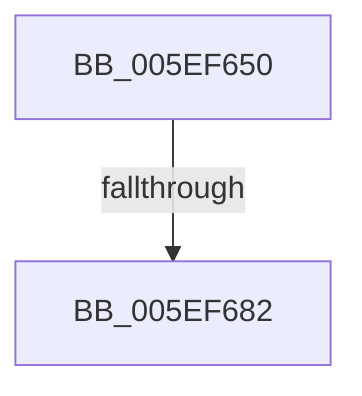

# RtlDecompressBufferXpressHuffProgress

- RVA: `0x005EF650`–`0x005EF68C` (길이 `60` bytes)
- VA: `0x00000001405EF650`
- 실행 섹션: `.text`
- PDB 이름 있음: `예`; PDB Function 태그: `아니요`
- unwind 정보 RVA: `0x000D00AC`
- 디코드: `14`개 명령, `60/60` bytes 표시
- 미해석 바이트: `0` (있으면 어셈블리에 `.byte`로 보존)

> 이 문서는 커널 이미지의 기계어와 PDB 기호를 분석해 생성했습니다. 4번과 5번은 함수 원형과 자료형을 바이너리 사용 방식에서 추정한 C 해석이며 원본 소스 복구 결과는 아닙니다.

## 1. Dependencies

- 직접 호출 지점: **0**; 고유 호출 대상: **0**
- 직접 호출자로 확인된 함수: **1**
- RIP 상대 이미지 참조: **0**

### Outgoing calls
- 직접 디코드된 call 명령이 없습니다.

### Direct callers
- [RtlDecompressBufferProgress](RtlDecompressBufferProgress_function_005EF580.md) at `0x005EF637`

### Static image references
- 디코드된 RIP-relative 메모리 참조가 없습니다.

## 2. Other-region calls and transfers

- 다른 실행 섹션으로 향하는 call: **0**
- call이 아닌 외부 분기/꼬리 이동: **2**
  - `0x005EF680` → [sub_005EF68C](Unknown_function_005EF68C.md) (`tail-transfer`)
  - `0x005EF687` → [sub_005EFC62](Unknown_function_005EFC62.md) (`tail-transfer`)

## 3. Assembly (complete function range)

```asm
005EF650  48 89 4C 24 08                  mov qword ptr [rsp + 8], rcx
005EF655  53                              push rbx
005EF656  55                              push rbp
005EF657  48 83 EC 68                     sub rsp, 0x68
005EF65B  48 8B 84 24 A8 00 00 00         mov rax, qword ptr [rsp + 0xa8]
005EF663  BB 00 10 00 00                  mov ebx, 0x1000
005EF668  89 9C 24 C0 00 00 00            mov dword ptr [rsp + 0xc0], ebx
005EF66F  49 8B E8                        mov rbp, r8
005EF672  C7 44 24 44 00 00 00 00         mov dword ptr [rsp + 0x44], 0
005EF67A  4C 8B D9                        mov r11, rcx
005EF67D  48 85 C0                        test rax, rax
005EF680  75 0A                           jne 0x1405ef68c
005EF682  B8 E8 00 00 C0                  mov eax, 0xc00000e8
005EF687  E9 D6 05 00 00                  jmp 0x1405efc62
```

## 4. C-style interpretation (structured pseudocode)

```c
__int64 __fastcall RtlDecompressBufferXpressHuffProgress(__int64 a1, __int64 a2, __int64 a3, __int64 a4, __int64 a5, __int64 a6)
{
    __int64 v_rsp;
    unsigned int v_stack_m34;
    unsigned int v_stack_p48;
    unsigned __int64 v_stack_p8;

    v_stack_p8 = a1;
    v_rsp = (v_rsp) - (104);
    v_stack_p48 = (unsigned int)((unsigned int)(0x1000ULL));
    v_stack_m34 = 0;
}
```

## 5. (Beta) C Style

```c
int64_t RtlDecompressBufferXpressHuffProgress(int64_t Arg1, int64_t Arg2, int64_t Arg3, int64_t Arg4, uint64_t Arg5, int64_t Arg6)
{
    int64_t local_rsp;
    uint32_t v_stack_m34;
    uint32_t v_stack_p48;
    uint64_t v_stack_p8;

    v_stack_p8 = Arg1;
    local_rsp = (local_rsp) - (104);
    v_stack_p48 = (uint32_t)((uint32_t)(0x1000ULL));
    v_stack_m34 = 0;
}
```

## 6. Execution-region graph

[열기: 2D/3D 그래프와 함수 탐색 컨트롤 패널](../../../control-panel.html?section=text&rva=0x005EF650&view=graph)

- 2D 그래프는 위에서 아래로 흐르고, 3D 그래프는 빈 공간을 드래그해 회전합니다. Shift+드래그는 이동, 휠은 확대·축소, 함수 노드 선택은 대상 보고서 이동입니다.

### Static fallback


