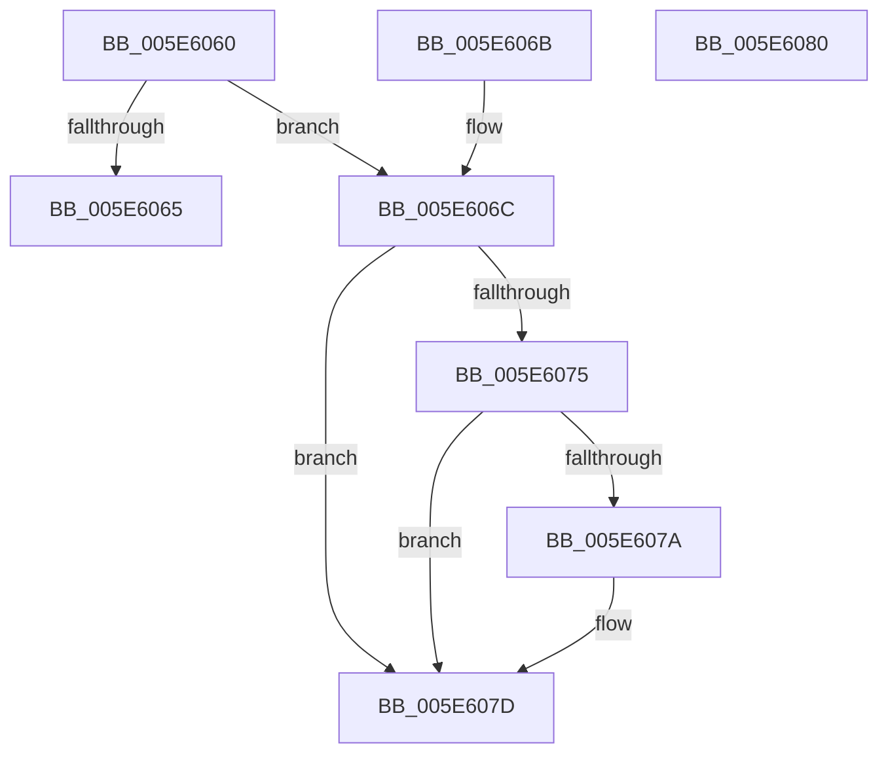

# RtlDrainNonVolatileFlush

- RVA: `0x005E6060`–`0x005E6081` (길이 `33` bytes)
- VA: `0x00000001405E6060`
- 실행 섹션: `.text`
- PDB 이름 있음: `예`; PDB Function 태그: `아니요`
- unwind 정보 RVA: `0x000DB714`
- 디코드: `13`개 명령, `33/33` bytes 표시
- 미해석 바이트: `0` (있으면 어셈블리에 `.byte`로 보존)

> 이 문서는 커널 이미지의 기계어와 PDB 기호를 분석해 생성했습니다. 4번과 5번은 함수 원형과 자료형을 바이너리 사용 방식에서 추정한 C 해석이며 원본 소스 복구 결과는 아닙니다.

## 1. Dependencies

- 직접 호출 지점: **0**; 고유 호출 대상: **0**
- 직접 호출자로 확인된 함수: **2**
- RIP 상대 이미지 참조: **1**

### Outgoing calls
- 직접 디코드된 call 명령이 없습니다.

### Direct callers
- [RtlFlushNonVolatileMemory](../4F/RtlFlushNonVolatileMemory_function_004FCBF0.md) at `0x004FCC61`
- [RtlFlushNonVolatileMemoryRanges](RtlFlushNonVolatileMemoryRanges_function_005EC690.md) at `0x005EC6F5`

### Static image references
- `0x005E606C` → RVA `0x00E67B08` (`.data`; read)

## 2. Other-region calls and transfers

- 다른 실행 섹션으로 향하는 call: **0**
- 별도 외부 분기/꼬리 이동을 확인하지 못했습니다.

## 3. Assembly (complete function range)

```asm
005E6060  F6 C1 01                        test cl, 1
005E6063  75 07                           jne 0x1405e606c
005E6065  B8 0D 00 00 C0                  mov eax, 0xc000000d
005E606A  C3                              ret
005E606B  CC                              int3
005E606C  80 3D 95 1A 88 00 00            cmp byte ptr [rip + 0x881a95], 0
005E6073  74 08                           je 0x1405e607d
005E6075  F6 C1 02                        test cl, 2
005E6078  74 03                           je 0x1405e607d
005E607A  0F AE F8                        sfence
005E607D  33 C0                           xor eax, eax
005E607F  C3                              ret
005E6080  CC                              int3
```

## 4. C-style interpretation (structured pseudocode)

```c
__int64 __fastcall RtlDrainNonVolatileFlush(unsigned __int8 a1)
{
    __int64 result;

    if (((a1) & (1)) != 0) goto loc_005E606C;
    return (unsigned int)(0xC000000DULL);
loc_005E606C:
    if ((*(unsigned __int8 *)(v_rip + 8919701)) == 0) goto loc_005E607D;
    if (((a1) & (2)) != 0) {
    }
    result = 0;
    return result;
}
```

## 5. (Beta) C Style

```c
int64_t RtlDrainNonVolatileFlush(uint8_t Arg1)
{
    int64_t result;

    if (((Arg1) & (1)) != 0) goto loc_005E606C;
    return (uint32_t)(0xC000000DULL);
loc_005E606C:
    if ((*(uint8_t *)(v_rip + 0x881A95)) == 0) goto loc_005E607D;
    if (((Arg1) & (2)) != 0) {
    }
    result = 0;
    return result;
}
```

## 6. Execution-region graph

[열기: 2D/3D 그래프와 함수 탐색 컨트롤 패널](../../../control-panel.html?section=text&rva=0x005E6060&view=graph)

- 2D 그래프는 위에서 아래로 흐르고, 3D 그래프는 빈 공간을 드래그해 회전합니다. Shift+드래그는 이동, 휠은 확대·축소, 함수 노드 선택은 대상 보고서 이동입니다.

### Static fallback


