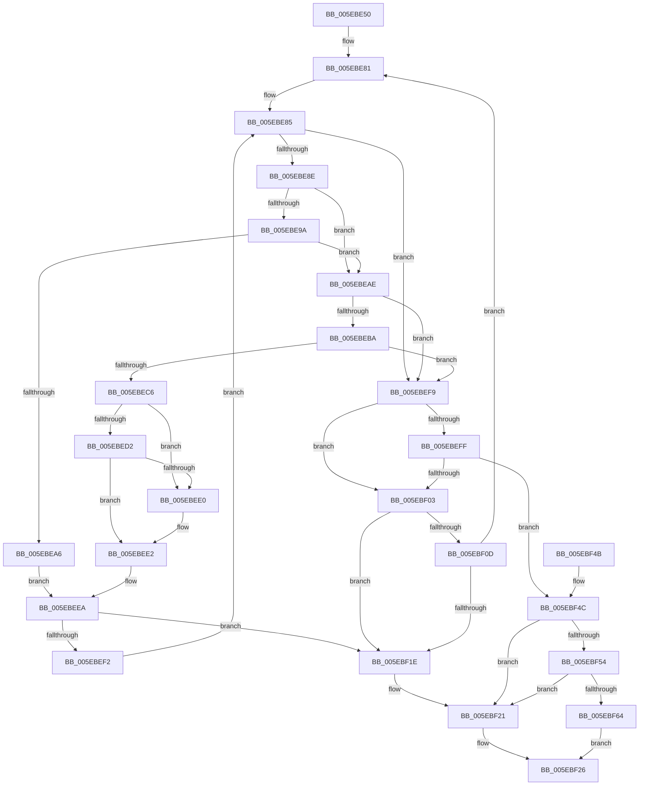

# RtlEthernetStringToAddressA

- RVA: `0x005EBE50`–`0x005EBF7A` (길이 `298` bytes)
- VA: `0x00000001405EBE50`
- 실행 섹션: `.text`
- PDB 이름 있음: `예`; PDB Function 태그: `아니요`
- unwind 정보 RVA: `0x000CFCF4`
- 디코드: `102`개 명령, `298/298` bytes 표시
- 미해석 바이트: `0` (있으면 어셈블리에 `.byte`로 보존)

> 이 문서는 커널 이미지의 기계어와 PDB 기호를 분석해 생성했습니다. 4번과 5번은 함수 원형과 자료형을 바이너리 사용 방식에서 추정한 C 해석이며 원본 소스 복구 결과는 아닙니다.

## 1. Dependencies

- 직접 호출 지점: **7**; 고유 호출 대상: **5**
- 직접 호출자로 확인된 함수: **0**
- RIP 상대 이미지 참조: **1**

### Outgoing calls
- `0x005EBE91` → [_isascii](../50/_isascii_function_00500660.md) (function, `0x00500660`)
- `0x005EBE9D` → [isdigit](../50/isdigit_function_00500680.md) (function, `0x00500680`)
- `0x005EBEB1` → [_isascii](../50/_isascii_function_00500660.md) (function, `0x00500660`)
- `0x005EBEBD` → [isxdigit](../50/isxdigit_function_00500770.md) (function, `0x00500770`)
- `0x005EBEC9` → [_isascii](../50/_isascii_function_00500660.md) (function, `0x00500660`)
- `0x005EBED5` → [islower](../50/islower_function_005006B0.md) (function, `0x005006B0`)
- `0x005EBF2E` → [_security_check_cookie](../6A/_security_check_cookie_function_006AC640.md) (function, `0x006AC640`)

### Direct callers
- 이 함수 시작 RVA로 연결되는 직접 call은 확인되지 않았습니다. 간접 호출은 완전히 역산할 수 없습니다.

### Static image references
- `0x005EBE64` → RVA `0x00E0A740` (`.data`; read)

## 2. Other-region calls and transfers

- 다른 실행 섹션으로 향하는 call: **0**
- 별도 외부 분기/꼬리 이동을 확인하지 못했습니다.

## 3. Assembly (complete function range)

```asm
005EBE50  48 89 5C 24 20                  mov qword ptr [rsp + 0x20], rbx
005EBE55  55                              push rbp
005EBE56  56                              push rsi
005EBE57  57                              push rdi
005EBE58  41 54                           push r12
005EBE5A  41 55                           push r13
005EBE5C  41 56                           push r14
005EBE5E  41 57                           push r15
005EBE60  48 83 EC 30                     sub rsp, 0x30
005EBE64  48 8B 05 D5 E8 81 00            mov rax, qword ptr [rip + 0x81e8d5]
005EBE6B  48 33 C4                        xor rax, rsp
005EBE6E  48 89 44 24 28                  mov qword ptr [rsp + 0x28], rax
005EBE73  4D 8B E8                        mov r13, r8
005EBE76  48 8D 74 24 20                  lea rsi, [rsp + 0x20]
005EBE7B  4C 8B FA                        mov r15, rdx
005EBE7E  48 8B F9                        mov rdi, rcx
005EBE81  33 ED                           xor ebp, ebp
005EBE83  32 DB                           xor bl, bl
005EBE85  44 0F BE 27                     movsx r12d, byte ptr [rdi]
005EBE89  45 84 E4                        test r12b, r12b
005EBE8C  74 6B                           je 0x1405ebef9
005EBE8E  41 8B CC                        mov ecx, r12d
005EBE91  E8 CA 47 F1 FF                  call 0x140500660
005EBE96  85 C0                           test eax, eax
005EBE98  74 14                           je 0x1405ebeae
005EBE9A  41 8B CC                        mov ecx, r12d
005EBE9D  E8 DE 47 F1 FF                  call 0x140500680
005EBEA2  85 C0                           test eax, eax
005EBEA4  74 08                           je 0x1405ebeae
005EBEA6  80 C3 0D                        add bl, 0xd
005EBEA9  C0 E3 04                        shl bl, 4
005EBEAC  EB 3C                           jmp 0x1405ebeea
005EBEAE  41 8B CC                        mov ecx, r12d
005EBEB1  E8 AA 47 F1 FF                  call 0x140500660
005EBEB6  85 C0                           test eax, eax
005EBEB8  74 3F                           je 0x1405ebef9
005EBEBA  41 8B CC                        mov ecx, r12d
005EBEBD  E8 AE 48 F1 FF                  call 0x140500770
005EBEC2  85 C0                           test eax, eax
005EBEC4  74 33                           je 0x1405ebef9
005EBEC6  41 8B CC                        mov ecx, r12d
005EBEC9  E8 92 47 F1 FF                  call 0x140500660
005EBECE  85 C0                           test eax, eax
005EBED0  74 0E                           je 0x1405ebee0
005EBED2  41 8B CC                        mov ecx, r12d
005EBED5  E8 D6 47 F1 FF                  call 0x1405006b0
005EBEDA  85 C0                           test eax, eax
005EBEDC  B0 61                           mov al, 0x61
005EBEDE  75 02                           jne 0x1405ebee2
005EBEE0  B0 41                           mov al, 0x41
005EBEE2  C0 E3 04                        shl bl, 4
005EBEE5  2A D8                           sub bl, al
005EBEE7  80 C3 0A                        add bl, 0xa
005EBEEA  41 02 DC                        add bl, r12b
005EBEED  83 FD 02                        cmp ebp, 2
005EBEF0  74 2C                           je 0x1405ebf1e
005EBEF2  48 FF C7                        inc rdi
005EBEF5  FF C5                           inc ebp
005EBEF7  EB 8C                           jmp 0x1405ebe85
005EBEF9  8A 07                           mov al, byte ptr [rdi]
005EBEFB  3C 2D                           cmp al, 0x2d
005EBEFD  74 04                           je 0x1405ebf03
005EBEFF  3C 3A                           cmp al, 0x3a
005EBF01  75 49                           jne 0x1405ebf4c
005EBF03  48 8D 44 24 25                  lea rax, [rsp + 0x25]
005EBF08  48 3B F0                        cmp rsi, rax
005EBF0B  73 11                           jae 0x1405ebf1e
005EBF0D  88 1E                           mov byte ptr [rsi], bl
005EBF0F  48 FF C7                        inc rdi
005EBF12  48 FF C6                        inc rsi
005EBF15  83 FD 02                        cmp ebp, 2
005EBF18  0F 84 63 FF FF FF               je 0x1405ebe81
005EBF1E  49 89 3F                        mov qword ptr [r15], rdi
005EBF21  B8 0D 00 00 C0                  mov eax, 0xc000000d
005EBF26  48 8B 4C 24 28                  mov rcx, qword ptr [rsp + 0x28]
005EBF2B  48 33 CC                        xor rcx, rsp
005EBF2E  E8 0D 07 0C 00                  call 0x1406ac640
005EBF33  48 8B 9C 24 88 00 00 00         mov rbx, qword ptr [rsp + 0x88]
005EBF3B  48 83 C4 30                     add rsp, 0x30
005EBF3F  41 5F                           pop r15
005EBF41  41 5E                           pop r14
005EBF43  41 5D                           pop r13
005EBF45  41 5C                           pop r12
005EBF47  5F                              pop rdi
005EBF48  5E                              pop rsi
005EBF49  5D                              pop rbp
005EBF4A  C3                              ret
005EBF4B  CC                              int3
005EBF4C  49 89 3F                        mov qword ptr [r15], rdi
005EBF4F  83 FD 02                        cmp ebp, 2
005EBF52  75 CD                           jne 0x1405ebf21
005EBF54  48 8D 46 01                     lea rax, [rsi + 1]
005EBF58  88 1E                           mov byte ptr [rsi], bl
005EBF5A  48 8D 4C 24 26                  lea rcx, [rsp + 0x26]
005EBF5F  48 3B C1                        cmp rax, rcx
005EBF62  75 BD                           jne 0x1405ebf21
005EBF64  8B 44 24 20                     mov eax, dword ptr [rsp + 0x20]
005EBF68  41 89 45 00                     mov dword ptr [r13], eax
005EBF6C  0F B7 44 24 24                  movzx eax, word ptr [rsp + 0x24]
005EBF71  66 41 89 45 04                  mov word ptr [r13 + 4], ax
005EBF76  33 C0                           xor eax, eax
005EBF78  EB AC                           jmp 0x1405ebf26
```

## 4. C-style interpretation (structured pseudocode)

```c
__int64 __fastcall RtlEthernetStringToAddressA(__int64 a1, __int64 a2, __int64 a3)
{
    __int64 result;
    __int64 v_rbp;
    __int64 v_rbx;
    __int64 v_rdi;
    __int64 v_rsi;
    __int64 v_rsp;
    unsigned __int64 v_stack_m40;
    unsigned __int64 v_stack_m43;
    unsigned __int64 v_stack_m48;
    unsigned __int64 v_stack_p20;
    unsigned __int16 v_stack_p24;
    unsigned __int64 v_stack_p26;

    v_stack_p20 = v_rbx;
    v_rsp = (v_rsp) - (48);
    result = (*(unsigned __int64 *)(v_rip + 8513749)) ^ (v_rsp);
    v_stack_m40 = result;
loc_005EBE81:
    v_rbp = 0;
    v_rbx = 0;
loc_005EBE85:
    if ((unsigned __int8)((__int8)(*(unsigned __int8 *)(a1))) == 0) goto loc_005EBEF9;
    result = _isascii((unsigned int)((unsigned int)((__int8)(*(unsigned __int8 *)(a1)))), a2, a3, a4);
    if ((unsigned int)(result) == 0) goto loc_005EBEAE;
    result = isdigit((unsigned int)((unsigned int)((__int8)(*(unsigned __int8 *)(a1)))), a2, a3, a4);
    if ((unsigned int)(result) == 0) goto loc_005EBEAE;
    v_rbx = (unsigned __int8)((v_rbx) + (13));
    v_rbx = (unsigned __int8)((v_rbx) << (4));
    goto loc_005EBEEA;
loc_005EBEAE:
    result = _isascii((unsigned int)((unsigned int)((__int8)(*(unsigned __int8 *)(a1)))), a2, a3, a4);
    if ((unsigned int)(result) == 0) goto loc_005EBEF9;
    result = isxdigit((unsigned int)((unsigned int)((__int8)(*(unsigned __int8 *)(a1)))), a2, a3, a4);
    if ((unsigned int)(result) == 0) goto loc_005EBEF9;
    result = _isascii((unsigned int)((unsigned int)((__int8)(*(unsigned __int8 *)(a1)))), a2, a3, a4);
    if ((unsigned int)(result) == 0) goto loc_005EBEE0;
    result = islower((unsigned int)((unsigned int)((__int8)(*(unsigned __int8 *)(a1)))), a2, a3, a4);
    result = 97;
    if ((unsigned int)(result) == 0) {
        result = 65;
    }
    v_rbx = (unsigned __int8)((v_rbx) << (4));
    v_rbx = (unsigned __int8)((v_rbx) - ((unsigned __int8)(result)));
    v_rbx = (unsigned __int8)((v_rbx) + (10));
loc_005EBEEA:
    v_rbx = (unsigned __int8)((v_rbx) + ((unsigned __int8)((__int8)(*(unsigned __int8 *)(a1)))));
    if (0 == 2) goto loc_005EBF1E;
    v_rdi = (a1) + 1;
    v_rbp = (unsigned int)((v_rbp) + 1);
    goto loc_005EBE85;
loc_005EBEF9:
    if (((unsigned __int8)(*(unsigned __int8 *)(v_rdi))) == 45) goto loc_005EBF03;
    if (((unsigned __int8)(*(unsigned __int8 *)(v_rdi))) != 58) goto loc_005EBF4C;
loc_005EBF03:
    if (v_stack_m48 >= v_stack_m43) goto loc_005EBF1E;
    *(unsigned __int8 *)(v_stack_m48) = (unsigned __int8)(v_rbx);
    v_rdi = (v_rdi) + 1;
    v_rsi = (v_stack_m48) + 1;
    if (((unsigned int)(v_rbp)) == 2) goto loc_005EBE81;
loc_005EBF1E:
    *(unsigned __int64 *)(a2) = v_rdi;
loc_005EBF21:
loc_005EBF26:
    a1 = (v_stack_m40) ^ (v_rsp);
    result = _security_check_cookie(a1, a2, a3, a4);
    v_rsp = (v_rsp) + (48);
    return result;
loc_005EBF4C:
    *(unsigned __int64 *)(a2) = v_rdi;
    if (((unsigned int)(v_rbp)) != 2) goto loc_005EBF21;
    *(unsigned __int8 *)(v_rsi) = (unsigned __int8)(v_stack_p20);
    if ((v_rsi + 1) != v_stack_p26) goto loc_005EBF21;
    *(unsigned int *)(a3) = (unsigned int)((unsigned int)(v_stack_p20));
    *(unsigned __int16 *)(a3 + 4) = (unsigned __int16)(v_stack_p24);
    result = 0;
    goto loc_005EBF26;
}
```

## 5. (Beta) C Style

```c
int64_t RtlEthernetStringToAddressA(int64_t Arg1, void *Arg2, void *Arg3)
{
    uint8_t *arg2 = (uint8_t *)Arg2;
    uint8_t *arg3 = (uint8_t *)Arg3;

    int64_t result;
    int64_t local_rbp;
    int64_t local_rbx;
    int64_t local_rdi;
    int64_t local_rsi;
    int64_t local_rsp;
    uint64_t v_stack_m40;
    uint64_t v_stack_m43;
    uint64_t v_stack_m48;
    uint64_t v_stack_p20;
    uint16_t v_stack_p24;
    uint64_t v_stack_p26;

    v_stack_p20 = local_rbx;
    local_rsp = (local_rsp) - (48);
    result = (*(uint64_t *)(v_rip + 0x81E8D5)) ^ (local_rsp);
    v_stack_m40 = result;
loc_005EBE81:
    local_rbp = 0;
    local_rbx = 0;
loc_005EBE85:
    if ((uint8_t)((int8_t)(*(uint8_t *)(Arg1))) == 0) goto loc_005EBEF9;
    result = _isascii((uint32_t)((uint32_t)((int8_t)(*(uint8_t *)(Arg1)))), Arg2, Arg3, a4);
    if ((uint32_t)(result) == 0) goto loc_005EBEAE;
    result = isdigit((uint32_t)((uint32_t)((int8_t)(*(uint8_t *)(Arg1)))), Arg2, Arg3, a4);
    if ((uint32_t)(result) == 0) goto loc_005EBEAE;
    local_rbx = (uint8_t)((local_rbx) + (13));
    local_rbx = (uint8_t)((local_rbx) << (4));
    goto loc_005EBEEA;
loc_005EBEAE:
    result = _isascii((uint32_t)((uint32_t)((int8_t)(*(uint8_t *)(Arg1)))), Arg2, Arg3, a4);
    if ((uint32_t)(result) == 0) goto loc_005EBEF9;
    result = isxdigit((uint32_t)((uint32_t)((int8_t)(*(uint8_t *)(Arg1)))), Arg2, Arg3, a4);
    if ((uint32_t)(result) == 0) goto loc_005EBEF9;
    result = _isascii((uint32_t)((uint32_t)((int8_t)(*(uint8_t *)(Arg1)))), Arg2, Arg3, a4);
    if ((uint32_t)(result) == 0) goto loc_005EBEE0;
    result = islower((uint32_t)((uint32_t)((int8_t)(*(uint8_t *)(Arg1)))), Arg2, Arg3, a4);
    result = 97;
    if ((uint32_t)(result) == 0) {
        result = 65;
    }
    local_rbx = (uint8_t)((local_rbx) << (4));
    local_rbx = (uint8_t)((local_rbx) - ((uint8_t)(result)));
    local_rbx = (uint8_t)((local_rbx) + (10));
loc_005EBEEA:
    local_rbx = (uint8_t)((local_rbx) + ((uint8_t)((int8_t)(*(uint8_t *)(Arg1)))));
    if (0 == 2) goto loc_005EBF1E;
    local_rdi = (Arg1) + 1;
    local_rbp = (uint32_t)((local_rbp) + 1);
    goto loc_005EBE85;
loc_005EBEF9:
    if (((uint8_t)(*(uint8_t *)(local_rdi))) == 45) goto loc_005EBF03;
    if (((uint8_t)(*(uint8_t *)(local_rdi))) != 58) goto loc_005EBF4C;
loc_005EBF03:
    if (v_stack_m48 >= v_stack_m43) goto loc_005EBF1E;
    *(uint8_t *)(v_stack_m48) = (uint8_t)(local_rbx);
    local_rdi = (local_rdi) + 1;
    local_rsi = (v_stack_m48) + 1;
    if (((uint32_t)(local_rbp)) == 2) goto loc_005EBE81;
loc_005EBF1E:
    *(uint64_t *)(arg2) = local_rdi;
loc_005EBF21:
loc_005EBF26:
    Arg1 = (v_stack_m40) ^ (local_rsp);
    result = _security_check_cookie(Arg1, Arg2, Arg3, a4);
    local_rsp = (local_rsp) + (48);
    return result;
loc_005EBF4C:
    *(uint64_t *)(arg2) = local_rdi;
    if (((uint32_t)(local_rbp)) != 2) goto loc_005EBF21;
    *(uint8_t *)(local_rsi) = (uint8_t)(v_stack_p20);
    if ((local_rsi + 1) != v_stack_p26) goto loc_005EBF21;
    *(uint32_t *)(arg3) = (uint32_t)((uint32_t)(v_stack_p20));
    *(uint16_t *)(arg3 + 0x4) = (uint16_t)(v_stack_p24);
    result = 0;
    goto loc_005EBF26;
}
```

### 관측된 메모리 오프셋

구조체 형식이 확인되지 않은 접근은 인자 기준의 오프셋으로만 기록했습니다.

| 기준 인자 | 오프셋 표현 | 폭 (bit) | 접근 |
|---|---:|---:|---|
| `Arg2` | `+ 0x0` | `64` | `W` |
| `Arg3` | `+ 0x0` | `32` | `W` |
| `Arg3` | `+ 0x4` | `16` | `W` |

## 6. Execution-region graph

[열기: 2D/3D 그래프와 함수 탐색 컨트롤 패널](../../../control-panel.html?section=text&rva=0x005EBE50&view=graph)

- 2D 그래프는 위에서 아래로 흐르고, 3D 그래프는 빈 공간을 드래그해 회전합니다. Shift+드래그는 이동, 휠은 확대·축소, 함수 노드 선택은 대상 보고서 이동입니다.

### Static fallback


