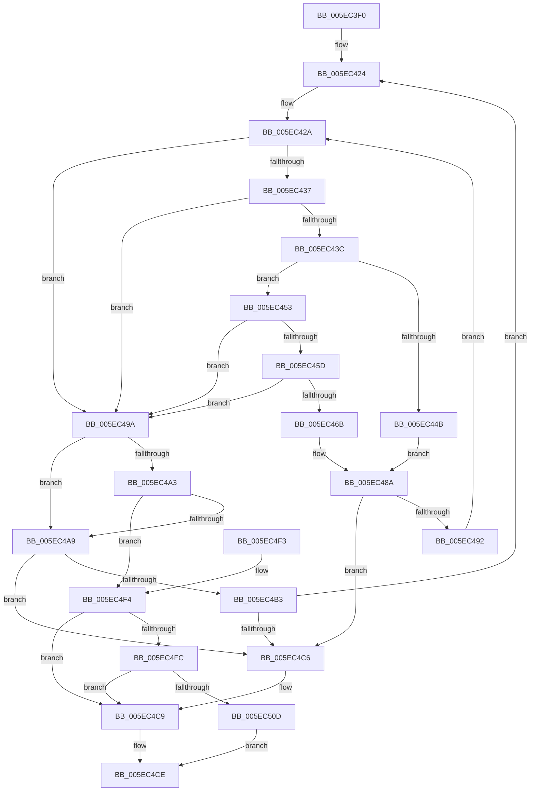

# RtlEthernetStringToAddressW

- RVA: `0x005EC3F0`–`0x005EC524` (길이 `308` bytes)
- VA: `0x00000001405EC3F0`
- 실행 섹션: `.text`
- PDB 이름 있음: `예`; PDB Function 태그: `아니요`
- unwind 정보 RVA: `0x000CFD38`
- 디코드: `100`개 명령, `308/308` bytes 표시
- 미해석 바이트: `0` (있으면 어셈블리에 `.byte`로 보존)

> 이 문서는 커널 이미지의 기계어와 PDB 기호를 분석해 생성했습니다. 4번과 5번은 함수 원형과 자료형을 바이너리 사용 방식에서 추정한 C 해석이며 원본 소스 복구 결과는 아닙니다.

## 1. Dependencies

- 직접 호출 지점: **4**; 고유 호출 대상: **2**
- 직접 호출자로 확인된 함수: **0**
- RIP 상대 이미지 참조: **1**

### Outgoing calls
- `0x005EC442` → [iswctype](../50/iswctype_function_00502900.md) (function, `0x00502900`)
- `0x005EC462` → [iswctype](../50/iswctype_function_00502900.md) (function, `0x00502900`)
- `0x005EC473` → [iswctype](../50/iswctype_function_00502900.md) (function, `0x00502900`)
- `0x005EC4D6` → [_security_check_cookie](../6A/_security_check_cookie_function_006AC640.md) (function, `0x006AC640`)

### Direct callers
- 이 함수 시작 RVA로 연결되는 직접 call은 확인되지 않았습니다. 간접 호출은 완전히 역산할 수 없습니다.

### Static image references
- `0x005EC404` → RVA `0x00E0A740` (`.data`; read)

## 2. Other-region calls and transfers

- 다른 실행 섹션으로 향하는 call: **0**
- 별도 외부 분기/꼬리 이동을 확인하지 못했습니다.

## 3. Assembly (complete function range)

```asm
005EC3F0  48 89 5C 24 20                  mov qword ptr [rsp + 0x20], rbx
005EC3F5  55                              push rbp
005EC3F6  56                              push rsi
005EC3F7  57                              push rdi
005EC3F8  41 54                           push r12
005EC3FA  41 55                           push r13
005EC3FC  41 56                           push r14
005EC3FE  41 57                           push r15
005EC400  48 83 EC 30                     sub rsp, 0x30
005EC404  48 8B 05 35 E3 81 00            mov rax, qword ptr [rip + 0x81e335]
005EC40B  48 33 C4                        xor rax, rsp
005EC40E  48 89 44 24 28                  mov qword ptr [rsp + 0x28], rax
005EC413  4D 8B E0                        mov r12, r8
005EC416  4C 8D 74 24 20                  lea r14, [rsp + 0x20]
005EC41B  4C 8B FA                        mov r15, rdx
005EC41E  48 8B F9                        mov rdi, rcx
005EC421  45 33 ED                        xor r13d, r13d
005EC424  41 8B ED                        mov ebp, r13d
005EC427  41 8A DD                        mov bl, r13b
005EC42A  0F B7 37                        movzx esi, word ptr [rdi]
005EC42D  B8 80 00 00 00                  mov eax, 0x80
005EC432  66 85 F6                        test si, si
005EC435  74 63                           je 0x1405ec49a
005EC437  66 3B F0                        cmp si, ax
005EC43A  73 5E                           jae 0x1405ec49a
005EC43C  8D 50 84                        lea edx, [rax - 0x7c]
005EC43F  0F B7 CE                        movzx ecx, si
005EC442  E8 B9 64 F1 FF                  call 0x140502900
005EC447  85 C0                           test eax, eax
005EC449  74 08                           je 0x1405ec453
005EC44B  80 C3 0D                        add bl, 0xd
005EC44E  C0 E3 04                        shl bl, 4
005EC451  EB 37                           jmp 0x1405ec48a
005EC453  B8 80 00 00 00                  mov eax, 0x80
005EC458  66 3B F0                        cmp si, ax
005EC45B  73 3D                           jae 0x1405ec49a
005EC45D  8B D0                           mov edx, eax
005EC45F  0F B7 CE                        movzx ecx, si
005EC462  E8 99 64 F1 FF                  call 0x140502900
005EC467  85 C0                           test eax, eax
005EC469  74 2F                           je 0x1405ec49a
005EC46B  BA 02 00 00 00                  mov edx, 2
005EC470  0F B7 CE                        movzx ecx, si
005EC473  E8 88 64 F1 FF                  call 0x140502900
005EC478  F7 D8                           neg eax
005EC47A  1A C9                           sbb cl, cl
005EC47C  C0 E3 04                        shl bl, 4
005EC47F  80 E1 20                        and cl, 0x20
005EC482  80 C1 41                        add cl, 0x41
005EC485  2A D9                           sub bl, cl
005EC487  80 C3 0A                        add bl, 0xa
005EC48A  40 02 DE                        add bl, sil
005EC48D  83 FD 02                        cmp ebp, 2
005EC490  74 34                           je 0x1405ec4c6
005EC492  48 83 C7 02                     add rdi, 2
005EC496  FF C5                           inc ebp
005EC498  EB 90                           jmp 0x1405ec42a
005EC49A  0F B7 07                        movzx eax, word ptr [rdi]
005EC49D  66 83 F8 2D                     cmp ax, 0x2d
005EC4A1  74 06                           je 0x1405ec4a9
005EC4A3  66 83 F8 3A                     cmp ax, 0x3a
005EC4A7  75 4B                           jne 0x1405ec4f4
005EC4A9  48 8D 44 24 25                  lea rax, [rsp + 0x25]
005EC4AE  4C 3B F0                        cmp r14, rax
005EC4B1  73 13                           jae 0x1405ec4c6
005EC4B3  41 88 1E                        mov byte ptr [r14], bl
005EC4B6  48 83 C7 02                     add rdi, 2
005EC4BA  49 FF C6                        inc r14
005EC4BD  83 FD 02                        cmp ebp, 2
005EC4C0  0F 84 5E FF FF FF               je 0x1405ec424
005EC4C6  49 89 3F                        mov qword ptr [r15], rdi
005EC4C9  B8 0D 00 00 C0                  mov eax, 0xc000000d
005EC4CE  48 8B 4C 24 28                  mov rcx, qword ptr [rsp + 0x28]
005EC4D3  48 33 CC                        xor rcx, rsp
005EC4D6  E8 65 01 0C 00                  call 0x1406ac640
005EC4DB  48 8B 9C 24 88 00 00 00         mov rbx, qword ptr [rsp + 0x88]
005EC4E3  48 83 C4 30                     add rsp, 0x30
005EC4E7  41 5F                           pop r15
005EC4E9  41 5E                           pop r14
005EC4EB  41 5D                           pop r13
005EC4ED  41 5C                           pop r12
005EC4EF  5F                              pop rdi
005EC4F0  5E                              pop rsi
005EC4F1  5D                              pop rbp
005EC4F2  C3                              ret
005EC4F3  CC                              int3
005EC4F4  49 89 3F                        mov qword ptr [r15], rdi
005EC4F7  83 FD 02                        cmp ebp, 2
005EC4FA  75 CD                           jne 0x1405ec4c9
005EC4FC  49 8D 46 01                     lea rax, [r14 + 1]
005EC500  41 88 1E                        mov byte ptr [r14], bl
005EC503  48 8D 4C 24 26                  lea rcx, [rsp + 0x26]
005EC508  48 3B C1                        cmp rax, rcx
005EC50B  75 BC                           jne 0x1405ec4c9
005EC50D  8B 44 24 20                     mov eax, dword ptr [rsp + 0x20]
005EC511  41 89 04 24                     mov dword ptr [r12], eax
005EC515  0F B7 44 24 24                  movzx eax, word ptr [rsp + 0x24]
005EC51A  66 41 89 44 24 04               mov word ptr [r12 + 4], ax
005EC520  33 C0                           xor eax, eax
005EC522  EB AA                           jmp 0x1405ec4ce
```

## 4. C-style interpretation (structured pseudocode)

```c
__int64 __fastcall RtlEthernetStringToAddressW(__int64 a1, __int64 a2, __int64 a3)
{
    __int64 result;
    __int64 v_r13;
    __int64 v_r14;
    __int64 v_rbp;
    __int64 v_rbx;
    __int64 v_rdi;
    __int64 v_rsp;
    unsigned __int64 v_stack_m40;
    unsigned __int64 v_stack_m43;
    unsigned __int64 v_stack_m48;
    unsigned __int64 v_stack_p20;
    unsigned __int16 v_stack_p24;
    unsigned __int64 v_stack_p26;

    v_stack_p20 = v_rbx;
    v_rsp = (v_rsp) - (48);
    result = (*(unsigned __int64 *)(v_rip + 8512309)) ^ (v_rsp);
    v_stack_m40 = result;
    v_r13 = 0;
loc_005EC424:
loc_005EC42A:
    if ((unsigned __int16)(*(unsigned __int16 *)(a1)) == 0) goto loc_005EC49A;
    if (((unsigned __int16)(*(unsigned __int16 *)(a1))) >= 128) goto loc_005EC49A;
    result = iswctype((unsigned __int16)(*(unsigned __int16 *)(a1)), 128 - 124, a3, a4);
    if ((unsigned int)(result) == 0) goto loc_005EC453;
    v_rbx = (unsigned __int8)((0) + (13));
    v_rbx = (unsigned __int8)((v_rbx) << (4));
    goto loc_005EC48A;
loc_005EC453:
    if (((unsigned __int16)(*(unsigned __int16 *)(a1))) >= 128) goto loc_005EC49A;
    result = iswctype((unsigned __int16)(*(unsigned __int16 *)(a1)), 128, a3, a4);
    if ((unsigned int)(result) == 0) goto loc_005EC49A;
    result = iswctype((unsigned __int16)(*(unsigned __int16 *)(a1)), 2, a3, a4);
    result = (unsigned int)(-(result));
    v_rbx = (unsigned __int8)((v_rbx) << (4));
    a1 = (unsigned __int8)(((unsigned __int16)(*(unsigned __int16 *)(a1))) & (32));
    a1 = (unsigned __int8)((a1) + (65));
    v_rbx = (unsigned __int8)((v_rbx) - ((unsigned __int8)(a1)));
    v_rbx = (unsigned __int8)((v_rbx) + (10));
loc_005EC48A:
    v_rbx = (unsigned __int8)((v_rbx) + ((unsigned __int8)(*(unsigned __int16 *)(a1))));
    if (0 == 2) goto loc_005EC4C6;
    v_rdi = (a1) + (2);
    v_rbp = (unsigned int)((0) + 1);
    goto loc_005EC42A;
loc_005EC49A:
    if (((unsigned __int16)(*(unsigned __int16 *)(v_rdi))) == 45) goto loc_005EC4A9;
    if (((unsigned __int16)(*(unsigned __int16 *)(v_rdi))) != 58) goto loc_005EC4F4;
loc_005EC4A9:
    if (v_stack_m48 >= v_stack_m43) goto loc_005EC4C6;
    *(unsigned __int8 *)(v_stack_m48) = (unsigned __int8)(v_rbx);
    v_rdi = (v_rdi) + (2);
    v_r14 = (v_stack_m48) + 1;
    if (((unsigned int)(v_rbp)) == 2) goto loc_005EC424;
loc_005EC4C6:
    *(unsigned __int64 *)(a2) = v_rdi;
loc_005EC4C9:
loc_005EC4CE:
    a1 = (v_stack_m40) ^ (v_rsp);
    result = _security_check_cookie(a1, 2, a3, a4);
    v_rsp = (v_rsp) + (48);
    return result;
loc_005EC4F4:
    *(unsigned __int64 *)(a2) = v_rdi;
    if (((unsigned int)(v_rbp)) != 2) goto loc_005EC4C9;
    *(unsigned __int8 *)(v_r14) = (unsigned __int8)(v_stack_p20);
    if ((v_r14 + 1) != v_stack_p26) goto loc_005EC4C9;
    *(unsigned int *)(a3) = (unsigned int)((unsigned int)(v_stack_p20));
    *(unsigned __int16 *)(a3 + 4) = (unsigned __int16)(v_stack_p24);
    result = 0;
    goto loc_005EC4CE;
}
```

## 5. (Beta) C Style

```c
int64_t RtlEthernetStringToAddressW(void *Arg1, void *Arg2, void *Arg3)
{
    uint8_t *arg1 = (uint8_t *)Arg1;
    uint8_t *arg2 = (uint8_t *)Arg2;
    uint8_t *arg3 = (uint8_t *)Arg3;

    int64_t result;
    int64_t local_r13;
    int64_t local_r14;
    int64_t local_rbp;
    int64_t local_rbx;
    int64_t local_rdi;
    int64_t local_rsp;
    uint64_t v_stack_m40;
    uint64_t v_stack_m43;
    uint64_t v_stack_m48;
    uint64_t v_stack_p20;
    uint16_t v_stack_p24;
    uint64_t v_stack_p26;

    v_stack_p20 = local_rbx;
    local_rsp = (local_rsp) - (48);
    result = (*(uint64_t *)(v_rip + 0x81E335)) ^ (local_rsp);
    v_stack_m40 = result;
    local_r13 = 0;
loc_005EC424:
loc_005EC42A:
    if ((uint16_t)(*(uint16_t *)(arg1)) == 0) goto loc_005EC49A;
    if (((uint16_t)(*(uint16_t *)(arg1))) >= 128) goto loc_005EC49A;
    result = iswctype((uint16_t)(*(uint16_t *)(arg1)), 128 - 124, Arg3, a4);
    if ((uint32_t)(result) == 0) goto loc_005EC453;
    local_rbx = (uint8_t)((0) + (13));
    local_rbx = (uint8_t)((local_rbx) << (4));
    goto loc_005EC48A;
loc_005EC453:
    if (((uint16_t)(*(uint16_t *)(arg1))) >= 128) goto loc_005EC49A;
    result = iswctype((uint16_t)(*(uint16_t *)(arg1)), 128, Arg3, a4);
    if ((uint32_t)(result) == 0) goto loc_005EC49A;
    result = iswctype((uint16_t)(*(uint16_t *)(arg1)), 2, Arg3, a4);
    result = (uint32_t)(-(result));
    local_rbx = (uint8_t)((local_rbx) << (4));
    Arg1 = (uint8_t)(((uint16_t)(*(uint16_t *)(arg1))) & (32));
    Arg1 = (uint8_t)((Arg1) + (65));
    local_rbx = (uint8_t)((local_rbx) - ((uint8_t)(Arg1)));
    local_rbx = (uint8_t)((local_rbx) + (10));
loc_005EC48A:
    local_rbx = (uint8_t)((local_rbx) + ((uint8_t)(*(uint16_t *)(arg1))));
    if (0 == 2) goto loc_005EC4C6;
    local_rdi = (Arg1) + (2);
    local_rbp = (uint32_t)((0) + 1);
    goto loc_005EC42A;
loc_005EC49A:
    if (((uint16_t)(*(uint16_t *)(local_rdi))) == 45) goto loc_005EC4A9;
    if (((uint16_t)(*(uint16_t *)(local_rdi))) != 58) goto loc_005EC4F4;
loc_005EC4A9:
    if (v_stack_m48 >= v_stack_m43) goto loc_005EC4C6;
    *(uint8_t *)(v_stack_m48) = (uint8_t)(local_rbx);
    local_rdi = (local_rdi) + (2);
    local_r14 = (v_stack_m48) + 1;
    if (((uint32_t)(local_rbp)) == 2) goto loc_005EC424;
loc_005EC4C6:
    *(uint64_t *)(arg2) = local_rdi;
loc_005EC4C9:
loc_005EC4CE:
    Arg1 = (v_stack_m40) ^ (local_rsp);
    result = _security_check_cookie(Arg1, 2, Arg3, a4);
    local_rsp = (local_rsp) + (48);
    return result;
loc_005EC4F4:
    *(uint64_t *)(arg2) = local_rdi;
    if (((uint32_t)(local_rbp)) != 2) goto loc_005EC4C9;
    *(uint8_t *)(local_r14) = (uint8_t)(v_stack_p20);
    if ((local_r14 + 1) != v_stack_p26) goto loc_005EC4C9;
    *(uint32_t *)(arg3) = (uint32_t)((uint32_t)(v_stack_p20));
    *(uint16_t *)(arg3 + 0x4) = (uint16_t)(v_stack_p24);
    result = 0;
    goto loc_005EC4CE;
}
```

### 관측된 메모리 오프셋

구조체 형식이 확인되지 않은 접근은 인자 기준의 오프셋으로만 기록했습니다.

| 기준 인자 | 오프셋 표현 | 폭 (bit) | 접근 |
|---|---:|---:|---|
| `Arg1` | `+ 0x0` | `16` | `R` |
| `Arg2` | `+ 0x0` | `64` | `W` |
| `Arg3` | `+ 0x0` | `32` | `W` |
| `Arg3` | `+ 0x4` | `16` | `W` |

## 6. Execution-region graph

[열기: 2D/3D 그래프와 함수 탐색 컨트롤 패널](../../../control-panel.html?section=text&rva=0x005EC3F0&view=graph)

- 2D 그래프는 위에서 아래로 흐르고, 3D 그래프는 빈 공간을 드래그해 회전합니다. Shift+드래그는 이동, 휠은 확대·축소, 함수 노드 선택은 대상 보고서 이동입니다.

### Static fallback


