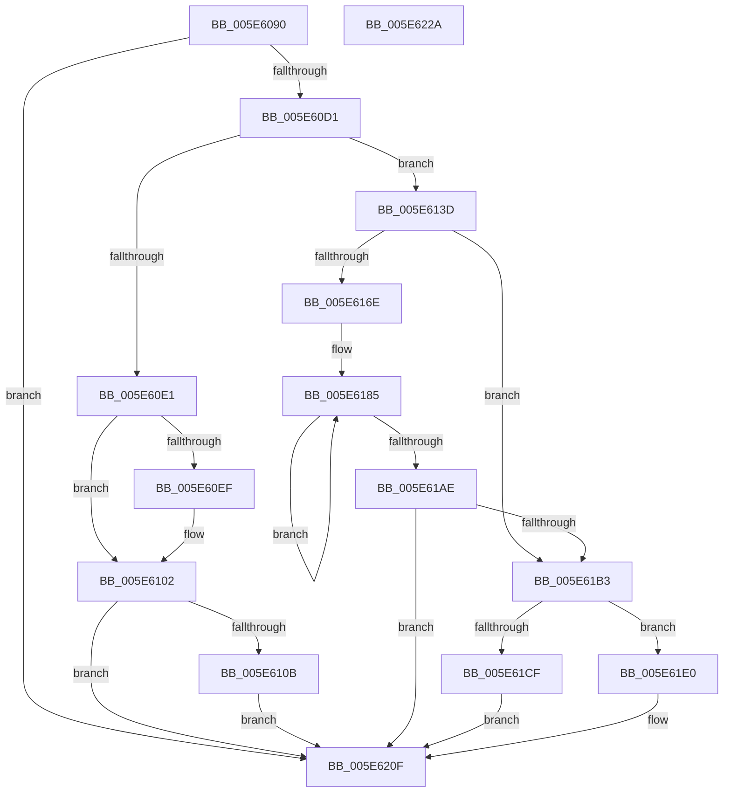

# RtlExtractBitMap

- RVA: `0x005E6090`–`0x005E622B` (길이 `411` bytes)
- VA: `0x00000001405E6090`
- 실행 섹션: `.text`
- PDB 이름 있음: `예`; PDB Function 태그: `아니요`
- unwind 정보 RVA: `0x0005E6B4`
- 디코드: `128`개 명령, `411/411` bytes 표시
- 미해석 바이트: `0` (있으면 어셈블리에 `.byte`로 보존)

> 이 문서는 커널 이미지의 기계어와 PDB 기호를 분석해 생성했습니다. 4번과 5번은 함수 원형과 자료형을 바이너리 사용 방식에서 추정한 C 해석이며 원본 소스 복구 결과는 아닙니다.

## 1. Dependencies

- 직접 호출 지점: **1**; 고유 호출 대상: **1**
- 직접 호출자로 확인된 함수: **1**
- RIP 상대 이미지 참조: **0**

### Outgoing calls
- `0x005E60FD` → [memcpy](../6C/memcpy_function_006C6840.md) (function, `0x006C6840`)

### Direct callers
- [RtlShiftLeftBitMap](RtlShiftLeftBitMap_function_005E6580.md) at `0x005E65C6`

### Static image references
- 디코드된 RIP-relative 메모리 참조가 없습니다.

## 2. Other-region calls and transfers

- 다른 실행 섹션으로 향하는 call: **0**
- 별도 외부 분기/꼬리 이동을 확인하지 못했습니다.

## 3. Assembly (complete function range)

```asm
005E6090  48 8B C4                        mov rax, rsp
005E6093  48 89 58 08                     mov qword ptr [rax + 8], rbx
005E6097  48 89 68 10                     mov qword ptr [rax + 0x10], rbp
005E609B  48 89 70 18                     mov qword ptr [rax + 0x18], rsi
005E609F  48 89 78 20                     mov qword ptr [rax + 0x20], rdi
005E60A3  41 56                           push r14
005E60A5  48 83 EC 20                     sub rsp, 0x20
005E60A9  44 8B 11                        mov r10d, dword ptr [rcx]
005E60AC  48 8B EA                        mov rbp, rdx
005E60AF  8B 1A                           mov ebx, dword ptr [rdx]
005E60B1  45 2B D0                        sub r10d, r8d
005E60B4  45 3B CA                        cmp r9d, r10d
005E60B7  41 8B C1                        mov eax, r9d
005E60BA  4C 8B F1                        mov r14, rcx
005E60BD  44 0F 46 D0                     cmovbe r10d, eax
005E60C1  4C 3B D3                        cmp r10, rbx
005E60C4  41 0F 46 DA                     cmovbe ebx, r10d
005E60C8  48 85 DB                        test rbx, rbx
005E60CB  0F 84 3E 01 00 00               je 0x1405e620f
005E60D1  41 8B F0                        mov esi, r8d
005E60D4  48 C1 EE 03                     shr rsi, 3
005E60D8  41 8B C8                        mov ecx, r8d
005E60DB  41 F6 C0 07                     test r8b, 7
005E60DF  75 5C                           jne 0x1405e613d
005E60E1  8B FB                           mov edi, ebx
005E60E3  83 E3 07                        and ebx, 7
005E60E6  48 C1 EF 03                     shr rdi, 3
005E60EA  48 85 FF                        test rdi, rdi
005E60ED  74 13                           je 0x1405e6102
005E60EF  49 8B 56 08                     mov rdx, qword ptr [r14 + 8]
005E60F3  4C 8B C7                        mov r8, rdi
005E60F6  48 8B 4D 08                     mov rcx, qword ptr [rbp + 8]
005E60FA  48 03 D6                        add rdx, rsi
005E60FD  E8 3E 07 0E 00                  call 0x1406c6840
005E6102  48 85 DB                        test rbx, rbx
005E6105  0F 84 04 01 00 00               je 0x1405e620f
005E610B  49 8B 46 08                     mov rax, qword ptr [r14 + 8]
005E610F  48 8D 14 3E                     lea rdx, [rsi + rdi]
005E6113  4C 8B 4D 08                     mov r9, qword ptr [rbp + 8]
005E6117  48 8B CB                        mov rcx, rbx
005E611A  44 8A 04 02                     mov r8b, byte ptr [rdx + rax]
005E611E  BA 01 00 00 00                  mov edx, 1
005E6123  D2 E2                           shl dl, cl
005E6125  FE CA                           dec dl
005E6127  8A C2                           mov al, dl
005E6129  41 22 D0                        and dl, r8b
005E612C  F6 D0                           not al
005E612E  42 22 04 0F                     and al, byte ptr [rdi + r9]
005E6132  0A C2                           or al, dl
005E6134  42 88 04 0F                     mov byte ptr [rdi + r9], al
005E6138  E9 D2 00 00 00                  jmp 0x1405e620f
005E613D  49 8B 46 08                     mov rax, qword ptr [r14 + 8]
005E6141  4C 8B D9                        mov r11, rcx
005E6144  4C 8B 4A 08                     mov r9, qword ptr [rdx + 8]
005E6148  41 83 E3 1F                     and r11d, 0x1f
005E614C  48 C1 E9 05                     shr rcx, 5
005E6150  BF 20 00 00 00                  mov edi, 0x20
005E6155  41 BA 01 00 00 00               mov r10d, 1
005E615B  49 2B FB                        sub rdi, r11
005E615E  48 8D 34 88                     lea rsi, [rax + rcx*4]
005E6162  41 8B CB                        mov ecx, r11d
005E6165  41 D3 E2                        shl r10d, cl
005E6168  48 83 FB 20                     cmp rbx, 0x20
005E616C  72 45                           jb 0x1405e61b3
005E616E  4C 8B C3                        mov r8, rbx
005E6171  45 8D 72 FF                     lea r14d, [r10 - 1]
005E6175  49 C1 E8 05                     shr r8, 5
005E6179  41 8B EE                        mov ebp, r14d
005E617C  49 6B C0 E0                     imul rax, r8, -0x20
005E6180  F7 D5                           not ebp
005E6182  48 03 D8                        add rbx, rax
005E6185  8B 16                           mov edx, dword ptr [rsi]
005E6187  49 8B CB                        mov rcx, r11
005E618A  23 D5                           and edx, ebp
005E618C  48 83 C6 04                     add rsi, 4
005E6190  D3 EA                           shr edx, cl
005E6192  48 8B CF                        mov rcx, rdi
005E6195  41 89 11                        mov dword ptr [r9], edx
005E6198  8B 06                           mov eax, dword ptr [rsi]
005E619A  41 23 C6                        and eax, r14d
005E619D  D3 E0                           shl eax, cl
005E619F  0B C2                           or eax, edx
005E61A1  41 89 01                        mov dword ptr [r9], eax
005E61A4  49 83 C1 04                     add r9, 4
005E61A8  49 83 E8 01                     sub r8, 1
005E61AC  75 D7                           jne 0x1405e6185
005E61AE  48 85 DB                        test rbx, rbx
005E61B1  74 5C                           je 0x1405e620f
005E61B3  8B 2E                           mov ebp, dword ptr [rsi]
005E61B5  48 8B CB                        mov rcx, rbx
005E61B8  B8 01 00 00 00                  mov eax, 1
005E61BD  D3 E0                           shl eax, cl
005E61BF  FF C8                           dec eax
005E61C1  44 8B C0                        mov r8d, eax
005E61C4  41 F7 D0                        not r8d
005E61C7  45 23 01                        and r8d, dword ptr [r9]
005E61CA  48 3B DF                        cmp rbx, rdi
005E61CD  77 11                           ja 0x1405e61e0
005E61CF  49 8B CB                        mov rcx, r11
005E61D2  D3 E0                           shl eax, cl
005E61D4  23 C5                           and eax, ebp
005E61D6  D3 E8                           shr eax, cl
005E61D8  41 0B C0                        or eax, r8d
005E61DB  41 89 01                        mov dword ptr [r9], eax
005E61DE  EB 2F                           jmp 0x1405e620f
005E61E0  41 F7 DA                        neg r10d
005E61E3  41 8D 8B E0 00 00 00            lea ecx, [r11 + 0xe0]
005E61EA  02 CB                           add cl, bl
005E61EC  44 23 D5                        and r10d, ebp
005E61EF  BA 01 00 00 00                  mov edx, 1
005E61F4  D3 E2                           shl edx, cl
005E61F6  48 8B CF                        mov rcx, rdi
005E61F9  FF CA                           dec edx
005E61FB  23 56 04                        and edx, dword ptr [rsi + 4]
005E61FE  D3 E2                           shl edx, cl
005E6200  49 8B CB                        mov rcx, r11
005E6203  41 D3 EA                        shr r10d, cl
005E6206  41 0B D2                        or edx, r10d
005E6209  44 0B C2                        or r8d, edx
005E620C  45 89 01                        mov dword ptr [r9], r8d
005E620F  48 8B 5C 24 30                  mov rbx, qword ptr [rsp + 0x30]
005E6214  48 8B 6C 24 38                  mov rbp, qword ptr [rsp + 0x38]
005E6219  48 8B 74 24 40                  mov rsi, qword ptr [rsp + 0x40]
005E621E  48 8B 7C 24 48                  mov rdi, qword ptr [rsp + 0x48]
005E6223  48 83 C4 20                     add rsp, 0x20
005E6227  41 5E                           pop r14
005E6229  C3                              ret
005E622A  CC                              int3
```

## 4. C-style interpretation (structured pseudocode)

```c
__int64 __fastcall RtlExtractBitMap(__int64 a1, __int64 a2, int a3, int a4)
{
    __int64 result;
    __int64 v_r10;
    __int64 v_r11;
    __int64 v_rbp;
    __int64 v_rbx;
    __int64 v_rdi;
    __int64 v_rsi;
    __int64 v_rsp;
    unsigned __int64 v_stack_p10;
    unsigned __int64 v_stack_p18;
    unsigned __int64 v_stack_p20;
    unsigned __int64 v_stack_p8;

    *(unsigned __int64 *)(v_rsp + 8) = v_rbx;
    *(unsigned __int64 *)(v_rsp + 16) = v_rbp;
    *(unsigned __int64 *)(v_rsp + 24) = v_rsi;
    *(unsigned __int64 *)(v_rsp + 32) = v_rdi;
    v_rsp = (v_rsp) - (32);
    v_r10 = (unsigned int)(((unsigned int)(*(unsigned int *)(a1))) - (a3));
    if (a4 <= ((unsigned int)(v_r10))) { v_r10 = (unsigned int)((unsigned int)(a4)); }
    v_rbx = (unsigned int)(*(unsigned int *)(a2));
    if (v_r10 <= ((unsigned int)(*(unsigned int *)(a2)))) { v_rbx = (unsigned int)(v_r10); }
    if (v_rbx == 0) goto loc_005E620F;
    v_rsi = ((unsigned int)(a3)) >> (3);
    if ((((unsigned __int8)(a3)) & (7)) != 0) goto loc_005E613D;
    v_rbx = (unsigned int)((v_rbx) & (7));
    v_rdi = ((unsigned int)((unsigned int)(v_rbx))) >> (3);
    result = (unsigned int)(a4);
    if (v_rdi != 0) {
        a2 = *(unsigned __int64 *)(a1 + 8);
        a3 = v_rdi;
        a1 = *(unsigned __int64 *)(a2 + 8);
        a2 = (a2) + (v_rsi);
        result = memcpy(a1, a2, a3, a4);
    }
    if (v_rbx == 0) goto loc_005E620F;
    a2 = (unsigned __int8)((1) << ((unsigned __int8)(v_rbx)));
    a2 = (unsigned __int8)((a2) - 1);
    a2 = (unsigned __int8)((a2) & ((unsigned __int8)(*(unsigned __int8 *)(v_rsi + v_rdi * 1 + *(unsigned __int64 *)(a1 + 8) * 1))));
    result = (unsigned __int8)(~((unsigned __int8)(a2)));
    result = (unsigned __int8)((result) & (*(unsigned __int8 *)(v_rdi + *(unsigned __int64 *)(a2 + 8) * 1)));
    result = (unsigned __int8)((result) | ((unsigned __int8)(a2)));
    *(unsigned __int8 *)(v_rdi + *(unsigned __int64 *)(a2 + 8) * 1) = (unsigned __int8)(result);
    goto loc_005E620F;
loc_005E613D:
    v_r11 = (unsigned int)((v_rbx) & (31));
    a1 = (v_rbx) >> (5);
    v_rdi = (32) - (v_r11);
    v_r10 = (unsigned int)((1) << ((unsigned __int8)((unsigned int)((unsigned int)(v_r11)))));
    if (v_rbx < 32) goto loc_005E61B3;
    a3 = (v_rbx) >> (5);
    result = (*(unsigned __int64 *)(a1 + 8)) * (a3);
    v_rbp = (unsigned int)(~((unsigned int)((unsigned int)(v_r10 - 1))));
    v_rbx = (v_rbx) + (result);
loc_005E6185:
    a2 = (unsigned int)(((unsigned int)(*(unsigned int *)(*(unsigned __int64 *)(a1 + 8) + a1 * 4))) & ((unsigned int)(v_rbp)));
    v_rsi = (*(unsigned __int64 *)(a1 + 8) + a1 * 4) + (4);
    a2 = (unsigned int)((a2) >> ((unsigned __int8)(v_r11)));
    *(unsigned int *)(*(unsigned __int64 *)(a2 + 8)) = (unsigned int)(a2);
    result = (unsigned int)(((unsigned int)(*(unsigned int *)(v_rsi))) & ((unsigned int)(v_r10 - 1)));
    result = (unsigned int)((result) << ((unsigned __int8)(v_rdi)));
    result = (unsigned int)((result) | ((unsigned int)(a2)));
    *(unsigned int *)(*(unsigned __int64 *)(a2 + 8)) = (unsigned int)(result);
    a4 = (*(unsigned __int64 *)(a2 + 8)) + (4);
    a3 = (a3) - (1);
    if (condition_is_not_equal) goto loc_005E6185;
    if (v_rbx == 0) goto loc_005E620F;
loc_005E61B3:
    result = (unsigned int)((1) << ((unsigned __int8)(v_rbx)));
    result = (unsigned int)((result) - 1);
    a3 = (unsigned int)(~((unsigned int)((unsigned int)(result))));
    a3 = (unsigned int)((a3) & (*(unsigned int *)(a4)));
    if (v_rbx > v_rdi) goto loc_005E61E0;
    result = (unsigned int)((result) << ((unsigned __int8)(v_r11)));
    result = (unsigned int)((result) & ((unsigned int)((unsigned int)(*(unsigned int *)(v_rsi)))));
    result = (unsigned int)((result) >> ((unsigned __int8)(v_r11)));
    result = (unsigned int)((result) | (a3));
    *(unsigned int *)(a4) = (unsigned int)(result);
    goto loc_005E620F;
loc_005E61E0:
    v_r10 = (unsigned int)(-(v_r10));
    a1 = (unsigned __int8)((v_r11 + 224) + ((unsigned __int8)(v_rbx)));
    v_r10 = (unsigned int)((v_r10) & ((unsigned int)((unsigned int)(*(unsigned int *)(v_rsi)))));
    a2 = (unsigned int)((1) << ((unsigned __int8)(a1)));
    a2 = (unsigned int)((a2) - 1);
    a2 = (unsigned int)((a2) & (*(unsigned int *)(v_rsi + 4)));
    a2 = (unsigned int)((a2) << ((unsigned __int8)(v_rdi)));
    v_r10 = (unsigned int)((v_r10) >> ((unsigned __int8)(v_r11)));
    a2 = (unsigned int)((a2) | ((unsigned int)(v_r10)));
    a3 = (unsigned int)((a3) | ((unsigned int)(a2)));
    *(unsigned int *)(a4) = a3;
loc_005E620F:
    v_rsp = (v_rsp) + (32);
    return result;
}
```

## 5. (Beta) C Style

```c
int64_t RtlExtractBitMap(void *Arg1, void *Arg2, void *Arg3, int32_t Arg4)
{
    uint8_t *arg1 = (uint8_t *)Arg1;
    uint8_t *arg2 = (uint8_t *)Arg2;
    uint8_t *arg3 = (uint8_t *)Arg3;

    int64_t result;
    int64_t local_r10;
    int64_t local_r11;
    int64_t local_rbp;
    int64_t local_rbx;
    int64_t local_rdi;
    int64_t local_rsi;
    int64_t local_rsp;
    uint64_t v_stack_p10;
    uint64_t v_stack_p18;
    uint64_t v_stack_p20;
    uint64_t v_stack_p8;

    *(uint64_t *)(local_rsp + 0x8) = local_rbx;
    *(uint64_t *)(local_rsp + 0x10) = local_rbp;
    *(uint64_t *)(local_rsp + 0x18) = local_rsi;
    *(uint64_t *)(local_rsp + 0x20) = local_rdi;
    local_rsp = (local_rsp) - (32);
    local_r10 = (uint32_t)(((uint32_t)(*(uint32_t *)(arg1))) - (Arg3));
    if (Arg4 <= ((uint32_t)(local_r10))) { local_r10 = (uint32_t)((uint32_t)(Arg4)); }
    local_rbx = (uint32_t)(*(uint32_t *)(arg2));
    if (local_r10 <= ((uint32_t)(*(uint32_t *)(arg2)))) { local_rbx = (uint32_t)(local_r10); }
    if (local_rbx == 0) goto loc_005E620F;
    local_rsi = ((uint32_t)(Arg3)) >> (3);
    if ((((uint8_t)(Arg3)) & (7)) != 0) goto loc_005E613D;
    local_rbx = (uint32_t)((local_rbx) & (7));
    local_rdi = ((uint32_t)((uint32_t)(local_rbx))) >> (3);
    result = (uint32_t)(Arg4);
    if (local_rdi != 0) {
        Arg2 = *(uint64_t *)(arg1 + 0x8);
        Arg3 = local_rdi;
        Arg1 = *(uint64_t *)(arg2 + 0x8);
        Arg2 = (Arg2) + (local_rsi);
        result = memcpy(Arg1, Arg2, Arg3, Arg4);
    }
    if (local_rbx == 0) goto loc_005E620F;
    Arg2 = (uint8_t)((1) << ((uint8_t)(local_rbx)));
    Arg2 = (uint8_t)((Arg2) - 1);
    Arg2 = (uint8_t)((Arg2) & ((uint8_t)(*(uint8_t *)(local_rsi + local_rdi * 1 + *(uint64_t *)(arg1 + 0x8) * 1))));
    result = (uint8_t)(~((uint8_t)(Arg2)));
    result = (uint8_t)((result) & (*(uint8_t *)(local_rdi + *(uint64_t *)(arg2 + 0x8) * 1)));
    result = (uint8_t)((result) | ((uint8_t)(Arg2)));
    *(uint8_t *)(local_rdi + *(uint64_t *)(arg2 + 0x8) * 1) = (uint8_t)(result);
    goto loc_005E620F;
loc_005E613D:
    local_r11 = (uint32_t)((local_rbx) & (31));
    Arg1 = (local_rbx) >> (5);
    local_rdi = (32) - (local_r11);
    local_r10 = (uint32_t)((1) << ((uint8_t)((uint32_t)((uint32_t)(local_r11)))));
    if (local_rbx < 32) goto loc_005E61B3;
    Arg3 = (local_rbx) >> (5);
    result = (*(uint64_t *)(arg1 + 0x8)) * (Arg3);
    local_rbp = (uint32_t)(~((uint32_t)((uint32_t)(local_r10 - 1))));
    local_rbx = (local_rbx) + (result);
loc_005E6185:
    Arg2 = (uint32_t)(((uint32_t)(*(uint32_t *)(*(uint64_t *)(arg1 + 0x8) + arg1 * 4))) & ((uint32_t)(local_rbp)));
    local_rsi = (*(uint64_t *)(arg1 + 0x8) + Arg1 * 4) + (4);
    Arg2 = (uint32_t)((Arg2) >> ((uint8_t)(local_r11)));
    *(uint32_t *)(*(uint64_t *)(arg2 + 0x8)) = (uint32_t)(Arg2);
    result = (uint32_t)(((uint32_t)(*(uint32_t *)(local_rsi))) & ((uint32_t)(local_r10 - 1)));
    result = (uint32_t)((result) << ((uint8_t)(local_rdi)));
    result = (uint32_t)((result) | ((uint32_t)(Arg2)));
    *(uint32_t *)(*(uint64_t *)(arg2 + 0x8)) = (uint32_t)(result);
    Arg4 = (*(uint64_t *)(arg2 + 0x8)) + (4);
    Arg3 = (Arg3) - (1);
    if (condition_is_not_equal) goto loc_005E6185;
    if (local_rbx == 0) goto loc_005E620F;
loc_005E61B3:
    result = (uint32_t)((1) << ((uint8_t)(local_rbx)));
    result = (uint32_t)((result) - 1);
    Arg3 = (uint32_t)(~((uint32_t)((uint32_t)(result))));
    Arg3 = (uint32_t)((Arg3) & (*(uint32_t *)(Arg4)));
    if (local_rbx > local_rdi) goto loc_005E61E0;
    result = (uint32_t)((result) << ((uint8_t)(local_r11)));
    result = (uint32_t)((result) & ((uint32_t)((uint32_t)(*(uint32_t *)(local_rsi)))));
    result = (uint32_t)((result) >> ((uint8_t)(local_r11)));
    result = (uint32_t)((result) | (Arg3));
    *(uint32_t *)(Arg4) = (uint32_t)(result);
    goto loc_005E620F;
loc_005E61E0:
    local_r10 = (uint32_t)(-(local_r10));
    Arg1 = (uint8_t)((local_r11 + 224) + ((uint8_t)(local_rbx)));
    local_r10 = (uint32_t)((local_r10) & ((uint32_t)((uint32_t)(*(uint32_t *)(local_rsi)))));
    Arg2 = (uint32_t)((1) << ((uint8_t)(Arg1)));
    Arg2 = (uint32_t)((Arg2) - 1);
    Arg2 = (uint32_t)((Arg2) & (*(uint32_t *)(local_rsi + 0x4)));
    Arg2 = (uint32_t)((Arg2) << ((uint8_t)(local_rdi)));
    local_r10 = (uint32_t)((local_r10) >> ((uint8_t)(local_r11)));
    Arg2 = (uint32_t)((Arg2) | ((uint32_t)(local_r10)));
    Arg3 = (uint32_t)((Arg3) | ((uint32_t)(Arg2)));
    *(uint32_t *)(Arg4) = Arg3;
loc_005E620F:
    local_rsp = (local_rsp) + (32);
    return result;
}
```

### 관측된 메모리 오프셋

구조체 형식이 확인되지 않은 접근은 인자 기준의 오프셋으로만 기록했습니다.

| 기준 인자 | 오프셋 표현 | 폭 (bit) | 접근 |
|---|---:|---:|---|
| `Arg1` | `+ 0x0` | `32` | `R` |
| `Arg1` | `+ 0x8` | `64` | `R` |
| `Arg2` | `+ 0x0` | `32` | `R` |
| `Arg2` | `+ 0x8` | `64` | `R` |
| `Arg3` | `+ 0xE0` | `32` | `R` |

## 6. Execution-region graph

[열기: 2D/3D 그래프와 함수 탐색 컨트롤 패널](../../../control-panel.html?section=text&rva=0x005E6090&view=graph)

- 2D 그래프는 위에서 아래로 흐르고, 3D 그래프는 빈 공간을 드래그해 회전합니다. Shift+드래그는 이동, 휠은 확대·축소, 함수 노드 선택은 대상 보고서 이동입니다.

### Static fallback


