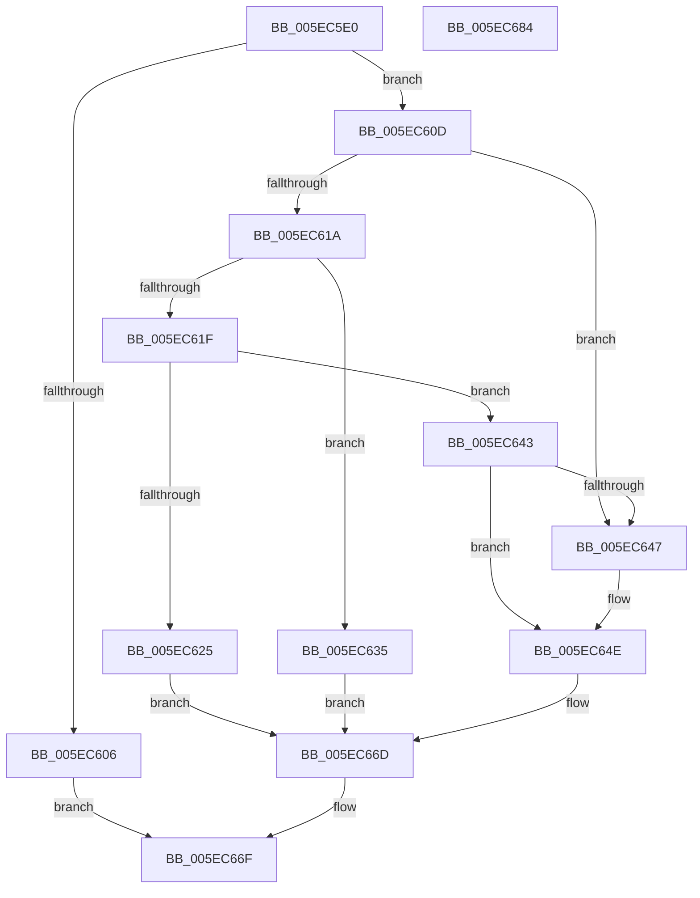

# RtlFillNonVolatileMemory

- RVA: `0x005EC5E0`–`0x005EC685` (길이 `165` bytes)
- VA: `0x00000001405EC5E0`
- 실행 섹션: `.text`
- PDB 이름 있음: `예`; PDB Function 태그: `아니요`
- unwind 정보 RVA: `0x0005C954`
- 디코드: `53`개 명령, `165/165` bytes 표시
- 미해석 바이트: `0` (있으면 어셈블리에 `.byte`로 보존)

> 이 문서는 커널 이미지의 기계어와 PDB 기호를 분석해 생성했습니다. 4번과 5번은 함수 원형과 자료형을 바이너리 사용 방식에서 추정한 C 해석이며 원본 소스 복구 결과는 아닙니다.

## 1. Dependencies

- 직접 호출 지점: **4**; 고유 호출 대상: **3**
- 직접 호출자로 확인된 함수: **0**
- RIP 상대 이미지 참조: **0**

### Outgoing calls
- `0x005EC62E` → [RtlFillMemoryNonTemporal](../6B/RtlFillMemoryNonTemporal_function_006BA860.md) (function, `0x006BA860`)
- `0x005EC63C` → [memset](../6C/memset_function_006C6C40.md) (function, `0x006C6C40`)
- `0x005EC655` → [memset](../6C/memset_function_006C6C40.md) (function, `0x006C6C40`)
- `0x005EC666` → [RtlFlushNonVolatileMemory](../4F/RtlFlushNonVolatileMemory_function_004FCBF0.md) (function, `0x004FCBF0`)

### Direct callers
- 이 함수 시작 RVA로 연결되는 직접 call은 확인되지 않았습니다. 간접 호출은 완전히 역산할 수 없습니다.

### Static image references
- 디코드된 RIP-relative 메모리 참조가 없습니다.

## 2. Other-region calls and transfers

- 다른 실행 섹션으로 향하는 call: **0**
- 별도 외부 분기/꼬리 이동을 확인하지 못했습니다.

## 3. Assembly (complete function range)

```asm
005EC5E0  48 89 5C 24 08                  mov qword ptr [rsp + 8], rbx
005EC5E5  48 89 6C 24 10                  mov qword ptr [rsp + 0x10], rbp
005EC5EA  48 89 74 24 18                  mov qword ptr [rsp + 0x18], rsi
005EC5EF  57                              push rdi
005EC5F0  48 83 EC 20                     sub rsp, 0x20
005EC5F4  33 DB                           xor ebx, ebx
005EC5F6  48 8B F2                        mov rsi, rdx
005EC5F9  49 8B F8                        mov rdi, r8
005EC5FC  48 8B E9                        mov rbp, rcx
005EC5FF  8D 53 01                        lea edx, [rbx + 1]
005EC602  84 CA                           test dl, cl
005EC604  75 07                           jne 0x1405ec60d
005EC606  B8 0D 00 00 C0                  mov eax, 0xc000000d
005EC60B  EB 62                           jmp 0x1405ec66f
005EC60D  8B 4C 24 50                     mov ecx, dword ptr [rsp + 0x50]
005EC611  8B C1                           mov eax, ecx
005EC613  83 E0 03                        and eax, 3
005EC616  3B C2                           cmp eax, edx
005EC618  74 2D                           je 0x1405ec647
005EC61A  F6 C1 02                        test cl, 2
005EC61D  74 16                           je 0x1405ec635
005EC61F  48 83 FF 08                     cmp rdi, 8
005EC623  72 1E                           jb 0x1405ec643
005EC625  45 8A C1                        mov r8b, r9b
005EC628  48 8B D7                        mov rdx, rdi
005EC62B  48 8B CE                        mov rcx, rsi
005EC62E  E8 2D E2 0C 00                  call 0x1406ba860
005EC633  EB 38                           jmp 0x1405ec66d
005EC635  41 0F B6 D1                     movzx edx, r9b
005EC639  48 8B CE                        mov rcx, rsi
005EC63C  E8 FF A5 0D 00                  call 0x1406c6c40
005EC641  EB 2A                           jmp 0x1405ec66d
005EC643  3B C2                           cmp eax, edx
005EC645  75 07                           jne 0x1405ec64e
005EC647  0F BA E1 08                     bt ecx, 8
005EC64B  0F 42 DA                        cmovb ebx, edx
005EC64E  41 0F B6 D1                     movzx edx, r9b
005EC652  48 8B CE                        mov rcx, rsi
005EC655  E8 E6 A5 0D 00                  call 0x1406c6c40
005EC65A  44 8B CB                        mov r9d, ebx
005EC65D  4C 8B C7                        mov r8, rdi
005EC660  48 8B D6                        mov rdx, rsi
005EC663  48 8B CD                        mov rcx, rbp
005EC666  E8 85 05 F1 FF                  call 0x1404fcbf0
005EC66B  8B D8                           mov ebx, eax
005EC66D  8B C3                           mov eax, ebx
005EC66F  48 8B 5C 24 30                  mov rbx, qword ptr [rsp + 0x30]
005EC674  48 8B 6C 24 38                  mov rbp, qword ptr [rsp + 0x38]
005EC679  48 8B 74 24 40                  mov rsi, qword ptr [rsp + 0x40]
005EC67E  48 83 C4 20                     add rsp, 0x20
005EC682  5F                              pop rdi
005EC683  C3                              ret
005EC684  CC                              int3
```

## 4. C-style interpretation (structured pseudocode)

```c
__int64 __fastcall RtlFillNonVolatileMemory(__int64 a1, __int64 a2, __int64 a3, unsigned __int8 a4, unsigned int a5)
{
    __int64 result;
    __int64 v_rbx;
    __int64 v_rsp;
    unsigned __int64 v_stack_p10;
    unsigned __int64 v_stack_p18;
    unsigned __int64 v_stack_p8;

    v_stack_p8 = v_rbx;
    v_stack_p10 = v_rbp;
    v_stack_p18 = v_rsi;
    v_rsp = (v_rsp) - (32);
    v_rbx = 0;
    if ((((unsigned __int8)(v_rbx + 1)) & ((unsigned __int8)(a1))) != 0) goto loc_005EC60D;
    goto loc_005EC66F;
loc_005EC60D:
    result = (unsigned int)(((unsigned int)((unsigned int)((unsigned int)(a5)))) & (3));
    if (((unsigned int)(result)) == ((unsigned int)(v_rbx + 1))) goto loc_005EC647;
    if ((((unsigned __int8)((unsigned int)(a5))) & (2)) == 0) goto loc_005EC635;
    if (a3 < 8) goto loc_005EC643;
    result = RtlFillMemoryNonTemporal(a2, a3, a4, a4);
    goto loc_005EC66D;
loc_005EC635:
    result = memset(a2, a4, a4, a4);
    goto loc_005EC66D;
loc_005EC643:
    if (((unsigned int)(result)) == a4) {
        if (((unsigned int)(result)) < a4) { v_rbx = a4; }
    }
    result = memset(a2, a4, a4, a4);
    result = RtlFlushNonVolatileMemory(a1, a2, a3, (unsigned int)((unsigned int)(v_rbx)));
loc_005EC66D:
loc_005EC66F:
    v_rsp = (v_rsp) + (32);
    return (unsigned int)((unsigned int)((unsigned int)((unsigned int)(result))));
}
```

## 5. (Beta) C Style

```c
int64_t RtlFillNonVolatileMemory(int64_t Arg1, int64_t Arg2, int64_t Arg3, uint8_t Arg4, uint32_t Arg5)
{
    int64_t result;
    int64_t local_rbx;
    int64_t local_rsp;
    uint64_t v_stack_p10;
    uint64_t v_stack_p18;
    uint64_t v_stack_p8;

    v_stack_p8 = local_rbx;
    v_stack_p10 = local_rbp;
    v_stack_p18 = local_rsi;
    local_rsp = (local_rsp) - (32);
    local_rbx = 0;
    if ((((uint8_t)(local_rbx + 1)) & ((uint8_t)(Arg1))) != 0) goto loc_005EC60D;
    goto loc_005EC66F;
loc_005EC60D:
    result = (uint32_t)(((uint32_t)((uint32_t)((uint32_t)(Arg5)))) & (3));
    if (((uint32_t)(result)) == ((uint32_t)(local_rbx + 1))) goto loc_005EC647;
    if ((((uint8_t)((uint32_t)(Arg5))) & (2)) == 0) goto loc_005EC635;
    if (Arg3 < 8) goto loc_005EC643;
    result = RtlFillMemoryNonTemporal(Arg2, Arg3, Arg4, Arg4);
    goto loc_005EC66D;
loc_005EC635:
    result = memset(Arg2, Arg4, Arg4, Arg4);
    goto loc_005EC66D;
loc_005EC643:
    if (((uint32_t)(result)) == Arg4) {
        if (((uint32_t)(result)) < Arg4) { local_rbx = Arg4; }
    }
    result = memset(Arg2, Arg4, Arg4, Arg4);
    result = RtlFlushNonVolatileMemory(Arg1, Arg2, Arg3, (uint32_t)((uint32_t)(local_rbx)));
loc_005EC66D:
loc_005EC66F:
    local_rsp = (local_rsp) + (32);
    return (uint32_t)((uint32_t)((uint32_t)((uint32_t)(result))));
}
```

## 6. Execution-region graph

[열기: 2D/3D 그래프와 함수 탐색 컨트롤 패널](../../../control-panel.html?section=text&rva=0x005EC5E0&view=graph)

- 2D 그래프는 위에서 아래로 흐르고, 3D 그래프는 빈 공간을 드래그해 회전합니다. Shift+드래그는 이동, 휠은 확대·축소, 함수 노드 선택은 대상 보고서 이동입니다.

### Static fallback


